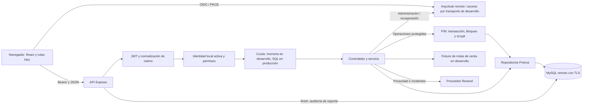

# Auditoría integral de rendimiento ITECSA

Fecha: 27 de octubre de 2026, America/Santiago. Base del análisis: rama `main`, commit `6405c3d407e92d89b286953cc9271daa51a6ac25`. Auditoría de lectura, sin optimizaciones, cambios funcionales, migraciones, commits ni despliegues.

## A. Resumen ejecutivo

El entorno accesible presenta un costo elevado y medido en el acceso desde la API a MySQL remoto. Una búsqueda de identidad interna tarda una mediana de **1.304 ms**, con **dos SELECT físicos**, antes de ejecutar el controlador de negocio. El detalle de Kanban tarda una mediana de **3.224 ms** en su función de lectura, con **17 SELECT en caliente**. Son duraciones de etapas del servidor, no tiempos completos de la interfaz.

La diferencia entre una consulta mínima del driver y una consulta mínima de Prisma también está medida: `connection.query('SELECT 1')` tiene p50 de **215 ms**, `connection.execute` sin caché de preparación tiene p50 de **444 ms**, y la lectura mínima a través de Prisma/pool tiene p50 de **643 ms**. Un registro del historial del motor para una lectura mínima informa **0,2492 ms** de ejecución. Esta última observación es una sola muestra y no representa todo el trabajo SQL de la aplicación. La evidencia demuestra que atribuir los cientos de milisegundos completos al procesamiento del SELECT en MySQL sería incorrecto.

El código confirma varios multiplicadores de este costo: relaciones recuperadas mediante múltiples consultas, identidad consultada de nuevo en ciertos servicios, hidratación completa de pedidos cuyo resultado se vuelve a obtener en el controlador, y recargas de pagos después de la escritura. En usuarios administrativos se agregan llamadas secuenciales a Keycloak. **Sus duraciones de escritura no se midieron**, porque la auditoría prohíbe mutar datos reales.

En las 14 vistas instrumentadas con datos sintéticos pequeños, las medianas de tiempo React acumulado por montaje están entre **7,4 y 12,3 ms**. No se demostró un cuello de botella de renderizado en ese escenario. Esto no descarta problemas con tablas grandes, drag-and-drop, dispositivos lentos o la aplicación autenticada completa.

Cobertura y resultados:

| Elemento | Alcance comprobado |
|---|---|
| Inventario | 141 operaciones y escenarios, identificados individualmente en C; incluye acciones locales, lecturas, mutaciones, rutas auxiliares y mantenimiento |
| Rutas frontend | 20 patrones explícitos del router, su fallback y el callback especial de recuperación gestionado en `App`; 14 vistas operativas abiertas en navegador con fixtures |
| Endpoints | 80 combinaciones método/patrón al expandir montajes y el bucle de recuperación; además existe un cierre genérico `/api/admin/users` mediante `router.use` |
| Lecturas instrumentadas del servidor | 15 bloques, 85 ejecuciones, sin errores de esos bloques; 5 o 10 muestras por bloque, insuficientes para percentiles poblacionales estables |
| HTTP público local | 30 GET: liveness, catálogo documental y HTML de Vite; todos respondieron 200 |
| Keycloak | 5 GET públicos de JWKS, todos 200; no se midió login, token, logout ni administración autenticada |
| Criptografía | 20 ejecuciones sintéticas de scrypt, sin PIN ni cuentas reales |
| Navegador | 140 montajes, 10 por vista, Edge headless; sin backend real y sin autenticación |
| SQL | 8 planes EXPLAIN de SELECT representativos; 14 familias críticas documentadas en H, además de escrituras trazadas estáticamente |
| Producción | Sin mediciones de aplicación de producción, concurrencia empresarial, escrituras, sesiones reales o recursos del servidor Ubuntu |

No hay evidencia suficiente para declarar cumplido el objetivo global de un segundo, ni para afirmar un incumplimiento contractual de producción. Sí hay lecturas internas que superan uno y tres segundos en el entorno de desarrollo conectado a la base remota. Los criterios p95 ≤ 1 s y p99 ≤ 3 s son referencias analíticas provisionales, no SLA/SLO aprobados.

Las cinco oportunidades principales son: estudiar la ubicación y el transporte de la base; reducir consultas e hidrataciones redundantes; simplificar la proyección de identidad preservando revocación; separar el tiempo de escritura del refresco posterior; y reducir cascadas administrativas de Keycloak únicamente donde exista independencia demostrable. L y M precisan evidencia, riesgo y validación.

## B. Arquitectura del sistema

### B.1. Entorno realmente observado

| Capa | Evidencia y versión |
|---|---|
| Host | Windows, AMD Ryzen 5 5500, 12 procesadores lógicos, RAM total 15,80 GiB; libre 3,60 GiB en una instantánea |
| Node del host | v24.19.0; utilizado para análisis, build en memoria y HTTP local |
| Docker | Cliente y servidor 29.9.2, Docker Desktop sobre kernel WSL2 `6.18.54.1-microsoft-standard-WSL2` |
| Recursos de la VM Docker | 12 CPU visibles, 7,65 GiB de memoria; no equivalen a RAM disponible del servidor empresarial |
| API activa | Contenedor de desarrollo, Node v22.23.4, Express 5.2.1, `APP_ENV=development`, `NODE_ENV=development` |
| Frontend activo | Vite de desarrollo en puerto local 5173; no es Nginx ni una build productiva |
| Paquetes locales resueltos | React/React DOM 19.2.6; React Router DOM 7.18.2; Vite 8.3.5; keycloak-js 26.2.4 |
| Datos | Prisma Client y adapter-mariadb 7.10.0; mariadb 3.5.4; motor MySQL 8.4.8, `Source distribution` |
| Conexión de datos activa | Destino remoto, TLS obligatorio; no había un contenedor MySQL local activo. No se publica hostname, usuario, nombre de base ni credenciales |
| Identidad | Keycloak; administración de identidad habilitada en la API activa; versión del servidor Keycloak no verificada |
| Notas de venta | Fuente `fixture` en el contenedor de desarrollo; no es una medición del sistema comercial externo |

Las versiones resueltas se leyeron de paquetes instalados. Los rangos de `package.json` no se usaron como prueba de la versión exacta. No se reinstalaron dependencias. Se compararon los hashes de nueve archivos decisivos entre repositorio y contenedor: Prisma, JWT, identidad activa, usuarios, vistas de pedidos, select de pedidos, servicio de pedidos, métricas y mensajes; coincidieron en los nueve casos.

Una instantánea de `docker stats` mostró API 0,41% CPU / 176,1 MiB y web 0,00% / 543,1 MiB. Ambos tienen `Memory=0` y `NanoCpus=0`: sin límite específico por contenedor, dentro del límite de Docker Desktop. Esa instantánea no demuestra ausencia de saturación durante una operación ni autoriza a dimensionar producción.

### B.2. Flujo comprobado



El dibujo expresa dependencias, no suma de tiempos. En las rutas con `requirePin`, ese middleware se ejecuta antes del controlador; el servicio valida después las reglas de negocio. La auditoría de soporte adjunta a `finish` ocurre después de terminar la respuesta y puede competir por conexiones sin formar parte de la espera directa del HTTP ya terminado.

### B.3. Referencias de trazabilidad

En tablas y fichas se usan los siguientes alias. Los números después de `:` señalan líneas del archivo en el commit auditado; el nombre de la función permite localizarla si cambia la numeración.

| Alias | Archivo principal |
|---|---|
| ROUTER | [router.jsx](../capaVista/src/app/router.jsx) y [routes.js](../capaVista/src/config/routes.js) |
| ID-FE | [keycloakSession.js](../capaVista/src/app/providers/keycloakSession.js), [IdentityProviders.jsx](../capaVista/src/app/providers/IdentityProviders.jsx) |
| AUTH-FE | [AuthProvider.jsx](../capaVista/src/app/providers/AuthProvider.jsx), [ProtectedRoute.jsx](../capaVista/src/shared/components/navigation/ProtectedRoute.jsx) |
| HTTP | [apiClient.js](../capaVista/src/services/api/apiClient.js), [useApiClient.js](../capaVista/src/hooks/useApiClient.js) |
| AUTH-BE | [auth.controller.js](../capaServidor/src/modules/auth/controller/auth.controller.js), [auth.routes.js](../capaServidor/src/modules/auth/routes/auth.routes.js) |
| JWT | [checkJwt.js](../capaServidor/src/middlewares/checkJwt.js), [requireActiveIdentity.js](../capaServidor/src/middlewares/requireActiveIdentity.js) |
| PIN | [pin.service.js](../capaServidor/src/modules/auth/service/pin.service.js), [requirePin.js](../capaServidor/src/middlewares/requirePin.js) |
| USER-FE | [UserManagementPage.jsx](../capaVista/src/modules/users/pages/UserManagementPage.jsx), [adminUsersApi.js](../capaVista/src/modules/users/api/adminUsersApi.js) |
| USER-BE | [keycloakIdentityAdministration.service.js](../capaServidor/src/modules/users/service/keycloakIdentityAdministration.service.js), [keycloakIdentityPreparation.routes.js](../capaServidor/src/modules/users/routes/keycloakIdentityPreparation.routes.js) |
| USER-REPO | [users.repo.js](../capaServidor/src/modules/users/repo/users.repo.js), [keycloakIdentity.repo.js](../capaServidor/src/modules/users/repo/keycloakIdentity.repo.js) |
| KC-ADMIN | [keycloakManagement.service.js](../capaServidor/src/modules/users/service/keycloakManagement.service.js) |
| PROFILE | [ProfilePage.jsx](../capaVista/src/modules/profile/pages/ProfilePage.jsx), [UserMovementsModal.jsx](../capaVista/src/modules/users/components/UserMovementsModal.jsx) |
| CREATE | [useOrderCreateFlow.js](../capaVista/src/hooks/useOrderCreateFlow.js), [salesOrderCreation.service.js](../capaServidor/src/modules/orders/service/salesOrderCreation.service.js) |
| KB | [KanbanColumn.jsx](../capaVista/src/modules/kanban/components/KanbanColumn.jsx), [KanbanOffCanvas.jsx](../capaVista/src/modules/kanban/components/KanbanOffCanvas.jsx) |
| KB-PAGE | [KanbanBoardPage.jsx](../capaVista/src/modules/kanban/pages/KanbanBoardPage.jsx) |
| ORDER-C | [orders.controller.js](../capaServidor/src/modules/orders/controller/orders.controller.js) |
| ORDER-S | [order.service.js](../capaServidor/src/modules/orders/service/order.service.js), [orderProduction.service.js](../capaServidor/src/modules/orders/service/orderProduction.service.js), [orderPayment.service.js](../capaServidor/src/modules/orders/service/orderPayment.service.js) |
| ORDER-R | [orders.repo.js](../capaServidor/src/modules/orders/repo/orders.repo.js), [orderViewOperations.js](../capaServidor/src/modules/orders/repo/orderViewOperations.js), [orderReadSelect.js](../capaServidor/src/modules/orders/repo/orderReadSelect.js) |
| PAY | [PaymentConfirmationPage.jsx](../capaVista/src/modules/payments/pages/PaymentConfirmationPage.jsx), [paymentsApi.js](../capaVista/src/modules/payments/api/paymentsApi.js) |
| PAY-BE | [paymentRecord.service.js](../capaServidor/src/modules/payments/service/paymentRecord.service.js), [paymentRecord.repo.js](../capaServidor/src/modules/payments/repo/paymentRecord.repo.js) |
| HIST | [OrderHistoryPage.jsx](../capaVista/src/modules/orderHistory/pages/OrderHistoryPage.jsx), [OrderHistoryDetailPage.jsx](../capaVista/src/modules/orderHistory/pages/OrderHistoryDetailPage.jsx) |
| HIST-BE | [orderHistory.service.js](../capaServidor/src/modules/history/service/orderHistory.service.js), [orderHistory.repo.js](../capaServidor/src/modules/history/repo/orderHistory.repo.js) |
| MSG | [MessageInboxPage.jsx](../capaVista/src/modules/messages/pages/MessageInboxPage.jsx), [MessageDetailPage.jsx](../capaVista/src/modules/messages/pages/MessageDetailPage.jsx), [NotificationBell.jsx](../capaVista/src/modules/messages/components/NotificationBell.jsx) |
| MSG-BE | [message.service.js](../capaServidor/src/modules/messages/service/message.service.js), [message.repo.js](../capaServidor/src/modules/messages/repo/message.repo.js) |
| MET | [MetricsPage.jsx](../capaVista/src/modules/metrics/pages/MetricsPage.jsx), [ProductionPerformance.jsx](../capaVista/src/modules/metrics/components/ProductionPerformance.jsx) |
| MET-BE | [metrics.service.js](../capaServidor/src/modules/metrics/service/metrics.service.js), [metrics.repo.js](../capaServidor/src/modules/metrics/repo/metrics.repo.js) |
| CAL | [ProductionCalendarPage.jsx](../capaVista/src/modules/productionCalendar/pages/ProductionCalendarPage.jsx), [ProductionCalendarGrid.jsx](../capaVista/src/modules/productionCalendar/components/ProductionCalendarGrid.jsx), [ordersCalendarApi.js](../capaVista/src/modules/productionCalendar/api/ordersCalendarApi.js) |
| PRIV | [usePrivacyDocuments.js](../capaVista/src/modules/privacy/hooks/usePrivacyDocuments.js), [useDataRequestForm.js](../capaVista/src/modules/privacy/hooks/useDataRequestForm.js), [privacyRequest.service.js](../capaServidor/src/modules/privacy/service/privacyRequest.service.js) |
| INC | [useIncidentConfiguration.js](../capaVista/src/modules/security/hooks/useIncidentConfiguration.js), [useIncidentReportForm.js](../capaVista/src/modules/security/hooks/useIncidentReportForm.js), [incidentReport.service.js](../capaServidor/src/modules/security/service/incidentReport.service.js) |
| LOAD | [productionLoad.service.js](../capaServidor/src/modules/productionLoad/service/productionLoad.service.js), [productionLoad.repo.js](../capaServidor/src/modules/productionLoad/repo/productionLoad.repo.js) |
| DB | [prisma.js](../capaServidor/src/database/prisma.js), [connectionConfig.js](../capaServidor/src/database/connectionConfig.js), [schema.prisma](../capaServidor/prisma/schema.prisma) |

## C. Inventario global de operaciones

Convenciones: todas las API propias comienzan con `/api`; `G`, `P` y `X` significan GET, POST y PATCH. En este inventario `P` dentro del **estado** significa PARCIALMENTE MEDIDA; `E`, ANALIZADA ESTÁTICAMENTE; `M`, MEDIDA para el alcance indicado; `N`, NO APLICA a una espera remota; `B`, BLOQUEADA para medir el flujo completo bajo las restricciones actuales. `Q01…Q14` remite a H. La ausencia de cifra significa **No medido**, nunca 0 ms. Las medidas de funciones internas no se convierten en medidas del endpoint ni del recorrido completo.

Cada ID conserva su acción y disparador propios, aunque comparta endpoint con otros. Las fichas F agregan secuencia, solicitudes, indicador, riesgo y validación; B.3 resuelve archivos, y el anexo de endpoints identifica las rutas de entrada.

| ID | Módulo / pantalla / ruta frontend | Acción y disparador | Función frontend / callback | API | Backend | Base de datos / externo | Estado de medición |
|---|---|---|---|---|---|---|---|
| PERF-001 | Auth / cualquier entrada | Inicializar documento | ID-FE `init`, efecto provider | OIDC SDK | Keycloak | Discovery/iframe/sesión, sin SQL propio directo | E |
| PERF-002 | Auth / `/login` | Iniciar sesión por redirección | `loginWithRedirect`, `LoginRedirect` | Authorization y token OIDC | Keycloak | Cuenta y sesión externas | B |
| PERF-003 | Auth / raíz protegida | Verificar sesión tras autenticar | AUTH-FE `verifySession` | G `/auth/verify` | AUTH-BE `createVerifyAuthSessionHandler` | JWT → Q01 → cuota → `ensureProvisioned` | P: Q01 medida; verificación completa no |
| PERF-004 | Navegación / rutas protegidas | Cambiar módulo | ROUTER, `ProtectedRoute`, `RoleGuard` | API de la vista de destino | Según módulo | Lazy chunk y datos de la vista | P: montajes sintéticos |
| PERF-005 | Auth / cualquier ruta | Renovar token / reanudar BFCache | ID-FE `getAccessToken`, `resume`, `publish` | Token OIDC; luego G `/auth/verify` | Keycloak y AUTH-BE | Q01; nueva verificación | E |
| PERF-006 | Auth / topbar | Confirmar cierre de sesión | AUTH-FE `logout`, ID-FE `logout` | Logout OIDC | Keycloak | Navegación completa | B |
| PERF-007 | Auth / `/recuperar-contrasena` | Abrir recuperación de contraseña | `PasswordResetPage` | Ninguna en esta pantalla | Contrato POST separado devuelve 503 | No hay flujo supervisado implementado | N |
| PERF-008 | Perfil / `/perfil` | Mostrar PIN pendiente | PROFILE efecto `revealPin` | P `/auth/pin/reveal` | AUTH-BE `createRevealPinHandler` | Q01 + lectura credencial y descifrado | B |
| PERF-009 | Perfil / `/perfil` | Aceptar recepción de PIN | PROFILE `acknowledgePin` | P `/auth/pin/acknowledge` → G `/auth/verify` | `acknowledge`, verificación | Usuario y credencial; puede escribir | E |
| PERF-010 | Perfil / `/perfil` | Iniciar recuperación PIN | `recoverPin`, `beginPinRecovery` | P `/auth/pin/recovery/start` | `PinRecoveryService.start`, navegación | Cuotas y memoria; Keycloak después | E |
| PERF-011 | Auth / `/auth/pin-recovery/callback` | Restaurar sesión original | `continuePinRecovery`, `resumePinRecoverySession` | P `/auth/pin/recovery/resume` | `PinRecoveryNavigationService.resume` | Token/JWKS Keycloak y puente de sesión | B |
| PERF-012 | Recuperación PIN / callback | Completar autorización reciente | `continuePinRecovery` | P `/auth/pin/recovery/finish` | `PinRecoveryService.finish`, `rotateAfterRecovery` | Token/JWKS, hash, bloqueo y UPDATE | E |
| PERF-013 | Recuperación PIN / navegación | Cancelar o expirar recorrido | `beginPinRecovery.cancel` / callback | P `/auth/pin/recovery/cancel` | `cancel`, `discard` | Estado temporal y cuota | E |
| PERF-014 | Usuarios / `/admin/usuarios` | Carga inicial del listado | USER-FE `loadUsers` | G `/admin/identity/users` | USER-BE `list` → USER-REPO `list` | Q01 y Q02 | P: repositorio sin auth |
| PERF-015 | Usuarios / misma ruta | Buscar texto tras debounce | efecto de búsqueda → `loadUsers` | G `/admin/identity/users?search=…` | `list` | Q02 con contains y count | E |
| PERF-016 | Usuarios / misma ruta | Cambiar rol/estado o limpiar filtros | `handleRoleChange`, `handleStatusChange`, `handleClearFilters` | G `/admin/identity/users` | `list` | Q02 | E |
| PERF-017 | Usuarios / misma ruta | Cambiar página | `setPage` → `loadUsers` | G `/admin/identity/users?page=…` | `list` | Q02 con OFFSET | E |
| PERF-018 | Usuarios / misma ruta | Cargar resumen inicial | USER-FE `loadSummary` | G `/admin/identity/users/summary` | `summary` | Q01 y Q02 groupBy | P: groupBy medido |
| PERF-019 | Usuarios / misma ruta | Refrescar resumen manualmente | botón → `loadSummary` | Mismo GET de resumen | `summary` | Q02 | E |
| PERF-020 | Usuarios / edición | Obtener usuario por subject para abrir edición | USER-FE `handleInspectUser` | G `/admin/identity/identities/:subject` | USER-BE `inspect` | Q01, actor, binding; KC `getUser`, `roles` | E, prioridad alta |
| PERF-021 | Usuarios / edición | Guardar datos personales con PIN | `handleSaveUser` | X `/admin/identity/identities/:subject` → listado ∥ resumen | `update` | Q03 + Keycloak y auditoría | E |
| PERF-022 | Usuarios / edición | Cambiar rol con PIN | Mismo guardado, rama de rol | Mismo PATCH → dos GET de refresco | `update` → `replaceRole` | Q03 y múltiples lecturas/mutaciones KC | E |
| PERF-023 | Usuarios / edición | Cambiar estado con PIN | Mismo guardado, rama de estado | Mismo PATCH → dos GET de refresco | `update` | Q03, bloqueo de acceso, logout KC | E |
| PERF-024 | Usuarios / creación | Crear cuenta y credencial temporal | `UserCreateForm.confirmPin` | P `/admin/identity/identities/prepare` | `prepare` → `execute` | Q03, provisión KC, PIN y auditoría | E |
| PERF-025 | Usuarios / creación parcial | Conciliar provisión pendiente | `confirmPin`, rama reconcile | P `/admin/identity/operations/:id/reconcile` | `reconcile` → `execute` | Operación durable + KC | E |
| PERF-026 | Usuarios / movimientos | Abrir historial de otro usuario | `UserMovementsModal` efecto | G `/admin/identity/users/:subject/movements` | `movements` → `inspect` → repo | Q03 de inspección + Q04 | E |
| PERF-027 | Usuarios / movimientos | Buscar o limpiar búsqueda | submit del modal | Mismo GET con search | `movements` | Q04 y validación de target | E |
| PERF-028 | Usuarios / movimientos | Paginar historial | `setQuery` | Mismo GET con page | `movements` | Q04 OFFSET | E |
| PERF-029 | Administración / API auxiliar | Buscar identidad por username exacto | Sin consumidor visual directo actual | G `/admin/identity/identities/by-username/:username` | `findByUsername` | Actor local y KC `listUsers(max:2)` | E |
| PERF-030 | Perfil / `/perfil` | Cargar datos y actividad reciente | PROFILE efecto `getProfile` | G `/auth/profile` | AUTH-BE `createGetProfileHandler` | Q01 → Q04, 10 registros recientes | P: etapas internas |
| PERF-031 | Perfil / movimientos | Abrir historial propio | `historyApi`, `UserMovementsModal` | G `/auth/profile/movements` | `createGetProfileMovementsHandler` | Q01 → Q04 | P: repo medido |
| PERF-032 | Perfil / movimientos | Buscar actividad propia | submit del modal | Mismo GET con search | Handler anterior | Q04 | E |
| PERF-033 | Perfil / movimientos | Paginar actividad propia | `setQuery` | Mismo GET con page | Handler anterior | Q04 OFFSET | E |
| PERF-034 | Ventas / `/ordenes/nuevo` | Consultar Nota de Venta | CREATE `handleSearchSalesNote` | G `/orders/sales-notes/:numeroNota` | `getSalesNote` → `getSalesNoteByNumber` → `observeSalesNote` | Q05, fixture; auditoría y cuota | E |
| PERF-035 | Ventas / confirmación | Validar borrador y abrir modal | `handleOpenConfirmModal` | Ninguna | Ninguno | Validación local | N |
| PERF-036 | Ventas / confirmación | Registrar pedido | `handleConfirmRegister` | P `/orders` | `createOrderFromSalesNote` → `SalesOrderCreationService.create` | Q05 y Q06, transacción y mensajes | E |
| PERF-037 | Kanban / `/kanban` | Cargar pedidos iniciales | KB:55 `loadOrders` | G `/orders/kanban-summary?limit=50` | ORDER-C `getOrders` → `getOrderViews` | Q07 | P: función de lectura medida |
| PERF-038 | Kanban / misma ruta | Cargar estados de columnas | KB:62 `Promise.allSettled` | G `/order-status` | `getOrderStatuses` | Catálogo Estado_Pedido | E |
| PERF-039 | Kanban / filtros | Aplicar búsqueda/producto | `appliedFilters` → efecto KB | Dos GET: resumen ∥ estados | Lecturas anteriores | Q07 y catálogo | E |
| PERF-040 | Kanban / tablero | Cargar más tarjetas | KB:112 `loadMoreOrders` | G `/orders/kanban-summary?cursor=…` | `getOrderViews` | Q07 keyset | E |
| PERF-041 | Kanban / panel | Abrir detalle de tarjeta | KB:218 `openOrderDetail` | G `/orders/:orderId/kanban-detail` | ORDER-C `getKanbanDetail` → `getOrderViewById` | Q08 | P: detalle medido |
| PERF-042 | Kanban / drag | Verificar paso 2 → 3 antes del PIN | KB:146 `handleDragEnd` | G `/orders/:orderId/kanban-detail` | Lectura de detalle | Q08 | P: misma etapa de lectura, flujo distinto |
| PERF-043 | Kanban / PIN | Mover a producción | KB:276 `confirmProductionMove` → `applyOrderMove` | X `/orders/:orderId/move` | `updGeneralStep` → `updateGeneralStep` | PIN y Q09; respuesta compacta | E |
| PERF-044 | Kanban / PIN | Mover a listo para entrega | Confirmación de movimiento | PATCH anterior tras PERF-042 | Mismos servicios, rama paso 3 | PIN, bloqueo, Q09 y aviso al responsable | E |
| PERF-045 | Kanban / PIN | Finalizar pedido desde etapa 3 | Confirmación de movimiento | PATCH move | Mismos servicios, paso 4 | PIN y Q09 | E |
| PERF-046 | Kanban / tarjeta | Activar/desactivar urgencia | KB:240 `handleToggleIndicator` | X `/orders/:orderId/labels` | `setOrderLabel` | Tag, asociación y registro | E |
| PERF-047 | Kanban / tarjeta | Cambiar prioridad por contrato | Mismo handler, otra etiqueta | PATCH labels | `setOrderLabel` | Tag, asociación y registro | E |
| PERF-048 | Kanban / tarjeta | Cambiar indicador produciéndose | Mismo handler, otra etiqueta | PATCH labels | `setOrderLabel` | Tag, asociación y registro | E |
| PERF-049 | Kanban / panel | Solicitar corrección | `submitCorrection` → KB:294 `handleSendToReview` | X `/orders/:orderId/review` | `sendToReview` → detalle nuevo | Q09 y Q08; aviso | E |
| PERF-050 | Kanban / PIN | Cancelar producción | `submitCancellation` → KB:301 | X `/orders/:orderId/cancel-production` | `cancelProduction` → detalle nuevo | PIN, Q09 y Q08 | E |
| PERF-051 | Kanban / panel | Reevaluar desde Nota de Venta | KB:316 `handleReevaluate` | X `/orders/:orderId/reevaluate` | `reevaluateOrder` → detalle nuevo | Fixture + actualización líneas y Q08 | E |
| PERF-052 | Kanban / carga operativa | Carga inicial del medidor | KB-PAGE:91 efecto | G `/production-load/today` | LOAD `getDailyLoad` | Q10 | P: repo medido |
| PERF-053 | Kanban / carga operativa | Guardar cantidades del día | KB-PAGE:123 `saveProductionLoad` | X `/production-load/today` | `saveDailyLoad` | Q10 UPDATE múltiple → lectura de carga | E |
| PERF-054 | Capacidad / API auxiliar | Consultar capacidades | `kanbanApi.getCapacities` sin uso en pantalla actual | G `/production-capacity` | `ProductionCapacityService.list` | Tipo_Producto Lanyard | E |
| PERF-055 | Capacidad / API auxiliar | Actualizar capacidad | `updateCapacities`, sin acción de página actual | X `/production-capacity` | `update` → `updateMany` | UPDATE y consulta posterior | E |
| PERF-056 | Subprocesos / panel Kanban | Completar subproceso con PIN | `completeSubProcess` → KB:285 | X `/orders/:orderId/details/:detailId/subprocesses/:subprocessId/complete` | ORDER-C:159 → `completeSubprocess` | PIN, bloqueo, Q09, dos hidrataciones | E |
| PERF-057 | Subprocesos / panel Kanban | Retroceder subproceso con PIN | `completeSubProcess`, rama rollback → KB:309 | X `/orders/:orderId/details/:detailId/subprocesses/:subprocessId/rollback` | ORDER-C:167 → `rollbackSubprocess` | PIN, bloqueo, Q09, hidrataciones | E |
| PERF-058 | Kanban / rama heredada | Aprobar desconfirmación | `approvePaymentDeconfirmation` sin callback conectado | Sin petición efectiva desde el padre actual | Sin flujo activo probado | No se habilitó ni se simuló | N |
| PERF-059 | Pagos / `/pagos` | Carga inicial del workspace | PAY:73 `loadPaymentData` | G `/orders/payments` | `getPagedPaymentWorkspace` | Q11 | P: servicio sin middleware |
| PERF-060 | Pagos / filtros | Cambiar estado visible | `handleFilterChange` | G `/orders/payments?status=…` | Mismo servicio | Página + tres conteos + catálogo | E |
| PERF-061 | Pagos / búsqueda | Escribir término | `handleSearchChange` | GET por cambio de searchTerm | Mismo servicio | Q11 contains | E |
| PERF-062 | Pagos / fechas | Cambiar rango de fechas | `handleDateFromChange`, `handleDateToChange` | GET workspace por cambio | Mismo servicio | Q11, fecha_creacion | E |
| PERF-063 | Pagos / lista | Cargar más pedidos | PAY:104 `loadMorePayments` | GET workspace con cursor | Mismo servicio | Repite conteos y catálogo | E |
| PERF-064 | Pagos / fila | Prefetch de previsualización | PAY:227 `prefetchPaymentPreview` | G `/orders/:id/payment-records/preview`, salvo cache | PAY-BE `getConfirmationDetails` | Snapshot SQL y fuente condicional | E |
| PERF-065 | Pagos / detalle | Abrir previsualización | PAY:370 `openPaymentDetail` | Mismo GET, salvo cache | Mismo servicio | Datos de cobro y productos | E |
| PERF-066 | Pagos / confirmación | Preparar acción antes de PIN | PAY:248 `openPaymentActionConfirmation` | Mismo GET, salvo cache | Mismo servicio | Dependencia previa a autorización visual | E |
| PERF-067 | Pagos / PIN | Confirmar pago pendiente | PAY:342 → `handleUpdatePaymentStatus` | X `/orders/:id/payment-status` → GET workspace | `updPaymentState` | PIN, Q11 y transacción, mensajes | E |
| PERF-068 | Pagos / PIN | Rechazar pago pendiente | Mismo callback, estado rechazado | PATCH → GET workspace | Rama de rechazo | PIN, registro y Q11 | E |
| PERF-069 | Pagos / PIN | Revisar decisión ya resuelta | Mismo callback con motivo | PATCH → GET workspace | Rama `REVISE_PAYMENT_STATUS` | PIN, autorización, posible cancelación/avisos | E |
| PERF-070 | Historial / `/historial-pedidos` | Carga inicial de lista | HIST:36 efecto | G `/history/orders` | `listOrders` → repo `list` | Q12 keyset | E |
| PERF-071 | Historial / búsqueda | Enviar búsqueda | `submitSearch` | GET lista con search | Mismo servicio | Q12 contains | E |
| PERF-072 | Historial / estados | Seleccionar estado | `selectStatus` | GET lista con status | Mismo servicio | Q12, relación Estado_Pedido | E |
| PERF-073 | Historial / fechas | Cambiar rango | `updateDate` | GET lista con from/to | Mismo servicio | Q12 fecha_creacion | E |
| PERF-074 | Historial / navegación | Página siguiente | `nextPage` | GET lista con cursor | Mismo servicio | Keyset por ID | E |
| PERF-075 | Historial / navegación | Página anterior | `previousPage` | GET lista, cursor de stack previo | Mismo servicio | Keyset, no cache de página | E |
| PERF-076 | Historial / `/:orderId` | Abrir ficha y eventos | HIST detalle:32 efecto | G `/history/orders/:id` | `getOrderHistory` | Header cuatro SQL ∥ eventos un SQL | P: etapas medidas separadamente |
| PERF-077 | Historial / eventos | Filtrar tipo de evento | `selectType` | G `/history/orders/:id/events` | `listOrderEvents` | Q12 con whitelist y cursor | P: rama all sin filtro medida |
| PERF-078 | Historial / eventos | Cargar más eventos | `loadMore` | GET events con cursor | Mismo servicio | Q12 keyset compuesto | E |
| PERF-079 | Mensajes / `/mensajes` | Carga inicial de bandeja | MSG `loadInbox` | G `/messages` | `getInbox` | Q01 otra vez en servicio y Q13 | E |
| PERF-080 | Mensajes / filtros | Cambiar leído/orden/fechas | `handleFiltersChange` | GET inbox con filtros | Mismo servicio | Q13, count y OFFSET | E |
| PERF-081 | Mensajes / paginación | Página siguiente/anterior | `setPage` | GET inbox con page | Mismo servicio | Q13 | E |
| PERF-082 | Mensajes / bandeja | Abrir mensaje no leído | `handleOpen` | X `/messages/:id/read` → navegación → GET detalle | `markAsRead`, `getMessage` | Q13 y actualizaciones | E |
| PERF-083 | Mensajes / bandeja | Abrir mensaje ya leído | `handleOpen` | Navegación → G `/messages/:id` | `getMessage` | Q13 | E |
| PERF-084 | Mensajes / `/:messageId` | Entrada directa al detalle | MSG detalle `loadMessage` | G `/messages/:id` | `getMessage` | Identidad + asignación autorizada | E |
| PERF-085 | Mensajes / detalle | Marcar lectura tras GET | `loadMessage`, rama unread | X `/messages/:id/read` | `markAsRead` | Identidad → lectura actual → UPDATE | E |
| PERF-086 | Notificaciones / topbar | Carga inicial de campana | MSG bell `loadNotifications` | G `/messages/notifications?limit=50` | `getNotifications` | Q13 | P: repo vacío, limit 10 medido |
| PERF-087 | Notificaciones / cualquier módulo | Polling visible cada 5 s | intervalo `refreshVisible` | GET notifications | Mismo servicio | Q13 + Q01 middleware y servicio | E |
| PERF-088 | Notificaciones / topbar | Refrescar por foco, visibilidad o evento | `refreshNotifications`, `messages:changed` | GET notifications, con guardas | Mismo servicio | Mismas lecturas | E |
| PERF-089 | Notificaciones / panel | Abrir aviso | `handleOpenMessage` | PATCH read → navegación → GET detalle | Servicios de mensajes | Q13; refresco de campana condicionado | E |
| PERF-090 | Notificaciones / panel | Ocultar un aviso | `handleHide` | X `/messages/notifications/:id` | `hideNotification` | Identidad → lectura → UPDATE | E |
| PERF-091 | Notificaciones / panel | Limpiar avisos | `handleClearAll` | X `/messages/notifications` | `clearNotifications` | Identidad y updateMany | E |
| PERF-092 | Toast / cualquier ruta | Abrir mensaje desde acción del toast | `onClick` → `navigate` | GET de detalle después de navegar | Servicio de mensajes | Q13; toast no contiene cuerpo privado | E |
| PERF-093 | Notificaciones / sonido | Reproducir señal al recibir lote | `useMessageSound` | Ninguna | Ninguno | AudioContext local | N |
| PERF-094 | Métricas / `/metricas` | Resumen inicial del período | MET efecto → `subscribeMetricsSummary` | G `/metrics/summary` | MET-BE `summary` | Q14 | P: servicio medido |
| PERF-095 | Métricas / período | Cambiar mes/año/rango | `updatePeriod` | GET summary con nuevo rango | Mismo servicio | Q14, hasta 366 días | E |
| PERF-096 | Métricas / desempeño | Generar cumplimiento | `ProductionPerformance.generate` | G `/metrics/production-performance` | `productionPerformance` | Q14: etapas de entrega | P: servicio medido |
| PERF-097 | Métricas / gráficos | Abrir grupos/filtrar producto | estados locales | Ninguna | Ninguno | Transformación y DOM local | P: montaje pequeño; interacción no |
| PERF-098 | Métricas / exportación | Exportar CSV | `exportReport('csv')` | Ninguna | Ninguno | Serialización local y Blob | E |
| PERF-099 | Métricas / exportación | Exportar Excel | `exportReport('excel')` | Ninguna | Ninguno | Texto tabulado/Blob con extensión xls | E |
| PERF-100 | Métricas / exportación | Abrir impresión/PDF | `exportReport('pdf')` | Ninguna | Ninguno | HTML local, ventana e impresión | E |
| PERF-101 | Calendario / `/calendario-produccion` | Cargar mes | CAL:90 efecto → `loadCalendarMonth` | G `/orders/calendar-summary`, páginas encadenadas | `getOrderViews(...,'calendar')` | Q07 por página | P: una página medida |
| PERF-102 | Calendario / pendientes | Cargar sin fecha | CAL:121 efecto → `loadUnscheduledOrders` | GET calendar-summary?unscheduled=true, páginas | Mismo servicio | Q07 sin fecha | E |
| PERF-103 | Calendario / período | Cambiar mes | `changeMonth` | GET por página del nuevo mes | Mismo servicio | Q07; pendientes no se recargan por mes | E |
| PERF-104 | Calendario / filtros | Filtrar texto/producto/estado | `updateFilters`, `filteredItems` | Ninguna | Ninguno | Filtrado de datos ya descargados | P: montaje pequeño |
| PERF-105 | Calendario / modal | Abrir detalle | grid `openDetail` → CAL:190 | G `/orders/:id/calendar-detail` | `getCalendarDetail` | Proyección reducida de pedido | E |
| PERF-106 | Calendario / drag | Preparar cambio y abrir PIN | drag/drop del grid | Ninguna hasta confirmar | Ninguno | Validaciones locales | N |
| PERF-107 | Calendario / PIN | Confirmar nueva fecha | grid:126 `confirmCredentials` → CAL:179 | X `/orders/:id/delivery-date` | `updateDeliveryDate` → detalle nuevo | PIN, pedido/detalles/registro | E |
| PERF-108 | Documentos / `/documentos` | Cargar catálogo legal | PRIV `usePrivacyDocuments` | G `/privacy/documents` | `PrivacyController.documents` | Configuración, sin SQL | P: HTTP público medido |
| PERF-109 | Documentos / error | Reintentar catálogo | hook `retry` | Mismo GET | Mismo handler | Sin SQL | E |
| PERF-110 | Documentos / tarjeta | Abrir documento publicado | `LegalDocumentCard` enlace | URL configurada en pestaña nueva | Hospedaje del documento | Fuera de API propia | B: no hubo documento representativo |
| PERF-111 | Privacidad / `/solicitudes` | Consultar disponibilidad del canal | `usePrivacyDocuments` en otra pantalla | GET documents | Mismo handler | Configuración; luego formulario | P: endpoint, no navegación real |
| PERF-112 | Privacidad / formulario | Enviar solicitud | `useDataRequestForm.submit` | P `/privacy/requests` | `PrivacyRequestService.submit` | Reserva durable → Resend → resultado | E |
| PERF-113 | Incidentes / `/reportar-incidente` | Consultar configuración del canal | `useIncidentConfiguration` | G `/security/incident-reports/config` | `configuration` | Q01 + configuración y email local | E |
| PERF-114 | Incidentes / error | Reintentar configuración | hook `retry` | Mismo GET config | Mismo handler | Sin proveedor de correo | E |
| PERF-115 | Incidentes / formulario | Enviar reporte | `useIncidentReportForm.submit` | P `/security/incident-reports` | `IncidentReportService.submit` | Eventos de auditoría → Resend → eventos | E |
| PERF-116 | Privacidad / fallo confirmado | Reintentar mismo identificador | mismo submit conserva requestId | POST requests | `reserve` / `claimRetry` | Idempotencia y posible proveedor | E |
| PERF-117 | Incidentes / fallo confirmado | Reintentar mismo intento lógico | mismo submit conserva reportId/payload | POST incident-reports | `claimRetry` | Historial de intentos y posible proveedor | E |
| PERF-118 | Clientes / API auxiliar | Obtener cliente por ID | Sin consumidor frontend directo actual | G `/clients/:clientId` | `getClient` → repo `get` | Cliente por PK | E |
| PERF-119 | Clientes / API auxiliar | Obtener cliente por RUT | Sin consumidor directo actual | G `/clients/rut/:rutCliente` | `getClientByRut` | Índice unique de RUT | E |
| PERF-120 | Productos / API auxiliar | Listar tipos | Sin consumidor directo actual | G `/products` | `getProductTypes` | Catálogo Tipo_Producto | E |
| PERF-121 | Productos / API auxiliar | Obtener tipo por ID | Sin consumidor directo actual | G `/products/:productTypeId` | `getProductTypeById` | PK de Tipo_Producto | E |
| PERF-122 | Productos / API auxiliar | Obtener tipo por nombre | Sin consumidor directo actual | G `/products/name/:nombreProducto` | `getProductTypeByName` | findFirst por nombre, sin índice específico | E |
| PERF-123 | Pagos / API auxiliar | Listar estados | Fuente alternativa al workspace | G `/payment-status` | `getPaymentStatuses` | Estado_Pago | E |
| PERF-124 | Pagos / API auxiliar | Estado por ID | Sin consumidor directo actual | G `/payment-status/:id` | `getPaymentStatus` | PK Estado_Pago | E |
| PERF-125 | Pedidos / API auxiliar | Obtener pedido completo | API no usada por detalle Kanban actual | G `/orders/:orderId` | `getOrderById` → repo `get` | readSelect completo | E |
| PERF-126 | Detalles / API auxiliar | Listar detalles de pedido | Sin consumidor directo actual | G `/orders/:orderId/details` o `/order-details` | `getDetailsByOrderId` | Detalle_pedido por FK | E |
| PERF-127 | Detalles / API auxiliar | Obtener un detalle | Sin consumidor directo actual | G `/orders/:orderId/details/:detailId` o `/order-details/:detailId` | `getOrderDetail` | Búsqueda por pedido/detalle; esquema snapshot | E |
| PERF-128 | Registros de pago / API | Listar registros de un pedido | Sin consumidor directo actual | G `/orders/:id/payment-records` | `getPaymentRecordsByOrderId` | Registro_Pago y Registros | E |
| PERF-129 | Registros de pago / API | Obtener registro individual | Sin consumidor directo actual | G `/orders/:id/payment-records/:paymentRecordId` | `getPaymentRecord` | Relación limitada al pedido | E |
| PERF-130 | Infraestructura / liveness | Consultar disponibilidad HTTP | Sonda de salud | G `/health/live` | `createHealthRouter` | Sin SQL ni auth | M: 10 GET |
| PERF-131 | Infraestructura / readiness | Comprobar datos internamente | Sonda protegida por token | G `/internal/ready` | `checkDatabaseConnection` | SELECT 1; deshabilitada en entorno activo | B: no se habilitó |
| PERF-132 | Infraestructura / web | Descargar HTML de entrada | Navegación del navegador | G `/` en Vite | Servidor Vite de desarrollo | HTML de 745 bytes en escenario medido | M: descarga, no app completa |
| PERF-133 | Build / herramienta local | Analizar distribución productiva | Vite `build({write:false})` | Ninguna | Herramienta local | Compilación en memoria | M: una construcción, sin percentiles |
| PERF-134 | Infraestructura / mantenimiento | Limpieza periódica temporal | `startTemporaryDataCleanup` → `run` | No HTTP | `TemporaryDataCleanupService` | Cuotas vencidas y cache fixture; solo producción | E, no ejecutada |
| PERF-135 | Infraestructura / retención | Revisar o limpiar datos vencidos | `cleanupBusinessRetention` | No HTTP | `businessRetention.service` | Lotes de 100, modo disabled/dry-run/delete | E, no ejecutada |
| PERF-136 | Usuarios / contrato cerrado | Cambiar contraseña temporal o desvincular por API antigua | `setTemporaryPassword`, `unlinkUser` → unavailable | Sin HTTP desde el cliente actual; `/admin/users` cerrado | Respuesta 503 genérica | Ninguna operación funcional habilitada | N |
| PERF-137 | Auth / `/access-denied` | Reintentar acceso | `AccessDeniedPage.retryAccess` → `refreshSession` | G `/auth/verify` | AUTH-BE | Misma verificación de PERF-003 | E |
| PERF-138 | Keycloak / acción requerida de contraseña | Cambiar contraseña inicial/expirada | Formulario nativo `kc-passwd-update-form` | POST `url.loginAction` dinámico de KC | Required Action del servidor KC | Política/hashing/sesión KC; no API Express | B: sin cuenta de prueba ni profiler KC |
| PERF-139 | Usuarios / credencial inicial | Copiar contraseña al portapapeles | `TemporaryPasswordModal` → `copyPassword` | Ninguna | Ninguno | `navigator.clipboard.writeText`, async local | E: no se copió una credencial real |
| PERF-140 | Calendario / pedidos del día | Abrir lista completa del día | `CalendarDayCell.onOpenDay` → `setSelectedDayKey` → `DayOrdersModal` | Ninguna al abrir; doble click de detalle inicia PERF-105 | Ninguno hasta detalle | Render de datos ya cargados | E: interacción con gran lista no perfilada |
| PERF-141 | Layout / sidebar, topbar y menú | Precargar código en idle/foco/puntero | `preloadInformationPages`, `preloadInformationPage` | Imports dinámicos de perfil/documentos/solicitudes/incidentes | Servidor de assets/Vite | Código de módulos, sin montar ni consultar datos | E: tráfico de recursos, no de API de negocio |

## D. Tabla de tiempos observados

### D.1. Método de cálculo y límites

Milisegundos, redondeados a una decimal. Se usó `performance.now()`. Para las series se ordenan los valores y se selecciona `ceil(p × n) - 1`: percentil empírico por rango más cercano. En n=5 o n=10, p95 coincide con el máximo. **No es una estimación fiable del p95 poblacional.** No se calcula p99. La variabilidad se conserva mediante mínimo, máximo y media, y las muestras de servidor se incluyen en el anexo reproducible.

Las 85 invocaciones de lectura se ejecutaron secuencialmente, con 250 ms de pausa entre invocaciones. Se mantuvo el paralelismo interno que ya tienen los servicios. Se instanció Prisma en un proceso temporal con el mismo adaptador, TLS, pool de 10 y timeouts configurados; los eventos `query` solo registraron tipo y duración, sin parámetros. No se instrumentó el proceso productivo ni se guardaron resultados de negocio.

Los sujetos e IDs existentes se resolvieron en memoria para seleccionar un usuario y un pedido, sin imprimirlos. Se usaron listados de 10 usuarios, 50 pedidos, calendario octubre 2026 con limit 100, historial de 30 eventos y movimientos de 10 registros. Métricas: 2026-01-01 a 2026-10-27. Notificaciones: usuario seleccionado sin avisos visibles y limit 10; **la campana real pide 50**. Esa serie no representa una bandeja llena.

### D.2. Etapas de lectura del servidor

| Medición / ID relacionado | Acción medida exactamente | n | Mín. | Media | p50 | p95 empírico | p99 | Máx. | Entorno / alcance |
|---|---|---:|---:|---:|---:|---:|---|---:|---|
| M01 / transversal | Prisma `$queryRawUnsafe('SELECT 1 AS ok')` | 10 | 440,1 | 612,7 | 642,7 | 660,6 | No medido | 660,6 | Pool ya conectado; no HTTP |
| M02 / PERF-003 y demás auth | `UserRepository.findBySubject` | 10 | 1224,5 | 1287,8 | 1303,9 | 1329,8 | No medido | 1329,8 | Identidad local; sin JWT/Keycloak |
| M03 / PERF-014 | `KeycloakIdentityRepository.list` | 5 | 1245,7 | 1301,5 | 1306,4 | 1329,2 | No medido | 1329,2 | Sin authorize ni middleware |
| M04 / PERF-018 | `KeycloakIdentityRepository.summary` | 5 | 578,8 | 626,9 | 646,7 | 666,4 | No medido | 666,4 | Solo groupBy y mapeo |
| M05 / PERF-037 | `OrderService.getOrderViews(...,'kanban')` | 5 | 1889,7 | 1963,8 | 1974,2 | 1996,0 | No medido | 1996,0 | Lista, relaciones y pageResult |
| M06 / PERF-041 | `OrderRepository.getOrderView(...,'kanban')` | 5 | 3219,0 | 3358,1 | 3223,6 | 3900,3 | No medido | 3900,3 | Primera muestra incluye probe de esquema |
| M07 / PERF-059 | `OrderService.getPagedPaymentWorkspace` | 5 | 1238,3 | 1432,2 | 1245,6 | 2097,2 | No medido | 2097,2 | Incluye catálogo por segundo cliente/pool |
| M08 / PERF-101 | `getOrderViews(...,'calendar')`, una página | 5 | 1972,6 | 1979,7 | 1980,2 | 1985,0 | No medido | 1985,0 | No incluye otras páginas ni pendientes |
| M09 / PERF-076 | `OrderHistoryRepository.getById` | 5 | 657,3 | 661,6 | 660,1 | 665,8 | No medido | 665,8 | Cabecera/ítems/etiquetas en paralelo |
| M10 / PERF-076,077 | `OrderHistoryRepository.listEvents(type='all')` | 5 | 581,2 | 634,5 | 666,9 | 670,9 | No medido | 670,9 | Sin middleware ni cabecera |
| M11 / PERF-086 | `listNotifications` ∥ `countUnreadNotifications` | 5 | 1893,7 | 1927,5 | 1903,9 | 1973,3 | No medido | 1973,3 | Avisos vacíos; excluye resolveUser |
| M12 / PERF-094 | `MetricsService.summary` | 5 | 2210,9 | 2592,2 | 2814,1 | 2864,9 | No medido | 2864,9 | Lectura y agregación JS del servidor |
| M13 / PERF-096 | `MetricsService.productionPerformance` | 5 | 1804,4 | 1924,9 | 1974,7 | 1985,2 | No medido | 1985,2 | Sin middleware |
| M14 / PERF-052 | `ProductionLoadRepository.listLanyardDetails` | 5 | 1881,8 | 1923,2 | 1900,6 | 1969,1 | No medido | 1969,1 | Sin resolveUser, solo lectura |
| M15 / PERF-031 | `UserRepository.listMovements` | 5 | 1900,5 | 1954,2 | 1965,7 | 1985,9 | No medido | 1985,9 | Página y count, sin auth |

Errores de esos 15 bloques: ninguno. Los intentos preparatorios, planes fallidos y muestras descartadas se detallan en Q; no se incluyen silenciosamente como éxitos del benchmark.

La primera lectura de conexión de un proceso Prisma nuevo tardó **1.926,6 ms** en la serie formal. Otra exploración inicial produjo **2.073,8 ms**. Son dos observaciones distintas, no una distribución cold suficiente. Incluyen inicialización, conexiones/capacidades y consulta; no son únicamente un handshake TLS.

### D.3. HTTP público, transporte y criptografía

| ID / prueba | n | Mín. | Media | p50 | p95 empírico | p99 | Máx. | Observación |
|---|---:|---:|---:|---:|---:|---|---:|---|
| PERF-130 GET liveness local | 10 | 11,8 | 19,8 | 18,0 | 41,4 | No medido | 41,4 | 39 bytes, 200, `no-store` |
| PERF-108 GET documents público | 10 | 17,4 | 18,0 | 18,0 | 18,8 | No medido | 18,8 | 236 bytes, 200, `no-store` |
| PERF-132 GET HTML Vite local | 10 | 5,9 | 17,5 | 18,7 | 19,7 | No medido | 19,7 | 745 bytes, 200, `no-cache`; no JS ni login |
| SQL driver `query`, conexión dedicada | 10 | 214,5 | 215,2 | 215,0 | 216,1 | No medido | 216,1 | Texto, conexión establecida |
| SQL driver `execute`, prepareCacheLength=0 | 10 | 442,5 | 444,3 | 444,0 | 447,5 | No medido | 447,5 | Replica el valor predeterminado del adaptador; no cambia la app |
| GET público JWKS desde API | 5 | 53,4 | 63,4 | 56,3 | 94,4 | No medido | 94,4 | 2917 bytes, 200; no autenticaciones |
| scrypt legado N=16384,r=8,p=1 | 10 | 29,8 | 37,1 | 31,1 | 67,7 | No medido | 67,7 | Entrada sintética, secuencial |
| scrypt actual N=32768,r=8,p=3 | 10 | 189,4 | 198,9 | 193,8 | 216,7 | No medido | 216,7 | Entrada sintética, maxmem 64 MiB |

La conexión dedicada del driver tardó **1.316,5 ms** en establecerse, una muestra. `execute` incrementó exactamente en diez los contadores de sesión `Com_stmt_prepare`, `Com_stmt_execute` y `Com_stmt_close` tras diez ejecuciones. La diferencia entre protocolos está demostrada para esta consulta mínima y este destino. No demuestra que cambiar el protocolo sea correcto para todos los tipos de datos ni constituye una mejora implementada.

### D.4. Navegador: únicamente fixtures pequeños

Edge `155.0.4283.62`, headless, viewport 1440×900, sin throttling artificial, Vite en proceso separado. Se usaron las páginas reales con los dobles de `verify/pageFixtures.js`; todas las escrituras de esos dobles rechazan, y la interceptación de red bloqueó destinos distintos del servidor temporal. Se añadió React Profiler únicamente a la transformación en memoria del harness, sin editar componentes del repositorio.

Diez navegaciones por vista. `React` es la suma de `actualDuration` de sus commits de montaje/actualización inicial, no incluye espera de APIs reales. `Observador listo` incluye navegación, módulos, consultas sintéticas, polling del harness, dos frames y una espera fija final de 60 ms: **no es una medida de TTI ni del tiempo real del negocio**. La primera vista fue cold respecto del servidor de fixtures; las siguientes compartieron dependencias/optimizer y caché del mismo perfil. No se etiquetan las diez muestras como cold ni como caché vaciada.

| Vista / PERF relacionado | n | React mín./p50/máx. ms | Commits por muestra | DOM elementos | FCP p50 / máx. ms | Observador listo p50 / máx. ms |
|---|---:|---|---:|---:|---|---|
| Pedidos / 034–036 | 10 | 7,0 / 8,7 / 25,6 | 3 | 147–151 | 148 / 876 | 226,3 / 931,8 |
| Calendario / 101–107 | 10 | 10,6 / 12,3 / 22,2 | 3 | 238 | 136 / 188 | 224,3 / 284,7 |
| Kanban / 037–058 | 10 | 10,8 / 11,7 / 15,8 | 3 | 167 | 156 / 276 | 227,1 / 348,9 |
| Pagos / 059–069 | 10 | 8,5 / 10,2 / 13,7 | 3 | 175 | 140 / 188 | 228,1 / 287,2 |
| Historial lista / 070–075 | 10 | 8,7 / 8,9 / 11,0 | 3 | 146 | 116 / 128 | 209,6 / 211,6 |
| Historial detalle / 076–078 | 10 | 7,6 / 8,3 / 10,5 | 3 | 137 | 116 / 132 | 210,3 / 212,7 |
| Métricas / 094–100 | 10 | 8,0 / 8,8 / 11,4 | 3 | 146 | 120 / 132 | 211,6 / 226,6 |
| Usuarios / 014–029 | 10 | 8,7 / 10,7 / 14,1 | 3 | 161 | 140 / 204 | 226,7 / 288,7 |
| Perfil / 030–033 | 10 | 8,1 / 8,7 / 10,9 | 3 | 165 | 128 / 152 | 212,1 / 242,0 |
| Documentos / 108–110 | 10 | 7,5 / 8,3 / 8,9 | 3 | 141 | 116 / 140 | 211,9 / 241,8 |
| Solicitudes / 111–112,116 | 10 | 8,6 / 10,0 / 12,4 | 3 | 181 | 132 / 144 | 211,9 / 229,4 |
| Incidentes / 113–115,117 | 10 | 9,6 / 10,5 / 15,3 | 3 | 177 | 144 / 160 | 211,9 / 258,9 |
| Bandeja / 079–083 | 10 | 8,6 / 9,0 / 10,6 | 3 | 157 | 116 / 144 | 208,3 / 227,0 |
| Mensaje / 084–085 | 10 | 7,0 / 7,4 / 8,6 | 3 | 121 | 112 / 124 | 209,5 / 211,8 |

Se observó una tarea larga de 75 ms en el primer montaje cold de pedidos y ninguna en las otras 139 navegaciones. No hubo excepciones JavaScript capturadas. Esto no es prueba de ausencia de tareas largas con datos reales. Los diferenciales de contadores CDP de script/layout/estilos entre documentos se descartaron porque esos contadores se reinician al navegar; no se publican como mediciones válidas ni se convierten en valores cero.

## E. Desglose por capas y rutas críticas

### E.1. Qué puede atribuirse

| Operación / escenario | Red | Middleware/auth | Servicios | SQL | Renderizado | Total |
|---|---|---|---|---|---|---|
| Liveness local | Incluida en HTTP; no separada | Middleware global incluido; sin JWT | Incluido, trivial | No usa DB | No medido | p50 HTTP 18,0 ms |
| Catálogo documental público | Incluida, no separada | Global incluido; sin checkJwt | Configuración incluida | No usa DB | Montaje fixture separado | p50 HTTP 18,0 ms |
| Identidad local | Transporte API→DB incluido | Solo función usada por middleware: 1303,9 ms p50 | Mapeo incluido | 2 SELECT; no se separó CPU motor de transporte | No corresponde | No medido E2E |
| Detalle Kanban | Transporte API→DB incluido | No incluido | 3223,6 ms p50 del repo con mapeo | 17 SELECT warm, 18 en primer caso | Fixture 11,7 ms p50 de la vista, no del panel real | No medido E2E |
| Workspace pagos | Transporte a DB incluido | No incluido | 1245,6 ms p50 | Página/conteos y catálogo, solapados | Fixture 10,2 ms p50 | No medido E2E |
| Perfil | No separado | Q01 no se midió dentro del mismo HTTP | Actividad interna medida aparte | Relaciones del historial | Fixture 8,7 ms p50 | No medido E2E |
| PIN correcto | No separado | JWT/identidad/cuota antes del PIN | Hash sintético 193,8 ms p50 | Bloqueo/lecturas/escrituras no medidos | Primera reacción al click no medida | No medido |
| Métricas resumen | Transporte a DB incluido | No incluido | 2814,1 ms p50, SQL+JS | 15 SELECT observados, con paralelismo | Fixture 8,8 ms p50 | No medido E2E |
| Login/edición KC | JWKS público medido aparte | No medido en sesión real | Cadena trazada estáticamente | SQL local y operaciones KC no perfiladas conjuntamente | No medido real | No medido |

Los tiempos de eventos Prisma incluyen ejecución en cliente/driver y red; **no son tiempos puros del motor**. No se suman sus duraciones cuando se solapan. Tampoco se suman mediana de backend y mediana de fixture para fabricar un E2E. No se pudo descomponer DNS/TCP/TLS/TTFB/transferencia por petición de negocio, ya que no se capturó un waterfall autenticado real ni se añadió `Server-Timing`.

### E.2. Identidad, sesión y lectura simple

```text
Entrada / recuperación de token
  → keycloakSession.getAccessToken (renovación compartida si hace falta)
  → fetch HTTP → parsing JSON global → checkJwt (firma/JWKS cacheada por biblioteca)
  → normalizeKeycloakClaims → requireActiveIdentity
      → UserRepository.findBySubject [M02: p50 1303,9 ms; dos SELECT]
      → si primer acceso pendiente: activar y volver a leer [no ejecutado]
  → authenticatedRateLimit [memoria en desarrollo; transacción SQL en producción]
  → requireCapability → controlador de la operación
  → repo/servicio → serialización → respuesta → parser DTO → estado → React
```

`/auth/verify` añade `ensureProvisioned` después de Q01. Puede generar un PIN si falta: por eso no se usó este GET real como benchmark inocuo. La inicialización OIDC y `/auth/verify` no se ejecutan en cada navegación ordinaria por un cambio de pathname; sí pueden repetirse después de `verificationKey`, un refresh explícito o reanudación. Se distingue esa condición de una consulta de permisos por cada click.

### E.3. PIN y operación protegida

```text
Click de confirmar → pending/LoadingAction y deshabilitar envío
  → POST/PATCH de la operación, con PIN en ese cuerpo (una petición, no /validate previo)
  → checkJwt → identidad → cuota → capacidad/rol → requirePin
      → formato → transacción PIN → SELECT ... FOR UPDATE por binding
      → estado/aceptación/bloqueo → scrypt async [solo componente sintético medido]
      → intentos/limpieza condicional → COMMIT → req.pinActor
  → controlador → reglas y transacción de negocio
  → persistencia/auditoría/mensajes → hidratación/DTO → respuesta
  → actualización local o GET posterior, según pantalla → cierre de modal/toast
```

La transacción PIN y la transacción de negocio son fronteras distintas. El hash se espera mientras la fila del usuario está bloqueada en la primera. Puede serializar autorizaciones concurrentes del mismo actor, aunque la función criptográfica sea asíncrona. No se midieron bloqueos ni concurrencia de PIN; es una hipótesis fundamentada. Está prohibido suprimir el bloqueo, el costo criptográfico, los intentos o la autorización como atajo.

### E.4. Obtener un usuario por su identificador

La pantalla no descarga toda la tabla para abrir una cuenta. `handleInspectUser` hace un GET específico por subject y solo abre el editor al resolverlo. El recorrido real es:

```text
GET identities/:subject
 → JWT / identidad local activa / cuota / requireAdministrativeRole
 → service.inspect → authorize → repository.actor(actor)
 → repository.binding(issuer, targetSubject), con Usuario relacionado
 → management.getUser(targetSubject)
 → management.roles(targetSubject)
     → roleClient() [consulta de cliente solo si falta su UUID en caché de proceso]
     → consulta de roles efectivos
 → comprobar binding/username/rol único → respuesta → editor
```

Las consultas locales usan identificación específica, no un barrido del listado de usuarios. Hay lecturas repetidas del actor entre middleware y servicio, y dos solicitudes remotas independientes de lectura (`getUser` y roles, una vez conocido el cliente). Su independencia de datos es comprobable, pero cualquier paralelización futura debe conservar las verificaciones y el tratamiento de errores. Con token administrativo o UUID de cliente fríos se agregan solicitudes. No se midió esta cadena y no se asigna una cifra a Keycloak administrativo.

### E.5. Pago y refresco posterior

```text
Previsualización, si no está cacheada → confirmación visual → PIN
 → PATCH payment-status
 → identidad/cuota/PIN
 → (estado destino ∥ pedido observado)
 → transacción: lock pedido → lectura vigente → decisión/idempotencia
 → UPDATE → registro de pago → avisos según rama → COMMIT → DTO
 → await loadPaymentData(): GET workspace
 → normalizar lista/contadores/estados → cerrar credenciales → toast
```

El GET posterior está en la ruta de espera del usuario. M07 mide su servicio de lectura, no el costo completo de ese GET; el PATCH no se midió. El cliente ya recibe un DTO de pedido pero lo descarta en este handler. Estudiar su uso exige mantener contadores, orden, filtros, paginación y conflictos; mostrar un éxito antes de confirmar el PATCH no es una alternativa válida.

### E.6. Kanban, subprocesos y doble hidratación

Para completar un subproceso, el repositorio bloquea el pedido, carga detalle/flujo, obtiene el pedido completo, valida, lee progreso y registros, actualiza condicionalmente, crea trazabilidad y devuelve `repository.get(orderId)`. El controlador espera ese resultado y luego obtiene de nuevo `getOrderViewById(...,'kanban')` para producir el DTO. El frontend aplica el detalle recibido sin GET de tablero.

La lectura repetida de la proyección final es un trabajo confirmado por código en completar/retroceder y otras mutaciones. No se elimina la lectura necesaria para decidir dentro de la transacción: la oportunidad es estudiar qué **resultado final** se calcula y descarta. M06 demuestra que el detalle final tiene un costo relevante en el entorno, pero no cuantifica el ahorro posible en cada mutación ni el tiempo de `repository.get` dentro de una transacción.

Para enviar a revisión y reevaluar también hay lecturas amplias previas, retornos hidratados y una lectura final del controlador. Cancelación obtiene un detalle final que el frontend no utiliza: elimina la tarjeta. El movimiento de etapa ordinario ya usa respuesta compacta; no se le atribuye indiscriminadamente el mismo patrón.

### E.7. Paralelismo ya existente

| Flujo | Paralelo comprobado | Dependencias que sí son secuenciales |
|---|---|---|
| Kanban inicial | Pedidos ∥ estados; carga operativa en efecto de página independiente | Relaciones dentro de cada lectura; ambos resultados antes de quitar loading del listado |
| Usuarios inicial | Listado ∥ resumen en efectos separados | Cada endpoint espera su auth y authorize |
| Pagos workspace | Página ∥ tres counts; catálogo en Promise.all exterior | Proyecciones relacionales por niveles |
| Historial detalle | Cabecera ∥ eventos; dentro de cabecera cuatro SQL | Comprobación/mapeo después de resultados |
| Métricas | Producción ∥ dwellTime ∥ reportOrders; dwellTime divide etapas/subprocesos | Relaciones y agregación posteriores |
| Calendario | Cadena del mes ∥ cadena de pendientes | Cada cursor depende de la página anterior |
| Nota de Venta | Fuente ∥ comprobación de duplicado | Observación/auditoría se espera después |

No se suman las cuatro consultas de cabecera de historial como cuatro viajes consecutivos: M09 observó aproximadamente un tiempo de consulta de 660 ms de pared, no cuatro veces esa cifra.

## F. Fichas individuales de operaciones

### F.0. Contrato de las fichas

Cada fila siguiente es una ficha individual: hereda **nombre, descripción funcional, pantalla/ruta, disparador, función, archivo, hook/callback, endpoint, controlador/servicio y familia SQL** de su fila C y de B.3. Aquí se agregan número y orden de solicitudes, inicio/fin de espera, indicador, cuello, alternativa y prueba. El número de solicitudes excluye recursos JS/CSS, preflight, polling independiente y renovación eventual de token, salvo indicación expresa. Todas las peticiones autenticadas heredan la cadena de E.2. El tiempo completo permanece **No medido** salvo que se indique exactamente otro alcance; D contiene los tiempos parciales y sus muestras.

Convenciones de validación/riesgo para no repetir textos extensos:

- **V-A**: mismo rol/subject/issuer/sesión; revocación, logout, cambio de cuenta, token expirado y error del proveedor; no cachear permisos entre sesiones.
- **V-P**: PIN válido/inválido/bloqueado, aceptación, concurrencia del mismo actor, datos eliminados del cuerpo y ausencia de duplicados; cuentas sintéticas aisladas.
- **V-W**: confirmar commit, integridad, auditoría, idempotencia y conflicto concurrente; comparar fallo/timeout y resultado incierto, sin reintentar escrituras automáticamente.
- **V-L**: igualdad de DTO/campos, filtros, orden, cursores, límites, cero datos y permisos; comparación de consultas/tamaños y benchmark antes/después.
- **V-R**: React Profiler con datos representativos; frames/tareas largas, teclado, móvil y errores; no deducir una mejora a partir de número de renders solamente.
- **V-D**: mismo requestId/reportId, titular y payload; estados enviado/fallido/no confirmado; jamás presentar aceptación local como recepción del proveedor.

`→` indica dependencia; `∥`, trabajo solapado. `0` solo se usa para un número comprobado de solicitudes o una ausencia comprobada de actividad, no para representar latencia faltante.

### F.1. Autenticación y recuperación: PERF-001 a PERF-013

| ID | Solicitudes y secuencia / frontera de espera | Estado visual | Evidencia, cuello y alternativa condicionada | Riesgo / validación |
|---|---|---|---|---|
| PERF-001 | Número variable de solicitudes SDK; init → snapshot utilizable. Una inicialización compartida por documento | Carga de autenticación | Singleton e `initialization` evitan replay de SDK. No hay lentitud medida de init; capturar waterfall cold | V-A; no sustituir SDK ni quitar PKCE/iframe |
| PERF-002 | Authorization → interacción humana → callback/token → verify; cantidad depende de sesión KC | Navegación y carga de acceso | No medido. Separar tiempo humano del automático; revisar redirecciones con cuenta de prueba | V-A; no repetir credenciales ni login masivo |
| PERF-003 | 1 GET propio, más renovación si hace falta; verify → identidad → ensureProvisioned → estado autenticado | Bloqueo de ruta protegida | Q01 medida; segunda lectura PIN estática. Medir etapas antes de estudiar proyección menor o reutilización dentro de petición | V-A/V-P; provisión puede escribir |
| PERF-004 | 0 verificación extra solo por pathname; API propia de cada vista tras lazy import | Suspense del contenido | Navegador sintético medido. Providers quedan por encima de rutas; no se confirmó reconstrucción por cada navegación | V-R/V-A; comparar sesión estable y expirada |
| PERF-005 | Token remoto compartido → incremento verificationKey → verify → posible remonte de descendientes | Puede reaparecer pantalla de acceso | Secuencia confirmada por dependencias. Hipótesis: nueva carga de página/bell al remontar; medir antes de rediseñar transición | V-A; no mostrar controles con verificación caducada |
| PERF-006 | URL logout → navegación fuera de app → login KC | Carga y confirmación previa | No medido; bloqueo `loggingOut` y limpieza inmediata de sesión/toasts ya existen | V-A; no eliminar invalidación para aparentar rapidez |
| PERF-007 | 0 HTTP desde pantalla; enlace de regreso | Contenido estático | No existe recuperación supervisada activa. No se propone optimizar una API de recuperación inexistente | Verificar contrato 503 y documentación |
| PERF-008 | 1 POST reveal → respuesta → PIN visible; consulta identidad y usuario | Estado de PIN pendiente | Descifrado AES es local; no se atribuye al hash de validación. No ejecutado por sensibilidad/estado real | V-A/V-P; no almacenar PIN para acelerar |
| PERF-009 | POST acknowledge → GET verify; retorno visual tras ambas etapas | Botón ocupado | Cascada explícita, sin medición de escritura. Separar acuse durable y renovación de pinStatus al instrumentar | V-P/V-W; no permitir usar PIN sin aceptación |
| PERF-010 | Obtener refresh token mediante SDK → POST start → redirección KC | Perfil ocupado | Tokens/memoria/cookie de puente son seguridad. No cuantificado; medir red y procesamiento por separado | V-A/V-P; no modificar cookies ni autorización reciente |
| PERF-011 | POST resume → token remoto → verificación JWT; luego flujo finish | Callback dedicado | Sin medición; estado ligado a sesión original y consumo atómico. No reutilizar autenticación de otra cuenta | V-A; errores/cancelaciones y BFCache |
| PERF-012 | POST finish → token → JWKS si frío → rotación PIN → retorno → verify/reveal según estado | Callback y perfil ocupado | scrypt aislado medido; resto no. Hash inicial antes de bloqueo y revalidación dentro del lock son deliberados | V-P/V-A/V-W; mantener autorización hasta commit |
| PERF-013 | 1 POST al cancelar si hay state; algunas salidas disparan cancelación sin esperarla | Cierre del flujo | Tiempo no medido. Cancelación no se evalúa como una escritura de pedido | V-A; carrera con finish y estado committing |

### F.2. Administración de usuarios: PERF-014 a PERF-029

| ID | Solicitudes / frontera | Indicador | Evidencia y oportunidad específica | Riesgo / validación |
|---|---|---|---|---|
| PERF-014 | 1 GET listado ∥ GET resumen de PERF-018; fin al render de filas | Carga de tabla | M03: 3 SELECT, dos ramas principales. No consulta KC por cada fila | V-L/V-A; no convertir lista en N+1 remoto |
| PERF-015 | 1 GET tras debounce de 350 ms y pausa de escritura; count en la misma respuesta | Carga de lista | Espera de debounce deliberada; contains no demuestra demora actual. Medir desde última tecla y desde inicio de escritura por separado | V-L; conservar búsquedas parciales y descarte de respuesta vieja |
| PERF-016 | 1 GET por filtro aplicado; reinicia página | Carga de lista | Ya se filtra en servidor. No proponer filtro local de una sola página como equivalente | V-L |
| PERF-017 | 1 GET por página; OFFSET y count | Carga de lista | Riesgo con páginas profundas, no observado con 34 usuarios. Evaluar keyset solo si UX de páginas lo permite | V-L; totales y navegación numerada |
| PERF-018 | 1 GET independiente del listado; fin al mostrar cards | Carga de resumen | M04 una agregación; auth/actor agregan espera no medida | V-L/V-A; cache solo si invalida cambios de estado y alta |
| PERF-019 | 1 GET solicitado manualmente | Botón/resumen ocupado | No se ejecuta listado por ese botón. No atribuirle refresco total sin evidencia | V-L; estados de error y reintento |
| PERF-020 | 1 GET de aplicación → SQL actor/binding → KC user → roles; fin al abrir editor | Botón de inspección ocupado | No hay API `getById` simple local equivalente a esta inspección de consistencia. Paralelismo user/roles es candidato tras revisar errores | V-A/V-L; binding, target y rol único |
| PERF-021 | 1 PATCH → 2 GET paralelos de lista/resumen | Modal cerrado tras PATCH; tabla/cards cargan | Guardado espera refrescos internamente, toast tras respuesta PATCH. No se midió escritura ni costo total | V-P/V-W/V-L; no sobrescribir cambios concurrentes |
| PERF-022 | 1 PATCH con más pasos remotos cuando cambia rol → 2 GET | Igual al guardado | `replaceRole`: getUser → efectivos → directos → representación → DELETE opcional → POST → verificar. Hay orden de seguridad real | V-P/V-A/V-W; no paralelizar deshabilitar/verificar/activar |
| PERF-023 | 1 PATCH → disable/logout/update/verify/enable, según rama → 2 GET | Igual al guardado | Estado `Actualizando:` evita acceso durante cambio; no es latencia artificial | V-A/V-W; restauración y conciliación |
| PERF-024 | 1 POST de alta → eventual aceptación local de credencial → 2 GET | Formulario/PIN y modal de credencial | Prepara cuenta deshabilitada, rol, password temporal y persistencia antes de activar. Costo remoto no medido | V-P/V-A/V-W; no mostrar alta completa ante 202 parcial |
| PERF-025 | 1 POST por conciliación autorizada; estado durable decide pasos | PIN/resultado contextual | No debe transformarse en retry automático ni nuevo username. Candidato a trazar checkpoints, no suprimirlos | V-P/V-W; idempotencia y ownership |
| PERF-026 | 1 GET → inspección remota del target → listado ∥ count | Modal de movimientos | Aunque solo muestre movimientos locales, `movements` llama a `inspect`. Dependencia KC confirmada; latencia no medida | V-A/V-L; no omitir autorización del target |
| PERF-027 | 1 GET por submit de búsqueda/limpieza; repite inspect | Modal ocupado | Reutilizar proyección/contexto autorizado requiere política explícita; no cache de permisos durable | V-A/V-L |
| PERF-028 | 1 GET por página; vuelve a inspeccionar target | Modal ocupado | OFFSET local y lecturas KC en cadena. Medir cada capa para elegir primera intervención | V-L/V-A |
| PERF-029 | 1 GET propio → actor → búsqueda KC exacta acotada | Sin UI directa | `max:2` detecta ambigüedad; no descarga todo el realm. No optimización demostrada necesaria | V-A/V-L; duplicados y forbidden |

### F.3. Perfil y ventas: PERF-030 a PERF-036

| ID | Solicitudes / frontera | Indicador | Evidencia y oportunidad | Riesgo / validación |
|---|---|---|---|---|
| PERF-030 | 1 GET perfil; actividad reciente se incluye en esa respuesta | Perfil y actividad | Usa `req.currentUser`, no vuelve a pedir datos personales a KC. Comparar proyección SQL de actividad antes de dividir endpoint | V-A/V-L; datos nunca de cuenta anterior |
| PERF-031 | 1 GET movimientos; página ∥ count | Modal | M15: 8 SELECT en el usuario seleccionado. Complejidad de relaciones, no filas ilimitadas | V-L; mantener tipo y texto de evento |
| PERF-032 | 1 GET tras submit | Modal | Búsqueda no es por cada tecla. contains y filtro de usuario son imprescindibles | V-L/V-A |
| PERF-033 | 1 GET por página | Modal | OFFSET, límite 10; no demostrado costo de página profunda | V-L |
| PERF-034 | 1 GET → fuente ∥ duplicado → observación/auditoría → respuesta | Botón de búsqueda y formulario | Auditoría esperada agrega I/O incluso a una lectura. Fixture tiene caché/Map; no es una integración remota medida | V-W/V-L; preservar detección y trazabilidad |
| PERF-035 | 0 HTTP; validación local → snapshot del payload → modal | Respuesta local | No se identificó cálculo costoso; benchmark de click no medido | V-R; no saltar validación por velocidad |
| PERF-036 | 1 POST → actor → fuente → transacción → reset formulario/toast | Confirmación ocupada | Consultas por tipo se reutilizan en Map dentro del alta; inserts por línea siguen en serie. Evaluar lote/retorno reducido, no quitar transacción | V-W/V-L; duplicado de Nota de Venta y rollback completo |

### F.4. Kanban y subprocesos: PERF-037 a PERF-058

| ID | Solicitudes / frontera | Indicador | Evidencia y oportunidad | Riesgo / validación |
|---|---|---|---|---|
| PERF-037 | 1 GET compartido para todas las columnas | Loading por columna, mismo estado | M05: 8 SELECT físicos. No hay multiplicación HTTP por columna. Estudiar proyección relacional | V-L/V-R; visibilidad de todos los estados activos |
| PERF-038 | 1 GET ∥ PERF-037; se espera allSettled | Misma carga | Catálogo se vuelve a pedir al cambiar filtros. Candidato a reutilización en sesión/TTL con invalidación de catálogo | V-L; no alterar fallback ni orden de etapas |
| PERF-039 | 2 GET paralelos por filtros aplicados | Tablero ocupado | No se dispara por cada tecla del borrador, sino appliedFilters. Evitar volver a cargar catálogo es oportunidad | V-L; búsqueda NV/cliente/producto |
| PERF-040 | 1 GET siguiente página; append y dedup | Botón cargar más | No hay request por columna. Dedup usa `.some` sobre lista acumulada: riesgo O(n×m), no cuello medido | V-L/V-R; cursor y duplicados |
| PERF-041 | 1 GET por apertura; respuestas viejas descartadas | Panel loading/error | M06: 17 SELECT warm para 1332 bytes serializados en el pedido elegido. Proyección y consultas son prioridad | V-L; comentarios/subprocesos completos y autorizados |
| PERF-042 | 1 GET detalle al drag a etapa 3, antes de PIN | Validando movimiento | Revalidación visual no sustituye reglas del servidor. Puede sumar detalle a cada intento; estudiar datos mínimos de precheck | V-W/V-L; no aceptar subprocesos incompletos |
| PERF-043 | 1 PATCH tras PIN; sin GET tablero posterior | Botón PIN ocupado | Backend ya devuelve patch compacto y UI actualiza elemento. Conservar este patrón como referencia | V-P/V-W; etapa, pago, permiso e idempotencia |
| PERF-044 | GET precheck de 042 → 1 PATCH; negocio bloquea pedido | Igual | Lock/detalles/aviso final agregan pasos legítimos. No cuantificados en mutación | V-P/V-W; listo para entrega solo con todos los detalles completos |
| PERF-045 | 1 PATCH; actualización compacta local | Igual | Sin recarga completa comprobada. Analizar solo si benchmark real excede presupuesto | V-P/V-W |
| PERF-046 | 1 PATCH; patch de etiquetas local | Acción de etiqueta protegida contra repetición | El servicio vuelve a resolver actor y ejecuta transacción. Estudiar consultas reutilizables dentro del request | V-A/V-W; asignador y registro |
| PERF-047 | 1 PATCH, misma estructura, otra etiqueta | Igual | No agrupar su medición futura con urgencia: frecuencia y reglas pueden diferir | V-W/V-L |
| PERF-048 | 1 PATCH, indicador de producción | Igual | No se requiere PIN en esta ruta. No confundir etiqueta con avance productivo autorizado | V-A/V-W |
| PERF-049 | 1 PATCH; detalle final aplicado localmente | Panel/submit ocupado | Servicio y repositorio hidratan antes de otra lectura del controlador. Estudiar retorno descartado | V-W; comentario obligatorio, aviso y etapa de revisión |
| PERF-050 | 1 PATCH; frontend elimina tarjeta | Modal PIN ocupado | Controlador obtiene detalle que el frontend descarta. Trabajo evitable potencial tras confirmar mismo contrato | V-P/V-W; cancelación durable y auditoría |
| PERF-051 | 1 PATCH → fuente y actor ∥ → transacción por líneas → detalle final | Acción ocupada | Bucles de reevaluación leen tipos por línea; distinto de Map por tipo en alta. Candidato a lecturas en lote | V-W/V-L; reconciliar líneas sin borrar trazabilidad |
| PERF-052 | 1 GET en efecto independiente de lista/estados | Medidor en carga | M14: 6 SELECT, incluye historial de avances ≤ fecha sin take. Estudiar último+avance del día | V-L; preservar acumulado y cantidad diaria |
| PERF-053 | 1 PATCH → SQL por lote → lectura de carga; refreshKey del tablero tras éxito | Botón guardar y medidor | Ya hay upsert múltiple. El refreshKey provoca resumen+estados otra vez; distinguir esa segunda espera del PATCH | V-W/V-L; capacidad, acumulados y concurrencia |
| PERF-054 | 1 GET si consumidor llama la API | Sin pantalla activa | Catálogo acotado a Lanyard. No hay cuello medido ni se simula botón inexistente | V-L |
| PERF-055 | 1 PATCH → transacción updates → list | Sin pantalla activa | Ruta autorizada, sin PIN middleware. No es el guardado actual de carga diaria | V-A/V-W |
| PERF-056 | 1 PATCH → PIN → transacción → pedido completo → detalle Kanban final | PIN/acción ocupada | Relectura final confirmada; hash no explica por sí solo todas las etapas. Probar proyección de validación y retorno único | V-P/V-W; orden de flujo y avance Lanyard |
| PERF-057 | 1 PATCH → PIN → lock → validación → updates/registros → dos retornos hidratados | Igual | No asumir misma cantidad SQL que complete: ramas distintas. Medición de escritura pendiente | V-P/V-W; rollback de subproceso y fila vigente |
| PERF-058 | 0 peticiones desde implementación padre actual | Rama no conectada | Problema de cobertura/función disponible, no lentitud demostrada. No habilitar como parte de rendimiento | Validar alcance funcional antes de intervenir |

### F.5. Pagos: PERF-059 a PERF-069

| ID | Solicitudes / frontera | Indicador | Evidencia y oportunidad | Riesgo / validación |
|---|---|---|---|---|
| PERF-059 | 1 GET workspace, no un GET por estado | Tabla ocupada | M07, 6 SELECT instrumentados más catálogo en otro cliente. Paralelismo ya existe | V-L; totals y estados visibles |
| PERF-060 | 1 GET por filtro; recalcula contadores comunes | Tabla ocupada | Counts independientes del status seleccionado; candidato a invalidación separada, no eliminación del total | V-L; contadores bajo mismo search/rango |
| PERF-061 | GET por cambio de searchTerm; respuestas anteriores invalidadas | Tabla ocupada | No hay debounce como en usuarios. Hipótesis de tráfico alto al escribir; medir interacciones antes de fijar espera | V-L/V-R; cancelar solo lecturas y proteger última respuesta |
| PERF-062 | GET por cambio de fecha | Tabla ocupada | Puede lanzar rangos intermedios; guardas de requestId protegen resultado. No se midió frecuencia real | V-L; fechas inválidas y filtros combinados |
| PERF-063 | 1 GET con cursor | Botón ocupado | Página siguiente vuelve a obtener tres counts y catálogo. Estudiar contrato con datos de página separados | V-L; coherencia de totales al llegar escrituras concurrentes |
| PERF-064 | 0 si cache; 1 GET si no; una promesa por ID | Prefetch silencioso | Cache de promesas ya evita solicitudes simultáneas/éxitos repetidos. No tiene TTL ni invalidación general explícita en la página | V-L/V-A; frescura de nota/productos y aislamiento de sesión |
| PERF-065 | 0/1 GET y apertura de modal | Detalle loading | Parte del tiempo puede estar amortizada por prefetch; medir cold y warm por separado | V-L; no usar muestra cacheada como API más rápida |
| PERF-066 | 0/1 GET antes del PIN | Cargando confirmación | Previsualizar no debe escribir ni confirmar pago. Puede bloquear primer acceso | V-L/V-W |
| PERF-067 | PATCH → GET workspace secuencial; preview previo aparte | PIN ocupado hasta ambas respuestas | Respuesta mutada se recibe pero handler espera recarga. Estudiar update local confirmado e invalidación coherente | V-P/V-W/V-L |
| PERF-068 | Misma secuencia de dos HTTP, distinto destino | Igual | Rama no genera los mismos avisos que confirmar. No inferir una cifra de la otra | V-P/V-W |
| PERF-069 | PATCH con motivo → GET workspace | Igual | Control de rol extra, conflictos y posible cancelación/aviso producción. No paralelizar decisiones sobre fila antigua | V-P/V-A/V-W |

### F.6. Historial: PERF-070 a PERF-078

| ID | Solicitudes / frontera | Indicador | Evidencia y oportunidad | Riesgo / validación |
|---|---|---|---|---|
| PERF-070 | 1 GET lista, límite 50 | Lista loading | Proyección de resumen y keyset ya existen. No hay descarga de historial completo | V-L |
| PERF-071 | 1 GET tras submit | Lista loading | Búsqueda explícita; contains puede perder selectividad futura. Medir plan con parámetros representativos | V-L; no convertir contains en exact sin decisión funcional |
| PERF-072 | 1 GET al seleccionar estado | Lista loading | Filtro relacional, PK cursor. Sin evidencia de demora por índice en tabla pequeña | V-L |
| PERF-073 | 1 GET por cambio de fecha | Lista loading | No existe índice dedicado fecha_creacion en metadatos consultados. Es candidato a EXPLAIN completo y volumen, no DDL inmediato | V-L |
| PERF-074 | 1 GET cursor siguiente | Lista loading | Keyset evita OFFSET profundo por diseño | V-L; no omitir registros con mismo estado |
| PERF-075 | 1 GET cursor previo almacenado | Lista loading | No cachea páginas anteriores; oportunidad menor si uso frecuente, con invalidación de cambios | V-L/V-A |
| PERF-076 | 1 GET → cabecera ∥ eventos; 5 SQL explícitos | Ficha loading | M09 y M10 son etapas separadas de prueba; no sumar como secuenciales. El índice de eventos ya existe y se usa | V-L; redacción de datos de pago según permisos |
| PERF-077 | 1 GET de eventos, conserva summary | Timeline ocupado | Ya evita volver a pedir cabecera al filtrar. Oportunidad de mantener este patrón en otros módulos | V-L; whitelist de tipo y privacidad |
| PERF-078 | 1 GET incremental, append | Cargar más ocupado | Índice compuesto respalda orden tiempo/ID. No recomendar otro índice igual | V-L; fronteras de cursor y no duplicación |

### F.7. Mensajes y notificaciones: PERF-079 a PERF-093

| ID | Solicitudes / frontera | Indicador | Evidencia y oportunidad | Riesgo / validación |
|---|---|---|---|---|
| PERF-079 | 1 GET → middleware resuelve actor → servicio lo resuelve otra vez → página/count | Bandeja loading | Duplicación request-local confirmada. Una sola resolución con garantías equivalentes es candidata | V-A/V-L; ownership siempre en servidor |
| PERF-080 | 1 GET por cambio de filtros, reinicia página | Bandeja loading | Lectura paginada, sin polling propio de inbox. Bell es tráfico aparte | V-L; sort/fechas/read |
| PERF-081 | 1 GET con OFFSET | Bandeja loading | Transacción de página/count es deliberada; no paralelizarla fuera sin evaluar consistencia | V-L/V-W |
| PERF-082 | 1 PATCH read → GET detalle al navegar; campana puede refrescar aparte | Fila openingId | Navegación espera marcado aunque no necesita su contenido; oportunidad de estudiar propiedad del marcado en detalle | V-W/V-A; no perder leído ni duplicar avisos |
| PERF-083 | Solo GET al destino | Fila temporalmente ocupada | No marca de nuevo desde inbox si leído. Ya evita una escritura | V-L |
| PERF-084 | 1 GET detalle; puede seguir PERF-085 | Vista loading | Propiedad comprobada por asignación compuesta usuario/mensaje. No hacer cache por messageId global | V-A/V-L |
| PERF-085 | 1 PATCH si GET devolvió no leído; lectura visible después | Mismo loading | GET → PATCH secuencial en detalle. Puede repetir intento fallido de inbox, es recuperación funcional | V-W/V-A |
| PERF-086 | 1 GET inicial, limit 50 | Campana inicial en carga | M11 fue repo vacío limit10, no campana completa. Evitar extrapolar sus bytes a 50 mensajes con cuerpo | V-L/V-A |
| PERF-087 | Como máximo un intento por tick de 5s mientras visible; guardas evitan solapar cargas/acciones | Refresco silencioso | 12 oportunidades/minuto por pestaña, no 12 completadas garantizadas. Repite actor en middleware/servicio | V-A/V-L; no perder nuevos avisos ni flood |
| PERF-088 | 1 GET si guardas permiten; eventos pueden coincidir con tick | Silencioso | loadingRef/actionRef limitan duplicación, pero una actualización pedida durante acción puede omitirse y esperar próximo tick | V-L; carrera y frescura, no causa de latencia probada |
| PERF-089 | PATCH read → navegación → GET detalle | Acción openingId | Incluso un aviso cacheado espera servidor. Estudiar flujo único de lectura sin quitar autorización | V-W/V-A |
| PERF-090 | 1 PATCH → eliminación local y contador local | Acción hide | Ya evita refresco global como requisito para cerrar. Evento adicional es best effort | V-W/V-L |
| PERF-091 | 1 PATCH → vaciar estado local | Acción clear | updateMany acotado al usuario; no N peticiones por aviso | V-W/V-A |
| PERF-092 | Navegación → GET detalle → posible PATCH read | Carga de destino | Acción de toast no valida ni descarga mensaje por sí misma. Sin duplicación del antiguo MessagePopup | V-A/V-L |
| PERF-093 | 0 HTTP; AudioContext | Audio de lote | Trabajo local breve no perfilado; no hay evidencia para considerarlo cuello | V-R; permisos del navegador y cleanup |

### F.8. Métricas y calendario: PERF-094 a PERF-107

| ID | Solicitudes / frontera | Indicador | Evidencia y oportunidad | Riesgo / validación |
|---|---|---|---|---|
| PERF-094 | 1 GET → tres ramas de repositorio paralelas → agregación JS | Módulo loading | M12: 15 SELECT. Rango máximo existe, pero reportOrders trae eventos amplios. Estudiar agregación/proyección | V-L; zona horaria, cantidades y duración |
| PERF-095 | 1 GET por período válido; suscripción ignora respuesta vieja | Loading del período | No aborta HTTP ya iniciado. No hay cache consolidada ni dedup en subscribeMetricsSummary | V-L; salida de vista y período cambiante |
| PERF-096 | 1 GET al generar, independiente del resumen | Botón de reporte ocupado | M13 tres SELECT; límite una entrada reciente por pedido en repo. Preservar fecha chilena/DST y fecha DATE | V-L; fuera de plazo vs sin fecha |
| PERF-097 | 0 HTTP; filtrar resultados | Estado local | Render fixture pequeño rápido; memoización general no justificada. Perfilar con resultados grandes | V-R |
| PERF-098 | 0 HTTP; serializar filas → Blob → descarga | Sin spinner específico | Trabajo síncrono crece con vendedores; CSV escapa fórmulas/celdas. No medido con gran volumen | V-R; no debilitar escaping |
| PERF-099 | 0 HTTP; texto tabulado → Blob | Sin spinner específico | No hay generación XLSX en backend ni dependencia pesada de Excel | V-R; compatibilidad y celdas seguras |
| PERF-100 | 0 HTTP; documento local → print | Diálogo de navegador | Tiempo humano/OS de impresión no es latencia de API | V-R; popup bloqueado, no inyectar HTML sin escape |
| PERF-101 | k GET secuenciales de páginas de mes; 1 si cabe | Calendario loading | M08 mide solo una página. Cursor requiere orden, no se puede lanzar páginas desconocidas en paralelo | V-L; mismo mes completo y no perder eventos |
| PERF-102 | j GET secuenciales de pendientes, en paralelo al mes | Mismo bloqueo inicial | Sin límite total de páginas; la UI espera ambas cadenas. Riesgo de crecimiento confirmado por bucle | V-L; no truncar pendientes silenciosamente |
| PERF-103 | k GET del mes nuevo; no repite pendientes por cambiar monthDate | Calendario loading | Respuestas antiguas ignoran isMounted; red previa continúa si salió la vista | V-L; cancelación de lecturas únicamente |
| PERF-104 | 0 HTTP; useMemo filtra listado descargado | Cambio local | No pedir API por cada filtro es comportamiento actual. Costo CPU pendiente con alta cardinalidad | V-R/V-L |
| PERF-105 | 1 GET detalle calendario | Modal loading | Proyección más corta que Kanban, sin flujo completo de subprocesos. No adjudicarle M06 | V-L |
| PERF-106 | 0 HTTP antes de confirmar PIN | Diálogo de autorización | Cambio visual de preparación no es persistencia. No medirlo como operación completada | V-P/V-W |
| PERF-107 | 1 PATCH → servidor actualiza/registro → GET interno detalle → parche local | Modal PIN ocupado | No GET HTTP de mes posterior. `updateDeliveryDateOperation` es una secuencia de repo; investigar atomicidad aparte, sin etiquetarla causa medida | V-P/V-W; fecha hábil, pedido/detalles/auditoría |

### F.9. Privacidad, incidentes y documentos: PERF-108 a PERF-117

| ID | Solicitudes / frontera | Indicador | Evidencia y oportunidad | Riesgo / validación |
|---|---|---|---|---|
| PERF-108 | 1 GET de catálogo | Tarjetas loading | HTTP público rápido sin SQL. El cliente común igualmente pide token antes de enviar | V-A/V-L; no confundir HTTP público con arranque autenticado |
| PERF-109 | 1 GET por retry explícito | Error previo visible; el hook no reinicia loading al subir revision | Espera asíncrona sin nuevo spinner: defecto de feedback potencial, no latencia de API demostrada | V-L/V-R |
| PERF-110 | 1 navegación a documento si URL existe | Otra pestaña | Hospedaje y tamaño no medidos. No había PDF representativo ni endpoint de generación en la API | Revisar enlace/TLS/tamaño sin descargar datos privados |
| PERF-111 | 1 GET al entrar en solicitudes | Canal/formulario loading | Mismo handler, otro flujo de UX. Puede repetirse al navegar desde documentos porque no comparte cache asentada | V-L; invalidar disponibilidad/versiones si se propone cache |
| PERF-112 | 1 POST → reserva SQL → proveedor → finish SQL → recibo | Formulario busy | Timeout proveedor 10s es configuración, no una demora observada. Entrega remota es parte de confirmación | V-D/V-A; no éxito optimista |
| PERF-113 | 1 GET autenticado | Canal loading | No contacta correo; lee configuración y usuario del request. No atribuirle espera de Resend | V-A/V-L |
| PERF-114 | 1 GET tras retry | Canal loading | Misma comprobación, sin efectos de entrega | V-L |
| PERF-115 | 1 POST → evento intento → proveedor → read/append/read → recibo | Formulario busy | Lecturas repetidas del intento confirmadas por repo. Estudiar retorno/reconstrucción manteniendo append-only | V-D/V-W; no perder eventos ni aceptación del proveedor |
| PERF-116 | 1 POST con mismo ID y payload; puede devolver recibo guardado sin proveedor | Busy y aviso contextual | Idempotencia evita entrega duplicada; no usar nuevo ID para aparentar recuperación | V-D |
| PERF-117 | 1 POST con mismo reportId; intento nuevo solo si corresponde | Busy/frozen | Eventos por intento con unique event_key. Costo crece con intentos de ese reporte, no con toda tabla si índice sirve | V-D/V-W |

### F.10. APIs auxiliares, infraestructura, contratos cerrados y acciones complementarias: PERF-118 a PERF-141

| ID | Solicitudes / frontera | Indicador | Evidencia y oportunidad | Riesgo / validación |
|---|---|---|---|---|
| PERF-118 | 1 GET autenticado por ID | No hay consumidor visual directo | PK Cliente, lectura específica. No cuello demostrado | V-L/V-A |
| PERF-119 | 1 GET por RUT | Igual | Índice único ya existente; no proponer duplicarlo | V-L/V-A |
| PERF-120 | 1 GET de catálogo | Igual | Catálogo pequeño sin paginar; oportunidad menor si aumenta/usa | V-L |
| PERF-121 | 1 GET por ID tipo | Igual | PK de tipo | V-L |
| PERF-122 | 1 GET por nombre | Igual | findFirst sin índice por nombre; catálogo pequeño. Plan y cardinalidad antes de índice | V-L; nombres y duplicados |
| PERF-123 | 1 GET de estados | Igual | Tres estados en metadatos estimados; workspace ya incluye catálogo | V-L; no agregar una llamada nueva a pagos |
| PERF-124 | 1 GET de estado por ID | Igual | PK; no evidencia de consulta costosa | V-L |
| PERF-125 | 1 GET completo | Sin consumidor actual de la vista | Relaciones amplias; endpoint distinto de resumen. No confundir con descargar todo Pedidos | V-L/V-A |
| PERF-126 | 1 GET de detalles por pedido; dos montajes HTTP | No visual actual | Snapshot capability y FK; montaje superior no aporta orderId al handler actual | V-L/V-A; posible contrato no funcional, no causa de demora demostrada |
| PERF-127 | 1 GET de detalle individual; dos montajes | Igual | Predicado de pedido/detalle antes de respuesta | V-L/V-A |
| PERF-128 | 1 GET registros de pago por pedido | Igual | Relación/autorización y selección. Cardinalidad histórica puede crecer | V-L/V-A |
| PERF-129 | 1 GET registro individual | Igual | Debe corresponder al pedido indicado | V-L/V-A |
| PERF-130 | 1 GET local sin DB | Sonda | Mínimo HTTP medido; no demuestra salud de DB ni autenticación | Comparar errores y estado 200 real |
| PERF-131 | 1 GET interno si habilitado/token correcto → SELECT 1 | Sonda | Está deshabilitado; no se cambió para medir. SELECT 1 directo ya separa ese costo | No publicar token ni abrir readiness |
| PERF-132 | 1 GET HTML | Navegación de documento | Solo 745 bytes; no representa descarga/evaluación de módulos Vite | Repetir con build productiva y navegación completa |
| PERF-133 | 0 HTTP; una build en memoria | Herramienta | 841,6 ms una muestra. Tamaños en I; no benchmark de navegación | Compilar sin `prebuild` que sincroniza archivos |
| PERF-134 | Trabajo de fondo por intervalo y al iniciar producción | Sin UI | No corre en el proceso API de desarrollo. Puede competir por pool/disco en producción, no medido | No ejecutar DELETE para auditar; medir en clon |
| PERF-135 | Tareas por lotes según modo; no HTTP | Sin UI | Modo disabled por defecto. Retención y throughput no son la espera de un click | V-W; backups, política y trazabilidad antes de medir |
| PERF-136 | 0 HTTP del wrapper unavailable; catch-all antiguo devuelve 503 si se llama | Mensaje contextual | Función no habilitada, no timeout de proveedor. No clasificar error funcional como consulta lenta | Verificar cierre del contrato |
| PERF-137 | 1 GET verify tras reintento | Acción de acceso ocupada | Reutiliza verifySession; no se vuelve a iniciar sesión por fuerza si solo se reintenta acceso | V-A; usuario desvinculado/rol cambiado |
| PERF-138 | POST de formulario nativo → validación/hashing KC → redirección OIDC; cantidad variable | Botón/formulario del tema | Tema implementado en `deploy/keycloak/themes/itecsa/login/login-update-password.ftl`; política viene de KC. No se midió ni se modificó | V-A; cuenta sintética, política y sesiones; no reducir hash/reglas |
| PERF-139 | 0 HTTP; await clipboard → toast de éxito/error | Sin pending específico; toast al resolver | Operación asíncrona local que no aparece como spinner. Sin evidencia de cuello; no instrumentar el contenido copiado | No registrar credencial ni usar clipboard como caché |
| PERF-140 | 0 HTTP para lista del día; render de items ya disponibles | Apertura local de modal | Grid muestra como máximo un evento por celda y botón +N; el modal sí mapea todos los del día. Medir con días densos antes de virtualizar | V-R; foco/drag/modal y acceso a detalle |
| PERF-141 | Hasta cuatro imports de código al idle del shell; foco/pointer del enlace puede iniciar el mismo import antes | Sin spinner propio | Caché de módulos comparte import con React.lazy; no realiza getProfile/getDocuments al precargar. Trabajo fuera de ruta crítica salvo competencia por recursos, pendiente de medir | V-R; no convertir precarga de código en acceso a datos sin permisos |

## G. Análisis detallado por módulo

### G.1. Autenticación

`AppProviders` mantiene identidad, sesión de notificaciones y auth por encima del router. El SDK se inicializa una vez por documento; StrictMode no multiplica sus inicializaciones. `useApiClient` depende de funciones estables y `sessionKey`; un token renovado no crea automáticamente un cliente por su texto. `AuthProvider`, en cambio, verifica también `verificationKey`. Esa distinción evita atribuirle a cada render una creación de cliente HTTP.

Una petición usa token vigente, compara generación de sesión antes/después y aplica timeout general de 45 s, también a obtención de token y lectura de cuerpo. No reintenta mutaciones. Hay AbortController interno y soporte para signal externo. El hallazgo anterior de «cliente sin timeout» **ya no aplica**. Muchas vistas invalidan respuestas mediante flags/requestId, pero no pasan signal al desmontar: previenen estado obsoleto sin eliminar el trabajo de red/servidor iniciado.

### G.2. Keycloak

Firma JWT y normalización de claims no requieren consultar al servidor Keycloak en cada HTTP con claves calientes. JWKS público respondió p50 56,3 ms desde el contenedor. No debe inferirse de eso que login, token o administración tardan 56 ms: son endpoints y recorridos diferentes.

`KeycloakManagementService` ya cachea el token técnico hasta expiración menos margen y comparte `tokenFlight`. También cachea UUID del cliente de roles. No cachea cuentas ni permisos de targets. `roleClient` no comparte explícitamente una promesa si varios callers lo resuelven en frío, una oportunidad menor para comprobar con contadores; no un problema medido. Las verificaciones antes/después de operaciones administrativas tienen una finalidad de consistencia y seguridad.

### G.3. PIN

Las rutas move, complete, rollback, cancel-production, delivery-date y payment-status usan `requirePin`. Altas/ediciones/conciliación de usuarios validan PIN dentro del servicio administrativo. La carga operativa y etiquetas no usan ese middleware; no se inventó una validación PIN para esos flujos.

El componente sintético scrypt actual tuvo p50 193,8 ms. El sistema usa `promisify(scrypt)`, no una versión síncrona que bloquee directamente el event loop. Puede ocupar el pool nativo de trabajo y memoria; no se midió saturación ni cola criptográfica. Cada autorización sigue esperando SQL y la operación de negocio. El PIN viaja dentro del PATCH/POST autorizado: no existe un HTTP `/validate-pin` previo en las mutaciones revisadas. Reducir animaciones o el costo del hash no arregla las relecturas del pedido.

### G.4. Usuarios

Listado paginado local y resumen no consultan todas las cuentas de Keycloak. Abrir edición sí inspecciona cuenta/roles remotos. Historial administrativo llama `inspect` antes de listar registros, por lo que también depende de Keycloak. La creación es un workflow durable que evita duplicar cuentas y conserva estado de conciliación; su latencia no puede optimizarse ocultando 202/parciales.

El target se mantiene bloqueado durante actualización, y el actor se revalida después del PIN y antes de activar el resultado. Se debe distinguir una resolución redundante de la identidad inicial de una revalidación de revocación tras una espera sensible. No se recomienda borrar todas las lecturas de actor.

### G.5. Perfil

Datos personales salen de `req.currentUser`; el handler añade diez registros recientes con relaciones. No hay GET de KC del usuario al cargar perfil. `getProfile` deduplica únicamente solicitudes simultáneas para el mismo subject, sin guardar indefinidamente datos asentados. El modal propio usa un endpoint específico distinto del administrativo y no inspecciona targets ajenos en KC. Perfil y actividad reciente llegan juntos; el listado completo de movimientos se carga aparte al abrirlo.

### G.6. Ventas y pedidos

La fuente actual es fixture con caché de cinco minutos y Map por número; se comprueba versión del archivo. La consulta de Nota de Venta corre junto al chequeo de duplicado, pero el controlador espera monitoreo de seguridad antes de responder. Por ello no se ejecutó ese GET real en bucle: incluso una «lectura» puede escribir auditoría.

Alta: actor → fuente → validación y snapshots → transacción 20 s/maxWait 10 s. Dentro: duplicado, cliente, etiquetas, pedido, registro inicial, líneas productivas, ítems sin seguimiento, avisos, auditoría y retorno completo. Hay Map de contexto por tipo de producto; no es correcto afirmar que cada línea repite siempre tipo/subprocesos. Sí hay persistencias secuenciales por línea y una hidratación final amplia. Evaluar batch requiere comprobar IDs, orden, snapshots y rollback.

### G.7. Kanban

Hay **un componente `KanbanColumn` que construye todas las columnas**, no una instancia de fetch por columna. La carga de resumen está limitada a 50 pedidos y usa cursor. Pedidos y estados van en paralelo; la página consulta carga operativa por separado. Los indicadores visibles en cada columna comparten el mismo estado de carga y no prueban múltiples HTTP.

Cambios de filtro y refreshKey repiten resumen/estados. Las mutaciones usuales aplican patch o detalle al estado local; no recargan automáticamente todo el tablero. Guardar carga diaria sí incrementa refreshKey y dispara nuevas lecturas. La revisión del código contradice una recomendación general de «evitar recargar todo Kanban en toda mutación»; se debe intervenir solo en el caso existente.

### G.8. Subprocesos

Completar y retroceder usan bloqueo por pedido y actualización condicional del detalle, mantienen registros y reglas de Lanyard. En `completeSubprocessOperation` se usa un pedido completo para validar etapa/pago y después se vuelve a hidratar; el controlador obtiene otra proyección. `rollbackSubprocessOperation` usa estado de transición más pequeño para validar, pero todavía devuelve pedido completo antes de la proyección del controlador. Son ramas distintas: no se informa un número único de SQL por mutación sin ejecutarlas en un clon.

### G.9. Pagos y cobranzas

Workspace ya es paginado y ofrece contadores por filtro desde servidor. El handler actual llama `getPagedPaymentWorkspace`, no el método histórico `getPaymentWorkspace` que trae todos los pagos. Se identificó ese método histórico sin atribuírselo al endpoint activo. Repetición de counts/catálogo al cargar más y refresco posterior a PATCH son los candidatos reales.

Hay cache de preview por ID y prefetch. La existencia de caché no basta para recomendar más caché: falta TTL/invalidación explícita del resultado asentado, y el cambio de cuenta debe destruir cualquier dato retenido. La escritura bloquea y relee la fila para detectar decisiones concurrentes y conservar idempotencia. Esa relectura no se considera prescindible.

### G.10. Historial

La lista usa keyset por ID. Los eventos usan `(FECHA_HORA, ID_REGISTRO)` y el índice real `idx_records_order_cursor`. El detalle inicial reúne cabecera y eventos en paralelo. La vista conserva summary y luego consulta solo events al filtrar o ampliar: ya existe una mejora de fetching que conviene preservar. SQL oculta ciertos campos de pago según permisos antes de enviarlos; cualquier reescritura debe conservar esa redacción.

### G.11. Mensajes

Inbox usa OFFSET y count dentro de una transacción; detalle está limitado por asignación usuario/mensaje. `MessageService.resolveUser` vuelve a consultar la identidad ya disponible en `req.currentUser`. En abrir no leído, inbox espera marcado y después el destino hace GET; si sigue no leído, vuelve a intentar marcado. Es una cascada real con recuperación de errores, no dos escrituras necesariamente ejecutadas en todos los casos.

### G.12. Notificaciones

Polling cada 5 s solo si documento visible; también foco, visibilidad y evento de mensajes. Guardas evitan solapamientos locales. En varias pestañas cada instancia tiene su intervalo; no hay coordinación entre pestañas. La campana pide hasta 50 mensajes con contenido/relaciones y count, aunque el toast solo muestra texto genérico. Medir payload con avisos reales de prueba antes de reducir proyección o cambiar canal de actualización. Un WebSocket/SSE implicaría infraestructura y semántica nuevas; no está demostrado necesario antes de reducir el trabajo por poll.

### G.13. Métricas y reportes

Resumen ejecuta ramas en paralelo y agrega en JavaScript de servidor. Las consultas de rango traen registros sin límite de filas dentro de un máximo de 366 días. `reportOrders` obtiene eventos de cada pedido aunque el informe usa una selección concreta para tiempo de flujo. La agregación/poda en SQL es candidata, pero debe reproducir reglas de fechas, vendedores, carga y tiempos.

Los gráficos son CSS/DOM; no se encontró una biblioteca de gráficos pesada. CSV/Excel/PDF se generan localmente desde datos existentes. No se detectó endpoint remoto de exportación ni generador XLSX/PDF de backend en estos flujos. Exportar no es un motivo para volver a consultar métricas.

El reporte manual `ProductionPerformance` se monta con `key={queryKey}`. Aunque su callback interno usa un flag de actividad, el cambio de período remonta la instancia y el cleanup impide aplicar su resultado anterior. No se diagnostica una respuesta obsoleta ignorando esa clave del padre.

### G.14. Calendario

Mes y pendientes se cargan en paralelo entre sí, pero cada flujo recorre todas sus páginas de 100 en serie hasta `hasMore=false`. Se comprueba cursor repetido. Paginación de API limita cada respuesta pero **no limita el total descargado antes de mostrar el calendario**. Aumentar pendientes aumenta la cadena y la memoria del navegador; no se extrapola un tiempo para 10.000 pedidos.

Filtros locales y `groupItemsByDate` memoizado ya existen. Actualizar fecha aplica el detalle recibido sin GET completo del mes. La unión de arrays de mes/pendientes usa `.some` para deduplicar, potencialmente cuadrática; no se observó costo relevante en la fixture pequeña.

Cada celda limita la representación inicial a un evento y un botón de cantidad adicional. Eso ya contiene parte del DOM de la grilla; no contiene la memoria descargada ni el render del modal de todos los pedidos de un día o bandejas de pendientes. PERF-140 distingue esas operaciones.

### G.15. Privacidad

Catálogo/disponibilidad proviene de configuración y respondió rápido sin SQL. Enviar solicita reserva durable, proveedor y cierre de estado. Reintentos conservan identificador y payload; los estados no confirmados congelan el formulario. Suprimir esa espera mostraría una confirmación que el sistema no puede garantizar.

### G.16. Incidentes

Configuración no envía correo. Submit registra intento en auditoría, espera proveedor y reconstruye el resultado mediante lecturas/eventos. `finish` hace read → record → read. Es un punto concreto para estudiar retorno de datos ya conocidos sin perder el evento único por intento. La tabla global de auditoría tenía estimación de unas 34.800 filas: el crecimiento debe observarse, pero no hay prueba de que escanee toda la tabla para un reporte.

### G.17. Documentos

La API devuelve metadatos, no binarios ni renderiza PDF. Tarjetas abren URLs publicadas y deshabilitan acción cuando faltan. No se inventaron tamaños ni descargas de documentos inexistentes. El rendimiento del hospedaje legal está pendiente de un documento representativo y autorización de lectura.

### G.18. Resto del repositorio

Clientes, productos, estados, capacidad, health y readiness están inventariados individualmente. Las rutas POST de catálogos y detalles retornan 403 antes de ejecutar los controladores históricos de creación; no constituyen operaciones de negocio disponibles. `/api/admin/users` y recuperación supervisada de contraseña están cerrados con 503. No se consideran lentitud por base de datos.

La limpieza temporal solo arranca en producción; la retención tiene modos y lotes. Se revisó su potencial competencia por pool, sin ejecutar mantenimiento. Compose de MySQL, laboratorio, herramientas Prisma, scripts de despliegue y temas Keycloak se inspeccionaron como infraestructura. Seeds, inicializadores, migraciones, backups/restores y scripts administrativos **no se ejecutaron** como benchmarks, porque pueden escribir o alterar servicios.

## H. Auditoría de base de datos

### H.1. Volumen y condiciones de observación

Una lectura de conteos exactos, posterior a las muestras de repositorio, encontró 34 usuarios, 50 pedidos, 72 detalles, 532 registros, 102 mensajes y 226 asignaciones de mensajes. No se extrajeron valores de esos registros al informe. `information_schema.TABLES` había informado estimaciones menores: 49 pedidos, 71 detalles, 488 registros y 91 mensajes. Son estimaciones y momentos distintos; no se usa esa diferencia como prueba de corrupción ni se asume un snapshot estático. La base seguía disponible para otros usuarios/procesos.

La auditoría global tenía una estimación de 34.800 filas, notablemente mayor que los pedidos. No se midió exactitud/cardinalidad de ese contador ni se descargaron sus eventos. Los planes de tablas pequeñas pueden preferir escaneos y no son predicción para grandes volúmenes.

### H.2. Inventario de consultas críticas

Conteos «ORM» se refieren a invocaciones en código. Prisma puede generar varias consultas físicas por relación; solo los conteos instrumentados son SQL observados. No se etiqueta automáticamente toda relación como N+1 por fila.

| Familia | Operaciones / archivos | Predicados, relaciones y orden | Cantidad y evidencia | Índices actuales / costo a investigar |
|---|---|---|---|---|
| Q01 Identidad | JWT y USER-REPO `findBySubject`:77 | Usuario filtrado por ExternalIdentity(provider,issuer,subject), select de usuario y binding | 1 invocación ORM, **2 SELECT** en 10/10 muestras | Unique `external_identity_subject` y PK Usuario; el lookup tiene índice, pero la proyección usa dos consultas |
| Q02 Lista/resumen usuarios | USER-REPO `keycloakIdentity.repo`:21,37 | Scope de issuer/roles, búsqueda OR contains en nombre/apellido/correo/RUT/username; OFFSET/take y count; groupBy estado | Lista **3 SELECT**, groupBy **1**, medidos sin authorize | PK Usuario, uniques correo/keycloak y binding; no índice específico para contains. Count corre paralelo al listado |
| Q03 Administración | USER-BE `authorize/inspect/update/execute`; `beginUpdate`, `complete`, `finishUpdate` | Actor, binding específico con Usuario, estado temporal, operación durable; SELECT FOR UPDATE y registros de auditoría | Cantidad variable por rama; no se ejecutaron mutaciones ni consultas remotas administrativas | Unique de binding/provisión, PK usuario y operación. Locks/rechecks conservan revocación y consistencia |
| Q04 Actividad | USER-REPO:108 `listRecentRecords`, `listMovements` | WHERE id_usuario y search; ORDER BY FECHA_HORA DESC, ID_REGISTRO DESC; LIMIT/OFFSET; relaciones etapas/pagos/subprocesos y count | **8 SELECT** de movements en muestra elegida; count paralelo | Índice actual solo id_usuario; plan simple muestra filesort sobre 8 filas estimadas; candidato compuesto, aún no demostrado necesario |
| Q05 Nota de Venta | `existsBySalesNoteNumberOperation`, `salesNoteSource`, `observeLookup` | WHERE numero_nota_venta; fixture Map; auditoría y cuotas posteriores | No medido HTTP; auditoría espera I/O en controlador | Unique `Pedidos_numero_nota_venta_UNIQUE`; no falta un índice de NV |
| Q06 Alta pedido | CREATE:43–177 y `salesOrder.transaction.js`:12 | Duplicado, cliente por RUT, etiquetas; INSERT pedido/registros/detalles, avisos y auditoría; lectura completa final | O(tipos distintos + líneas) invocaciones; Map evita repetir por tipo en el alta | PK/unique/FK existentes. Escrituras por línea y duración de transacción pendientes |
| Q07 Resúmenes Kanban/calendario | ORDER-R `listOrderViewsOperation` | id_pedido < cursor; estado activo, contains cliente/NV/producto; fecha de entrega o NULL; ORDER BY id_pedido DESC, take limit+1; relaciones resumidas | Kanban **8 SELECT**; calendario **7**, medidos. No por columna | PK y `idx_orders_cursor`, FK de estados/clientes. No índice de fecha de entrega observado |
| Q08 Detalle Kanban | ORDER-R `getOrderViewOperation`, `kanbanDetailSelect`, `readSelect` | PK pedido, cliente, estados, etiquetas, detalles, tipos/flujo, último Avance_Lanyard, registros/comentarios de subprocesos | **17 SELECT warm**, **18 primera muestra** por probe de columnas | FK y unique avance(detalle,fecha). Sin límite de comentarios históricos en esa ficha; medir crecimiento y proyección descartada |
| Q09 Mutaciones productivas | `orderStageOperations`, `orderSubprocessOperations`, `orderWriteOperations` | Pedido FOR UPDATE, estado esperado en updateMany, registros de etapas/subprocesos, datos relacionados, retorno full y lectura de controlador | No medido SQL de escritura; dependencia y retorno repetido confirmados por código | PK/FK para locks; duración depende de viajes secuenciales y rama. No paralelizar decisiones sobre datos bloqueados |
| Q10 Carga Lanyard | LOAD:112 `listLanyardDetails`, `updateDailyLoads` | Tipo contains Lanyard y etapa 2; includes amplios; todos avances ≤ fecha con orden; update por lote y consulta posterior | Lectura **6 SELECT**, medidos; escritura no | Unique `(id_detalle_pedido,fecha_produccion)` y fecha existentes. Historial completo se mapea para último/día |
| Q11 Pagos | ORDER-R `listPaymentViewsOperation`, `orderPaymentOperations`, PAY-BE | Página por id; status relacional, contains y fecha_creacion; tres counts; catálogo; preview snapshot por pedido; lock y registros al escribir | Workspace **6 SELECT** del cliente instrumentado, **más 1 GET SQL de catálogo** por cliente no instrumentado; mismo tiempo de servicio sí lo incluye | PK y FK estado pago; sin índice fecha_creacion. Counts/catálogo se repiten en paginación |
| Q12 Historial | HIST-BE `list`, `getById`, `listEvents` | Lista keyset ID; cabecera 4 SQL por FK en paralelo; eventos Registros con LEFT JOIN de tipos, filtro whitelist, cursor fecha/ID, LIMIT | Cabecera **4 SQL**; eventos **1 SQL**, medidos por separado; lista ORM no medida | `idx_records_order_cursor` ya existe y el plan lo usa. No recomendar otro igual |
| Q13 Mensajes | MSG-BE `resolveUser`, inbox/notifications/read/hide | Identidad repetida; MENSAJE_USUARIO por usuario y leído?/oculto?; join Mensaje/Pedidos; ORDER BY fecha_publicacion,id; OFFSET o take; count | Notifications vacío: **4 SELECT** para listado ∥ count; no incluye las dos resoluciones de identidad del HTTP completo | PK `(id_usuario,id_mensaje)` y FK mensaje. No índice de flags/fecha; plan con temporary/filesort, escasa muestra |
| Q14 Métricas | MET-BE `production`, `dwellTime`, `reportOrders`, `performanceOrders` | Rangos en fecha_real_termino/fecha_hora_entrada/fecha_creacion; joins y todas relaciones de reporte; agregación JS; entrega reciente take1 | Summary **15 SELECT**, performance **3**, medidos; no hay agregación GROUP BY SQL en producción resumida | No índices dedicados para esos rangos en tablas de detalles/etapas consultadas; ALL con 71/61 filas estimadas, no prueba de segundos de CPU SQL |

La cantidad de consultas de Q11 se presenta como cobertura parcial explícita: el servicio construyó el repositorio de estados con su cliente normal y el contador `query` del Prisma temporal no lo interceptó. No se contabiliza ese catálogo como si fuera una consulta medida por ese listener. En Q08, los 17 SELECT corresponden al pedido seleccionado; no se asegura que cualquier pedido vacío o con otras relaciones genere exactamente 17.

### H.3. Índices observados y planes

Se consultó `information_schema.STATISTICS` real, no solamente `schema.prisma`. Coincidieron los índices decisivos esperados:

| Tabla | Índices relevantes comprobados |
|---|---|
| ExternalIdentity | PRIMARY; unique `(provider,issuer,subject)`; unique user_id; unique `(provider,issuer,username)` |
| Usuario | PK id_usuario; uniques correo_usuario, id_keycloak, pin_fingerprint; también persistía índice histórico id_auth0 en el motor |
| Pedidos | PK; índices individuales cliente, estado pago, estado pedido, etiqueta, usuario; `idx_orders_cursor(id_pedido)`; unique de NV en metadatos completos |
| Registros | PK; FK por pedido/usuario; `idx_records_order_cursor(id_pedido,FECHA_HORA,ID_REGISTRO)` |
| Detalle_pedido | PK; índices pedido, tipo, estado de subproceso |
| Registro_Etapas | PK id_registro; índice estado pedido |
| registro_subprocesos | PK id_registro; índices detalle y estado |
| MENSAJE_USUARIO | PK compuesta usuario/mensaje; índice mensaje |
| Mensaje | PK; índice pedido |
| SecurityAuditEvent | PK; unique event_key; índices occurred_at, (actor_user_id,occurred_at), request_id |

Se usó EXPLAIN tradicional de SELECT. No `ANALYZE`, no consultas de escritura ni `FOR UPDATE` en el diagnóstico. Los planes son de formas SQL representativas con parámetros de prueba resueltos en memoria; **no son captura del SQL completo generado por Prisma** para cada endpoint.

| Plan | Forma examinada | Acceso / índice | Filas estimadas | Extra / interpretación |
|---|---|---|---:|---|
| EX01 | JOIN Usuario–ExternalIdentity por identidad completa | `const`, unique binding; `const`, PK usuario | 1 + 1 | Using index en usuario; búsqueda bien indexada |
| EX02 | Pedidos id < cursor ORDER BY id DESC LIMIT 51 | `index`, idx_orders_cursor | 49 | Using where; Using index. Con tabla pequeña, estimación cubre prácticamente todos |
| EX03 | Pedidos por fecha_estimada_termino, ORDER BY id DESC LIMIT 101 | `index`, PRIMARY | 49 | Backward index scan; filtro de fecha no respaldado por índice específico |
| EX04 | Registros por pedido, orden FECHA_HORA/ID LIMIT 51 | `ref`, idx_records_order_cursor | 7 | Using index; no filesort en esta forma simple |
| EX05 | Registros por usuario, mismo orden LIMIT 10 | `ref`, Registros_Usuario_FK | 8 | Using filesort; ordenar ocho filas no demuestra cuello relevante |
| EX06 | Asignaciones no leídas/no ocultas + Mensaje, orden fecha/id LIMIT 50 | `ref`, PRIMARY en asignación; `eq_ref`, PK mensaje | 1 + 1 | Using where; Using temporary; Using filesort. Escenario de usuario pequeño/vacío |
| EX07 | Detalle_pedido por fecha_real_termino | `ALL`, sin índice elegido | 71 | Using where; oportunidad de índice por rango si cardinalidad/perfil futuro lo justifica |
| EX08 | Registro_Etapas por fecha_hora_entrada y salida no nula | `ALL`, sin índice elegido | 61 | Using where; mismo límite de inferencia |

Candidatos que merecen pruebas posteriores, **sin crearlos ahora**:

1. `Registros(id_usuario, FECHA_HORA, ID_REGISTRO)`, frente al índice actual solo por usuario, para Q04. Medir a volúmenes de historial representativos; costo de mantenimiento de otro índice y compatibilidad con búsqueda textual.
2. `Detalle_pedido(fecha_real_termino)` y `Registro_Etapas(fecha_hora_entrada)`, para Q14. Confirmar selectividad/rango real y planes completos de relaciones; con decenas de filas no son la explicación principal demostrada.
3. Índices de fechas de `Pedidos` solo después de decidir el orden/cursor requerido y probar conjuntamente rango y orden por ID. Un índice de fecha aislado no garantiza evitar ordenamiento por ID.
4. Mensajería: estudiar compuesto de usuario/flags y estrategia de ordenación. La fecha reside en otra tabla; añadir un índice cualquiera de flags no garantiza resolver el ORDER BY del join.

No se propone indexar indiscriminadamente todas las columnas de contains. `%texto%` y OR entre tablas pueden no aprovechar un B-tree de la forma deseada. Tampoco se propone quitar índices existentes por supuesta redundancia sin medir escrituras y planes.

### H.4. Pool, conexiones y timeouts

`database/prisma.js`: singleton por proceso, adapter-mariadb, `connectionLimit:10`, connectTimeout 8000 ms y socketTimeout 15000 ms en el entorno activo. No hay un nuevo Prisma por cada petición. Otros procesos/replicas/herramientas sí crean pools independientes.

El driver instalado tiene por defecto acquireTimeout 10000 ms, minimumIdle igual a connectionLimit, minDelayValidation 500 ms y pingTimeout 250 ms. El adaptador normaliza prepareCacheLength a **0** y usa `client.execute` salvo opción de protocolo de texto. Son propiedades verificadas en el código instalado, no configuraciones implementadas por la auditoría.

En una instantánea global del motor: `max_connections=76`, `Threads_connected=22`, `Threads_running=2`, `Slow_queries=11`, uptime 269346 s y `innodb_lock_wait_timeout=120` s. **Incluía conexiones temporales de diagnóstico**; no prueba saturación ni fuga del proceso API. Slow_queries es acumulado global, sin atribución a endpoint y sin duración umbral verificada. No se usó como evidencia de once operaciones lentas de ITECSA.

La comparación query/execute/Prisma sugiere que preparación de statements, validación del pool y viajes adicionales contribuyen al costo de consultas pequeñas. Se observó prepare/execute/close por consulta dedicada y el código del pool puede enviar ping si una conexión no fue usada recientemente. **No se capturó un trace de paquetes ni se atribuyó exactamente el exceso de Prisma a un único mecanismo.** No es correcto afirmar que el ORM gasta 428 ms de CPU.

Cambiar protocolo, prepare cache, tamaño o validación del pool puede alterar tipos, reuso de conexiones, seguridad o límites del servidor. Se propone experimentar en clon, con el mismo TLS y resultados equivalentes; no reducir controles ni cambiar valores productivos durante esta fase.

### H.5. Transacciones y bloqueos

| Flujo | Frontera observada | Aspecto a medir / garantía que conservar |
|---|---|---|
| Validación PIN | Transacción interactiva; FOR UPDATE usuario; scrypt dentro | Tiempo de lock, hash y cola por mismo actor; intentos y bloqueo atómico |
| Pago | Transacción de negocio timeout 20 s / maxWait 10 s | Lock pedido, estado observado/vigente, updates, registros y avisos; respuesta solo tras commit |
| Movimiento/subproceso | Transacción de negocio con checks y updates condicionales | Concurrencia sobre mismo pedido y retorno amplio que mantiene conexión ocupada |
| Alta de pedido | Transacción 20 s / maxWait 10 s | Número de líneas/tipos, auditoría y avisos; rollback integral |
| Carga diaria | Transacción 15 s, lectura de contexto y upsert por lote | Consistencia de acumulados/capacidad y conflictos de día |
| Inbox | Transacción de lista/count | Snapshot/consistencia de total y filas; no asumir Promise.all equivalente |
| Administración KC | Transacciones locales cortas y estado de bloqueo alrededor de llamadas externas | No es una transacción distribuida de DB+KC; compensación y conciliación son parte de la garantía |
| Fecha de entrega | Update anidado de pedido/detalles; registro posterior y lectura, sin wrapper de servicio runInTransaction | Revisar frontera global como confiabilidad funcional; **no prueba de causa de lentitud** |

No se midió espera real de locks, maxWait, adquisición del pool ni deadlocks por endpoint. No se atribuye a esos parámetros toda demora observada. 15/20/45 segundos son timeouts, no muestras de respuesta.

### H.6. N+1 y escalabilidad

No se encontró un HTTP por columna Kanban ni consulta administrativa KC por cada usuario del listado. Prisma generó consultas por niveles de relaciones: su cantidad no prueba un N+1 por fila. Se requiere variar número de pedidos/detalles para determinar si el conteo crece por fila o por tipo de relación.

Sí existe trabajo dependiente de líneas dentro de transacciones: inserts por detalle al crear, lecturas/updates por línea al reevaluar, y lecturas amplias de progreso/comentarios. Map por tipo en alta reduce parte de esa dependencia. Calendario crece por páginas acumuladas y notificaciones por pestañas/sesiones visibles. Métricas recupera todo el rango admitido antes de reducirlo. No se asignan tiempos futuros exactos sin ejecutar datasets sintéticos aislados.

## I. Auditoría del frontend

### I.1. React, estado, hooks y navegación

Los montajes sintéticos no muestran un costo de React comparable a las lecturas remotas de segundos. Tres commits por vista son compatibles con montaje, carga y respuesta; no equivalen a un defecto. Las fixtures de usuarios/pagos/Kanban contienen listas vacías y otras vistas pocos elementos; **no son una prueba de 50 tarjetas, una tabla grande o un historial largo**.

Cálculos a perfilar si aumenta el volumen: filtro de pedidos por columna en render, deduplicación mediante `.some` al anexar páginas, unión de mes/pendientes, normalización reiterada de DTO y construcción de gráficos. Son riesgos de complejidad, no causas medidas hoy. `useMemo` ya se usa para filtros de calendario/gráficos y `groupItemsByDate`. No se recomienda envolver todo en memoización.

`AuthContext` cambia cuando cambian usuario verificado, permisos o sesión. `ToastProvider` mantiene acciones estables y suscribe el viewport al store; la arquitectura de toasts no invalida por diseño todas las páginas al emitir un aviso. El observer de capa/modal merece profiling con modales/listas grandes si aparece CPU alta, pero no hay evidencia de un cuello actual allí.

Las rutas operativas son lazy; Suspense exterior cubre router y hay otro en el Outlet. En una navegación autenticada normal los providers no se reconstruyen por pathname. Una verificación nueva sí puede sustituir el Outlet por loading y remontar contenidos. Ese caso debe medirse como secuencia de sesión, no confundirse con navegación ordinaria.

Hay precarga opcional de cuatro módulos informativos (`informationPageLoaders.js`): Sidebar la agenda con requestIdleCallback, o setTimeout(0) como fallback, y enlaces de sidebar/topbar/menú la inician con foco/puntero. Comparte exactamente los imports de React.lazy y no monta las páginas ni consulta sus datos. Explica parte de la actividad de recursos aun sin abrir esas vistas; no es polling de perfil ni de documentos. `ProfileSummary` usa datos de AuthContext, sin GET propio.

### I.2. HTTP, cancelación, errores y trabajo que sigue vivo

El timeout es de 45 s, con AbortController y comprobación de sesión. Las APIs de módulo en general no aceptan/transmiten signal desde sus páginas. RequestId/isMounted evita aplicar datos viejos, pero no detiene SELECT ni respuesta en tránsito. Una cancelación de fetch tampoco garantiza cancelar una consulta que el servidor ya inició. Reducir trabajo descartado necesita instrumentar ambos extremos; abortar una escritura nunca prueba que no fue ejecutada.

Casos específicos: Kanban utiliza versiones para lista/detalle y carga extra; pagos versiones para workspace; mensajes requestId; perfil subject/api/attempt; historial flags activos; métricas unsubscribe. La auditoría anterior sobre respuestas antiguas no se acepta globalmente como vigente. Algunas acciones/modales conservan resultados sin cache invalidation completa; se registran por consistencia, no como latencia demostrada.

Separar primera respuesta visual y término: los handlers ponen pending antes de su await y muestran LoadingAction/LoadingIndicator. No se midió evento→primer paint de clicks reales de mutación. La presencia de un spinner inmediato no cuenta como cumplir un segundo de operación completa.

### I.3. Build en memoria y recursos

Se ejecutó una construcción programática Vite con `write:false` y `reportCompressedSize:false`, leyendo la configuración existente. Duración única 841,6 ms. Se comprimió cada salida en memoria con gzip para dimensionamiento, **sin servir esos bytes comprimidos**. No se ejecutó `npm run build`, porque su prebuild sincroniza un archivo del tema Keycloak y esta auditoría solo permite crear este informe.

| Salida | Bytes originales | Bytes gzip calculados | Interpretación |
|---|---:|---:|---|
| JS de entrada | 328695 | 103944 | 147 módulos; React/router/SDK/layout y base compartida |
| CSS de entrada | 333324 | 49949 | Bootstrap, iconos y estilos globales; bloquea estilo inicial |
| Chunk JS Kanban | 148197 | 45805 | 34 módulos; lazy, contiene dependencias del tablero/drag |
| JS usuarios | 40309 | 11665 | Lazy |
| JS pagos | 28828 | 8756 | Lazy |
| JS calendario | 26973 | 7403 | Lazy |
| JS alta pedidos | 19828 | 5724 | Lazy |
| JS métricas | 15674 | 5148 | Lazy; gráficos de código/CSS |
| JS incidentes | 11138 | 4261 | Lazy |
| JS perfil | 9827 | 3102 | Lazy |
| Fuente iconos woff2 | 134044 | 134022 | El navegador puede elegir este formato |
| Fuente iconos woff | 180288 | 179848 | Alternativa incluida; no se afirma que descargue ambas |

Otros chunks separados incluyen inbox, detalle mensaje, historial, modales PIN/movimientos, privacidad y DTO. El JS inicial no contiene por fuerza todas las páginas. El HTML local medido fue 745 bytes en desarrollo; la salida HTML del build en memoria fue 738 bytes, por lo que son escenarios diferentes.

No se encontró una imagen grande en `capaVista/src/assets` o `public` que explique el arranque. `public/runtime-config.js` ocupa 109 bytes en el archivo inspeccionado. El logo AVIF del tema Keycloak pertenece a otro despliegue y no se suma como si se descargara en cada módulo React. Inter se declara en la pila CSS, con fuentes del sistema como fallback; no se encontraron archivos Inter distribuidos por este frontend. Imágenes de perfil/documentos externos no se descargaron para perfilar datos privados.

### I.4. CSS, DOM y animaciones

La fixture tuvo entre 121 y 238 elementos DOM, según vista. No se midieron reflow/pintado por separado con contadores válidos. No se encontró evidencia dinámica de layout thrashing. Los toasts animan opacity/transform; el arco de carga usa rotación transform, con duración adaptada a movimiento reducido. Estas animaciones no prolongan intencionalmente el await de las operaciones.

El CSS global sí tiene tamaño relevante para transferencia inicial; el hecho de estar presente no demuestra que sea el principal cuello actual. Estudiar cobertura de estilos, compresión servida y caché antes de rehacer Bootstrap o iconos. No se recomienda alterar animación, tipografía o estados de carga para cumplir artificialmente el objetivo de tiempo.

### I.5. Caché y reutilización existentes

| Mecanismo actual | Alcance y límite | Condición para estudiar cambios |
|---|---|---|
| Cache de chunks lazy / navegador | Recursos del documento; en Nginx /assets immutable | Hash de versión y despliegue coherente |
| `getProfile` in-flight | Solo solicitudes simultáneas de mismo subject | No convertir en dato personal persistido sin política de invalidación |
| `adminUsersApi.getMovements` in-flight | Clave subject/page/perPage/search, se elimina al terminar | Mantener aislamiento de cliente/sesión |
| Preview pagos | Map de promesas por orderId durante vida de página | TTL, invalidación por cambio de pedido/nota/cuenta y manejo de permisos |
| `useMemo` de presentación | Vida de componente y dependencias | Evidencia de CPU/costos, no uso generalizado |
| Fixture de notas | Map, versión y TTL 5 minutos en servidor | Solo desarrollo; no aplicar como cache de fuente empresarial no implementada |
| Esquema snapshot | WeakMap por cliente Prisma, promesa de columnas | Cliente transaccional distinto puede volver a consultar metadatos; no quitar comprobación de compatibilidad sin contrato de despliegue |
| Token KC / UUID cliente | Proceso del servicio administrativo | Ya implementado; no cachear roles efectivos del target como si fueran estáticos |

No se propone localStorage/cookies para acelerar datos personales, pagos, PIN o permisos. La cookie existente de recuperación es un control de sesión, no una caché de rendimiento.

## J. Auditoría del backend

### J.1. Middleware y observabilidad

Orden global: requestContext → cabeceras de seguridad → supportAudit → CORS → JSON limitado a 100 KB por defecto → static → router. Las rutas protegidas ejecutan JWT → claims KC → identidad activa → cuota → permiso/rol → PIN si corresponde → controlador.

`requestContext` emite identificador de solicitud y errores conservan requestId. No existe una instrumentación general encontrada de tiempo de controlador/servicio/SQL, event loop ni `Server-Timing`. `safeLogger` permite una lista de campos que **no incluye duración**, por lo que agregar `durationMs` a una llamada de ese logger, sin actualizar su contrato, no produciría una métrica útil. Esta observación es una propuesta para fase futura, no un cambio realizado.

### J.1.b. Contraste explícito con hallazgos anteriores

| Afirmación anterior a comprobar | Estado en este commit |
|---|---|
| Cliente común sin timeout/AbortSignal | Ya no aplica: 45 s, AbortController y signal; falta propagar cancelación desde muchas vistas |
| Todas las vistas aceptan respuestas antiguas | No confirmado como afirmación global: hay requestId/flags, scope de sesión y claves de remonte. Persisten riesgos de frescura de caché y algún feedback de reintento, distintos de una carrera universal |
| Kanban consulta por columna | No aplica a la arquitectura actual: un fetch compartido de pedidos y otro de catálogo, más carga operativa independiente |
| Pagos espera recarga después de escribir | Sigue presente en `handleUpdatePaymentStatus` |
| Cambiar token puede volver a verificar auth | Sigue presente mediante verificationKey y dependencias, no por pathname ordinario |
| Polling silencioso de notificaciones | Sigue presente cada 5 s con condición visible y guardas de solapamiento |
| Carga inicial/refresh/paginación mezclados | Hay estados separados en varias vistas; todavía se recalculan counts/catálogos en page/refresh de pagos y se acumulan páginas en calendario |
| Administración conversa varias veces con KC | Sigue presente por inspección, roles y workflow de modificación/provisión; no medido el costo remoto |

En desarrollo la cuota autenticada está en memoria. En producción se usa `SecurityThrottleService`: transacción con INSERT…ON DUPLICATE KEY UPDATE y SELECT por scope/hash. Por tanto un GET de negocio puede generar escrituras técnicas de cuota. El mutex por scope/subject en SQL puede competir entre pestañas; no se ejercitó ni se midió esa contención. No se puede extrapolar la latencia de middleware de desarrollo a producción ni quitar cuotas para ganar tiempo.

### J.2. Controladores, servicios y serialización

Predominan controladores finos, con validación/DTO y servicios. Excepciones de trabajo adicional relevantes: `observeSalesNote` esperado en controlador; proyección final de Kanban después del retorno de una mutación; y catálogo/counts del workspace. El service `getPaymentWorkspace` histórico no es el handler paginado activo.

M06 produjo 1332 bytes serializados del objeto interno del pedido elegido; M05, 18054 bytes de página interna; M07, 12126 bytes; M12, 10549 bytes. Son tamaños de `JSON.stringify` del resultado diagnóstico, **no bytes HTTP capturados del DTO final, ni transferencias comprimidas**. M11 devolvió `[[],0]` de 6 bytes al medir dos repositorios, distinto del objeto real del endpoint. Se registran para demostrar alcance y evitar extrapolación de payload.

Los DTO de pedidos se transforman en repo, controlador y parser frontend. Esa cadena existe; no se midió costo CPU significativo de JSON/normalización. El tiempo de red por query y la cantidad de queries tienen evidencia más fuerte hoy que una recomendación de quitar mapeos indiscriminadamente.

### J.3. CPU, event loop y concurrencia

Scrypt es async y trabaja fuera del hilo principal de JS. Sus 190–217 ms sintéticos no indican event loop bloqueado durante todo ese intervalo. No se midieron delay/eventLoopUtilization, GC, heap allocation por endpoint ni cola de worker threads. No se capturó un heap snapshot del proceso en uso por sensibilidad y falta de necesidad demostrada.

Los bucles de métricas y mapeos son O(filas recuperadas), con algún ordenamiento local. En alta se itera por líneas; el problema principal posible allí son await secuenciales de I/O, no un cálculo JS intensivo probado. Las transacciones interactivas mantienen conexión y locks mientras esperan sus pasos. `Promise.all` dentro de una transacción no equivale a consultas paralelas en varias conexiones y no se recomienda como arreglo automático.

No se lanzó carga concurrente de cuentas, PIN o escrituras. No se diagnosticó saturación del pool a partir de una instantánea global. Más replicas implican más pools, estado de recuperación PIN por proceso y límites de MySQL/Keycloak. La arquitectura de recuperación exige afinidad/propiedad de operación; escalar réplicas sin atender eso sería un problema funcional y de seguridad, no una optimización transparente.

### J.4. Integraciones y timeouts configurados

| Componente | Valor estático por defecto / activo comprobado | Interpretación |
|---|---|---|
| Cliente HTTP navegador | 45000 ms | Incluye espera de token/cuerpo; no retry automático de mutaciones |
| Verificación AuthProvider | 10000 ms | Límite de verificación visual, no cancelación demostrada de toda tarea de servidor |
| ProtectedRoute | 10000 ms | Guardia de espera, distinto del tiempo real exitoso |
| API HTTP request/headers/keepalive | 15000 / 10000 / 5000 ms, defaults del código | requestTimeout de Node no es un presupuesto garantizado de ejecución del handler |
| DB conexión/socket | 8000 / 15000 ms activos | Diferentes de maxWait/timeout de transacción |
| Negocio transaccional pedidos | timeout 20000 / maxWait 10000 ms | No son latencias observadas |
| Carga operativa | transacción 15000 ms | No se ejecutó escritura |
| Administración KC | 5000 ms default por transport; valor operativo no consultado | Varios pasos pueden acumular más que un solo timeout |
| Recuperación KC | token 8000 ms, JWKS 5000 ms | Estado y TTL adicionales son controles, no espera deliberada |
| Resend | 10000 ms por solicitud | Sin envíos de prueba ni timing de entrega |

La ausencia de un presupuesto de operación completo entre API, integración y cliente puede producir resultados inciertos después de un corte. Es un riesgo de confiabilidad confirmado por estructura, pero no se declara que ya haya causado una demora observada. Reducir todos los timeouts no elimina el trabajo y puede aumentar errores/reintentos peligrosos.

## K. Infraestructura y LAN

### K.1. Desarrollo accesible frente a despliegue previsto

`compose.yaml` ejecuta Vite y nodemon en contenedores, con `develop.watch` para sincronizar fuentes y rebuild de dependencias/esquema. No prueba que watch esté activo en una sesión concreta; sí se comprobó coincidencia de nueve fuentes decisivas. Usa puertos publicados solo en loopback. La configuración local obliga al origen 127.0.0.1:5173 y redirige localhost hacia él.

El transporte de Keycloak del contenedor apunta al gateway del host en el perfil de desarrollo. Eso permite usar el acceso hacia Ubuntu sin cambiar issuer de tokens/bindings. No se inspeccionaron túneles, CPU, discos, JVM, conexión o configuración del servidor Ubuntu. La versión keycloak-js no demuestra la versión del servidor KC.

`compose.production.yaml` usa imágenes fijadas por digest, API Node normal y web Nginx. `compose.mysql.yaml` describe además MySQL en red privada con TLS; **ese servicio no estaba activo en el escenario medido**. La presencia de una opción LAN en el repositorio no implica que la base actual esté en LAN.

### K.2. Red y transferencia

HTTP local sin DB dio medianas de ~18 ms. Una consulta de texto mínima a MySQL remoto dio ~215 ms y los accesos del adaptador fueron mayores. El dato respalda estudiar cercanía de API/DB, transporte y comandos de protocolo. No se midió ping ICMP, RTT TCP aislado, DNS de empresa, congestión del enlace o impacto de VPN/túneles; los 215 ms no se renombran como RTT puro.

El JWKS público desde el contenedor respondió alrededor de 56 ms p50. No se comparó desde otros puntos ni se midió latencia navegador→Ubuntu. No hay evidencia de que Docker bridge por sí solo explique los segundos; tampoco se puede descartar influencia de virtualización o antivirus a partir de una foto.

API y frontend tienen distinto origen local, por lo que las peticiones con Authorization pueden generar preflight. Los tiempos HTTP diagnósticos con Node no incluyen preflight del navegador. La configuración CORS no fija `maxAge` explícito. Antes de proponer cambios, capturar OPTIONS reales y su frecuencia; cualquier ajuste debe conservar origen y credenciales solo en las rutas previstas.

### K.3. Proxy, caché y compresión

Nginx configura `no-store` para index/runtime-config/version y callback PIN, y un año immutable para `/assets/`. No tiene un bloque proxy de API en ese archivo: la URL de API la suministra runtime config. No se supone un proxy único de todos los servicios.

No hay gzip/Brotli explícito en el `deploy/nginx.conf` del proyecto, ni middleware de compresión HTTP en Express. **No se inspeccionó `nginx -T` de un despliegue productivo ni un proxy superior**, así que no se declara ausencia definitiva de compresión en producción. Las respuestas públicas de desarrollo medidas no enviaron Content-Encoding. Hay ETag; `no-store` tiene prioridad sobre una expectativa de reutilización. Capturar transferencias productivas reales antes de atribuir costo al CSS/JS sin compresión.

### K.4. Recursos, límites y escalado

Sin throttling de CPU/memoria por contenedor en la instancia observada. WSL2 y RAM del host pueden influir bajo carga; no se realizaron pruebas de presión ni mediciones de disco/GC/JVM. No se recomienda subir recursos a ciegas: lecturas que esperan viajes remotos no necesariamente mejoran con más CPU.

Pool de 10 por proceso frente a max_connections 76 exige presupuesto global si se agregan API replicas, herramientas y workers. Las conexiones de diagnóstico también consumieron capacidad y se cerraron al terminar; el proceso temporal que conservó un segundo pool fue identificado por su código y terminado, sin detener API ni web. No se usó el conteo contaminado de 22 conexiones para justificar una ampliación.

## L. Hallazgos priorizados

No se asigna P0 de rendimiento: faltan pruebas de demoras severas de producción o indisponibilidad normal. P1 significa prioridad de investigación/intervención posterior sustentada, no permiso de modificar ahora ni promesa de un ahorro exacto. Confianza «alta estática» prueba el recorrido, no su duración completa.

| Hallazgo | Prioridad / categoría | Problema y operaciones | Evidencia / tiempo atribuible | Clasificación y confianza | Riesgo de la intervención |
|---|---|---|---|---|---|
| H01 | P1 — HTTP_NETWORK, DATABASE_QUERY, INFRASTRUCTURE | Costo por acceso remoto/protocolo de DB; transversal | Texto p50 215 ms; execute p50 444 ms; Prisma mínimo p50 643 ms; motor 0,2492 ms en una muestra | Costo cliente/transporte **confirmado**; reparto exacto red/pool/protocolo parcialmente inferido; alta | Relocalizar datos o cambiar protocolo afecta TLS, tipos, continuidad y contratos |
| H02 | P1 — BACKEND_MIDDLEWARE, REDUNDANT_REQUEST, DATABASE_QUERY | Identidad cuesta dos consultas por request; servicios de mensajes la resuelven otra vez | M02 1303,9 ms p50, 2 SELECT; `checkJwt` → requireIdentity y `MessageService.resolveUser` | **Confirmado** para lookup y repetición de código; impacto HTTP completo parcial | Reuso indebido puede ocultar revocación o mezclar actores; preservar rechecks sensibles |
| H03 | P1 — BACKEND_SERVICE, DATABASE_TRANSACTION, SEQUENTIAL_WATERFALL | Hidrataciones finales calculadas y descartadas; subprocesos/revisión/cancelación/reevaluación/fecha | Repo devuelve full; controlador vuelve a leer detalle. M06 17 SELECT / 3223,6 ms p50 de lectura final | Trabajo repetido **confirmado**; ahorro de cada mutación no medido | Leer fuera de transacción o retornar antes de commit puede romper consistencia |
| H04 | P1 — SEQUENTIAL_WATERFALL, REDUNDANT_REQUEST | Pagos espera workspace después del PATCH; usuarios refresca dos fuentes tras guardar | PAY:156–164; USER-FE:253–265; M07 1245,6 ms p50 de lectura parcial de workspace | Secuencia **confirmada**, latencia total/ganancia pendiente | Contadores, filtros y concurrencia pueden quedar obsoletos con update local incompleto |
| H05 | P1 — AUTH_KEYCLOAK, EXTERNAL_DEPENDENCY, SEQUENTIAL_WATERFALL | Inspección administrativa/roles y movimientos dependen de pasos KC en serie | `inspect`: actor → binding → getUser → roles; `movements` primero inspect; update/provision con checkpoints | **Hipótesis fundamentada** de latencia; secuencia estática alta, tiempo no medido | Omisión de checks o activación adelantada afecta seguridad/conciliación |
| H06 | P1 — UNKNOWN / observabilidad | Falta atribución por request en proceso real | Hay requestId, no spans ni tiempos; safeLogger descarta durationMs fuera de allowlist | Carencia de observabilidad **confirmada** | Logs de SQL/params/tokens pueden exponer secretos; instrumentación futura debe ser allowlisted |
| H07 | P2 — DATABASE_QUERY, BACKEND_SERVICE | Métricas resumen obtiene relaciones amplias y agrega en JS | M12 15 SELECT, 2814,1 ms p50; reportOrders incluye todos Registros del rango | Costo de lectura **confirmado**, CPU JS como cuello no demostrado | Cambiar agregación puede alterar DST, duraciones, carga y criterios de entrega |
| H08 | P2 — SEQUENTIAL_WATERFALL, FRONTEND_STATE | Calendario recorre todas las páginas de mes y pendientes antes de quedar listo | `loadCalendarMonth` do/await/while; dos cadenas en paralelo; M08 solo una página | Riesgo de escalabilidad **confirmado por algoritmo**, demora futura no medida | Truncamiento/pintado parcial debe ser explícito; no ocultar pedidos |
| H09 | P2 — REDUNDANT_REQUEST, DATABASE_QUERY | Polling de campana repite lecturas e identidad en cada pestaña visible | Intervalo 5s, limit50; M11 vacío 1903,9 ms p50, sin middleware/resolveUser | Patrón **confirmado**; saturación no demostrada | Intervalos/coordinar pestañas pueden perder avisos o romper sesión |
| H10 | P2 — REDUNDANT_REQUEST, FRONTEND_STATE | Búsqueda pagos lanza lecturas en cambios de texto; descarta respuestas sin abortar | Dependencia searchTerm, sin debounce; requestId activo | **Hipótesis fundamentada** de tráfico descartado; no tasa medida | Introducir espera cambia UX; abortar no prueba ausencia de trabajo servidor |
| H11 | P2 — DATABASE_QUERY, CACHE_OPPORTUNITY | Metadatos snapshot cacheados por cliente; clientes transaccionales son distintos | WeakMap keyed por client; primera lectura M06 añade 1 SELECT | Reprobe inicial **confirmado**; repetición entre transacciones inferida por identidad de cliente | No saltar compatibilidad con despliegues anteriores al DDL |
| H12 | P2 — DATABASE_QUERY | Rango de detalle/etapas usa ALL; historial propio usa filesort | EX07 71 filas, EX08 61, EX05 8 | Planes **confirmados**; causa de segundos no demostrada | Índices extra encarecen escrituras y no resuelven transporte remoto |
| H13 | P2 — AUTH_KEYCLOAK, FRONTEND_STATE | Renovación puede volver a verificar y remontar ruta | publish aumenta verificationKey; guard carga sustituye Outlet | **Hipótesis fundamentada**; sin timeline autenticado real | Conservar bloqueo de permisos hasta verificar; no pintar datos de otra sesión |
| H14 | P2 — EXTERNAL_DEPENDENCY, BACKEND_SERVICE | Incidentes hace reconstrucciones repetidas del intento al finalizar | Repo finish read → append → read, luego recibo | Trabajo **confirmado**, tiempo no medido | Append-only, event_key e idempotencia no pueden sacrificarse |
| H15 | P3 — FRONTEND_ASSETS, HTTP_NETWORK | Entrada JS/CSS y fuente de iconos; compresión productiva no verificada | Tamaños de build en I; nginx de proyecto sin compresión explícita | **Oportunidad**, no cuello principal medido | Cache mal invalidada mezcla versiones; eliminar CSS puede romper UI |
| H16 | P3 — FRONTEND_JS, FRONTEND_RENDER | Dedup/filtrado crecen con arrays acumulados | `.some` en append/merge y filtro por columnas; fixtures rápidas | **Oportunidad preventiva**, no lentitud actual demostrada | Memoización/virtualización cambia foco, drag y accesibilidad |
| H17 | P2 de confiabilidad, no ranking de latencia — UNKNOWN | Preview pagos persiste promesa exitosa sin invalidación general explícita | Map por ID; error elimina, éxito permanece en vida de página | **Problema de frescura potencial**, no causa confirmada de lentitud | Nuevas cachés empeoran dato obsoleto o aislamiento |
| H18 | Fuera de priorización de rendimiento | Rama desconfirmación sin callback; APIs históricas cerradas/montajes sin orderId; frontera auditoría de fecha | Fichas 058/126/136 y H.5 | **Problemas funcionales/alcance independientes**; no se usaron para explicar segundos | Resolver en trabajo funcional separado, sin ampliar esta auditoría |

## M. Oportunidades de optimización

Los beneficios son objetivos de investigación, no porcentajes ni ganancias garantizadas. Ninguna alternativa se implementó.

| Alternativa | Problema / archivos o capas | Alternativa concreta | Beneficio potencial que corresponde investigar | Complejidad / dependencia | Riesgo y validación necesaria |
|---|---|---|---|---|---|
| O01 | H01; DB, Compose, red API→MySQL | Comparar clon equivalente cercano a API frente a destino remoto, manteniendo TLS, dataset y queries | Reducir componente de transporte de cada nivel secuencial; no necesariamente CPU/tiempo KC | Alta operativa; copia segura, red y plan de reversión | Sin mover producción durante auditoría; misma integridad/restore, certificados y permisos |
| O02 | H01; adaptador/driver instalado, `database/prisma.js` en fase futura | Benchmark aislado de protocolos, preparación y adquisición/validación del pool; seleccionar solo configuración soportada y equivalente | Separar costo de ejecución, prepare, ping y pool; evitar atribuirlo todo al ORM | Media; primero trazas y tipos | Números/Decimal/BigInt/DATE/JSON/BIT/null/Unicode, parámetros SQL, TLS, transacciones; no desactivar validación a ciegas |
| O03 | H02; USER-REPO, middleware, MSG-BE | Proyección de identidad de una consulta y reuso request-local de actor ya validado en servicios de lectura | Reducir dos SELECT de lookup y resoluciones duplicadas del mismo request | Media; contrato interno y pruebas auth | Sin cache entre requests ni quitar revalidación tras PIN/operaciones remotas; V-A/V-L |
| O04 | H03; ORDER-C/ORDER-S y repos operaciones | Definir retorno de mutación mínimo/único que evite hidratar y descartar fullOrder; no repetir proyección final | Menos consultas mientras conexión/lock ocupado, menos I/O antes de respuesta | Media-alta; revisar cada rama y consumidor, especialmente cancelación | V-P/V-W/V-L; respuesta después de commit y datos consistentes; inyección de fallos |
| O05 | H04; PAY y workspace | Aplicar DTO confirmado al elemento afectado y actualizar/invalidation coherente de contadores/páginas; refresco posterior explícito si es necesario | Sacar trabajo redundante de la espera posterior al PATCH sin adelantar su éxito | Media; contrato de counters/estado | V-W/V-L; filtrado, fila que sale de página, totales concurrentes y error de recarga |
| O06 | H04; USER-FE | Diferenciar confirmación durable y refresco de listado/resumen; eliminar doble petición accidental al cambiar page tras alta solo si trace la confirma | Menos cascada/repetición después de operación KC | Media; primero waterfall después de setPage | No declarar completado alta parcial; V-W/V-A; comprobar page distinta de 1 |
| O07 | H05; USER-BE/KC-ADMIN | Paralelizar únicamente getUser y lectura de roles tras binding/cliente válidos; evitar inspección remota repetida en movimientos con autorización equivalente | Acortar cadena de lecturas, no los pasos obligatorios de provision/update | Media-alta; tokenFlight/cliente frío y política target | V-A/V-W; mantener binding/rol único/revocación; no paralelizar disable/logout/verify/enable |
| O08 | H07; MET-BE | Reducir columnas/relaciones a datos usados, seleccionar evento relevante o agregar en SQL con semántica equivalente | Menos SELECT, filas y transferencia; CPU JS solo si profiler lo respalda | Alta por reglas de métricas | Casos DST, fechas nulas, múltiples entregas, vendedores/carga; comparar resultados completos |
| O09 | H08; CAL y endpoint calendar-summary | Medir páginas/pendientes; estudiar render incremental o paginación de bandeja, conservando cobertura explícita | Acortar espera inicial y limitar DOM/memoria con muchos pendientes | Media-alta; producto debe definir completitud visible | V-L/V-R; no mostrar calendario «completo» si faltan páginas; drag solo con datos autorizados |
| O10 | H09; MSG-BE y campana | Primero reducir costo por poll y proyección; luego estudiar coalescencia entre pestañas/actualización incremental | Menos DB/payload por sesión; no se demuestra aún necesidad de SSE | Media; frescura definida y cuentas separadas | V-A/V-L; logout, varias pestañas, eventos perdidos, reanudación y notificaciones nuevas |
| O11 | H10; PAY/APIs/hooks | Debounce de búsqueda y signals para lecturas reemplazadas, con medición desde última tecla | Evitar trabajo que ya no puede actualizar pantalla | Baja-media; soporte signal de extremo a extremo | V-L; no reutilizar mecanismo para retry/cancelación de escrituras |
| O12 | H11; orderSnapshotSchema y contexto transaccional | Reutilizar capacidad verificada de esquema en contexto estable con invalidación ligada a despliegue | Evitar probes idénticos por transacción si trace los confirma | Media; compatibilidad código/DDL | No ocultar columnas ausentes ni cambiar comportamiento ante error de metadatos |
| O13 | H12; índices de H.3 | Probar candidatos concretos en clon y comparar EXPLAIN completo + runtime + escrituras | Menos filas/ordenamientos con volumen, no promesa sobre latencia actual | Media; datos sintéticos representativos | Índices no duplicados, presupuesto de disco/escrituras, regresión de planes |
| O14 | H13; ID-FE/AUTH-FE/ProtectedRoute | Medir revalidación y remonte; estudiar transición de sesión conservando barrera de acceso | Evitar recargas de datos de vista si puede mantenerse un contenedor seguro | Alta por seguridad | V-A/V-R; nunca mantener controles/datos operables con verificación invalidada |
| O15 | H14; incidentReport.repo | Evitar reconstrucción redundante del mismo intento confirmado devolviendo datos conocidos/registro único | Reducir lecturas después de entrega del proveedor | Media; modelo append-only | V-D/V-W; caídas después de aceptación, colisiones de event_key y replay |
| O16 | H15; Nginx, CSS y bundles | Comprobar compresión real; medir cobertura de Bootstrap/iconos antes de reducir estilos o fuente | Menos transferencia/evaluación inicial donde sea relevante | Baja para medir, media para cambiar assets | Cache por hash, runtime no-store, paridad visual y accesibilidad |
| O17 | H16; KB/CAL/listas | Reemplazar dedup costosa por Set/Map o virtualizar solo si profiler con datos grandes lo exige | Reducir trabajo de CPU/DOM al crecer | Baja para dedup, alta para virtualizar drag | V-R/V-L; keyboard, foco, scrolling, drag y elementos no montados |
| O18 | H06; logger/API/cliente/Prisma | Trazas sanitizadas por request y spans de auth/PIN/servicio/SQL/integración/render | Atribución real y comparación fiable de intervenciones | Media; esquema de métricas y staging | No capturar params, Authorization, PIN, refresh tokens ni datos personales |

### M.1. Reutilización y caché: matriz de seguridad

| Dato | Alternativa admisible para estudiar | Invalidación/consistencia requerida | Alternativa que no se recomienda |
|---|---|---|---|
| Catálogo de estados | Memoria de sesión o ETag/versionado si contrato lo permite | Cambio de catálogo/despliegue; fallo de lectura; no inventar estados | TTL arbitrario sin control ni borrar validación de etapa |
| Perfil/movimientos | Dedupe in-flight existente; cache solo si hay necesidad medida | Subject/issuer/cliente/sesión, edición, logout, TTL razonado | Cache global por ID sin sesión |
| Identidad/permisos | Proyección y reuso dentro de un request validado | Revocación y rechecks después de esperas sensibles | Tokens/PIN/roles en localStorage para ganar tiempo |
| Pagos/pedidos | Parche tras respuesta confirmada y refresh/invalidation explícitos | Escrituras concurrentes, filtros, cuentas, counters, preview | Éxito optimista de pago o reutilizar autorización PIN |
| Métricas agregadas | Cache temporal de un período si se define frescura aceptable | Fuente de eventos, permiso/tenant si aplica, mutaciones y zona horaria | Mismo reporte para todos los usuarios sin evaluar permisos |
| Documentos/disponibilidad | Catálogo versionado y URLs públicas aprobadas | Publicación/retiro y canal deshabilitado | Cachear solicitudes personales o acuses inciertos |

## N. Matriz de cumplimiento de tiempos

No hay muestra suficiente de ningún **flujo completo de negocio autenticado** para certificar p95/p99 o clasificarlo formalmente. Para que el informe siga siendo útil, se separa la comparación descriptiva de etapas observadas de la evaluación E2E pendiente.

| Grupo | Operaciones/etapas observadas | Criterio y escenario | Conclusión permitida |
|---|---|---|---|
| Bajo objetivo aspiracional en muestra | HTTP público liveness/documents/HTML; SELECT1 y operaciones criptográficas aisladas; summary local de usuarios; header/events de historial por separado; montajes fixture | Todas esas muestras individuales ≤1 s en su alcance | Solo cumplen el **alcance medido**. No extiende resultado a login, endpoint protegido o guardar |
| Entre 1 y 3 s en muestra | Lookup identidad, lista usuarios, resumen Kanban, workspace pagos, calendario de una página, notificaciones vacías de repo, métricas resumen/desempeño, carga y movimientos | Máximos de esas series entre 1 y 3 s | Etapas internas ya consumen parte importante del presupuesto; HTTP/auth puede agregar tiempo |
| Supera 3 s en muestra | Detalle Kanban M06 | 5/5 invocaciones >3 s; warm mínimo 3219,0 ms | Causa prioritaria en este entorno; no es por sí sola medida de producción |
| Sin medición suficiente | Login/logout, refresh completo, todas las mutaciones PIN/usuarios/pedidos/pagos, correo, exportaciones grandes, navegación real autenticada, concurrencia y producción LAN | No se ejecutaron efectos reales; no se suman series separadas | No medido / bloqueado para benchmark integral |

No se puede sostener que el sistema «cumple 1–3 segundos» porque un GET liveness respondió rápido. Tampoco que todos sus usuarios sufren exactamente M06 + M02: serían etapas medidas en invocaciones separadas, con otros factores. El objetivo de un segundo exige primero conocer el presupuesto real de las rutas interactivas prioritarias.

## O. Plan de acción futuro

Secuencia ajustada a la evidencia, pendiente de autorización para implementar:

1. **Asegurar benchmark aislado y trazabilidad.** Clon/staging con datos sintéticos representativos, cuentas y PIN de prueba, separación dev/producción, identificadores y tiempos sanitizados. Ningún cambio de código real de esta auditoría reemplaza esta preparación.
2. **Caracterizar DB/transporte/protocolo.** Repetir lecturas mínimas y operaciones reales con conexiones cold/warm, pool e instrumentación de comandos. Comparar ubicación equivalente cercana sin tocar la base empresarial. Conservar TLS y controles. No aumentar pool/CPU antes de atribuir la espera.
3. **Reducir trabajo redundante comprobado.** Identidad request-local y consulta proyectada, retornos hidratados descartados, catálogo/conteos repetidos y resultado confirmado de pago. Intervenir por flujo, con V-A/V-P/V-W/V-L y reversión independiente.
4. **Medir administración KC de extremo a extremo.** Separar autorización local, token técnico frío, roles/usuario, mutaciones, verificación y refresco. Paralelizar solo lecturas independientes; conservar cuenta deshabilitada, checkpoints y conciliación.
5. **Optimizar las consultas que sigan dominando.** Proyecciones de detalle/métricas/carga, cantidad de páginas de calendario; después probar índices concretos con cardinalidad representativa. Revisar planes completos y costo de escrituras.
6. **Controlar tráfico descartado y periódico.** Buscar pagos y polling; definir frescura, cancelar lecturas que ya no sirven y coalescer donde corresponda. No implementar cache global de identidad ni nuevos canales de red sin necesidad medida.
7. **Optimizar frontend/recursos según profiler productivo.** Transferencia comprimida real, CSS/iconos y render con 50/200/1000 elementos sintéticos. La evidencia actual no justifica una refactorización global de React ni virtualización inmediata.
8. **Probar concurrencia progresiva en staging.** Usuarios diferentes y mismo actor/pedido, cuotas/pool/KC/crypto/locks; fijar límites y detener ante errores/colas crecientes. No ejecutar esta fase contra datos empresariales activos.
9. **Validar seguridad y confiabilidad antes del benchmark final.** Tokens caducados, logout/cambio de cuenta, rol revocado, PIN inválido/bloqueado, no duplicar escrituras, fallos del proveedor/DB y recuperación de resultados inciertos.
10. **Comparar antes/después y decidir despliegue.** Misma infraestructura/dataset, medir E2E y cada capa, reportar percentiles con muestras suficientes, errores y regresiones. Si una etapa ya cumple holgadamente y no domina, dejar de optimizarla.

No hay una corrección P0 de rendimiento que se haya demostrado imprescindible ahora. Los posibles contratos no funcionales de H18 requieren ticket funcional propio y pruebas; no deben esconderse dentro de una optimización.

## P. Propuesta de benchmarks futuros

### P.1. Dataset y entorno controlados

Fijar commit, imagen por digest, Node/driver/DB/KC, CPU/RAM/límites, topología y latencias de enlaces. Restaurar el mismo snapshot sintético antes de cada variante. Conservar distribución de pedidos por estado, líneas por tipo, eventos por pedido, mensajes por usuario, avances diarios, usuarios y roles. No copiar secretos ni PII empresarial al harness.

Escenarios mínimos: vacío, volumen actual equivalente y crecimiento sintético por niveles; número de filas y distribución publicados. No afirmar tiempos para un volumen que no se ejecutó. Usar el mismo motor/TLS/collation/zona horaria y configuración de cuotas. Una build productiva debe servirse mediante Nginx/proxy equivalente; Vite/HMR no es sustituto.

### P.2. Catálogo de recorridos reproducibles

| Benchmark futuro | Inicio / final E2E | Separaciones necesarias | Casos |
|---|---|---|---|
| Login/verify | Navegación automática antes de login o submit de cuenta de prueba → vista operativa | Tiempo humano separado; OIDC, verify, datos iniciales, chunk/render | Sesión nueva, SSO, token/JWKS frío, error |
| Usuario por ID | Click editar → formulario listo con target verificado | HTTP auth, SQL actor/binding, KC token/user/roles, render modal | Cuenta activa, deshabilitada, conflicto de binding/rol |
| Completar subproceso | Click confirmar PIN → resultado confirmado y controles utilizables | Primer feedback, auth, PIN SQL/hash/lock, negocio/commit, hidratación y React | Lanyard/otros; siguiente paso/último; conflicto |
| Pago | Click confirmar PIN → tabla y modal estabilizados | PATCH vs GET refresco, preview cold/warm y contadores | Confirmar/rechazar/revisar decisión, mismo pedido concurrente |
| Alta pedido | Confirmar borrador → pedido confirmado y formulario listo | Fuente, actor, transacción, líneas, auditoría, retorno | 1/N líneas, tipos repetidos, duplicado, timeout/rollback |
| Kanban | Entrar/cambiar filtro → tablero utilizable | Resumen ∥ estados ∥ carga, detalle independiente, render | 50 tarjetas y más páginas; filtros selectivos/no selectivos |
| Calendario | Cambiar mes → completitud visible según contrato | Cadena mes ∥ pendientes; cantidad de páginas y DOM | 0/1/N páginas, pendientes altos y cambio rápido de mes |
| Historial | Abrir ficha/filtrar → eventos visibles | Cabecera ∥ eventos; auth/redacción, cursor y render | Muchos eventos, tipos, fechas iguales, permisos distintos |
| Mensajes/campana | Poll/abrir → datos actualizados / detalle leído | Dos resoluciones de actor, lista/count, marcado, refresh | 0/10/50 avisos; varias pestañas; ocultar/limpiar |
| Métricas | Período válido/generar → gráfico/reporte utilizable | SQL, transporte, agregación, serialización, paint | 1/31/366 días, DST, grandes listas de eventos |
| Privacidad/incidentes | Click enviar → recibo proveedor confirmado o estado incierto explícito | Reserva, envío, persistencia y reconstrucción | Fake proveedor, éxito/fallo/replay/aceptación con caída posterior |

### P.3. Diseño de muestras y estadística

1. Registrar cold separadamente: perfil nuevo/caché documentada, proceso/pool nuevo si corresponde. No mezclar primer handshake con warm sin etiquetarlo.
2. Ejecutar primero 10–30 muestras exploratorias de lecturas/acciones en staging. Para p95/p99 estables buscar al menos 100 y, para p99, una muestra bastante mayor cuando el costo/riesgo lo permita. Con pocos puntos, publicar distribución/rango y explicitar incertidumbre, no elevar el máximo a SLA.
3. Para mutaciones, preparar/restaurar fixtures por operación o usar entidades distintas; no repetir un mismo pago/subproceso como si todas las respuestas fueran trabajos equivalentes. Separar idempotente/no-op de escritura nueva.
4. Secuencial antes de concurrencia. Concurrencia progresiva acotada, diferentes actores y luego mismo actor/pedido. Máximo autorizado y condiciones de parada antes de empezar; ningún stress agresivo.
5. Reportar n, éxitos/errores/429/timeouts, min/max/media/mediana/p95/p99 justificados y dispersión. Guardar muestras sanitizadas, no HAR con tokens/PII.
6. Comparar alternando baseline/variante o condiciones equivalentes, evitando cambios de dataset, enlaces y carga ajena. Repetir por sesión si hay variabilidad.

### P.4. Desglose técnico que falta incorporar con autorización

En cliente: marca de click, primer pending pintado, request/response completos, token previo, parsing/DTO, commit React y primer paint de resultado. Network de navegador debe registrar preflight y fases DNS/TCP/TLS/TTFB/descarga cuando existan; las conexiones reutilizadas no vuelven a pagar todas esas fases.

En API: requestId/correlationId no secreto; spans de firma/JWKS, identidad, cuota, permiso, PIN (adquisición de lock y hash), negocio, commit, integración y serialización. En DB: adquisición del pool, comandos por conexión, ejecución del motor, filas examinadas/enviadas, locks y tiempo de transacción. No habilitar logging de parámetros SQL ni debug que imprima credenciales.

No sumar ramas paralelas. Para una operación, dibujar un waterfall con intervalos del mismo request y reloj comparable; atribuir tiempo crítico a la cadena más larga. Las duraciones acumuladas de queries pueden exceder el tiempo de pared y no son aditivas. Comparar respuestas equivalentes y errores de seguridad antes de aceptar una reducción.

## Q. Cobertura y limitaciones

### Q.1. Fuentes inspeccionadas

Se indexó la estructura accesible: 246 archivos en `capaVista/src`, 144 en `capaServidor/src` y 7 en `shared`. Eso es inventario de archivos, **no una afirmación de lectura manual línea por línea de los 397 archivos**. Se siguieron las rutas de entrada, APIs, hooks/handlers, controllers/services/repos de los módulos operativos; las referencias decisivas están en B.3, C, H y el anexo de endpoints. Tests y harness previos se usaron para conocer contratos/fixtures, no para atribuir tiempos de producción.

Se leyeron además configuraciones de build, paquetes, schema/migraciones/índices, clientes TLS, Dockerfiles, Compose de desarrollo/producción/MySQL/laboratorio, Nginx y configuración de canales/integraciones. Se inspeccionó el código instalado de adapter-mariadb y mariadb para explicar comportamiento predeterminado. No se instalaron herramientas ni actualizaron paquetes.

Rutas del router revisadas estáticamente: `/`, `/login`, `/recuperar-contrasena`, `/access-denied`, `/documentos`, `/solicitudes`, `/reportar-incidente`, `/kanban`, `/perfil`, `/mensajes`, `/mensajes/:messageId`, `/pagos`, `/ordenes/nuevo`, `/historial-pedidos`, `/historial-pedidos/:orderId`, `/calendario-produccion`, `/admin`, `/admin/usuarios`, `/admin/usuarios/nuevo`, `/metricas`; fallback `*`. El callback `/auth/pin-recovery/callback` se gestiona fuera del router ordinario mediante `App`.

Las 14 rutas operativas se abrieron diez veces mediante fixture real de página/Layout/ToastProvider. Las pantallas auth/redirect/callback se analizaron estáticamente; no se presentaron como recorridas con una sesión empresarial.

### Q.2. Herramientas y restricciones aplicadas

PowerShell/rg/Node, Git en lectura, Docker ps/inspect/stats/exec en lectura diagnóstica, Prisma con eventos solo en proceso temporal, driver mariadb con SELECT, information_schema/EXPLAIN/performance_schema, Vite build en memoria y Edge CDP con React Profiler/PerformanceObserver en harness temporal.

No se usaron credenciales de conversaciones anteriores ni se accedió por SSH al servidor Ubuntu. Las consultas de diagnóstico usaron la conexión ya configurada en el contenedor, en memoria y sin imprimir sus valores. Las únicas llamadas Keycloak de la auditoría fueron GET públicos de claves. No se intentaron contraseñas/PIN reales, no se provocaron bloqueos y no se emitieron correos.

No se cambiaron SQL de aplicación, índices, schema, flags, permisos, cookies, configuración KC, transacciones, estrategias React ni cachés. No se levantaron/actualizaron servicios de negocio. El único archivo creado en el repositorio es este informe. Las herramientas temporales de navegador se alojaron fuera del repositorio, con perfil nuevo, sin capturas/logs de datos privados; la build fue `write:false`.

### Q.3. Intentos, errores y datos descartados

- El sandbox inicialmente impidió consultar Docker y ejecutar navegador. Se obtuvo acceso elevado limitado a diagnósticos/Edge temporal; no se eludió mediante lectura de secretos. `Get-NetTCPConnection` no estuvo disponible por permisos; se utilizaron puertos publicados de Docker comprobados.
- Una primera ejecución de diagnóstico por stdin no produjo salida utilizable. Se repitió con `node -e`; solo los bloques con salida completa se usaron para métricas. Exploraciones iniciales de SELECT1 no se mezclaron con la serie formal.
- Un primer EXPLAIN de mensajería usó el nombre lógico ORM `leido_` en vez del nombre físico `leido?`, retornó P2010 y detuvo ese lote. Se corrigió exclusivamente el SQL diagnóstico y se completaron los tres planes restantes. No fue un error observado del endpoint de la aplicación.
- Los contadores CDP acumulados se reinician por documento; diferencias entre navegaciones resultaron inválidas. Se descartaron script/layout/estilos. Se conservaron medidas independientes válidas de Profiler, FCP, DOM y long tasks.
- El workspace de pagos usa un repositorio de catálogo con otro Prisma: su duración está dentro de M07 pero su query no aparece en el listener temporal. Se señala la consulta adicional sin falsificar un conteo capturado.
- El primer intento de navegador en sandbox se interrumpió; la ejecución válida fue con perfil temporal y permisos de lanzamiento, 140 montajes completados. No se conservó una prueba incompleta como éxito.
- El proceso temporal de lecturas conservó un pool del catálogo tras terminar los bloques. Se identificó exclusivamente por su script de auditoría y se cerró; no se terminó el servidor API, web, Docker ni sesiones del usuario.

### Q.4. Lo que permanece no medido

No hay E2E autenticado real ni p95/p99 fiables de negocio; no hay trace simultáneo cliente/API/DB/KC, mutaciones, concurrencia de PIN, carga empresarial, paquetes TCP, servidor Ubuntu, JVM KC, discos, CPU/GC/event loop de una acción real o Nginx productivo. No se midió entrega Resend ni descarga de documentos publicados. El pipeline de fixtures no ejercita firma JWT, cuotas, PIN ni base real.

El perfil del navegador utilizó desarrollo con listas pequeñas y la mayoría vacías. No valida rendimiento de producción, drag complejo ni móvil. El benchmark de repositorios corre fuera de HTTP y omite middleware/serialización DTO final; es evidencia fuerte del costo de esas etapas, no sustituto de toda la operación.

La base tenía uso externo y no fue congelada/restaurada. Cinco muestras por lectura compleja permiten detectar una señal de segundos, no caracterizar cola extrema o variabilidad diaria. Los contadores globales SQL estaban afectados por diagnóstico y posiblemente otros procesos. Los planes son representativos y sus estimaciones no son filas leídas medidas de un endpoint.

No se ejecutó la suite funcional para presentar sus tiempos como benchmarks ni se escribió un test nuevo de aplicación: no hubo cambios funcionales. La verificación pertinente de entrega es Markdown/trazabilidad y comprobar que Git contiene únicamente el informe. El siguiente trabajo autorizado debe añadir observabilidad/benchmark de staging antes de afirmar una mejora global.

## Anexo 1. Endpoints identificados y método de conteo

Todos los prefijos son rutas reales del servidor, sin hostname. `orderDetail.routes.js` se monta dos veces; son aliases distintos, no dos peticiones de la misma acción. Se identificaron 75 declaraciones literales `router.get/post/patch`, una de ellas en bucle: expandir sus tres acciones agrega 2. El segundo montaje de tres rutas de detalles agrega 3. Total **80 combinaciones método/patrón**. Las siete rutas POST cerradas de catálogos/detalles se cuentan como contratos HTTP, aunque no ejecutan escritura. OPTIONS de CORS y static genérico no se cuentan como endpoints de negocio enumerables.

| Router / montaje | Combinaciones método/patrón | Cantidad |
|---|---|---:|
| auth, `/api/auth` | GET `/profile`, `/profile/movements`, `/verify`; POST `/pin/reveal`, `/pin/acknowledge`, `/pin/recovery/start`, `/pin/recovery/finish`, `/pin/recovery/cancel`, `/pin/recovery/resume`, `/password-reset/request` (503) | 10 |
| clientes, `/api/clients` | GET `/rut/:rutCliente`, `/:clientId`; POST `/` (403) | 3 |
| salud | GET `/api/health/live`; GET `/internal/ready` (condicionado, deshabilitado en instancia) | 2 |
| historial, `/api/history` | GET `/orders`, `/orders/:orderId`, `/orders/:orderId/events` | 3 |
| mensajes, `/api/messages` | GET `/`, `/notifications`, `/:messageId`; PATCH `/notifications`, `/notifications/:messageId`, `/:messageId/read` | 6 |
| métricas, `/api/metrics` | GET `/summary`, `/production-performance` | 2 |
| pedidos, `/api/orders` | GET `/`, `/kanban`, `/kanban-summary`, `/calendar-summary`, `/payments`, `/sales-notes/:numeroNota`, `/:orderId`, `/:orderId/kanban-detail`, `/:orderId/calendar-detail`; POST `/`; PATCH `/:orderId/payment-status`, `/:orderId/move`, `/:orderId/review`, `/:orderId/cancel-production`, `/:orderId/reevaluate`, `/:orderId/labels`, `/:orderId/delivery-date`, `/:orderId/details/:detailId/subprocesses/:subprocessId/complete`, `/:orderId/details/:detailId/subprocesses/:subprocessId/rollback` | 19 |
| detalles, `/api/orders/:orderId/details` y `/api/order-details` | Cada montaje: GET `/`, `/:detailId`; POST `/` (403). El segundo no aporta orderId al handler | 6 |
| estados pedido, `/api/order-status` | GET `/`; POST `/` (403) | 2 |
| registros pago, `/api/orders/:orderId/payment-records` | GET `/preview`, `/`, `/:paymentRecordId`; POST `/` (403) | 4 |
| estados pago, `/api/payment-status` | GET `/`, `/:id`; POST `/` (403) | 3 |
| privacidad, `/api/privacy` | GET `/documents`; POST `/requests` | 2 |
| capacidad, `/api/production-capacity` | GET `/`; PATCH `/` | 2 |
| carga, `/api/production-load` | GET `/today`; PATCH `/today` | 2 |
| productos, `/api/products` | GET `/`, `/name/:nombreProducto`, `/:productTypeId`; POST `/` (403) | 4 |
| incidentes, `/api/security/incident-reports` | GET `/config`; POST `/` | 2 |
| identidad administrativa, `/api/admin/identity` | GET `/users`, `/users/summary`, `/users/:subject/movements`, `/identities/by-username/:username`, `/identities/:subject`; PATCH `/identities/:subject`; POST `/identities/prepare`, `/operations/:id/reconcile` | 8 |

El montaje de identidad administrativa depende de provider Keycloak y `IDENTITY_PREPARATION_ENABLED=true`, ambos comprobados para la instancia activa. El catch-all `/api/admin/users` pasa autenticación/rol y retorna 503; se documenta aparte, porque no corresponde a una lista finita de métodos y subpaths. Las rutas de detalle montadas arriba conservan un posible problema de contrato por falta de orderId; no se probaron inventando parámetros ni modificando handlers.

Referencias de routers: [servidor y prefijos](../capaServidor/src/server.js#L118), [pedidos](../capaServidor/src/modules/orders/routes/order.routes.js#L54), [auth](../capaServidor/src/modules/auth/routes/auth.routes.js#L20), [identidades](../capaServidor/src/modules/users/routes/keycloakIdentityPreparation.routes.js#L32). Los otros routers se ubican en `capaServidor/src/modules/<módulo>/routes/` y están incluidos en el conteo por método.

## Anexo 2. Muestras y reproducción de lecturas

### A2.1. Series formales del servidor

Valores ms, en orden de ejecución, redondeados a tres decimales; las tablas se calcularon con la precisión original. Las pausas de 250 ms entre invocaciones están fuera de la medición.

```text
M01 SELECT1:       440.147, 582.234, 660.551, 659.937, 581.342, 660.015, 658.345, 659.530, 642.744, 581.755
M02 identidad:     1252.777, 1323.325, 1305.020, 1245.015, 1329.838, 1224.544, 1323.372, 1303.942, 1243.247, 1327.383
M03 lista usuario: 1245.684, 1303.098, 1329.167, 1306.373, 1323.306
M04 resumen user:  646.670, 581.761, 660.989, 666.402, 578.803
M05 resumen KB:    1996.040, 1992.452, 1889.666, 1974.153, 1966.728
M06 detalle KB:    3900.311, 3222.811, 3224.972, 3218.954, 3223.627
M07 workspace:     2097.243, 1245.607, 1336.006, 1243.808, 1238.310
M08 calendario:    1980.510, 1980.168, 1972.613, 1985.042, 1980.089
M09 header hist:   665.438, 657.332, 660.143, 665.828, 659.105
M10 eventos hist:  670.862, 670.332, 581.175, 583.384, 666.859
M11 notificaciones:1973.286, 1902.457, 1893.744, 1964.170, 1903.915
M12 métricas:      2864.922, 2216.664, 2814.144, 2210.873, 2854.169
M13 desempeño:     1875.840, 1985.240, 1974.723, 1804.427, 1984.153
M14 carga:         1969.092, 1897.758, 1900.609, 1966.923, 1881.789
M15 movimientos:   1985.937, 1965.669, 1967.881, 1900.531, 1950.801
```

Conteos físicos por invocación: M01=1, M02=2, M03=3, M04=1, M05=8, M06=18/17/17/17/17, M07=6 del listener más catálogo aparte, M08=7, M09=4, M10=1, M11=4, M12=15, M13=3, M14=6, M15=8. No son conteos de paquetes TCP. El paralelismo hace que la suma de tiempos de eventos SQL exceda a veces la duración de la invocación.

### A2.2. Patrón reproducible sin secretos

Para repetir, primero verificar el entorno autorizado y que el método llamado sea de lectura. No reutilizar este patrón para `ensureProvisioned`, servicios que observan/auditan lecturas, PIN, creación o actualizaciones. Los siguientes fragmentos son instrucciones documentadas, **no scripts añadidos al repositorio ni una invitación a ejecutarlos contra producción sin control**.

```js
// Ejecutar dentro del contenedor de API, directorio /app/capaServidor.
// La configuración existente se lee en memoria y nunca se imprime.
import { PrismaClient } from '@prisma/client';
import { PrismaMariaDb } from '@prisma/adapter-mariadb';
import { resolveDatabaseConnection, createStrictTlsOptions }
  from './src/database/connectionConfig.js';
const c = resolveDatabaseConnection();
const db = new PrismaClient({
  adapter: new PrismaMariaDb({
    host: c.host, port: c.port, user: c.user, password: c.password,
    database: c.database, connectTimeout: 8000, socketTimeout: 15000,
    connectionLimit: 10,
    ...(c.sslMode === 'required'
      ? { ssl: createStrictTlsOptions(c.host, c.ca) } : {}),
  }),
  log: [{ emit: 'event', level: 'query' }],
});
let count = 0;
db.$on('query', () => { count++; }); // No imprimir query.params.
const samples = [];
try {
  await db.$queryRawUnsafe('SELECT 1 AS ok'); // Calentamiento separado.
  for (let i = 0; i < 10; i++) {
    count = 0;
    const t = performance.now();
    await db.$queryRawUnsafe('SELECT 1 AS ok');
    samples.push({ ms: performance.now() - t, queries: count });
    await new Promise(resolve => setTimeout(resolve, 250));
  }
  console.log(JSON.stringify({ samples }));
} finally {
  await db.$disconnect();
}
```

Para M02/M03/M04/M05/M06/M08/M09/M10/M11/M12/M13/M14/M15, inyectar este Prisma en los repositorios de B.3 y usar exactamente los métodos/filtros de D.1–D.2. Resolver subject/issuer/ID en memoria, sin imprimirlo. No habilitar logs de errores completos que puedan incluir parámetros. En M07, inyectar también el repositorio de estados al instrumentar una nueva línea base para evitar la limitación de conteo descrita; si se pretende replicar exactamente la observación histórica, mantener explícita la diferencia.

HTTP: diez `fetch` secuenciales al origen loopback real, timeout diagnóstico 8 s, consumir `arrayBuffer()` y registrar solo status/bytes/cache/encoding/duración; pausa 150 ms. Se midió desde antes de fetch hasta cuerpo completo. Driver: conexión dedicada con el mismo TLS; diez `query('SELECT 1 AS ok')` o `execute` con prepareCacheLength=0, sin cambiar pool de la aplicación, pausas 250 ms. Cerrar conexiones siempre. Las comparaciones no ejecutan DDL/DML.

Criptografía: Node del contenedor, `promisify(crypto.scrypt)`, entrada fija sintética no vinculada a cuenta y salt aleatorio por muestra, 32 bytes de salida, 10 repeticiones secuenciales por configuración. No imprimir entrada, hash ni salt; N/r/p/maxmem figuran en D.3.

### A2.3. EXPLAIN reproducible

Ejemplos de formas examinadas; `?` se liga mediante parámetros, nunca interpolar PII en SQL o logs. No usar nombres lógicos de Prisma en lugar de nombres físicos del schema.

```sql
EXPLAIN
SELECT u.id_usuario
FROM Usuario u JOIN ExternalIdentity e ON e.user_id = u.id_usuario
WHERE e.provider = ? AND e.issuer = ? AND e.subject = ?;

EXPLAIN
SELECT ID_REGISTRO, FECHA_HORA FROM Registros
WHERE id_pedido = ? ORDER BY FECHA_HORA DESC, ID_REGISTRO DESC LIMIT 51;

EXPLAIN
SELECT ID_REGISTRO, FECHA_HORA FROM Registros
WHERE id_usuario = ? ORDER BY FECHA_HORA DESC, ID_REGISTRO DESC LIMIT 10;

EXPLAIN
SELECT mu.id_mensaje
FROM MENSAJE_USUARIO mu JOIN Mensaje m ON m.id_mensaje = mu.id_mensaje
WHERE mu.id_usuario = ? AND mu.`leido?` = 0 AND mu.`oculto?` = 0
ORDER BY m.fecha_publicacion DESC, mu.id_mensaje DESC LIMIT 50;

EXPLAIN
SELECT id_detalle_pedido, cantidad FROM Detalle_pedido
WHERE fecha_real_termino >= ? AND fecha_real_termino < ?;
```

Los índices se obtuvieron agrupando `information_schema.STATISTICS` por tabla/índice y columnas ordenadas por `SEQ_IN_INDEX`, restringido a `TABLE_SCHEMA=DATABASE()`. No se creó un índice ni se ejecutó EXPLAIN ANALYZE. La observación de 0,2492 ms del motor provino del último SELECT terminado en `performance_schema.events_statements_history` del mismo hilo de conexión dedicada; es evidencia puntual, no profiler de todas las consultas.

### A2.4. Reproducción de frontend y control de artefactos

Build: importar Vite instalado y llamar `build({root:'capaVista', configFile:'capaVista/vite.config.js', logLevel:'silent', build:{write:false, reportCompressedSize:false}})`. Para cada output medir byteLength de code/source y `gzipSync` en memoria. No ejecutar prebuild ni sobrescribir dist/temas.

Navegador: reutilizar entradas `verify/toasts.html`, `toastFixtures.jsx` y lista `pageFixtures.js` únicamente como harness; servidor Vite temporal con `configFile:false`, plugin React instalado, alias `@`, cacheDir/perfil en directorio temporal del SO. Resolver `useAuth`, `useApiClient` e identityContext a los dobles existentes, sin modificar fuentes. El getRecoveryRefreshToken sintético rechaza. En transformación en memoria envolver Review/ToastProvider en React Profiler y registrar phase/actualDuration/baseDuration. Bloquear con CDP Fetch todos los destinos ajenos al origen temporal. Diez navegaciones por cada entrada de `pages`, viewport 1440×900; esperar montaje, dos requestAnimationFrame y 60 ms. Recoger Profiler, navigation/paint, DOM y long tasks; sin capturas ni cuerpos privados. Cerrar browser/servidor/perfil al terminar.

No ejecutar directamente `scripts/verify-toasts.mjs` para esta auditoría de cambio único: ese script escribe capturas/resultados en dist. Aquí se usó un harness temporal externo y solo se incorporaron resultados sanitizados al informe.

## Anexo 3. Cinco decisiones técnicas para la siguiente fase

1. **Transporte/protocolo de DB — demostrado parcialmente por medición.** Costo mínimo alto y diferencias entre query/execute/Prisma observadas. Faltan trazas de comandos y comparación con infraestructura productiva equivalente para atribuir exactamente cada intervalo.
2. **Consultas/hidrataciones repetidas — recorrido demostrado y costo de lectura medido.** Detalle Kanban supera 3 s en esta etapa. Falta medir cada mutación en clon y demostrar qué retorno puede reducirse sin cambiar garantías.
3. **Identidad local por request — lookup demostrado.** Dos SELECT y p50 1,3 s; duplicación adicional en servicios de mensajes confirmada por código. La alternativa debe conservar binding, revocación y revalidaciones sensibles.
4. **Recarga posterior a la escritura — secuencia demostrada, ahorro no medido.** Pagos espera workspace y usuarios refresca lista/resumen. Falta benchmark de mutación+refresco con datos de prueba y contrato consistente de contadores.
5. **Cascadas administrativas de Keycloak — hipótesis de latencia sustentada por código.** Inspección, movimientos, cambio de rol y provisión tienen pasos remotos; no hay medición administrativa real. Medir antes de paralelizar, conservando bloqueo, verificación, compensación y conciliación.

La entrega es un diagnóstico y una línea base parcial verificable. No se realizó una optimización ni se afirma cobertura dinámica total del sistema.

## Anexo 4. Índice de funciones y callbacks con líneas

Índice estático de declaraciones nombradas y callbacks asíncronos detectables en las fuentes del commit auditado, excluyendo tests. Complementa las fichas y permite localizar una función sin inferir su costo por el nombre. No implica que cada helper se haya perfilado ni incluye todas las funciones anónimas de efectos/JSX; para estas se usa la función contenedora y su archivo.

| Archivo | Declaración y línea |
|---|---|
| [capaVista/src/app/App.jsx](../capaVista/src/app/App.jsx) | [App:10](../capaVista/src/app/App.jsx#L10); [onComplete:14](../capaVista/src/app/App.jsx#L14) |
| [capaVista/src/app/informationPageLoaders.js](../capaVista/src/app/informationPageLoaders.js) | [preloadInformationPage:11](../capaVista/src/app/informationPageLoaders.js#L11); [preloadInformationPages:16](../capaVista/src/app/informationPageLoaders.js#L16) |
| [capaVista/src/app/providers/AppProviders.jsx](../capaVista/src/app/providers/AppProviders.jsx) | [AppProviders:9](../capaVista/src/app/providers/AppProviders.jsx#L9); [handleRedirectCallback:11](../capaVista/src/app/providers/AppProviders.jsx#L11) |
| [capaVista/src/app/providers/AuthProvider.jsx](../capaVista/src/app/providers/AuthProvider.jsx) | [withTimeout:22](../capaVista/src/app/providers/AuthProvider.jsx#L22); [AuthProvider:41](../capaVista/src/app/providers/AuthProvider.jsx#L41); [verifySession:65](../capaVista/src/app/providers/AuthProvider.jsx#L65); [refreshSession:77](../capaVista/src/app/providers/AuthProvider.jsx#L77); [logout:151](../capaVista/src/app/providers/AuthProvider.jsx#L151); [hasRole:161](../capaVista/src/app/providers/AuthProvider.jsx#L161); [hasPermission:168](../capaVista/src/app/providers/AuthProvider.jsx#L168) |
| [capaVista/src/app/providers/identityContext.js](../capaVista/src/app/providers/identityContext.js) | [useIdentity:4](../capaVista/src/app/providers/identityContext.js#L4) |
| [capaVista/src/app/providers/IdentityProviders.jsx](../capaVista/src/app/providers/IdentityProviders.jsx) | [KeycloakIdentityProvider:8](../capaVista/src/app/providers/IdentityProviders.jsx#L8) |
| [capaVista/src/app/providers/keycloakSession.js](../capaVista/src/app/providers/keycloakSession.js) | [safeReturnPath:1](../capaVista/src/app/providers/keycloakSession.js#L1); [createKeycloakSession:8](../capaVista/src/app/providers/keycloakSession.js#L8); [logout:91](../capaVista/src/app/providers/keycloakSession.js#L91); [getRecoveryRefreshToken:107](../capaVista/src/app/providers/keycloakSession.js#L107); [resume:112](../capaVista/src/app/providers/keycloakSession.js#L112) |
| [capaVista/src/app/providers/verifiedIdentity.js](../capaVista/src/app/providers/verifiedIdentity.js) | [isValidVerifiedIdentity:4](../capaVista/src/app/providers/verifiedIdentity.js#L4); [isCurrentVerification:13](../capaVista/src/app/providers/verifiedIdentity.js#L13) |
| [capaVista/src/app/router.jsx](../capaVista/src/app/router.jsx) | [UnknownRouteRedirect:31](../capaVista/src/app/router.jsx#L31); [HomeRedirect:37](../capaVista/src/app/router.jsx#L37); [UsersEntry:43](../capaVista/src/app/router.jsx#L43); [AppRouter:49](../capaVista/src/app/router.jsx#L49) |
| [capaVista/src/config/navigationAccess.js](../capaVista/src/config/navigationAccess.js) | [homeForIdentity:17](../capaVista/src/config/navigationAccess.js#L17); [resolvePostLoginPath:27](../capaVista/src/config/navigationAccess.js#L27) |
| [capaVista/src/config/roles.js](../capaVista/src/config/roles.js) | [isOfficialRole:6](../capaVista/src/config/roles.js#L6); [getRoleLabel:7](../capaVista/src/config/roles.js#L7) |
| [capaVista/src/config/runtimeConfig.js](../capaVista/src/config/runtimeConfig.js) | [resolveRuntimeConfig:1](../capaVista/src/config/runtimeConfig.js#L1); [validateIdentityConfig:15](../capaVista/src/config/runtimeConfig.js#L15); [validateBrowserIdentityConfig:27](../capaVista/src/config/runtimeConfig.js#L27) |
| [capaVista/src/hooks/useApiClient.js](../capaVista/src/hooks/useApiClient.js) | [useApiClient:5](../capaVista/src/hooks/useApiClient.js#L5) |
| [capaVista/src/hooks/useAuth.js](../capaVista/src/hooks/useAuth.js) | [useAuth:4](../capaVista/src/hooks/useAuth.js#L4) |
| [capaVista/src/hooks/useOrderCreateFlow.js](../capaVista/src/hooks/useOrderCreateFlow.js) | [createInitialDraft:9](../capaVista/src/hooks/useOrderCreateFlow.js#L9); [getErrorMessage:15](../capaVista/src/hooks/useOrderCreateFlow.js#L15); [toDisplayRecord:19](../capaVista/src/hooks/useOrderCreateFlow.js#L19); [useOrderCreateFlow:32](../capaVista/src/hooks/useOrderCreateFlow.js#L32); [updateDraftField:63](../capaVista/src/hooks/useOrderCreateFlow.js#L63); [handleSearchSalesNote:88](../capaVista/src/hooks/useOrderCreateFlow.js#L88); [updatePriority:124](../capaVista/src/hooks/useOrderCreateFlow.js#L124); [handleOpenConfirmModal:134](../capaVista/src/hooks/useOrderCreateFlow.js#L134); [handleConfirmRegister:147](../capaVista/src/hooks/useOrderCreateFlow.js#L147); [closeConfirmModal:176](../capaVista/src/hooks/useOrderCreateFlow.js#L176); [resetFlow:182](../capaVista/src/hooks/useOrderCreateFlow.js#L182) |
| [capaVista/src/modules/auth/api/authApi.js](../capaVista/src/modules/auth/api/authApi.js) | [resumePinRecoverySession:3](../capaVista/src/modules/auth/api/authApi.js#L3); [createAuthApi:13](../capaVista/src/modules/auth/api/authApi.js#L13); [getProfile:17](../capaVista/src/modules/auth/api/authApi.js#L17) |
| [capaVista/src/modules/auth/components/LogoutButton.jsx](../capaVista/src/modules/auth/components/LogoutButton.jsx) | [LogoutButton:7](../capaVista/src/modules/auth/components/LogoutButton.jsx#L7); [openConfirmation:15](../capaVista/src/modules/auth/components/LogoutButton.jsx#L15); [closeConfirmation:20](../capaVista/src/modules/auth/components/LogoutButton.jsx#L20); [handleLogout:25](../capaVista/src/modules/auth/components/LogoutButton.jsx#L25) |
| [capaVista/src/modules/auth/hooks/useAuthApi.js](../capaVista/src/modules/auth/hooks/useAuthApi.js) | [useAuthApi:6](../capaVista/src/modules/auth/hooks/useAuthApi.js#L6) |
| [capaVista/src/modules/auth/pages/AccessDeniedPage.jsx](../capaVista/src/modules/auth/pages/AccessDeniedPage.jsx) | [AccessDeniedPage:8](../capaVista/src/modules/auth/pages/AccessDeniedPage.jsx#L8); [retryAccess:15](../capaVista/src/modules/auth/pages/AccessDeniedPage.jsx#L15) |
| [capaVista/src/modules/auth/pages/LoginRedirect.jsx](../capaVista/src/modules/auth/pages/LoginRedirect.jsx) | [LoginRedirect:9](../capaVista/src/modules/auth/pages/LoginRedirect.jsx#L9) |
| [capaVista/src/modules/auth/pages/PasswordResetPage.jsx](../capaVista/src/modules/auth/pages/PasswordResetPage.jsx) | [PasswordResetPage:5](../capaVista/src/modules/auth/pages/PasswordResetPage.jsx#L5) |
| [capaVista/src/modules/auth/pages/PinRecoveryCallbackPage.jsx](../capaVista/src/modules/auth/pages/PinRecoveryCallbackPage.jsx) | [PinRecoveryCallbackPage:4](../capaVista/src/modules/auth/pages/PinRecoveryCallbackPage.jsx#L4) |
| [capaVista/src/modules/auth/pinRecoveryBrowser.js](../capaVista/src/modules/auth/pinRecoveryBrowser.js) | [hasPinRecoveryContext:10](../capaVista/src/modules/auth/pinRecoveryBrowser.js#L10); [beginPinRecovery:14](../capaVista/src/modules/auth/pinRecoveryBrowser.js#L14); [continuePinRecovery:43](../capaVista/src/modules/auth/pinRecoveryBrowser.js#L43) |
| [capaVista/src/modules/kanban/api/kanbanApi.js](../capaVista/src/modules/kanban/api/kanbanApi.js) | [createKanbanApi:8](../capaVista/src/modules/kanban/api/kanbanApi.js#L8) |
| [capaVista/src/modules/kanban/components/CancelProductionModal.jsx](../capaVista/src/modules/kanban/components/CancelProductionModal.jsx) | [CancelProductionModal:3](../capaVista/src/modules/kanban/components/CancelProductionModal.jsx#L3) |
| [capaVista/src/modules/kanban/components/DroppableColumn.jsx](../capaVista/src/modules/kanban/components/DroppableColumn.jsx) | [DroppableColumn:4](../capaVista/src/modules/kanban/components/DroppableColumn.jsx#L4) |
| [capaVista/src/modules/kanban/components/KanbanCard.jsx](../capaVista/src/modules/kanban/components/KanbanCard.jsx) | [buildSummaryItems:4](../capaVista/src/modules/kanban/components/KanbanCard.jsx#L4); [formatClientNameForDisplay:24](../capaVista/src/modules/kanban/components/KanbanCard.jsx#L24); [KanbanCard:28](../capaVista/src/modules/kanban/components/KanbanCard.jsx#L28) |
| [capaVista/src/modules/kanban/components/KanbanColumn.jsx](../capaVista/src/modules/kanban/components/KanbanColumn.jsx) | [KanbanColumn:27](../capaVista/src/modules/kanban/components/KanbanColumn.jsx#L27); [loadMoreOrders:112](../capaVista/src/modules/kanban/components/KanbanColumn.jsx#L112); [applyOrderMove:138](../capaVista/src/modules/kanban/components/KanbanColumn.jsx#L138); [handleDragEnd:146](../capaVista/src/modules/kanban/components/KanbanColumn.jsx#L146); [handleUpdateOrder:211](../capaVista/src/modules/kanban/components/KanbanColumn.jsx#L211); [openOrderDetail:218](../capaVista/src/modules/kanban/components/KanbanColumn.jsx#L218); [closeOrderDetail:233](../capaVista/src/modules/kanban/components/KanbanColumn.jsx#L233); [handleToggleIndicator:240](../capaVista/src/modules/kanban/components/KanbanColumn.jsx#L240); [confirmProductionMove:276](../capaVista/src/modules/kanban/components/KanbanColumn.jsx#L276); [handleCompleteSubprocess:285](../capaVista/src/modules/kanban/components/KanbanColumn.jsx#L285); [handleSendToReview:294](../capaVista/src/modules/kanban/components/KanbanColumn.jsx#L294); [handleCancelProduction:301](../capaVista/src/modules/kanban/components/KanbanColumn.jsx#L301); [handleRollbackSubprocess:309](../capaVista/src/modules/kanban/components/KanbanColumn.jsx#L309); [handleReevaluate:316](../capaVista/src/modules/kanban/components/KanbanColumn.jsx#L316) |
| [capaVista/src/modules/kanban/components/KanbanComments.jsx](../capaVista/src/modules/kanban/components/KanbanComments.jsx) | [KanbanComments:4](../capaVista/src/modules/kanban/components/KanbanComments.jsx#L4) |
| [capaVista/src/modules/kanban/components/KanbanFilters.jsx](../capaVista/src/modules/kanban/components/KanbanFilters.jsx) | [KanbanFilters:10](../capaVista/src/modules/kanban/components/KanbanFilters.jsx#L10); [updateFilter:14](../capaVista/src/modules/kanban/components/KanbanFilters.jsx#L14); [applyFilters:21](../capaVista/src/modules/kanban/components/KanbanFilters.jsx#L21); [clearFilters:25](../capaVista/src/modules/kanban/components/KanbanFilters.jsx#L25) |
| [capaVista/src/modules/kanban/components/KanbanOffCanvas.jsx](../capaVista/src/modules/kanban/components/KanbanOffCanvas.jsx) | [KanbanOffCanvas:21](../capaVista/src/modules/kanban/components/KanbanOffCanvas.jsx#L21); [KanbanOffCanvasContent:25](../capaVista/src/modules/kanban/components/KanbanOffCanvas.jsx#L25); [openAuthModal:95](../capaVista/src/modules/kanban/components/KanbanOffCanvas.jsx#L95); [resetAuthModal:110](../capaVista/src/modules/kanban/components/KanbanOffCanvas.jsx#L110); [closeAuthModal:114](../capaVista/src/modules/kanban/components/KanbanOffCanvas.jsx#L114); [openRollbackModal:118](../capaVista/src/modules/kanban/components/KanbanOffCanvas.jsx#L118); [completeSubProcess:123](../capaVista/src/modules/kanban/components/KanbanOffCanvas.jsx#L123); [submitCorrection:161](../capaVista/src/modules/kanban/components/KanbanOffCanvas.jsx#L161); [submitCancellation:189](../capaVista/src/modules/kanban/components/KanbanOffCanvas.jsx#L189); [closeDeconfirmationAuthModal:218](../capaVista/src/modules/kanban/components/KanbanOffCanvas.jsx#L218); [approvePaymentDeconfirmation:225](../capaVista/src/modules/kanban/components/KanbanOffCanvas.jsx#L225) |
| [capaVista/src/modules/kanban/components/KanbanOrderSummary.jsx](../capaVista/src/modules/kanban/components/KanbanOrderSummary.jsx) | [KanbanOrderSummary:4](../capaVista/src/modules/kanban/components/KanbanOrderSummary.jsx#L4) |
| [capaVista/src/modules/kanban/components/KanbanSubprocesses.jsx](../capaVista/src/modules/kanban/components/KanbanSubprocesses.jsx) | [KanbanSubprocesses:4](../capaVista/src/modules/kanban/components/KanbanSubprocesses.jsx#L4) |
| [capaVista/src/modules/kanban/components/MoveToProductionModal.jsx](../capaVista/src/modules/kanban/components/MoveToProductionModal.jsx) | [MoveToProductionModal:3](../capaVista/src/modules/kanban/components/MoveToProductionModal.jsx#L3) |
| [capaVista/src/modules/kanban/components/PaymentDeconfirmationModal.jsx](../capaVista/src/modules/kanban/components/PaymentDeconfirmationModal.jsx) | [PaymentDeconfirmationModal:3](../capaVista/src/modules/kanban/components/PaymentDeconfirmationModal.jsx#L3) |
| [capaVista/src/modules/kanban/components/SubprocessAuthModal.jsx](../capaVista/src/modules/kanban/components/SubprocessAuthModal.jsx) | [SubprocessAuthModal:3](../capaVista/src/modules/kanban/components/SubprocessAuthModal.jsx#L3) |
| [capaVista/src/modules/kanban/hooks/useKanbanApi.js](../capaVista/src/modules/kanban/hooks/useKanbanApi.js) | [useKanbanApi:5](../capaVista/src/modules/kanban/hooks/useKanbanApi.js#L5) |
| [capaVista/src/modules/kanban/pages/KanbanBoardPage.jsx](../capaVista/src/modules/kanban/pages/KanbanBoardPage.jsx) | [toInteger:14](../capaVista/src/modules/kanban/pages/KanbanBoardPage.jsx#L14); [formatDate:19](../capaVista/src/modules/kanban/pages/KanbanBoardPage.jsx#L19); [normalizeLoad:32](../capaVista/src/modules/kanban/pages/KanbanBoardPage.jsx#L32); [getEditableMax:42](../capaVista/src/modules/kanban/pages/KanbanBoardPage.jsx#L42); [getProgressPercentage:46](../capaVista/src/modules/kanban/pages/KanbanBoardPage.jsx#L46); [hasDailyLoadChange:52](../capaVista/src/modules/kanban/pages/KanbanBoardPage.jsx#L52); [KanbanBoardPage:56](../capaVista/src/modules/kanban/pages/KanbanBoardPage.jsx#L56); [updateDraftQuantity:116](../capaVista/src/modules/kanban/pages/KanbanBoardPage.jsx#L116); [saveProductionLoad:123](../capaVista/src/modules/kanban/pages/KanbanBoardPage.jsx#L123) |
| [capaVista/src/modules/kanban/utils/kanbanColumns.js](../capaVista/src/modules/kanban/utils/kanbanColumns.js) | [getColumnTitleByStepId:47](../capaVista/src/modules/kanban/utils/kanbanColumns.js#L47) |
| [capaVista/src/modules/kanban/utils/kanbanDates.js](../capaVista/src/modules/kanban/utils/kanbanDates.js) | [parseDate:3](../capaVista/src/modules/kanban/utils/kanbanDates.js#L3); [startOfToday:35](../capaVista/src/modules/kanban/utils/kanbanDates.js#L35); [isBusinessDay:42](../capaVista/src/modules/kanban/utils/kanbanDates.js#L42); [countBusinessDaysUntil:48](../capaVista/src/modules/kanban/utils/kanbanDates.js#L48); [getDeliveryDelayStatus:77](../capaVista/src/modules/kanban/utils/kanbanDates.js#L77); [isOrderDelayed:95](../capaVista/src/modules/kanban/utils/kanbanDates.js#L95); [isOrderUrgent:101](../capaVista/src/modules/kanban/utils/kanbanDates.js#L101); [toDateKey:111](../capaVista/src/modules/kanban/utils/kanbanDates.js#L111) |
| [capaVista/src/modules/kanban/utils/kanbanDetail.js](../capaVista/src/modules/kanban/utils/kanbanDetail.js) | [formatStatus:7](../capaVista/src/modules/kanban/utils/kanbanDetail.js#L7); [getSubProcessesForItem:11](../capaVista/src/modules/kanban/utils/kanbanDetail.js#L11); [isLanyardItem:22](../capaVista/src/modules/kanban/utils/kanbanDetail.js#L22); [normalizeText:26](../capaVista/src/modules/kanban/utils/kanbanDetail.js#L26); [isPackagingProcess:34](../capaVista/src/modules/kanban/utils/kanbanDetail.js#L34); [getLanyardProgress:38](../capaVista/src/modules/kanban/utils/kanbanDetail.js#L38); [isLanyardPackagingBlocked:53](../capaVista/src/modules/kanban/utils/kanbanDetail.js#L53); [displayValue:57](../capaVista/src/modules/kanban/utils/kanbanDetail.js#L57); [formatCommentDate:63](../capaVista/src/modules/kanban/utils/kanbanDetail.js#L63); [normalizeCommentItem:79](../capaVista/src/modules/kanban/utils/kanbanDetail.js#L79); [sortCommentsByDate:89](../capaVista/src/modules/kanban/utils/kanbanDetail.js#L89); [getCommentGroups:93](../capaVista/src/modules/kanban/utils/kanbanDetail.js#L93); [getOrderItems:110](../capaVista/src/modules/kanban/utils/kanbanDetail.js#L110); [getManufacturingDetails:143](../capaVista/src/modules/kanban/utils/kanbanDetail.js#L143) |
| [capaVista/src/modules/kanban/utils/kanbanOrderMapping.js](../capaVista/src/modules/kanban/utils/kanbanOrderMapping.js) | [normalizeProcessName:5](../capaVista/src/modules/kanban/utils/kanbanOrderMapping.js#L5); [createItemFromDetail:9](../capaVista/src/modules/kanban/utils/kanbanOrderMapping.js#L9); [buildOrderItems:22](../capaVista/src/modules/kanban/utils/kanbanOrderMapping.js#L22); [normalizeOrder:31](../capaVista/src/modules/kanban/utils/kanbanOrderMapping.js#L31); [normalizeStatus:67](../capaVista/src/modules/kanban/utils/kanbanOrderMapping.js#L67) |
| [capaVista/src/modules/kanban/utils/kanbanOrderRules.js](../capaVista/src/modules/kanban/utils/kanbanOrderRules.js) | [isPaymentConfirmed:3](../capaVista/src/modules/kanban/utils/kanbanOrderRules.js#L3); [isLanyardItem:7](../capaVista/src/modules/kanban/utils/kanbanOrderRules.js#L7); [getProductionPriority:11](../capaVista/src/modules/kanban/utils/kanbanOrderRules.js#L11); [compareOrderIds:19](../capaVista/src/modules/kanban/utils/kanbanOrderRules.js#L19); [normalizeText:30](../capaVista/src/modules/kanban/utils/kanbanOrderRules.js#L30); [hasOrderLabel:38](../capaVista/src/modules/kanban/utils/kanbanOrderRules.js#L38); [getCoreProductType:47](../capaVista/src/modules/kanban/utils/kanbanOrderRules.js#L47); [getOrderCoreProductTypes:57](../capaVista/src/modules/kanban/utils/kanbanOrderRules.js#L57); [hasActiveFilters:66](../capaVista/src/modules/kanban/utils/kanbanOrderRules.js#L66); [orderMatchesFilters:71](../capaVista/src/modules/kanban/utils/kanbanOrderRules.js#L71); [getLanyardProgressPercentage:104](../capaVista/src/modules/kanban/utils/kanbanOrderRules.js#L104); [isItemReadyForDelivery:111](../capaVista/src/modules/kanban/utils/kanbanOrderRules.js#L111); [sortOrdersForColumn:121](../capaVista/src/modules/kanban/utils/kanbanOrderRules.js#L121) |
| [capaVista/src/modules/kanban/utils/orderStagePatch.js](../capaVista/src/modules/kanban/utils/orderStagePatch.js) | [applyOrderStagePatch:1](../capaVista/src/modules/kanban/utils/orderStagePatch.js#L1) |
| [capaVista/src/modules/messages/api/messagesApi.js](../capaVista/src/modules/messages/api/messagesApi.js) | [toQueryString:1](../capaVista/src/modules/messages/api/messagesApi.js#L1); [createMessagesApi:14](../capaVista/src/modules/messages/api/messagesApi.js#L14) |
| [capaVista/src/modules/messages/components/MessageFilters.jsx](../capaVista/src/modules/messages/components/MessageFilters.jsx) | [MessageFilters:14](../capaVista/src/modules/messages/components/MessageFilters.jsx#L14); [update:15](../capaVista/src/modules/messages/components/MessageFilters.jsx#L15) |
| [capaVista/src/modules/messages/components/MessageList.jsx](../capaVista/src/modules/messages/components/MessageList.jsx) | [MessageList:5](../capaVista/src/modules/messages/components/MessageList.jsx#L5) |
| [capaVista/src/modules/messages/components/NotificationBell.jsx](../capaVista/src/modules/messages/components/NotificationBell.jsx) | [NotificationBell:14](../capaVista/src/modules/messages/components/NotificationBell.jsx#L14); [loadNotifications:36](../capaVista/src/modules/messages/components/NotificationBell.jsx#L36); [handlePointerDown:87](../capaVista/src/modules/messages/components/NotificationBell.jsx#L87); [handleOpenMessage:95](../capaVista/src/modules/messages/components/NotificationBell.jsx#L95); [handleHide:114](../capaVista/src/modules/messages/components/NotificationBell.jsx#L114); [handleClearAll:135](../capaVista/src/modules/messages/components/NotificationBell.jsx#L135) |
| [capaVista/src/modules/messages/hooks/useMessagesApi.js](../capaVista/src/modules/messages/hooks/useMessagesApi.js) | [useMessagesApi:5](../capaVista/src/modules/messages/hooks/useMessagesApi.js#L5) |
| [capaVista/src/modules/messages/hooks/useMessageSound.js](../capaVista/src/modules/messages/hooks/useMessageSound.js) | [useMessageSound:4](../capaVista/src/modules/messages/hooks/useMessageSound.js#L4); [unlock:7](../capaVista/src/modules/messages/hooks/useMessageSound.js#L7) |
| [capaVista/src/modules/messages/pages/MessageDetailPage.jsx](../capaVista/src/modules/messages/pages/MessageDetailPage.jsx) | [MessageDetailPage:11](../capaVista/src/modules/messages/pages/MessageDetailPage.jsx#L11); [loadMessage:19](../capaVista/src/modules/messages/pages/MessageDetailPage.jsx#L19) |
| [capaVista/src/modules/messages/pages/MessageInboxPage.jsx](../capaVista/src/modules/messages/pages/MessageInboxPage.jsx) | [errorText:16](../capaVista/src/modules/messages/pages/MessageInboxPage.jsx#L16); [MessageInboxPage:22](../capaVista/src/modules/messages/pages/MessageInboxPage.jsx#L22); [loadInbox:34](../capaVista/src/modules/messages/pages/MessageInboxPage.jsx#L34); [handleFiltersChange:62](../capaVista/src/modules/messages/pages/MessageInboxPage.jsx#L62); [handleOpen:67](../capaVista/src/modules/messages/pages/MessageInboxPage.jsx#L67) |
| [capaVista/src/modules/messages/utils/messageFormatters.js](../capaVista/src/modules/messages/utils/messageFormatters.js) | [formatMessageDate:1](../capaVista/src/modules/messages/utils/messageFormatters.js#L1); [messagePreview:15](../capaVista/src/modules/messages/utils/messageFormatters.js#L15); [notifyMessagesChanged:20](../capaVista/src/modules/messages/utils/messageFormatters.js#L20) |
| [capaVista/src/modules/messages/utils/popupNotifications.js](../capaVista/src/modules/messages/utils/popupNotifications.js) | [collectNewNotifications:2](../capaVista/src/modules/messages/utils/popupNotifications.js#L2) |
| [capaVista/src/modules/metrics/api/metricsApi.js](../capaVista/src/modules/metrics/api/metricsApi.js) | [queryString:1](../capaVista/src/modules/metrics/api/metricsApi.js#L1); [createMetricsApi:10](../capaVista/src/modules/metrics/api/metricsApi.js#L10) |
| [capaVista/src/modules/metrics/components/ProductionPerformance.jsx](../capaVista/src/modules/metrics/components/ProductionPerformance.jsx) | [PerformanceResult:5](../capaVista/src/modules/metrics/components/ProductionPerformance.jsx#L5); [ProductionPerformance:17](../capaVista/src/modules/metrics/components/ProductionPerformance.jsx#L17); [generate:29](../capaVista/src/modules/metrics/components/ProductionPerformance.jsx#L29) |
| [capaVista/src/modules/metrics/hooks/useMetricsApi.js](../capaVista/src/modules/metrics/hooks/useMetricsApi.js) | [useMetricsApi:5](../capaVista/src/modules/metrics/hooks/useMetricsApi.js#L5) |
| [capaVista/src/modules/metrics/pages/MetricsPage.jsx](../capaVista/src/modules/metrics/pages/MetricsPage.jsx) | [formatDuration:19](../capaVista/src/modules/metrics/pages/MetricsPage.jsx#L19); [MetricsPage:27](../capaVista/src/modules/metrics/pages/MetricsPage.jsx#L27); [updatePeriod:87](../capaVista/src/modules/metrics/pages/MetricsPage.jsx#L87); [exportReport:92](../capaVista/src/modules/metrics/pages/MetricsPage.jsx#L92) |
| [capaVista/src/modules/metrics/utils/metricsPage.js](../capaVista/src/modules/metrics/utils/metricsPage.js) | [getCurrentMonth:6](../capaVista/src/modules/metrics/utils/metricsPage.js#L6); [createInitialPeriod:10](../capaVista/src/modules/metrics/utils/metricsPage.js#L10); [isValidDateInput:14](../capaVista/src/modules/metrics/utils/metricsPage.js#L14); [getPeriodQuery:25](../capaVista/src/modules/metrics/utils/metricsPage.js#L25); [buildProductionChart:77](../capaVista/src/modules/metrics/utils/metricsPage.js#L77); [subscribeMetricsSummary:103](../capaVista/src/modules/metrics/utils/metricsPage.js#L103) |
| [capaVista/src/modules/metrics/utils/reportFormatting.js](../capaVista/src/modules/metrics/utils/reportFormatting.js) | [escapeReportHtml:1](../capaVista/src/modules/metrics/utils/reportFormatting.js#L1); [spreadsheetCell:5](../capaVista/src/modules/metrics/utils/reportFormatting.js#L5) |
| [capaVista/src/modules/orderHistory/api/orderHistoryApi.js](../capaVista/src/modules/orderHistory/api/orderHistoryApi.js) | [queryString:1](../capaVista/src/modules/orderHistory/api/orderHistoryApi.js#L1); [createOrderHistoryApi:10](../capaVista/src/modules/orderHistory/api/orderHistoryApi.js#L10) |
| [capaVista/src/modules/orderHistory/hooks/useOrderHistoryApi.js](../capaVista/src/modules/orderHistory/hooks/useOrderHistoryApi.js) | [useOrderHistoryApi:5](../capaVista/src/modules/orderHistory/hooks/useOrderHistoryApi.js#L5) |
| [capaVista/src/modules/orderHistory/pages/OrderHistoryDetailPage.jsx](../capaVista/src/modules/orderHistory/pages/OrderHistoryDetailPage.jsx) | [OrderHistoryDetailPage:20](../capaVista/src/modules/orderHistory/pages/OrderHistoryDetailPage.jsx#L20); [selectType:61](../capaVista/src/modules/orderHistory/pages/OrderHistoryDetailPage.jsx#L61); [loadMore:71](../capaVista/src/modules/orderHistory/pages/OrderHistoryDetailPage.jsx#L71) |
| [capaVista/src/modules/orderHistory/pages/OrderHistoryPage.jsx](../capaVista/src/modules/orderHistory/pages/OrderHistoryPage.jsx) | [errorMessage:20](../capaVista/src/modules/orderHistory/pages/OrderHistoryPage.jsx#L20); [OrderHistoryPage:24](../capaVista/src/modules/orderHistory/pages/OrderHistoryPage.jsx#L24); [updateDate:50](../capaVista/src/modules/orderHistory/pages/OrderHistoryPage.jsx#L50); [submitSearch:57](../capaVista/src/modules/orderHistory/pages/OrderHistoryPage.jsx#L57); [selectStatus:67](../capaVista/src/modules/orderHistory/pages/OrderHistoryPage.jsx#L67); [nextPage:76](../capaVista/src/modules/orderHistory/pages/OrderHistoryPage.jsx#L76); [previousPage:83](../capaVista/src/modules/orderHistory/pages/OrderHistoryPage.jsx#L83) |
| [capaVista/src/modules/orderHistory/utils/orderHistoryFormatters.js](../capaVista/src/modules/orderHistory/utils/orderHistoryFormatters.js) | [formatDate:1](../capaVista/src/modules/orderHistory/utils/orderHistoryFormatters.js#L1); [formatDateTime:10](../capaVista/src/modules/orderHistory/utils/orderHistoryFormatters.js#L10); [formatDuration:20](../capaVista/src/modules/orderHistory/utils/orderHistoryFormatters.js#L20) |
| [capaVista/src/modules/orders/api/ordersApi.js](../capaVista/src/modules/orders/api/ordersApi.js) | [createOrdersApi:3](../capaVista/src/modules/orders/api/ordersApi.js#L3) |
| [capaVista/src/modules/orders/components/OrderCreateConfirmModal.jsx](../capaVista/src/modules/orders/components/OrderCreateConfirmModal.jsx) | [SummaryItem:5](../capaVista/src/modules/orders/components/OrderCreateConfirmModal.jsx#L5); [OrderCreateConfirmModal:19](../capaVista/src/modules/orders/components/OrderCreateConfirmModal.jsx#L19); [handleKeyDown:31](../capaVista/src/modules/orders/components/OrderCreateConfirmModal.jsx#L31) |
| [capaVista/src/modules/orders/components/OrderCreateHeader.jsx](../capaVista/src/modules/orders/components/OrderCreateHeader.jsx) | [OrderCreateHeader:3](../capaVista/src/modules/orders/components/OrderCreateHeader.jsx#L3) |
| [capaVista/src/modules/orders/components/SalesNoteStep.jsx](../capaVista/src/modules/orders/components/SalesNoteStep.jsx) | [getProductRows:20](../capaVista/src/modules/orders/components/SalesNoteStep.jsx#L20); [getAccessoryRows:34](../capaVista/src/modules/orders/components/SalesNoteStep.jsx#L34); [DataItem:47](../capaVista/src/modules/orders/components/SalesNoteStep.jsx#L47); [PriorityIcon:56](../capaVista/src/modules/orders/components/SalesNoteStep.jsx#L56); [PriorityOption:64](../capaVista/src/modules/orders/components/SalesNoteStep.jsx#L64); [ProductCard:82](../capaVista/src/modules/orders/components/SalesNoteStep.jsx#L82); [AccessoryRow:111](../capaVista/src/modules/orders/components/SalesNoteStep.jsx#L111); [SalesNoteStep:122](../capaVista/src/modules/orders/components/SalesNoteStep.jsx#L122); [handleSearchSubmit:137](../capaVista/src/modules/orders/components/SalesNoteStep.jsx#L137) |
| [capaVista/src/modules/orders/hooks/useOrdersApi.js](../capaVista/src/modules/orders/hooks/useOrdersApi.js) | [useOrdersApi:5](../capaVista/src/modules/orders/hooks/useOrdersApi.js#L5) |
| [capaVista/src/modules/orders/pages/OrderCreatePage.jsx](../capaVista/src/modules/orders/pages/OrderCreatePage.jsx) | [OrderCreatePage:11](../capaVista/src/modules/orders/pages/OrderCreatePage.jsx#L11) |
| [capaVista/src/modules/orders/utils/createOrderPayload.js](../capaVista/src/modules/orders/utils/createOrderPayload.js) | [buildCreateOrderPayload:1](../capaVista/src/modules/orders/utils/createOrderPayload.js#L1) |
| [capaVista/src/modules/orders/utils/orderCreateFormatters.js](../capaVista/src/modules/orders/utils/orderCreateFormatters.js) | [normalizeSalesNoteCode:1](../capaVista/src/modules/orders/utils/orderCreateFormatters.js#L1) |
| [capaVista/src/modules/orders/utils/orderCreateValidation.js](../capaVista/src/modules/orders/utils/orderCreateValidation.js) | [isEmpty:1](../capaVista/src/modules/orders/utils/orderCreateValidation.js#L1); [validateSalesNoteStep:5](../capaVista/src/modules/orders/utils/orderCreateValidation.js#L5); [canContinueFromSalesNote:21](../capaVista/src/modules/orders/utils/orderCreateValidation.js#L21) |
| [capaVista/src/modules/orders/utils/orderDto.js](../capaVista/src/modules/orders/utils/orderDto.js) | [assertObject:1](../capaVista/src/modules/orders/utils/orderDto.js#L1); [requireFields:5](../capaVista/src/modules/orders/utils/orderDto.js#L5); [parseLabel:18](../capaVista/src/modules/orders/utils/orderDto.js#L18); [parseManufacturingDetails:25](../capaVista/src/modules/orders/utils/orderDto.js#L25); [parseItem:30](../capaVista/src/modules/orders/utils/orderDto.js#L30); [parseComment:37](../capaVista/src/modules/orders/utils/orderDto.js#L37); [parseCommentGroups:43](../capaVista/src/modules/orders/utils/orderDto.js#L43); [parseSummary:52](../capaVista/src/modules/orders/utils/orderDto.js#L52); [parsePage:60](../capaVista/src/modules/orders/utils/orderDto.js#L60); [parsePaymentOrderDTO:88](../capaVista/src/modules/orders/utils/orderDto.js#L88); [parsePaymentWorkspaceDTO:91](../capaVista/src/modules/orders/utils/orderDto.js#L91); [parseOrderLabelsPatchDTO:105](../capaVista/src/modules/orders/utils/orderDto.js#L105) |
| [capaVista/src/modules/payments/api/paymentsApi.js](../capaVista/src/modules/payments/api/paymentsApi.js) | [createPaymentsApi:3](../capaVista/src/modules/payments/api/paymentsApi.js#L3) |
| [capaVista/src/modules/payments/components/DocumentPreviewModalLayout.jsx](../capaVista/src/modules/payments/components/DocumentPreviewModalLayout.jsx) | [DocumentPreviewModalLayout:28](../capaVista/src/modules/payments/components/DocumentPreviewModalLayout.jsx#L28) |
| [capaVista/src/modules/payments/components/PaymentActionConfirmModal.jsx](../capaVista/src/modules/payments/components/PaymentActionConfirmModal.jsx) | [displayValue:8](../capaVista/src/modules/payments/components/PaymentActionConfirmModal.jsx#L8); [DataItem:13](../capaVista/src/modules/payments/components/PaymentActionConfirmModal.jsx#L13); [ProductCard:22](../capaVista/src/modules/payments/components/PaymentActionConfirmModal.jsx#L22); [SectionTitle:39](../capaVista/src/modules/payments/components/PaymentActionConfirmModal.jsx#L39); [PaymentActionConfirmModal:50](../capaVista/src/modules/payments/components/PaymentActionConfirmModal.jsx#L50) |
| [capaVista/src/modules/payments/components/PaymentCredentialsModal.jsx](../capaVista/src/modules/payments/components/PaymentCredentialsModal.jsx) | [PaymentCredentialsModal:4](../capaVista/src/modules/payments/components/PaymentCredentialsModal.jsx#L4) |
| [capaVista/src/modules/payments/components/PaymentFilters.jsx](../capaVista/src/modules/payments/components/PaymentFilters.jsx) | [openNativeDatePicker:3](../capaVista/src/modules/payments/components/PaymentFilters.jsx#L3); [handleDateFieldClick:17](../capaVista/src/modules/payments/components/PaymentFilters.jsx#L17); [handleDateInputClick:26](../capaVista/src/modules/payments/components/PaymentFilters.jsx#L26); [PaymentFilters:30](../capaVista/src/modules/payments/components/PaymentFilters.jsx#L30) |
| [capaVista/src/modules/payments/components/PaymentOrderMobileList.jsx](../capaVista/src/modules/payments/components/PaymentOrderMobileList.jsx) | [PaymentOrderMobileList:13](../capaVista/src/modules/payments/components/PaymentOrderMobileList.jsx#L13) |
| [capaVista/src/modules/payments/components/PaymentOrdersTable.jsx](../capaVista/src/modules/payments/components/PaymentOrdersTable.jsx) | [PaymentOrdersTable:6](../capaVista/src/modules/payments/components/PaymentOrdersTable.jsx#L6) |
| [capaVista/src/modules/payments/components/PaymentRowActions.jsx](../capaVista/src/modules/payments/components/PaymentRowActions.jsx) | [PaymentActionOption:29](../capaVista/src/modules/payments/components/PaymentRowActions.jsx#L29); [ManageButton:56](../capaVista/src/modules/payments/components/PaymentRowActions.jsx#L56); [PaymentRowActions:194](../capaVista/src/modules/payments/components/PaymentRowActions.jsx#L194) |
| [capaVista/src/modules/payments/components/PaymentStatusBadge.jsx](../capaVista/src/modules/payments/components/PaymentStatusBadge.jsx) | [PaymentStatusBadge:10](../capaVista/src/modules/payments/components/PaymentStatusBadge.jsx#L10) |
| [capaVista/src/modules/payments/components/PaymentSummaryCards.jsx](../capaVista/src/modules/payments/components/PaymentSummaryCards.jsx) | [PaymentSummaryCards:27](../capaVista/src/modules/payments/components/PaymentSummaryCards.jsx#L27) |
| [capaVista/src/modules/payments/hooks/usePaymentsApi.js](../capaVista/src/modules/payments/hooks/usePaymentsApi.js) | [usePaymentsApi:5](../capaVista/src/modules/payments/hooks/usePaymentsApi.js#L5) |
| [capaVista/src/modules/payments/pages/PaymentConfirmationPage.jsx](../capaVista/src/modules/payments/pages/PaymentConfirmationPage.jsx) | [PaymentConfirmationPage:30](../capaVista/src/modules/payments/pages/PaymentConfirmationPage.jsx#L30); [loadPaymentData:73](../capaVista/src/modules/payments/pages/PaymentConfirmationPage.jsx#L73); [loadMorePayments:104](../capaVista/src/modules/payments/pages/PaymentConfirmationPage.jsx#L104); [getFilterCount:131](../capaVista/src/modules/payments/pages/PaymentConfirmationPage.jsx#L131); [handleUpdatePaymentStatus:142](../capaVista/src/modules/payments/pages/PaymentConfirmationPage.jsx#L142); [handleFilterChange:185](../capaVista/src/modules/payments/pages/PaymentConfirmationPage.jsx#L185); [handleSearchChange:190](../capaVista/src/modules/payments/pages/PaymentConfirmationPage.jsx#L190); [handleDateFromChange:195](../capaVista/src/modules/payments/pages/PaymentConfirmationPage.jsx#L195); [handleDateToChange:200](../capaVista/src/modules/payments/pages/PaymentConfirmationPage.jsx#L200); [clearDateRange:205](../capaVista/src/modules/payments/pages/PaymentConfirmationPage.jsx#L205); [getPaymentPreview:211](../capaVista/src/modules/payments/pages/PaymentConfirmationPage.jsx#L211); [prefetchPaymentPreview:227](../capaVista/src/modules/payments/pages/PaymentConfirmationPage.jsx#L227); [openPaymentEditor:233](../capaVista/src/modules/payments/pages/PaymentConfirmationPage.jsx#L233); [closePaymentEditor:244](../capaVista/src/modules/payments/pages/PaymentConfirmationPage.jsx#L244); [openPaymentActionConfirmation:248](../capaVista/src/modules/payments/pages/PaymentConfirmationPage.jsx#L248); [closePaymentActionConfirmation:317](../capaVista/src/modules/payments/pages/PaymentConfirmationPage.jsx#L317); [openCredentialsValidation:326](../capaVista/src/modules/payments/pages/PaymentConfirmationPage.jsx#L326); [closeCredentialsValidation:336](../capaVista/src/modules/payments/pages/PaymentConfirmationPage.jsx#L336); [completeCredentialsValidation:342](../capaVista/src/modules/payments/pages/PaymentConfirmationPage.jsx#L342); [openPaymentDetail:370](../capaVista/src/modules/payments/pages/PaymentConfirmationPage.jsx#L370); [closePaymentDetail:405](../capaVista/src/modules/payments/pages/PaymentConfirmationPage.jsx#L405) |
| [capaVista/src/modules/payments/utils/paymentDocuments.js](../capaVista/src/modules/payments/utils/paymentDocuments.js) | [getPaymentDateKey:3](../capaVista/src/modules/payments/utils/paymentDocuments.js#L3); [formatPaymentDate:22](../capaVista/src/modules/payments/utils/paymentDocuments.js#L22); [isPaymentDateInRange:32](../capaVista/src/modules/payments/utils/paymentDocuments.js#L32); [getPaymentActionMeta:42](../capaVista/src/modules/payments/utils/paymentDocuments.js#L42) |
| [capaVista/src/modules/payments/utils/paymentOrders.js](../capaVista/src/modules/payments/utils/paymentOrders.js) | [hasText:5](../capaVista/src/modules/payments/utils/paymentOrders.js#L5); [textOrNull:9](../capaVista/src/modules/payments/utils/paymentOrders.js#L9); [normalizeQuantity:13](../capaVista/src/modules/payments/utils/paymentOrders.js#L13); [normalizePreviewProducts:20](../capaVista/src/modules/payments/utils/paymentOrders.js#L20); [normalizeStatusName:34](../capaVista/src/modules/payments/utils/paymentOrders.js#L34); [normalizePaymentOrder:43](../capaVista/src/modules/payments/utils/paymentOrders.js#L43); [normalizePaymentOrders:68](../capaVista/src/modules/payments/utils/paymentOrders.js#L68); [mergePaymentPreview:76](../capaVista/src/modules/payments/utils/paymentOrders.js#L76); [getPaymentStatusIdByName:92](../capaVista/src/modules/payments/utils/paymentOrders.js#L92) |
| [capaVista/src/modules/privacy/api/privacyApi.js](../capaVista/src/modules/privacy/api/privacyApi.js) | [createPrivacyApi:1](../capaVista/src/modules/privacy/api/privacyApi.js#L1) |
| [capaVista/src/modules/privacy/components/DataRequestForm.jsx](../capaVista/src/modules/privacy/components/DataRequestForm.jsx) | [DataRequestForm:9](../capaVista/src/modules/privacy/components/DataRequestForm.jsx#L9) |
| [capaVista/src/modules/privacy/components/LegalDocumentCard.jsx](../capaVista/src/modules/privacy/components/LegalDocumentCard.jsx) | [LegalDocumentCard:3](../capaVista/src/modules/privacy/components/LegalDocumentCard.jsx#L3) |
| [capaVista/src/modules/privacy/components/PrivacyPageHeader.jsx](../capaVista/src/modules/privacy/components/PrivacyPageHeader.jsx) | [PrivacyPageHeader:3](../capaVista/src/modules/privacy/components/PrivacyPageHeader.jsx#L3) |
| [capaVista/src/modules/privacy/components/RequestTypesPanel.jsx](../capaVista/src/modules/privacy/components/RequestTypesPanel.jsx) | [RequestTypesPanel:4](../capaVista/src/modules/privacy/components/RequestTypesPanel.jsx#L4) |
| [capaVista/src/modules/privacy/hooks/useDataRequestForm.js](../capaVista/src/modules/privacy/hooks/useDataRequestForm.js) | [useDataRequestForm:6](../capaVista/src/modules/privacy/hooks/useDataRequestForm.js#L6); [change:14](../capaVista/src/modules/privacy/hooks/useDataRequestForm.js#L14); [submit:22](../capaVista/src/modules/privacy/hooks/useDataRequestForm.js#L22) |
| [capaVista/src/modules/privacy/hooks/usePrivacyApi.js](../capaVista/src/modules/privacy/hooks/usePrivacyApi.js) | [usePrivacyApi:5](../capaVista/src/modules/privacy/hooks/usePrivacyApi.js#L5) |
| [capaVista/src/modules/privacy/hooks/usePrivacyDocuments.js](../capaVista/src/modules/privacy/hooks/usePrivacyDocuments.js) | [usePrivacyDocuments:3](../capaVista/src/modules/privacy/hooks/usePrivacyDocuments.js#L3); [retry:6](../capaVista/src/modules/privacy/hooks/usePrivacyDocuments.js#L6) |
| [capaVista/src/modules/privacy/pages/DataRequestsPage.jsx](../capaVista/src/modules/privacy/pages/DataRequestsPage.jsx) | [DataRequestsPage:11](../capaVista/src/modules/privacy/pages/DataRequestsPage.jsx#L11) |
| [capaVista/src/modules/privacy/pages/DocumentsPage.jsx](../capaVista/src/modules/privacy/pages/DocumentsPage.jsx) | [DocumentsPage:16](../capaVista/src/modules/privacy/pages/DocumentsPage.jsx#L16) |
| [capaVista/src/modules/productionCalendar/api/ordersCalendarApi.js](../capaVista/src/modules/productionCalendar/api/ordersCalendarApi.js) | [createOrdersCalendarApi:3](../capaVista/src/modules/productionCalendar/api/ordersCalendarApi.js#L3); [loadCalendarMonth:25](../capaVista/src/modules/productionCalendar/api/ordersCalendarApi.js#L25) |
| [capaVista/src/modules/productionCalendar/components/CalendarDayCell.jsx](../capaVista/src/modules/productionCalendar/components/CalendarDayCell.jsx) | [CalendarDayCell:6](../capaVista/src/modules/productionCalendar/components/CalendarDayCell.jsx#L6) |
| [capaVista/src/modules/productionCalendar/components/CalendarEvent.jsx](../capaVista/src/modules/productionCalendar/components/CalendarEvent.jsx) | [CalendarEvent:6](../capaVista/src/modules/productionCalendar/components/CalendarEvent.jsx#L6) |
| [capaVista/src/modules/productionCalendar/components/CalendarFilters.jsx](../capaVista/src/modules/productionCalendar/components/CalendarFilters.jsx) | [CalendarFilters:4](../capaVista/src/modules/productionCalendar/components/CalendarFilters.jsx#L4) |
| [capaVista/src/modules/productionCalendar/components/CalendarHeader.jsx](../capaVista/src/modules/productionCalendar/components/CalendarHeader.jsx) | [CalendarHeader:4](../capaVista/src/modules/productionCalendar/components/CalendarHeader.jsx#L4) |
| [capaVista/src/modules/productionCalendar/components/CalendarOrderDetailModal.jsx](../capaVista/src/modules/productionCalendar/components/CalendarOrderDetailModal.jsx) | [OrderDetailModal:7](../capaVista/src/modules/productionCalendar/components/CalendarOrderDetailModal.jsx#L7) |
| [capaVista/src/modules/productionCalendar/components/CalendarOrderTrays.jsx](../capaVista/src/modules/productionCalendar/components/CalendarOrderTrays.jsx) | [PendingOrdersTray:6](../capaVista/src/modules/productionCalendar/components/CalendarOrderTrays.jsx#L6); [handleDragStart:9](../capaVista/src/modules/productionCalendar/components/CalendarOrderTrays.jsx#L9); [TransferOrdersTray:67](../capaVista/src/modules/productionCalendar/components/CalendarOrderTrays.jsx#L67); [handleDragStart:71](../capaVista/src/modules/productionCalendar/components/CalendarOrderTrays.jsx#L71); [handleDragOver:77](../capaVista/src/modules/productionCalendar/components/CalendarOrderTrays.jsx#L77); [handleDrop:84](../capaVista/src/modules/productionCalendar/components/CalendarOrderTrays.jsx#L84) |
| [capaVista/src/modules/productionCalendar/components/CalendarToolbar.jsx](../capaVista/src/modules/productionCalendar/components/CalendarToolbar.jsx) | [CalendarToolbar:4](../capaVista/src/modules/productionCalendar/components/CalendarToolbar.jsx#L4) |
| [capaVista/src/modules/productionCalendar/components/DayOrdersModal.jsx](../capaVista/src/modules/productionCalendar/components/DayOrdersModal.jsx) | [DayOrdersModal:6](../capaVista/src/modules/productionCalendar/components/DayOrdersModal.jsx#L6); [handleModalItemDragStart:10](../capaVista/src/modules/productionCalendar/components/DayOrdersModal.jsx#L10) |
| [capaVista/src/modules/productionCalendar/components/DeliveryChangeModals.jsx](../capaVista/src/modules/productionCalendar/components/DeliveryChangeModals.jsx) | [DeliveryChangeConfirmModal:5](../capaVista/src/modules/productionCalendar/components/DeliveryChangeModals.jsx#L5); [DeliveryChangeCredentialsModal:38](../capaVista/src/modules/productionCalendar/components/DeliveryChangeModals.jsx#L38) |
| [capaVista/src/modules/productionCalendar/components/ProductionCalendarGrid.jsx](../capaVista/src/modules/productionCalendar/components/ProductionCalendarGrid.jsx) | [ProductionCalendarGrid:14](../capaVista/src/modules/productionCalendar/components/ProductionCalendarGrid.jsx#L14); [openDetail:63](../capaVista/src/modules/productionCalendar/components/ProductionCalendarGrid.jsx#L63); [handleDropTransferItem:76](../capaVista/src/modules/productionCalendar/components/ProductionCalendarGrid.jsx#L76); [handleDropItem:91](../capaVista/src/modules/productionCalendar/components/ProductionCalendarGrid.jsx#L91); [handleDragEnd:116](../capaVista/src/modules/productionCalendar/components/ProductionCalendarGrid.jsx#L116); [closeDeliveryChangeFlow:121](../capaVista/src/modules/productionCalendar/components/ProductionCalendarGrid.jsx#L121); [confirmCredentials:126](../capaVista/src/modules/productionCalendar/components/ProductionCalendarGrid.jsx#L126) |
| [capaVista/src/modules/productionCalendar/hooks/useOrdersCalendarApi.js](../capaVista/src/modules/productionCalendar/hooks/useOrdersCalendarApi.js) | [useOrdersCalendarApi:5](../capaVista/src/modules/productionCalendar/hooks/useOrdersCalendarApi.js#L5) |
| [capaVista/src/modules/productionCalendar/pages/ProductionCalendarPage.jsx](../capaVista/src/modules/productionCalendar/pages/ProductionCalendarPage.jsx) | [toCalendarDateKey:18](../capaVista/src/modules/productionCalendar/pages/ProductionCalendarPage.jsx#L18); [monthRange:22](../capaVista/src/modules/productionCalendar/pages/ProductionCalendarPage.jsx#L22); [normalizeText:31](../capaVista/src/modules/productionCalendar/pages/ProductionCalendarPage.jsx#L31); [getOrderProductNames:39](../capaVista/src/modules/productionCalendar/pages/ProductionCalendarPage.jsx#L39); [normalizeCalendarOrder:52](../capaVista/src/modules/productionCalendar/pages/ProductionCalendarPage.jsx#L52); [ProductionCalendarPage:73](../capaVista/src/modules/productionCalendar/pages/ProductionCalendarPage.jsx#L73); [loadOrders:93](../capaVista/src/modules/productionCalendar/pages/ProductionCalendarPage.jsx#L93); [clearDraggedItem:137](../capaVista/src/modules/productionCalendar/pages/ProductionCalendarPage.jsx#L137); [changeMonth:168](../capaVista/src/modules/productionCalendar/pages/ProductionCalendarPage.jsx#L168); [updateFilters:172](../capaVista/src/modules/productionCalendar/pages/ProductionCalendarPage.jsx#L172); [updateItemDeliveryDate:179](../capaVista/src/modules/productionCalendar/pages/ProductionCalendarPage.jsx#L179); [getOrderDetail:190](../capaVista/src/modules/productionCalendar/pages/ProductionCalendarPage.jsx#L190) |
| [capaVista/src/modules/productionCalendar/utils/calendarOrder.js](../capaVista/src/modules/productionCalendar/utils/calendarOrder.js) | [getCalendarOrderStatus:3](../capaVista/src/modules/productionCalendar/utils/calendarOrder.js#L3); [getCalendarOrderQuantity:11](../capaVista/src/modules/productionCalendar/utils/calendarOrder.js#L11) |
| [capaVista/src/modules/productionCalendar/utils/calendarPresentation.js](../capaVista/src/modules/productionCalendar/utils/calendarPresentation.js) | [formatDayTitle:4](../capaVista/src/modules/productionCalendar/utils/calendarPresentation.js#L4); [formatScheduleState:14](../capaVista/src/modules/productionCalendar/utils/calendarPresentation.js#L14); [displayValue:21](../capaVista/src/modules/productionCalendar/utils/calendarPresentation.js#L21); [getProductSummary:27](../capaVista/src/modules/productionCalendar/utils/calendarPresentation.js#L27); [isLanyardItem:43](../capaVista/src/modules/productionCalendar/utils/calendarPresentation.js#L43); [getCalendarOrderItems:47](../capaVista/src/modules/productionCalendar/utils/calendarPresentation.js#L47); [getManufacturingDetails:68](../capaVista/src/modules/productionCalendar/utils/calendarPresentation.js#L68); [normalizeLabelName:85](../capaVista/src/modules/productionCalendar/utils/calendarPresentation.js#L85); [hasOrderLabel:93](../capaVista/src/modules/productionCalendar/utils/calendarPresentation.js#L93); [getOrderToneClass:102](../capaVista/src/modules/productionCalendar/utils/calendarPresentation.js#L102) |
| [capaVista/src/modules/productionCalendar/utils/calendarUtils.js](../capaVista/src/modules/productionCalendar/utils/calendarUtils.js) | [formatMonthTitle:3](../capaVista/src/modules/productionCalendar/utils/calendarUtils.js#L3); [toDateKey:12](../capaVista/src/modules/productionCalendar/utils/calendarUtils.js#L12); [isBusinessDay:20](../capaVista/src/modules/productionCalendar/utils/calendarUtils.js#L20); [isBusinessDateKey:26](../capaVista/src/modules/productionCalendar/utils/calendarUtils.js#L26); [getMondayBasedDayIndex:34](../capaVista/src/modules/productionCalendar/utils/calendarUtils.js#L34); [buildMonthGrid:38](../capaVista/src/modules/productionCalendar/utils/calendarUtils.js#L38); [groupItemsByDate:63](../capaVista/src/modules/productionCalendar/utils/calendarUtils.js#L63); [isSameMonth:73](../capaVista/src/modules/productionCalendar/utils/calendarUtils.js#L73); [isLanyardItem:83](../capaVista/src/modules/productionCalendar/utils/calendarUtils.js#L83) |
| [capaVista/src/modules/profile/components/ProfileSummary.jsx](../capaVista/src/modules/profile/components/ProfileSummary.jsx) | [ProfileSummary:5](../capaVista/src/modules/profile/components/ProfileSummary.jsx#L5) |
| [capaVista/src/modules/profile/pages/ProfilePage.jsx](../capaVista/src/modules/profile/pages/ProfilePage.jsx) | [getDisplayValue:19](../capaVista/src/modules/profile/pages/ProfilePage.jsx#L19); [ProfilePage:23](../capaVista/src/modules/profile/pages/ProfilePage.jsx#L23); [ProfileContent:28](../capaVista/src/modules/profile/pages/ProfilePage.jsx#L28); [acknowledgePin:97](../capaVista/src/modules/profile/pages/ProfilePage.jsx#L97); [recoverPin:119](../capaVista/src/modules/profile/pages/ProfilePage.jsx#L119) |
| [capaVista/src/modules/profile/utils/profileFormatters.js](../capaVista/src/modules/profile/utils/profileFormatters.js) | [formatProfileDate:1](../capaVista/src/modules/profile/utils/profileFormatters.js#L1) |
| [capaVista/src/modules/security/api/incidentReportsApi.js](../capaVista/src/modules/security/api/incidentReportsApi.js) | [createIncidentReportsApi:1](../capaVista/src/modules/security/api/incidentReportsApi.js#L1) |
| [capaVista/src/modules/security/components/IncidentReportForm.jsx](../capaVista/src/modules/security/components/IncidentReportForm.jsx) | [openDatePicker:10](../capaVista/src/modules/security/components/IncidentReportForm.jsx#L10); [IncidentReportForm:16](../capaVista/src/modules/security/components/IncidentReportForm.jsx#L16) |
| [capaVista/src/modules/security/components/IncidentTypesPanel.jsx](../capaVista/src/modules/security/components/IncidentTypesPanel.jsx) | [IncidentTypesPanel:10](../capaVista/src/modules/security/components/IncidentTypesPanel.jsx#L10) |
| [capaVista/src/modules/security/hooks/useIncidentConfiguration.js](../capaVista/src/modules/security/hooks/useIncidentConfiguration.js) | [useIncidentConfiguration:5](../capaVista/src/modules/security/hooks/useIncidentConfiguration.js#L5); [retry:8](../capaVista/src/modules/security/hooks/useIncidentConfiguration.js#L8) |
| [capaVista/src/modules/security/hooks/useIncidentReportForm.js](../capaVista/src/modules/security/hooks/useIncidentReportForm.js) | [useIncidentReportForm:6](../capaVista/src/modules/security/hooks/useIncidentReportForm.js#L6); [change:14](../capaVista/src/modules/security/hooks/useIncidentReportForm.js#L14); [submit:22](../capaVista/src/modules/security/hooks/useIncidentReportForm.js#L22) |
| [capaVista/src/modules/security/hooks/useIncidentReportsApi.js](../capaVista/src/modules/security/hooks/useIncidentReportsApi.js) | [useIncidentReportsApi:5](../capaVista/src/modules/security/hooks/useIncidentReportsApi.js#L5) |
| [capaVista/src/modules/security/pages/IncidentReportPage.jsx](../capaVista/src/modules/security/pages/IncidentReportPage.jsx) | [IncidentReportPage:9](../capaVista/src/modules/security/pages/IncidentReportPage.jsx#L9) |
| [capaVista/src/modules/users/api/adminUsersApi.js](../capaVista/src/modules/users/api/adminUsersApi.js) | [buildQueryString:1](../capaVista/src/modules/users/api/adminUsersApi.js#L1); [createAdminUsersApi:9](../capaVista/src/modules/users/api/adminUsersApi.js#L9); [getMovements:15](../capaVista/src/modules/users/api/adminUsersApi.js#L15) |
| [capaVista/src/modules/users/components/IdentityPreparationPanel.jsx](../capaVista/src/modules/users/components/IdentityPreparationPanel.jsx) | [IdentityPreparationPanel:3](../capaVista/src/modules/users/components/IdentityPreparationPanel.jsx#L3) |
| [capaVista/src/modules/users/components/TemporaryPasswordModal.jsx](../capaVista/src/modules/users/components/TemporaryPasswordModal.jsx) | [TemporaryPasswordModal:6](../capaVista/src/modules/users/components/TemporaryPasswordModal.jsx#L6); [InitialCredentialModal:10](../capaVista/src/modules/users/components/TemporaryPasswordModal.jsx#L10); [copyPassword:13](../capaVista/src/modules/users/components/TemporaryPasswordModal.jsx#L13) |
| [capaVista/src/modules/users/components/UserButton.jsx](../capaVista/src/modules/users/components/UserButton.jsx) | [UserButton:11](../capaVista/src/modules/users/components/UserButton.jsx#L11) |
| [capaVista/src/modules/users/components/UserCreateForm.jsx](../capaVista/src/modules/users/components/UserCreateForm.jsx) | [FieldErrors:20](../capaVista/src/modules/users/components/UserCreateForm.jsx#L20); [getErrorMessage:23](../capaVista/src/modules/users/components/UserCreateForm.jsx#L23); [preparationMessage:32](../capaVista/src/modules/users/components/UserCreateForm.jsx#L32); [UserCreateForm:35](../capaVista/src/modules/users/components/UserCreateForm.jsx#L35); [UserCreateFormContent:40](../capaVista/src/modules/users/components/UserCreateForm.jsx#L40); [handleFieldChange:55](../capaVista/src/modules/users/components/UserCreateForm.jsx#L55); [handleSubmit:66](../capaVista/src/modules/users/components/UserCreateForm.jsx#L66); [openPin:79](../capaVista/src/modules/users/components/UserCreateForm.jsx#L79); [cancelPin:84](../capaVista/src/modules/users/components/UserCreateForm.jsx#L84); [confirmPin:90](../capaVista/src/modules/users/components/UserCreateForm.jsx#L90); [acceptCredential:123](../capaVista/src/modules/users/components/UserCreateForm.jsx#L123) |
| [capaVista/src/modules/users/components/UserCreateModal.jsx](../capaVista/src/modules/users/components/UserCreateModal.jsx) | [UserCreateModal:6](../capaVista/src/modules/users/components/UserCreateModal.jsx#L6); [handleBackdropMouseDown:23](../capaVista/src/modules/users/components/UserCreateModal.jsx#L23) |
| [capaVista/src/modules/users/components/UserEditModal.jsx](../capaVista/src/modules/users/components/UserEditModal.jsx) | [createFormState:12](../capaVista/src/modules/users/components/UserEditModal.jsx#L12); [UserEditModal:22](../capaVista/src/modules/users/components/UserEditModal.jsx#L22); [UserEditForm:28](../capaVista/src/modules/users/components/UserEditModal.jsx#L28); [close:40](../capaVista/src/modules/users/components/UserEditModal.jsx#L40); [handleChange:49](../capaVista/src/modules/users/components/UserEditModal.jsx#L49); [handleSubmit:53](../capaVista/src/modules/users/components/UserEditModal.jsx#L53) |
| [capaVista/src/modules/users/components/UserManagementFilters.jsx](../capaVista/src/modules/users/components/UserManagementFilters.jsx) | [UserManagementFilters:14](../capaVista/src/modules/users/components/UserManagementFilters.jsx#L14) |
| [capaVista/src/modules/users/components/UserManagementMobileList.jsx](../capaVista/src/modules/users/components/UserManagementMobileList.jsx) | [UserManagementMobileList:7](../capaVista/src/modules/users/components/UserManagementMobileList.jsx#L7) |
| [capaVista/src/modules/users/components/UserManagementTable.jsx](../capaVista/src/modules/users/components/UserManagementTable.jsx) | [buildNearbyPages:17](../capaVista/src/modules/users/components/UserManagementTable.jsx#L17); [UserManagementTable:33](../capaVista/src/modules/users/components/UserManagementTable.jsx#L33) |
| [capaVista/src/modules/users/components/UserMovementsModal.jsx](../capaVista/src/modules/users/components/UserMovementsModal.jsx) | [UserMovementsModal:6](../capaVista/src/modules/users/components/UserMovementsModal.jsx#L6) |
| [capaVista/src/modules/users/components/UserMovementsTable.jsx](../capaVista/src/modules/users/components/UserMovementsTable.jsx) | [UserMovementsTable:4](../capaVista/src/modules/users/components/UserMovementsTable.jsx#L4) |
| [capaVista/src/modules/users/components/UserStatusBadge.jsx](../capaVista/src/modules/users/components/UserStatusBadge.jsx) | [UserStatusBadge:12](../capaVista/src/modules/users/components/UserStatusBadge.jsx#L12) |
| [capaVista/src/modules/users/components/UserSummaryCards.jsx](../capaVista/src/modules/users/components/UserSummaryCards.jsx) | [UserSummaryCards:11](../capaVista/src/modules/users/components/UserSummaryCards.jsx#L11) |
| [capaVista/src/modules/users/hooks/useAdminUsersApi.js](../capaVista/src/modules/users/hooks/useAdminUsersApi.js) | [useAdminUsersApi:5](../capaVista/src/modules/users/hooks/useAdminUsersApi.js#L5) |
| [capaVista/src/modules/users/hooks/useModalDialog.js](../capaVista/src/modules/users/hooks/useModalDialog.js) | [getFocusableElements:12](../capaVista/src/modules/users/hooks/useModalDialog.js#L12); [nextModalFocusTarget:20](../capaVista/src/modules/users/hooks/useModalDialog.js#L20); [updateIsolation:38](../capaVista/src/modules/users/hooks/useModalDialog.js#L38); [useModalDialog:61](../capaVista/src/modules/users/hooks/useModalDialog.js#L61); [handleKeyDown:93](../capaVista/src/modules/users/hooks/useModalDialog.js#L93) |
| [capaVista/src/modules/users/pages/SupportHomePage.jsx](../capaVista/src/modules/users/pages/SupportHomePage.jsx) | [SupportHomePage:5](../capaVista/src/modules/users/pages/SupportHomePage.jsx#L5) |
| [capaVista/src/modules/users/pages/UserManagementPage.jsx](../capaVista/src/modules/users/pages/UserManagementPage.jsx) | [firstWord:31](../capaVista/src/modules/users/pages/UserManagementPage.jsx#L31); [mapApiUser:35](../capaVista/src/modules/users/pages/UserManagementPage.jsx#L35); [getErrorText:60](../capaVista/src/modules/users/pages/UserManagementPage.jsx#L60); [UserManagementPage:88](../capaVista/src/modules/users/pages/UserManagementPage.jsx#L88); [loadUsers:130](../capaVista/src/modules/users/pages/UserManagementPage.jsx#L130); [loadSummary:184](../capaVista/src/modules/users/pages/UserManagementPage.jsx#L184); [handleStatusChange:235](../capaVista/src/modules/users/pages/UserManagementPage.jsx#L235); [handleRoleChange:240](../capaVista/src/modules/users/pages/UserManagementPage.jsx#L240); [handleClearFilters:245](../capaVista/src/modules/users/pages/UserManagementPage.jsx#L245); [refreshAfterMutation:253](../capaVista/src/modules/users/pages/UserManagementPage.jsx#L253); [handleSaveUser:259](../capaVista/src/modules/users/pages/UserManagementPage.jsx#L259); [handleCreatedUser:276](../capaVista/src/modules/users/pages/UserManagementPage.jsx#L276); [handleInspectUser:284](../capaVista/src/modules/users/pages/UserManagementPage.jsx#L284) |
| [capaVista/src/modules/users/utils/generateUsername.js](../capaVista/src/modules/users/utils/generateUsername.js) | [generateUsername:1](../capaVista/src/modules/users/utils/generateUsername.js#L1) |
| [capaVista/src/modules/users/utils/latestRequestTracker.js](../capaVista/src/modules/users/utils/latestRequestTracker.js) | [createLatestRequestTracker:1](../capaVista/src/modules/users/utils/latestRequestTracker.js#L1) |
| [capaVista/src/modules/users/utils/userValidation.js](../capaVista/src/modules/users/utils/userValidation.js) | [validateRequiredText:6](../capaVista/src/modules/users/utils/userValidation.js#L6); [validatePersonName:10](../capaVista/src/modules/users/utils/userValidation.js#L10); [validateEmail:20](../capaVista/src/modules/users/utils/userValidation.js#L20); [validateRole:45](../capaVista/src/modules/users/utils/userValidation.js#L45); [validateRut:55](../capaVista/src/modules/users/utils/userValidation.js#L55); [validateUserCreateForm:66](../capaVista/src/modules/users/utils/userValidation.js#L66); [hasValidationErrors:76](../capaVista/src/modules/users/utils/userValidation.js#L76) |
| [capaVista/src/services/api/apiClient.js](../capaVista/src/services/api/apiClient.js) | [getDefaultBaseUrl:19](../capaVista/src/services/api/apiClient.js#L19); [buildUrl:31](../capaVista/src/services/api/apiClient.js#L31); [readResponsePayload:38](../capaVista/src/services/api/apiClient.js#L38); [createSessionInvalidError:57](../capaVista/src/services/api/apiClient.js#L57); [getBearerToken:65](../capaVista/src/services/api/apiClient.js#L65); [isFormDataBody:83](../capaVista/src/services/api/apiClient.js#L83); [createApiClient:87](../capaVista/src/services/api/apiClient.js#L87); [performRequest:94](../capaVista/src/services/api/apiClient.js#L94); [request:146](../capaVista/src/services/api/apiClient.js#L146) |
| [capaVista/src/shared/components/data/RoleBadge.jsx](../capaVista/src/shared/components/data/RoleBadge.jsx) | [RoleBadge:3](../capaVista/src/shared/components/data/RoleBadge.jsx#L3) |
| [capaVista/src/shared/components/forms/SelectInput.jsx](../capaVista/src/shared/components/forms/SelectInput.jsx) | [SelectInput:1](../capaVista/src/shared/components/forms/SelectInput.jsx#L1) |
| [capaVista/src/shared/components/forms/TextInput.jsx](../capaVista/src/shared/components/forms/TextInput.jsx) | [TextInput:1](../capaVista/src/shared/components/forms/TextInput.jsx#L1) |
| [capaVista/src/shared/components/layout/AppLayout.jsx](../capaVista/src/shared/components/layout/AppLayout.jsx) | [AppLayout:8](../capaVista/src/shared/components/layout/AppLayout.jsx#L8); [handleToggleSidebar:12](../capaVista/src/shared/components/layout/AppLayout.jsx#L12); [handleOpenMobileSidebar:16](../capaVista/src/shared/components/layout/AppLayout.jsx#L16); [handleCloseMobileSidebar:20](../capaVista/src/shared/components/layout/AppLayout.jsx#L20) |
| [capaVista/src/shared/components/layout/PageHeader.jsx](../capaVista/src/shared/components/layout/PageHeader.jsx) | [PageHeader:3](../capaVista/src/shared/components/layout/PageHeader.jsx#L3) |
| [capaVista/src/shared/components/layout/PageShell.jsx](../capaVista/src/shared/components/layout/PageShell.jsx) | [PageShell:3](../capaVista/src/shared/components/layout/PageShell.jsx#L3); [PageSurface:11](../capaVista/src/shared/components/layout/PageShell.jsx#L11) |
| [capaVista/src/shared/components/layout/Sidebar.jsx](../capaVista/src/shared/components/layout/Sidebar.jsx) | [Sidebar:9](../capaVista/src/shared/components/layout/Sidebar.jsx#L9) |
| [capaVista/src/shared/components/layout/Topbar.jsx](../capaVista/src/shared/components/layout/Topbar.jsx) | [Topbar:10](../capaVista/src/shared/components/layout/Topbar.jsx#L10) |
| [capaVista/src/shared/components/loading/LoadingIndicator.jsx](../capaVista/src/shared/components/loading/LoadingIndicator.jsx) | [LoadingIndicator:4](../capaVista/src/shared/components/loading/LoadingIndicator.jsx#L4); [LoadingAction:16](../capaVista/src/shared/components/loading/LoadingIndicator.jsx#L16) |
| [capaVista/src/shared/components/navigation/ModuleLoadingState.jsx](../capaVista/src/shared/components/navigation/ModuleLoadingState.jsx) | [ModuleLoadingState:3](../capaVista/src/shared/components/navigation/ModuleLoadingState.jsx#L3) |
| [capaVista/src/shared/components/navigation/NavigationMenu.jsx](../capaVista/src/shared/components/navigation/NavigationMenu.jsx) | [NavigationMenu:17](../capaVista/src/shared/components/navigation/NavigationMenu.jsx#L17); [canNavigate:20](../capaVista/src/shared/components/navigation/NavigationMenu.jsx#L20) |
| [capaVista/src/shared/components/navigation/ProtectedRoute.jsx](../capaVista/src/shared/components/navigation/ProtectedRoute.jsx) | [ProtectedRoute:9](../capaVista/src/shared/components/navigation/ProtectedRoute.jsx#L9) |
| [capaVista/src/shared/components/navigation/RoleGuard.jsx](../capaVista/src/shared/components/navigation/RoleGuard.jsx) | [RoleGuard:5](../capaVista/src/shared/components/navigation/RoleGuard.jsx#L5) |
| [capaVista/src/shared/components/pin/PinAuthorizationModal.jsx](../capaVista/src/shared/components/pin/PinAuthorizationModal.jsx) | [PinAuthorizationModal:7](../capaVista/src/shared/components/pin/PinAuthorizationModal.jsx#L7); [AuthorizationForm:13](../capaVista/src/shared/components/pin/PinAuthorizationModal.jsx#L13); [close:29](../capaVista/src/shared/components/pin/PinAuthorizationModal.jsx#L29); [submit:34](../capaVista/src/shared/components/pin/PinAuthorizationModal.jsx#L34) |
| [capaVista/src/shared/components/pin/PinModal.jsx](../capaVista/src/shared/components/pin/PinModal.jsx) | [PinModal:8](../capaVista/src/shared/components/pin/PinModal.jsx#L8); [PinActions:36](../capaVista/src/shared/components/pin/PinModal.jsx#L36); [PinError:45](../capaVista/src/shared/components/pin/PinModal.jsx#L45); [PinField:49](../capaVista/src/shared/components/pin/PinModal.jsx#L49); [PinObservation:67](../capaVista/src/shared/components/pin/PinModal.jsx#L67) |
| [capaVista/src/shared/notifications/NotificationSession.jsx](../capaVista/src/shared/notifications/NotificationSession.jsx) | [NotificationSession:5](../capaVista/src/shared/notifications/NotificationSession.jsx#L5) |
| [capaVista/src/shared/notifications/operationFeedback.js](../capaVista/src/shared/notifications/operationFeedback.js) | [publicOperationMessage:3](../capaVista/src/shared/notifications/operationFeedback.js#L3); [requiresContext:9](../capaVista/src/shared/notifications/operationFeedback.js#L9); [uncertainOperation:15](../capaVista/src/shared/notifications/operationFeedback.js#L15); [operationFailureMessage:19](../capaVista/src/shared/notifications/operationFeedback.js#L19) |
| [capaVista/src/shared/notifications/ToastProvider.jsx](../capaVista/src/shared/notifications/ToastProvider.jsx) | [ToastCard:15](../capaVista/src/shared/notifications/ToastProvider.jsx#L15); [close:17](../capaVista/src/shared/notifications/ToastProvider.jsx#L17); [ToastViewport:48](../capaVista/src/shared/notifications/ToastProvider.jsx#L48); [ToastProvider:81](../capaVista/src/shared/notifications/ToastProvider.jsx#L81) |
| [capaVista/src/shared/notifications/toastStore.js](../capaVista/src/shared/notifications/toastStore.js) | [createToastStore:4](../capaVista/src/shared/notifications/toastStore.js#L4); [publish:7](../capaVista/src/shared/notifications/toastStore.js#L7); [stop:12](../capaVista/src/shared/notifications/toastStore.js#L12); [schedule:18](../capaVista/src/shared/notifications/toastStore.js#L18); [dismiss:27](../capaVista/src/shared/notifications/toastStore.js#L27); [emit:42](../capaVista/src/shared/notifications/toastStore.js#L42); [pause:57](../capaVista/src/shared/notifications/toastStore.js#L57); [clear:64](../capaVista/src/shared/notifications/toastStore.js#L64) |
| [capaVista/src/shared/notifications/useToast.js](../capaVista/src/shared/notifications/useToast.js) | [useToast:5](../capaVista/src/shared/notifications/useToast.js#L5) |
| [capaVista/src/shared/utils/createRequestId.js](../capaVista/src/shared/utils/createRequestId.js) | [createRequestId:1](../capaVista/src/shared/utils/createRequestId.js#L1) |
| [capaServidor/src/app/app.js](../capaServidor/src/app/app.js) | [validateEnvironment:25](../capaServidor/src/app/app.js#L25) |
| [capaServidor/src/app/shutdown.js](../capaServidor/src/app/shutdown.js) | [registerShutdown:1](../capaServidor/src/app/shutdown.js#L1); [shutdown:3](../capaServidor/src/app/shutdown.js#L3) |
| [capaServidor/src/config/environment.js](../capaServidor/src/config/environment.js) | [resolveEnvironmentConfig:5](../capaServidor/src/config/environment.js#L5); [isSalesNoteFixtureEnabled:42](../capaServidor/src/config/environment.js#L42); [isDemoFeatureEnabled:47](../capaServidor/src/config/environment.js#L47); [parseAppEnvironment:55](../capaServidor/src/config/environment.js#L55); [currentAppEnvironment:68](../capaServidor/src/config/environment.js#L68); [parseTrustedProxy:72](../capaServidor/src/config/environment.js#L72) |
| [capaServidor/src/config/identity.js](../capaServidor/src/config/identity.js) | [resolveIdentityConfiguration:2](../capaServidor/src/config/identity.js#L2) |
| [capaServidor/src/config/incidentChannel.js](../capaServidor/src/config/incidentChannel.js) | [readIncidentChannel:3](../capaServidor/src/config/incidentChannel.js#L3) |
| [capaServidor/src/config/keycloakAdministration.js](../capaServidor/src/config/keycloakAdministration.js) | [resolveKeycloakAdministration:2](../capaServidor/src/config/keycloakAdministration.js#L2) |
| [capaServidor/src/config/pinRecovery.js](../capaServidor/src/config/pinRecovery.js) | [pinRecoveryConfiguration:3](../capaServidor/src/config/pinRecovery.js#L3) |
| [capaServidor/src/config/privacyChannel.js](../capaServidor/src/config/privacyChannel.js) | [documentUrl:5](../capaServidor/src/config/privacyChannel.js#L5); [readPrivacyDocuments:15](../capaServidor/src/config/privacyChannel.js#L15); [readPrivacyChannel:23](../capaServidor/src/config/privacyChannel.js#L23) |
| [capaServidor/src/database/connectionConfig.js](../capaServidor/src/database/connectionConfig.js) | [invalid:11](../capaServidor/src/database/connectionConfig.js#L11); [createStrictTlsOptions:15](../capaServidor/src/database/connectionConfig.js#L15); [assertSelectedEnvironmentFile:25](../capaServidor/src/database/connectionConfig.js#L25); [resolveDatabaseConnection:36](../capaServidor/src/database/connectionConfig.js#L36) |
| [capaServidor/src/database/identityBinding.js](../capaServidor/src/database/identityBinding.js) | [identityKey:2](../capaServidor/src/database/identityBinding.js#L2); [identityUserWhere:10](../capaServidor/src/database/identityBinding.js#L10) |
| [capaServidor/src/database/mysqlLabAccounts.js](../capaServidor/src/database/mysqlLabAccounts.js) | [expectedHostname:14](../capaServidor/src/database/mysqlLabAccounts.js#L14); [fail:18](../capaServidor/src/database/mysqlLabAccounts.js#L18); [account:22](../capaServidor/src/database/mysqlLabAccounts.js#L22); [validateAccountBootstrapEnvironment:27](../capaServidor/src/database/mysqlLabAccounts.js#L27); [bootstrapMysqlLabAccounts:40](../capaServidor/src/database/mysqlLabAccounts.js#L40) |
| [capaServidor/src/database/mysqlLabInitializer.js](../capaServidor/src/database/mysqlLabInitializer.js) | [sanitized:9](../capaServidor/src/database/mysqlLabInitializer.js#L9); [runChild:15](../capaServidor/src/database/mysqlLabInitializer.js#L15); [initializeMysqlLab:22](../capaServidor/src/database/mysqlLabInitializer.js#L22) |
| [capaServidor/src/database/mysqlLabSafety.js](../capaServidor/src/database/mysqlLabSafety.js) | [standalone:16](../capaServidor/src/database/mysqlLabSafety.js#L16); [expected:20](../capaServidor/src/database/mysqlLabSafety.js#L20); [fail:34](../capaServidor/src/database/mysqlLabSafety.js#L34); [buildMigrationDatabaseUrl:38](../capaServidor/src/database/mysqlLabSafety.js#L38); [readLabInstanceIdentity:57](../capaServidor/src/database/mysqlLabSafety.js#L57); [assertLabSelection:77](../capaServidor/src/database/mysqlLabSafety.js#L77); [verifyEffectiveLabServer:89](../capaServidor/src/database/mysqlLabSafety.js#L89); [openVerifiedLabConnection:111](../capaServidor/src/database/mysqlLabSafety.js#L111); [assertSafeMigrationState:140](../capaServidor/src/database/mysqlLabSafety.js#L140) |
| [capaServidor/src/database/mysqlLabSeed.js](../capaServidor/src/database/mysqlLabSeed.js) | [sameFields:12](../capaServidor/src/database/mysqlLabSeed.js#L12); [rowLabel:16](../capaServidor/src/database/mysqlLabSeed.js#L16); [planMysqlLabCatalog:20](../capaServidor/src/database/mysqlLabSeed.js#L20); [seedMysqlLabCatalog:42](../capaServidor/src/database/mysqlLabSeed.js#L42); [validateMysqlLabCatalog:55](../capaServidor/src/database/mysqlLabSeed.js#L55) |
| [capaServidor/src/database/mysqlMaintenance.js](../capaServidor/src/database/mysqlMaintenance.js) | [fail:5](../capaServidor/src/database/mysqlMaintenance.js#L5); [account:6](../capaServidor/src/database/mysqlMaintenance.js#L6); [setMysqlApiWrites:11](../capaServidor/src/database/mysqlMaintenance.js#L11) |
| [capaServidor/src/database/prisma.js](../capaServidor/src/database/prisma.js) | [readPrismaConfiguration:8](../capaServidor/src/database/prisma.js#L8); [getPrismaClient:30](../capaServidor/src/database/prisma.js#L30); [checkDatabaseConnection:40](../capaServidor/src/database/prisma.js#L40); [disconnectPrismaClient:46](../capaServidor/src/database/prisma.js#L46) |
| [capaServidor/src/database/uniqueConstraint.js](../capaServidor/src/database/uniqueConstraint.js) | [isUniqueConstraint:2](../capaServidor/src/database/uniqueConstraint.js#L2) |
| [capaServidor/src/errors/httpErrors.js](../capaServidor/src/errors/httpErrors.js) | [requestId:29](../capaServidor/src/errors/httpErrors.js#L29); [requestContext:36](../capaServidor/src/errors/httpErrors.js#L36); [publicError:41](../capaServidor/src/errors/httpErrors.js#L41); [safeErrorType:70](../capaServidor/src/errors/httpErrors.js#L70); [respondError:82](../capaServidor/src/errors/httpErrors.js#L82); [errorHandler:97](../capaServidor/src/errors/httpErrors.js#L97) |
| [capaServidor/src/middlewares/checkJwt.js](../capaServidor/src/middlewares/checkJwt.js) | [createCheckJwt:8](../capaServidor/src/middlewares/checkJwt.js#L8); [checkJwt:12](../capaServidor/src/middlewares/checkJwt.js#L12) |
| [capaServidor/src/middlewares/errorHandler.js](../capaServidor/src/middlewares/errorHandler.js) | [notFoundHandler:1](../capaServidor/src/middlewares/errorHandler.js#L1) |
| [capaServidor/src/middlewares/keycloakClaims.js](../capaServidor/src/middlewares/keycloakClaims.js) | [normalizeKeycloakClaims:3](../capaServidor/src/middlewares/keycloakClaims.js#L3) |
| [capaServidor/src/middlewares/rateLimit.js](../capaServidor/src/middlewares/rateLimit.js) | [clientAddress:3](../capaServidor/src/middlewares/rateLimit.js#L3); [respondRateLimit:7](../capaServidor/src/middlewares/rateLimit.js#L7); [createThrottleMiddleware:17](../capaServidor/src/middlewares/rateLimit.js#L17); [throttleMiddleware:18](../capaServidor/src/middlewares/rateLimit.js#L18); [createPinRecoveryRateLimit:43](../capaServidor/src/middlewares/rateLimit.js#L43) |
| [capaServidor/src/middlewares/requireActiveIdentity.js](../capaServidor/src/middlewares/requireActiveIdentity.js) | [createRequireActiveIdentity:7](../capaServidor/src/middlewares/requireActiveIdentity.js#L7) |
| [capaServidor/src/middlewares/requireCapability.js](../capaServidor/src/middlewares/requireCapability.js) | [requireCapability:4](../capaServidor/src/middlewares/requireCapability.js#L4) |
| [capaServidor/src/middlewares/requirePin.js](../capaServidor/src/middlewares/requirePin.js) | [createRequirePin:4](../capaServidor/src/middlewares/requirePin.js#L4); [requirePin:5](../capaServidor/src/middlewares/requirePin.js#L5) |
| [capaServidor/src/middlewares/supportAudit.js](../capaServidor/src/middlewares/supportAudit.js) | [createSupportAudit:6](../capaServidor/src/middlewares/supportAudit.js#L6); [supportAudit:7](../capaServidor/src/middlewares/supportAudit.js#L7) |
| [capaServidor/src/modules/auth/controller/auth.controller.js](../capaServidor/src/modules/auth/controller/auth.controller.js) | [createVerifyAuthSessionHandler:12](../capaServidor/src/modules/auth/controller/auth.controller.js#L12); [verifyAuthSessionHandler:16](../capaServidor/src/modules/auth/controller/auth.controller.js#L16); [createRevealPinHandler:71](../capaServidor/src/modules/auth/controller/auth.controller.js#L71); [revealPinHandler:72](../capaServidor/src/modules/auth/controller/auth.controller.js#L72); [createAcknowledgePinHandler:84](../capaServidor/src/modules/auth/controller/auth.controller.js#L84); [acknowledgePinHandler:85](../capaServidor/src/modules/auth/controller/auth.controller.js#L85); [createPinRecoveryHandler:96](../capaServidor/src/modules/auth/controller/auth.controller.js#L96); [recoverPinHandler:97](../capaServidor/src/modules/auth/controller/auth.controller.js#L97); [createResumePinSessionHandler:125](../capaServidor/src/modules/auth/controller/auth.controller.js#L125); [createGetProfileHandler:133](../capaServidor/src/modules/auth/controller/auth.controller.js#L133); [getProfileHandler:134](../capaServidor/src/modules/auth/controller/auth.controller.js#L134); [createGetProfileMovementsHandler:156](../capaServidor/src/modules/auth/controller/auth.controller.js#L156); [getProfileMovementsHandler:157](../capaServidor/src/modules/auth/controller/auth.controller.js#L157) |
| [capaServidor/src/modules/auth/routes/auth.routes.js](../capaServidor/src/modules/auth/routes/auth.routes.js) | [createAuthRouter:14](../capaServidor/src/modules/auth/routes/auth.routes.js#L14) |
| [capaServidor/src/modules/auth/service/pin.service.js](../capaServidor/src/modules/auth/service/pin.service.js) | [decodeSecret:36](../capaServidor/src/modules/auth/service/pin.service.js#L36); [deriveKey:56](../capaServidor/src/modules/auth/service/pin.service.js#L56); [hashValue:62](../capaServidor/src/modules/auth/service/pin.service.js#L62); [matchesHash:73](../capaServidor/src/modules/auth/service/pin.service.js#L73); [sixDigits:92](../capaServidor/src/modules/auth/service/pin.service.js#L92); [pinStatus:96](../capaServidor/src/modules/auth/service/pin.service.js#L96); [assertActiveUser:100](../capaServidor/src/modules/auth/service/pin.service.js#L100); [buildCredential:175](../capaServidor/src/modules/auth/service/pin.service.js#L175); [findUser:196](../capaServidor/src/modules/auth/service/pin.service.js#L196); [findUserForUpdate:202](../capaServidor/src/modules/auth/service/pin.service.js#L202); [provisionByUserId:215](../capaServidor/src/modules/auth/service/pin.service.js#L215); [ensureProvisioned:244](../capaServidor/src/modules/auth/service/pin.service.js#L244); [reveal:256](../capaServidor/src/modules/auth/service/pin.service.js#L256); [acknowledge:276](../capaServidor/src/modules/auth/service/pin.service.js#L276); [validate:301](../capaServidor/src/modules/auth/service/pin.service.js#L301); [rotateAfterRecovery:388](../capaServidor/src/modules/auth/service/pin.service.js#L388); [invalidateBySubject:410](../capaServidor/src/modules/auth/service/pin.service.js#L410) |
| [capaServidor/src/modules/auth/service/pinRecovery.service.js](../capaServidor/src/modules/auth/service/pinRecovery.service.js) | [finish:83](../capaServidor/src/modules/auth/service/pinRecovery.service.js#L83) |
| [capaServidor/src/modules/auth/service/pinRecoveryNavigation.service.js](../capaServidor/src/modules/auth/service/pinRecoveryNavigation.service.js) | [resume:49](../capaServidor/src/modules/auth/service/pinRecoveryNavigation.service.js#L49) |
| [capaServidor/src/modules/clients/controller/clients.controller.js](../capaServidor/src/modules/clients/controller/clients.controller.js) | [postClient:15](../capaServidor/src/modules/clients/controller/clients.controller.js#L15); [getClient:39](../capaServidor/src/modules/clients/controller/clients.controller.js#L39); [getClientByRut:52](../capaServidor/src/modules/clients/controller/clients.controller.js#L52) |
| [capaServidor/src/modules/clients/repo/clients.repo.js](../capaServidor/src/modules/clients/repo/clients.repo.js) | [create:16](../capaServidor/src/modules/clients/repo/clients.repo.js#L16); [get:34](../capaServidor/src/modules/clients/repo/clients.repo.js#L34); [getAll:40](../capaServidor/src/modules/clients/repo/clients.repo.js#L40); [getByRut:44](../capaServidor/src/modules/clients/repo/clients.repo.js#L44) |
| [capaServidor/src/modules/clients/routes/clients.routes.js](../capaServidor/src/modules/clients/routes/clients.routes.js) | [createPaymentStatusRouter:8](../capaServidor/src/modules/clients/routes/clients.routes.js#L8) |
| [capaServidor/src/modules/clients/service/clients.service.js](../capaServidor/src/modules/clients/service/clients.service.js) | [createClient:10](../capaServidor/src/modules/clients/service/clients.service.js#L10); [findOrCreateClient:29](../capaServidor/src/modules/clients/service/clients.service.js#L29); [getClient:54](../capaServidor/src/modules/clients/service/clients.service.js#L54); [getClientByRut:60](../capaServidor/src/modules/clients/service/clients.service.js#L60) |
| [capaServidor/src/modules/health/routes/health.routes.js](../capaServidor/src/modules/health/routes/health.routes.js) | [createHealthRouter:5](../capaServidor/src/modules/health/routes/health.routes.js#L5); [tokenMatches:16](../capaServidor/src/modules/health/routes/health.routes.js#L16); [createInternalHealthRouter:23](../capaServidor/src/modules/health/routes/health.routes.js#L23) |
| [capaServidor/src/modules/history/controller/orderHistory.controller.js](../capaServidor/src/modules/history/controller/orderHistory.controller.js) | [mayReadPayments:6](../capaServidor/src/modules/history/controller/orderHistory.controller.js#L6); [listOrders:17](../capaServidor/src/modules/history/controller/orderHistory.controller.js#L17); [getOrderHistory:25](../capaServidor/src/modules/history/controller/orderHistory.controller.js#L25); [listOrderEvents:37](../capaServidor/src/modules/history/controller/orderHistory.controller.js#L37) |
| [capaServidor/src/modules/history/repo/orderHistory.repo.js](../capaServidor/src/modules/history/repo/orderHistory.repo.js) | [nullableNumber:32](../capaServidor/src/modules/history/repo/orderHistory.repo.js#L32); [mapOrderHeader:36](../capaServidor/src/modules/history/repo/orderHistory.repo.js#L36); [mapEventRow:73](../capaServidor/src/modules/history/repo/orderHistory.repo.js#L73); [list:116](../capaServidor/src/modules/history/repo/orderHistory.repo.js#L116); [getById:147](../capaServidor/src/modules/history/repo/orderHistory.repo.js#L147); [listEvents:189](../capaServidor/src/modules/history/repo/orderHistory.repo.js#L189) |
| [capaServidor/src/modules/history/routes/orderHistory.routes.js](../capaServidor/src/modules/history/routes/orderHistory.routes.js) | [createOrderHistoryRouter:6](../capaServidor/src/modules/history/routes/orderHistory.routes.js#L6) |
| [capaServidor/src/modules/history/service/orderHistory.service.js](../capaServidor/src/modules/history/service/orderHistory.service.js) | [httpError:15](../capaServidor/src/modules/history/service/orderHistory.service.js#L15); [positiveInteger:20](../capaServidor/src/modules/history/service/orderHistory.service.js#L20); [dateRangeFromSearch:29](../capaServidor/src/modules/history/service/orderHistory.service.js#L29); [dateRangeFromQuery:47](../capaServidor/src/modules/history/service/orderHistory.service.js#L47); [personName:68](../capaServidor/src/modules/history/service/orderHistory.service.js#L68); [parseLanyardProgress:73](../capaServidor/src/modules/history/service/orderHistory.service.js#L73); [mapSummary:96](../capaServidor/src/modules/history/service/orderHistory.service.js#L96); [mapEvent:106](../capaServidor/src/modules/history/service/orderHistory.service.js#L106); [mapDetail:185](../capaServidor/src/modules/history/service/orderHistory.service.js#L185); [eventPageInfo:224](../capaServidor/src/modules/history/service/orderHistory.service.js#L224); [parseEventQuery:238](../capaServidor/src/modules/history/service/orderHistory.service.js#L238); [listOrders:257](../capaServidor/src/modules/history/service/orderHistory.service.js#L257); [getOrderHistory:274](../capaServidor/src/modules/history/service/orderHistory.service.js#L274); [listOrderEvents:294](../capaServidor/src/modules/history/service/orderHistory.service.js#L294) |
| [capaServidor/src/modules/messages/controller/message.controller.js](../capaServidor/src/modules/messages/controller/message.controller.js) | [getInbox:10](../capaServidor/src/modules/messages/controller/message.controller.js#L10); [getNotifications:20](../capaServidor/src/modules/messages/controller/message.controller.js#L20); [getMessage:30](../capaServidor/src/modules/messages/controller/message.controller.js#L30); [markAsRead:43](../capaServidor/src/modules/messages/controller/message.controller.js#L43); [hideNotification:56](../capaServidor/src/modules/messages/controller/message.controller.js#L56); [clearNotifications:69](../capaServidor/src/modules/messages/controller/message.controller.js#L69) |
| [capaServidor/src/modules/messages/repo/message.repo.js](../capaServidor/src/modules/messages/repo/message.repo.js) | [mapMessageAssignment:3](../capaServidor/src/modules/messages/repo/message.repo.js#L3); [listInbox:73](../capaServidor/src/modules/messages/repo/message.repo.js#L73); [listNotifications:111](../capaServidor/src/modules/messages/repo/message.repo.js#L111); [countUnreadNotifications:135](../capaServidor/src/modules/messages/repo/message.repo.js#L135); [findUserMessage:145](../capaServidor/src/modules/messages/repo/message.repo.js#L145); [markAsRead:159](../capaServidor/src/modules/messages/repo/message.repo.js#L159); [hideNotification:176](../capaServidor/src/modules/messages/repo/message.repo.js#L176); [hideAllNotifications:193](../capaServidor/src/modules/messages/repo/message.repo.js#L193); [create:205](../capaServidor/src/modules/messages/repo/message.repo.js#L205) |
| [capaServidor/src/modules/messages/routes/message.routes.js](../capaServidor/src/modules/messages/routes/message.routes.js) | [createMessageRouter:6](../capaServidor/src/modules/messages/routes/message.routes.js#L6) |
| [capaServidor/src/modules/messages/service/message.service.js](../capaServidor/src/modules/messages/service/message.service.js) | [createHttpError:8](../capaServidor/src/modules/messages/service/message.service.js#L8); [parsePositiveInteger:13](../capaServidor/src/modules/messages/service/message.service.js#L13); [parseDate:23](../capaServidor/src/modules/messages/service/message.service.js#L23); [resolveUser:45](../capaServidor/src/modules/messages/service/message.service.js#L45); [getInbox:59](../capaServidor/src/modules/messages/service/message.service.js#L59); [getNotifications:95](../capaServidor/src/modules/messages/service/message.service.js#L95); [getMessage:113](../capaServidor/src/modules/messages/service/message.service.js#L113); [markAsRead:125](../capaServidor/src/modules/messages/service/message.service.js#L125); [hideNotification:141](../capaServidor/src/modules/messages/service/message.service.js#L141); [clearNotifications:157](../capaServidor/src/modules/messages/service/message.service.js#L157); [createMessage:166](../capaServidor/src/modules/messages/service/message.service.js#L166) |
| [capaServidor/src/modules/metrics/controller/metrics.controller.js](../capaServidor/src/modules/metrics/controller/metrics.controller.js) | [summary:9](../capaServidor/src/modules/metrics/controller/metrics.controller.js#L9); [productionPerformance:17](../capaServidor/src/modules/metrics/controller/metrics.controller.js#L17) |
| [capaServidor/src/modules/metrics/repo/metrics.repo.js](../capaServidor/src/modules/metrics/repo/metrics.repo.js) | [performanceOrders:14](../capaServidor/src/modules/metrics/repo/metrics.repo.js#L14); [production:37](../capaServidor/src/modules/metrics/repo/metrics.repo.js#L37); [dwellTime:55](../capaServidor/src/modules/metrics/repo/metrics.repo.js#L55); [reportOrders:94](../capaServidor/src/modules/metrics/repo/metrics.repo.js#L94) |
| [capaServidor/src/modules/metrics/routes/metrics.routes.js](../capaServidor/src/modules/metrics/routes/metrics.routes.js) | [createMetricsRouter:6](../capaServidor/src/modules/metrics/routes/metrics.routes.js#L6) |
| [capaServidor/src/modules/metrics/service/metrics.service.js](../capaServidor/src/modules/metrics/service/metrics.service.js) | [httpError:4](../capaServidor/src/modules/metrics/service/metrics.service.js#L4); [dateRange:9](../capaServidor/src/modules/metrics/service/metrics.service.js#L9); [sellerName:28](../capaServidor/src/modules/metrics/service/metrics.service.js#L28); [latestDate:32](../capaServidor/src/modules/metrics/service/metrics.service.js#L32); [buildSellerCompliance:36](../capaServidor/src/modules/metrics/service/metrics.service.js#L36); [buildFlowTime:76](../capaServidor/src/modules/metrics/service/metrics.service.js#L76); [productionPerformance:100](../capaServidor/src/modules/metrics/service/metrics.service.js#L100); [summary:126](../capaServidor/src/modules/metrics/service/metrics.service.js#L126) |
| [capaServidor/src/modules/orders/controller/orderDetail.controller.js](../capaServidor/src/modules/orders/controller/orderDetail.controller.js) | [postOrderDetail:10](../capaServidor/src/modules/orders/controller/orderDetail.controller.js#L10); [getOrderDetail:22](../capaServidor/src/modules/orders/controller/orderDetail.controller.js#L22); [getDetailsByOrderId:34](../capaServidor/src/modules/orders/controller/orderDetail.controller.js#L34) |
| [capaServidor/src/modules/orders/controller/orders.controller.js](../capaServidor/src/modules/orders/controller/orders.controller.js) | [getOrders:23](../capaServidor/src/modules/orders/controller/orders.controller.js#L23); [getCalendarOrders:28](../capaServidor/src/modules/orders/controller/orders.controller.js#L28); [getKanbanDetail:33](../capaServidor/src/modules/orders/controller/orders.controller.js#L33); [getCalendarDetail:38](../capaServidor/src/modules/orders/controller/orders.controller.js#L38); [getPaymentWorkspace:43](../capaServidor/src/modules/orders/controller/orders.controller.js#L43); [observeSalesNote:56](../capaServidor/src/modules/orders/controller/orders.controller.js#L56); [getSalesNote:69](../capaServidor/src/modules/orders/controller/orders.controller.js#L69); [createOrder:86](../capaServidor/src/modules/orders/controller/orders.controller.js#L86); [updatePaymentStatus:95](../capaServidor/src/modules/orders/controller/orders.controller.js#L95); [updateGeneralStep:109](../capaServidor/src/modules/orders/controller/orders.controller.js#L109); [sendToReview:122](../capaServidor/src/modules/orders/controller/orders.controller.js#L122); [cancelProduction:130](../capaServidor/src/modules/orders/controller/orders.controller.js#L130); [reevaluate:138](../capaServidor/src/modules/orders/controller/orders.controller.js#L138); [setLabel:146](../capaServidor/src/modules/orders/controller/orders.controller.js#L146); [updateDeliveryDate:151](../capaServidor/src/modules/orders/controller/orders.controller.js#L151); [completeSubprocess:159](../capaServidor/src/modules/orders/controller/orders.controller.js#L159); [rollbackSubprocess:167](../capaServidor/src/modules/orders/controller/orders.controller.js#L167) |
| [capaServidor/src/modules/orders/controller/orderStatus.controller.js](../capaServidor/src/modules/orders/controller/orderStatus.controller.js) | [getOrderStatuses:12](../capaServidor/src/modules/orders/controller/orderStatus.controller.js#L12); [postOrderStatus:22](../capaServidor/src/modules/orders/controller/orderStatus.controller.js#L22) |
| [capaServidor/src/modules/orders/dto/order.dto.js](../capaServidor/src/modules/orders/dto/order.dto.js) | [assertInternalOrder:1](../capaServidor/src/modules/orders/dto/order.dto.js#L1); [baseSummary:62](../capaServidor/src/modules/orders/dto/order.dto.js#L62); [toKanbanOrderSummaryDTO:76](../capaServidor/src/modules/orders/dto/order.dto.js#L76); [toKanbanOrderDetailDTO:85](../capaServidor/src/modules/orders/dto/order.dto.js#L85); [toCalendarOrderSummaryDTO:95](../capaServidor/src/modules/orders/dto/order.dto.js#L95); [toCalendarOrderDetailDTO:99](../capaServidor/src/modules/orders/dto/order.dto.js#L99); [toPaymentOrderDTO:103](../capaServidor/src/modules/orders/dto/order.dto.js#L103); [toPaymentStatusDTO:117](../capaServidor/src/modules/orders/dto/order.dto.js#L117); [toOrderCreatedDTO:127](../capaServidor/src/modules/orders/dto/order.dto.js#L127); [toOrderStagePatchDTO:132](../capaServidor/src/modules/orders/dto/order.dto.js#L132); [toOrderLabelsPatchDTO:142](../capaServidor/src/modules/orders/dto/order.dto.js#L142) |
| [capaServidor/src/modules/orders/repo/orderDetail.repo.js](../capaServidor/src/modules/orders/repo/orderDetail.repo.js) | [create:17](../capaServidor/src/modules/orders/repo/orderDetail.repo.js#L17); [getById:45](../capaServidor/src/modules/orders/repo/orderDetail.repo.js#L45); [getByOrderId:52](../capaServidor/src/modules/orders/repo/orderDetail.repo.js#L52); [getByOrderIdAndDetailId:60](../capaServidor/src/modules/orders/repo/orderDetail.repo.js#L60) |
| [capaServidor/src/modules/orders/repo/orderMapping.js](../capaServidor/src/modules/orders/repo/orderMapping.js) | [uniqueProductNames:3](../capaServidor/src/modules/orders/repo/orderMapping.js#L3); [uniqueProductDescriptions:11](../capaServidor/src/modules/orders/repo/orderMapping.js#L11); [totalQuantity:19](../capaServidor/src/modules/orders/repo/orderMapping.js#L19); [mapDetailSubprocesses:29](../capaServidor/src/modules/orders/repo/orderMapping.js#L29); [mapLanyardProgress:60](../capaServidor/src/modules/orders/repo/orderMapping.js#L60); [mapOrderDetail:76](../capaServidor/src/modules/orders/repo/orderMapping.js#L76); [mapUntrackedItem:103](../capaServidor/src/modules/orders/repo/orderMapping.js#L103); [toOrderSummaryDTO:113](../capaServidor/src/modules/orders/repo/orderMapping.js#L113); [toOrderDetailDTO:152](../capaServidor/src/modules/orders/repo/orderMapping.js#L152); [mapOrderRow:160](../capaServidor/src/modules/orders/repo/orderMapping.js#L160); [mapPaymentOrderRow:164](../capaServidor/src/modules/orders/repo/orderMapping.js#L164) |
| [capaServidor/src/modules/orders/repo/orderNotificationOperations.js](../capaServidor/src/modules/orders/repo/orderNotificationOperations.js) | [notifyProductionAdministratorsOperation:3](../capaServidor/src/modules/orders/repo/orderNotificationOperations.js#L3); [notifyCollectionsAdministratorsOperation:7](../capaServidor/src/modules/orders/repo/orderNotificationOperations.js#L7); [notifyAdministratorsByRoleOperation:11](../capaServidor/src/modules/orders/repo/orderNotificationOperations.js#L11); [notifyOrderReadyOperation:49](../capaServidor/src/modules/orders/repo/orderNotificationOperations.js#L49) |
| [capaServidor/src/modules/orders/repo/orderPaymentOperations.js](../capaServidor/src/modules/orders/repo/orderPaymentOperations.js) | [lockPaymentOrderOperation:3](../capaServidor/src/modules/orders/repo/orderPaymentOperations.js#L3); [updatePaymentStatusOperation:14](../capaServidor/src/modules/orders/repo/orderPaymentOperations.js#L14) |
| [capaServidor/src/modules/orders/repo/orderProductionRules.js](../capaServidor/src/modules/orders/repo/orderProductionRules.js) | [normalizeProcessName:3](../capaServidor/src/modules/orders/repo/orderProductionRules.js#L3); [isLanyardProduct:11](../capaServidor/src/modules/orders/repo/orderProductionRules.js#L11); [isPackagingSubprocess:15](../capaServidor/src/modules/orders/repo/orderProductionRules.js#L15); [stripLanyardProgressObservation:19](../capaServidor/src/modules/orders/repo/orderProductionRules.js#L19) |
| [capaServidor/src/modules/orders/repo/orderReadOperations.js](../capaServidor/src/modules/orders/repo/orderReadOperations.js) | [getBySalesNoteNumberOperation:4](../capaServidor/src/modules/orders/repo/orderReadOperations.js#L4); [existsBySalesNoteNumberOperation:11](../capaServidor/src/modules/orders/repo/orderReadOperations.js#L11); [getAllOrdersOperation:20](../capaServidor/src/modules/orders/repo/orderReadOperations.js#L20); [getPaymentOrdersOperation:53](../capaServidor/src/modules/orders/repo/orderReadOperations.js#L53); [getPaymentOrderOperation:77](../capaServidor/src/modules/orders/repo/orderReadOperations.js#L77); [getOperation:102](../capaServidor/src/modules/orders/repo/orderReadOperations.js#L102); [getTransitionStateOperation:111](../capaServidor/src/modules/orders/repo/orderReadOperations.js#L111); [getProductSubprocessesOperation:137](../capaServidor/src/modules/orders/repo/orderReadOperations.js#L137) |
| [capaServidor/src/modules/orders/repo/orderReadSelect.js](../capaServidor/src/modules/orders/repo/orderReadSelect.js) | [readSelect:91](../capaServidor/src/modules/orders/repo/orderReadSelect.js#L91) |
| [capaServidor/src/modules/orders/repo/orders.repo.js](../capaServidor/src/modules/orders/repo/orders.repo.js) | [getBySalesNoteNumber:53](../capaServidor/src/modules/orders/repo/orders.repo.js#L53); [existsBySalesNoteNumber:57](../capaServidor/src/modules/orders/repo/orders.repo.js#L57); [getAllOrders:61](../capaServidor/src/modules/orders/repo/orders.repo.js#L61); [listOrderViews:65](../capaServidor/src/modules/orders/repo/orders.repo.js#L65); [getOrderView:69](../capaServidor/src/modules/orders/repo/orders.repo.js#L69); [listPaymentViews:73](../capaServidor/src/modules/orders/repo/orders.repo.js#L73); [getPaymentOrders:77](../capaServidor/src/modules/orders/repo/orders.repo.js#L77); [getPaymentOrder:81](../capaServidor/src/modules/orders/repo/orders.repo.js#L81); [lockPaymentOrder:85](../capaServidor/src/modules/orders/repo/orders.repo.js#L85); [get:89](../capaServidor/src/modules/orders/repo/orders.repo.js#L89); [getTransitionState:93](../capaServidor/src/modules/orders/repo/orders.repo.js#L93); [recordCreation:97](../capaServidor/src/modules/orders/repo/orders.repo.js#L97); [create:101](../capaServidor/src/modules/orders/repo/orders.repo.js#L101); [addLabels:105](../capaServidor/src/modules/orders/repo/orders.repo.js#L105); [createUntrackedItems:109](../capaServidor/src/modules/orders/repo/orders.repo.js#L109); [getProductSubprocesses:113](../capaServidor/src/modules/orders/repo/orders.repo.js#L113); [update:117](../capaServidor/src/modules/orders/repo/orders.repo.js#L117); [transitionGeneralStage:121](../capaServidor/src/modules/orders/repo/orders.repo.js#L121); [setOrderLabel:125](../capaServidor/src/modules/orders/repo/orders.repo.js#L125); [updateGeneralStep:129](../capaServidor/src/modules/orders/repo/orders.repo.js#L129); [sendToReview:133](../capaServidor/src/modules/orders/repo/orders.repo.js#L133); [cancelProduction:137](../capaServidor/src/modules/orders/repo/orders.repo.js#L137); [reevaluateFromSalesNote:141](../capaServidor/src/modules/orders/repo/orders.repo.js#L141); [updateDeliveryDate:145](../capaServidor/src/modules/orders/repo/orders.repo.js#L145); [updatePaymentStatus:149](../capaServidor/src/modules/orders/repo/orders.repo.js#L149); [notifyProductionAdministrators:153](../capaServidor/src/modules/orders/repo/orders.repo.js#L153); [notifyCollectionsAdministrators:157](../capaServidor/src/modules/orders/repo/orders.repo.js#L157); [notifyAdministratorsByRole:161](../capaServidor/src/modules/orders/repo/orders.repo.js#L161); [notifyOrderReady:165](../capaServidor/src/modules/orders/repo/orders.repo.js#L165); [lockProductionOrder:171](../capaServidor/src/modules/orders/repo/orders.repo.js#L171); [completeSubprocess:175](../capaServidor/src/modules/orders/repo/orders.repo.js#L175); [rollbackSubprocess:179](../capaServidor/src/modules/orders/repo/orders.repo.js#L179) |
| [capaServidor/src/modules/orders/repo/orderSalesNoteOperations.js](../capaServidor/src/modules/orders/repo/orderSalesNoteOperations.js) | [reevaluateFromSalesNoteOperation:6](../capaServidor/src/modules/orders/repo/orderSalesNoteOperations.js#L6) |
| [capaServidor/src/modules/orders/repo/orderSnapshotSchema.js](../capaServidor/src/modules/orders/repo/orderSnapshotSchema.js) | [supportsOrderSnapshots:17](../capaServidor/src/modules/orders/repo/orderSnapshotSchema.js#L17); [snapshotOmit:32](../capaServidor/src/modules/orders/repo/orderSnapshotSchema.js#L32); [snapshotData:36](../capaServidor/src/modules/orders/repo/orderSnapshotSchema.js#L36) |
| [capaServidor/src/modules/orders/repo/orderStageOperations.js](../capaServidor/src/modules/orders/repo/orderStageOperations.js) | [transitionGeneralStageOperation:3](../capaServidor/src/modules/orders/repo/orderStageOperations.js#L3); [updateGeneralStepOperation:87](../capaServidor/src/modules/orders/repo/orderStageOperations.js#L87); [sendToReviewOperation:110](../capaServidor/src/modules/orders/repo/orderStageOperations.js#L110); [cancelProductionOperation:155](../capaServidor/src/modules/orders/repo/orderStageOperations.js#L155) |
| [capaServidor/src/modules/orders/repo/orderStatus.repo.js](../capaServidor/src/modules/orders/repo/orderStatus.repo.js) | [getAll:22](../capaServidor/src/modules/orders/repo/orderStatus.repo.js#L22); [create:28](../capaServidor/src/modules/orders/repo/orderStatus.repo.js#L28); [update:40](../capaServidor/src/modules/orders/repo/orderStatus.repo.js#L40); [get:59](../capaServidor/src/modules/orders/repo/orderStatus.repo.js#L59) |
| [capaServidor/src/modules/orders/repo/orderSubprocessOperations.js](../capaServidor/src/modules/orders/repo/orderSubprocessOperations.js) | [lockProductionOrderOperation:5](../capaServidor/src/modules/orders/repo/orderSubprocessOperations.js#L5); [completeSubprocessOperation:11](../capaServidor/src/modules/orders/repo/orderSubprocessOperations.js#L11); [rollbackSubprocessOperation:158](../capaServidor/src/modules/orders/repo/orderSubprocessOperations.js#L158) |
| [capaServidor/src/modules/orders/repo/orderViewOperations.js](../capaServidor/src/modules/orders/repo/orderViewOperations.js) | [products:23](../capaServidor/src/modules/orders/repo/orderViewOperations.js#L23); [mapKanbanSummary:32](../capaServidor/src/modules/orders/repo/orderViewOperations.js#L32); [mapCalendarSummary:48](../capaServidor/src/modules/orders/repo/orderViewOperations.js#L48); [commentEntry:61](../capaServidor/src/modules/orders/repo/orderViewOperations.js#L61); [mapKanbanCommentGroups:72](../capaServidor/src/modules/orders/repo/orderViewOperations.js#L72); [kanbanDetailSelect:113](../capaServidor/src/modules/orders/repo/orderViewOperations.js#L113); [listOrderViewsOperation:152](../capaServidor/src/modules/orders/repo/orderViewOperations.js#L152); [getOrderViewOperation:175](../capaServidor/src/modules/orders/repo/orderViewOperations.js#L175); [listPaymentViewsOperation:196](../capaServidor/src/modules/orders/repo/orderViewOperations.js#L196) |
| [capaServidor/src/modules/orders/repo/orderWriteOperations.js](../capaServidor/src/modules/orders/repo/orderWriteOperations.js) | [recordCreationOperation:12](../capaServidor/src/modules/orders/repo/orderWriteOperations.js#L12); [createOperation:27](../capaServidor/src/modules/orders/repo/orderWriteOperations.js#L27); [addLabelsOperation:63](../capaServidor/src/modules/orders/repo/orderWriteOperations.js#L63); [createUntrackedItemsOperation:79](../capaServidor/src/modules/orders/repo/orderWriteOperations.js#L79); [updateOperation:97](../capaServidor/src/modules/orders/repo/orderWriteOperations.js#L97); [setOrderLabelOperation:118](../capaServidor/src/modules/orders/repo/orderWriteOperations.js#L118); [updateDeliveryDateOperation:150](../capaServidor/src/modules/orders/repo/orderWriteOperations.js#L150) |
| [capaServidor/src/modules/orders/routes/order.routes.js](../capaServidor/src/modules/orders/routes/order.routes.js) | [createOrderRouter:14](../capaServidor/src/modules/orders/routes/order.routes.js#L14) |
| [capaServidor/src/modules/orders/routes/orderDetail.routes.js](../capaServidor/src/modules/orders/routes/orderDetail.routes.js) | [createOrderDetailRouter:7](../capaServidor/src/modules/orders/routes/orderDetail.routes.js#L7) |
| [capaServidor/src/modules/orders/routes/orderStatus.routes.js](../capaServidor/src/modules/orders/routes/orderStatus.routes.js) | [createOrderStatusRouter:8](../capaServidor/src/modules/orders/routes/orderStatus.routes.js#L8) |
| [capaServidor/src/modules/orders/service/order.service.js](../capaServidor/src/modules/orders/service/order.service.js) | [runInTransaction:77](../capaServidor/src/modules/orders/service/order.service.js#L77); [updGeneralStep:116](../capaServidor/src/modules/orders/service/order.service.js#L116); [sendToReview:120](../capaServidor/src/modules/orders/service/order.service.js#L120); [cancelProduction:124](../capaServidor/src/modules/orders/service/order.service.js#L124); [updateDeliveryDate:128](../capaServidor/src/modules/orders/service/order.service.js#L128); [completeSubprocess:132](../capaServidor/src/modules/orders/service/order.service.js#L132); [rollbackSubprocess:136](../capaServidor/src/modules/orders/service/order.service.js#L136); [getAllOrders:140](../capaServidor/src/modules/orders/service/order.service.js#L140); [getOrderViews:144](../capaServidor/src/modules/orders/service/order.service.js#L144); [getOrderViewById:180](../capaServidor/src/modules/orders/service/order.service.js#L180); [getPaymentWorkspace:187](../capaServidor/src/modules/orders/service/order.service.js#L187); [getPagedPaymentWorkspace:196](../capaServidor/src/modules/orders/service/order.service.js#L196); [getSalesNoteByNumber:218](../capaServidor/src/modules/orders/service/order.service.js#L218); [reevaluateOrder:235](../capaServidor/src/modules/orders/service/order.service.js#L235); [setOrderLabel:255](../capaServidor/src/modules/orders/service/order.service.js#L255); [resolveInternalUserId:268](../capaServidor/src/modules/orders/service/order.service.js#L268); [updPaymentState:288](../capaServidor/src/modules/orders/service/order.service.js#L288); [createOrder:292](../capaServidor/src/modules/orders/service/order.service.js#L292); [createOrderFromSalesNote:296](../capaServidor/src/modules/orders/service/order.service.js#L296); [getOrderById:305](../capaServidor/src/modules/orders/service/order.service.js#L305) |
| [capaServidor/src/modules/orders/service/orderDetail.service.js](../capaServidor/src/modules/orders/service/orderDetail.service.js) | [createOrderDetail:9](../capaServidor/src/modules/orders/service/orderDetail.service.js#L9); [getOrderDetail:42](../capaServidor/src/modules/orders/service/orderDetail.service.js#L42); [getDetailsByOrderId:58](../capaServidor/src/modules/orders/service/orderDetail.service.js#L58) |
| [capaServidor/src/modules/orders/service/orderPayment.service.js](../capaServidor/src/modules/orders/service/orderPayment.service.js) | [updPaymentStateOperation:9](../capaServidor/src/modules/orders/service/orderPayment.service.js#L9) |
| [capaServidor/src/modules/orders/service/orderProduction.service.js](../capaServidor/src/modules/orders/service/orderProduction.service.js) | [toPrismaDate:12](../capaServidor/src/modules/orders/service/orderProduction.service.js#L12); [isBusinessDate:18](../capaServidor/src/modules/orders/service/orderProduction.service.js#L18); [normalizeText:24](../capaServidor/src/modules/orders/service/orderProduction.service.js#L24); [updGeneralStepOperation:28](../capaServidor/src/modules/orders/service/orderProduction.service.js#L28); [sendToReviewOperation:107](../capaServidor/src/modules/orders/service/orderProduction.service.js#L107); [cancelProductionOperation:144](../capaServidor/src/modules/orders/service/orderProduction.service.js#L144); [updateDeliveryDateOperation:185](../capaServidor/src/modules/orders/service/orderProduction.service.js#L185); [completeSubprocessOperation:227](../capaServidor/src/modules/orders/service/orderProduction.service.js#L227); [rollbackSubprocessOperation:256](../capaServidor/src/modules/orders/service/orderProduction.service.js#L256) |
| [capaServidor/src/modules/orders/service/orderStatus.service.js](../capaServidor/src/modules/orders/service/orderStatus.service.js) | [createOrderStatus:11](../capaServidor/src/modules/orders/service/orderStatus.service.js#L11); [getAll:27](../capaServidor/src/modules/orders/service/orderStatus.service.js#L27); [getById:32](../capaServidor/src/modules/orders/service/orderStatus.service.js#L32) |
| [capaServidor/src/modules/orders/service/salesNoteSource.service.js](../capaServidor/src/modules/orders/service/salesNoteSource.service.js) | [normalizeText:21](../capaServidor/src/modules/orders/service/salesNoteSource.service.js#L21); [normalizeSalesNoteNumber:25](../capaServidor/src/modules/orders/service/salesNoteSource.service.js#L25); [normalizeClient:29](../capaServidor/src/modules/orders/service/salesNoteSource.service.js#L29); [resolveProductType:36](../capaServidor/src/modules/orders/service/salesNoteSource.service.js#L36); [normalizeProductionItem:47](../capaServidor/src/modules/orders/service/salesNoteSource.service.js#L47); [normalizeUntrackedItem:58](../capaServidor/src/modules/orders/service/salesNoteSource.service.js#L58); [normalizeSalesNote:68](../capaServidor/src/modules/orders/service/salesNoteSource.service.js#L68); [validatedRepositoryDTO:91](../capaServidor/src/modules/orders/service/salesNoteSource.service.js#L91); [getByNumber:110](../capaServidor/src/modules/orders/service/salesNoteSource.service.js#L110); [getSalesNotes:126](../capaServidor/src/modules/orders/service/salesNoteSource.service.js#L126); [getByNumber:164](../capaServidor/src/modules/orders/service/salesNoteSource.service.js#L164); [purgeExpiredSalesNoteCaches:184](../capaServidor/src/modules/orders/service/salesNoteSource.service.js#L184); [getByNumber:189](../capaServidor/src/modules/orders/service/salesNoteSource.service.js#L189) |
| [capaServidor/src/modules/orders/service/salesOrder.errors.js](../capaServidor/src/modules/orders/service/salesOrder.errors.js) | [sendOrderError:11](../capaServidor/src/modules/orders/service/salesOrder.errors.js#L11); [sendOrderOperationError:37](../capaServidor/src/modules/orders/service/salesOrder.errors.js#L37) |
| [capaServidor/src/modules/orders/service/salesOrder.snapshot.js](../capaServidor/src/modules/orders/service/salesOrder.snapshot.js) | [normalized:3](../capaServidor/src/modules/orders/service/salesOrder.snapshot.js#L3); [salesNoteLineIdentity:7](../capaServidor/src/modules/orders/service/salesOrder.snapshot.js#L7); [createLineSnapshots:18](../capaServidor/src/modules/orders/service/salesOrder.snapshot.js#L18) |
| [capaServidor/src/modules/orders/service/salesOrder.transaction.js](../capaServidor/src/modules/orders/service/salesOrder.transaction.js) | [createSalesOrderTransaction:12](../capaServidor/src/modules/orders/service/salesOrder.transaction.js#L12) |
| [capaServidor/src/modules/orders/service/salesOrder.validator.js](../capaServidor/src/modules/orders/service/salesOrder.validator.js) | [object:4](../capaServidor/src/modules/orders/service/salesOrder.validator.js#L4); [text:8](../capaServidor/src/modules/orders/service/salesOrder.validator.js#L8); [validateCreateSalesOrder:16](../capaServidor/src/modules/orders/service/salesOrder.validator.js#L16); [validateSalesNoteSource:33](../capaServidor/src/modules/orders/service/salesOrder.validator.js#L33); [toSalesNotePreview:86](../capaServidor/src/modules/orders/service/salesOrder.validator.js#L86) |
| [capaServidor/src/modules/orders/service/salesOrderCreation.service.js](../capaServidor/src/modules/orders/service/salesOrderCreation.service.js) | [normalizePriorityLabels:14](../capaServidor/src/modules/orders/service/salesOrderCreation.service.js#L14); [create:25](../capaServidor/src/modules/orders/service/salesOrderCreation.service.js#L25) |
| [capaServidor/src/modules/payments/controller/paymentRecord.controller.js](../capaServidor/src/modules/payments/controller/paymentRecord.controller.js) | [getPaymentRecord:10](../capaServidor/src/modules/payments/controller/paymentRecord.controller.js#L10); [getPaymentRecordsByOrderId:21](../capaServidor/src/modules/payments/controller/paymentRecord.controller.js#L21); [getConfirmationDetails:32](../capaServidor/src/modules/payments/controller/paymentRecord.controller.js#L32) |
| [capaServidor/src/modules/payments/controller/paymentStatus.controller.js](../capaServidor/src/modules/payments/controller/paymentStatus.controller.js) | [getPaymentStatus:12](../capaServidor/src/modules/payments/controller/paymentStatus.controller.js#L12); [getPaymentStatuses:25](../capaServidor/src/modules/payments/controller/paymentStatus.controller.js#L25) |
| [capaServidor/src/modules/payments/repo/paymentRecord.repo.js](../capaServidor/src/modules/payments/repo/paymentRecord.repo.js) | [create:54](../capaServidor/src/modules/payments/repo/paymentRecord.repo.js#L54); [getById:87](../capaServidor/src/modules/payments/repo/paymentRecord.repo.js#L87); [getByOrderId:94](../capaServidor/src/modules/payments/repo/paymentRecord.repo.js#L94); [getByOrderIdAndRecordId:109](../capaServidor/src/modules/payments/repo/paymentRecord.repo.js#L109); [getConfirmationSource:121](../capaServidor/src/modules/payments/repo/paymentRecord.repo.js#L121) |
| [capaServidor/src/modules/payments/repo/paymentStatus.repo.js](../capaServidor/src/modules/payments/repo/paymentStatus.repo.js) | [get:20](../capaServidor/src/modules/payments/repo/paymentStatus.repo.js#L20); [getAll:35](../capaServidor/src/modules/payments/repo/paymentStatus.repo.js#L35) |
| [capaServidor/src/modules/payments/routes/paymentRecord.routes.js](../capaServidor/src/modules/payments/routes/paymentRecord.routes.js) | [createPaymentRecordRouter:7](../capaServidor/src/modules/payments/routes/paymentRecord.routes.js#L7) |
| [capaServidor/src/modules/payments/routes/paymentStatus.routes.js](../capaServidor/src/modules/payments/routes/paymentStatus.routes.js) | [createPaymentStatusRouter:8](../capaServidor/src/modules/payments/routes/paymentStatus.routes.js#L8) |
| [capaServidor/src/modules/payments/service/paymentRecord.service.js](../capaServidor/src/modules/payments/service/paymentRecord.service.js) | [normalizeText:5](../capaServidor/src/modules/payments/service/paymentRecord.service.js#L5); [toUserSummary:9](../capaServidor/src/modules/payments/service/paymentRecord.service.js#L9); [toPaymentRecordDTO:19](../capaServidor/src/modules/payments/service/paymentRecord.service.js#L19); [resolveSalesNoteItems:42](../capaServidor/src/modules/payments/service/paymentRecord.service.js#L42); [createPaymentRecord:94](../capaServidor/src/modules/payments/service/paymentRecord.service.js#L94); [getPaymentRecord:131](../capaServidor/src/modules/payments/service/paymentRecord.service.js#L131); [getPaymentRecordsByOrderId:147](../capaServidor/src/modules/payments/service/paymentRecord.service.js#L147); [getConfirmationDetails:157](../capaServidor/src/modules/payments/service/paymentRecord.service.js#L157) |
| [capaServidor/src/modules/payments/service/paymentStatus.service.js](../capaServidor/src/modules/payments/service/paymentStatus.service.js) | [getPaymentStatus:9](../capaServidor/src/modules/payments/service/paymentStatus.service.js#L9); [getPaymentStatuses:20](../capaServidor/src/modules/payments/service/paymentStatus.service.js#L20) |
| [capaServidor/src/modules/privacy/controller/privacy.controller.js](../capaServidor/src/modules/privacy/controller/privacy.controller.js) | [submit:9](../capaServidor/src/modules/privacy/controller/privacy.controller.js#L9) |
| [capaServidor/src/modules/privacy/repo/privacySubmission.repo.js](../capaServidor/src/modules/privacy/repo/privacySubmission.repo.js) | [reserve:5](../capaServidor/src/modules/privacy/repo/privacySubmission.repo.js#L5); [claimRetry:14](../capaServidor/src/modules/privacy/repo/privacySubmission.repo.js#L14) |
| [capaServidor/src/modules/privacy/routes/privacy.routes.js](../capaServidor/src/modules/privacy/routes/privacy.routes.js) | [createPrivacyRouter:6](../capaServidor/src/modules/privacy/routes/privacy.routes.js#L6) |
| [capaServidor/src/modules/privacy/service/privacyRequest.service.js](../capaServidor/src/modules/privacy/service/privacyRequest.service.js) | [submit:23](../capaServidor/src/modules/privacy/service/privacyRequest.service.js#L23) |
| [capaServidor/src/modules/privacy/validators/privacyRequest.validator.js](../capaServidor/src/modules/privacy/validators/privacyRequest.validator.js) | [validatePrivacyRequest:5](../capaServidor/src/modules/privacy/validators/privacyRequest.validator.js#L5) |
| [capaServidor/src/modules/productionCapacity/controller/productionCapacity.controller.js](../capaServidor/src/modules/productionCapacity/controller/productionCapacity.controller.js) | [list:6](../capaServidor/src/modules/productionCapacity/controller/productionCapacity.controller.js#L6); [update:12](../capaServidor/src/modules/productionCapacity/controller/productionCapacity.controller.js#L12) |
| [capaServidor/src/modules/productionCapacity/repo/productionCapacity.repo.js](../capaServidor/src/modules/productionCapacity/repo/productionCapacity.repo.js) | [updateMany:13](../capaServidor/src/modules/productionCapacity/repo/productionCapacity.repo.js#L13) |
| [capaServidor/src/modules/productionCapacity/routes/productionCapacity.routes.js](../capaServidor/src/modules/productionCapacity/routes/productionCapacity.routes.js) | [createProductionCapacityRouter:6](../capaServidor/src/modules/productionCapacity/routes/productionCapacity.routes.js#L6) |
| [capaServidor/src/modules/productionCapacity/service/productionCapacity.service.js](../capaServidor/src/modules/productionCapacity/service/productionCapacity.service.js) | [list:8](../capaServidor/src/modules/productionCapacity/service/productionCapacity.service.js#L8); [update:9](../capaServidor/src/modules/productionCapacity/service/productionCapacity.service.js#L9) |
| [capaServidor/src/modules/productionLoad/controller/productionLoad.controller.js](../capaServidor/src/modules/productionLoad/controller/productionLoad.controller.js) | [getToday:9](../capaServidor/src/modules/productionLoad/controller/productionLoad.controller.js#L9); [saveToday:17](../capaServidor/src/modules/productionLoad/controller/productionLoad.controller.js#L17) |
| [capaServidor/src/modules/productionLoad/repo/productionLoad.repo.js](../capaServidor/src/modules/productionLoad/repo/productionLoad.repo.js) | [normalizeText:9](../capaServidor/src/modules/productionLoad/repo/productionLoad.repo.js#L9); [isLanyardName:17](../capaServidor/src/modules/productionLoad/repo/productionLoad.repo.js#L17); [toDateKey:21](../capaServidor/src/modules/productionLoad/repo/productionLoad.repo.js#L21); [toDateOnly:30](../capaServidor/src/modules/productionLoad/repo/productionLoad.repo.js#L30); [latestProgress:34](../capaServidor/src/modules/productionLoad/repo/productionLoad.repo.js#L34); [deduplicateEntries:38](../capaServidor/src/modules/productionLoad/repo/productionLoad.repo.js#L38); [firstProgressByDetail:52](../capaServidor/src/modules/productionLoad/repo/productionLoad.repo.js#L52); [mapDetail:66](../capaServidor/src/modules/productionLoad/repo/productionLoad.repo.js#L66); [getCapacity:102](../capaServidor/src/modules/productionLoad/repo/productionLoad.repo.js#L102); [listLanyardDetails:106](../capaServidor/src/modules/productionLoad/repo/productionLoad.repo.js#L106); [updateDailyLoads:139](../capaServidor/src/modules/productionLoad/repo/productionLoad.repo.js#L139) |
| [capaServidor/src/modules/productionLoad/routes/productionLoad.routes.js](../capaServidor/src/modules/productionLoad/routes/productionLoad.routes.js) | [createProductionLoadRouter:7](../capaServidor/src/modules/productionLoad/routes/productionLoad.routes.js#L7) |
| [capaServidor/src/modules/productionLoad/service/productionLoad.service.js](../capaServidor/src/modules/productionLoad/service/productionLoad.service.js) | [todayKey:5](../capaServidor/src/modules/productionLoad/service/productionLoad.service.js#L5); [normalizeDateKey:13](../capaServidor/src/modules/productionLoad/service/productionLoad.service.js#L13); [normalizeEntries:34](../capaServidor/src/modules/productionLoad/service/productionLoad.service.js#L34); [summarize:59](../capaServidor/src/modules/productionLoad/service/productionLoad.service.js#L59); [getDailyLoad:76](../capaServidor/src/modules/productionLoad/service/productionLoad.service.js#L76); [saveDailyLoad:88](../capaServidor/src/modules/productionLoad/service/productionLoad.service.js#L88) |
| [capaServidor/src/modules/products/controller/product.controller.js](../capaServidor/src/modules/products/controller/product.controller.js) | [getProductTypes:10](../capaServidor/src/modules/products/controller/product.controller.js#L10); [getProductTypeById:20](../capaServidor/src/modules/products/controller/product.controller.js#L20); [postProductType:32](../capaServidor/src/modules/products/controller/product.controller.js#L32); [getProductTypeByName:44](../capaServidor/src/modules/products/controller/product.controller.js#L44) |
| [capaServidor/src/modules/products/repo/product.repo.js](../capaServidor/src/modules/products/repo/product.repo.js) | [getAll:16](../capaServidor/src/modules/products/repo/product.repo.js#L16); [getById:22](../capaServidor/src/modules/products/repo/product.repo.js#L22); [create:28](../capaServidor/src/modules/products/repo/product.repo.js#L28); [getByName:39](../capaServidor/src/modules/products/repo/product.repo.js#L39) |
| [capaServidor/src/modules/products/routes/product.routes.js](../capaServidor/src/modules/products/routes/product.routes.js) | [createProductTypeRouter:7](../capaServidor/src/modules/products/routes/product.routes.js#L7) |
| [capaServidor/src/modules/products/service/product.service.js](../capaServidor/src/modules/products/service/product.service.js) | [getProductTypes:9](../capaServidor/src/modules/products/service/product.service.js#L9); [getProductTypeById:13](../capaServidor/src/modules/products/service/product.service.js#L13); [createProductType:29](../capaServidor/src/modules/products/service/product.service.js#L29); [getProductTypeByName:40](../capaServidor/src/modules/products/service/product.service.js#L40) |
| [capaServidor/src/modules/security/controller/incidentReport.controller.js](../capaServidor/src/modules/security/controller/incidentReport.controller.js) | [submit:9](../capaServidor/src/modules/security/controller/incidentReport.controller.js#L9) |
| [capaServidor/src/modules/security/repo/incidentReport.repo.js](../capaServidor/src/modules/security/repo/incidentReport.repo.js) | [read:24](../capaServidor/src/modules/security/repo/incidentReport.repo.js#L24); [reserve:40](../capaServidor/src/modules/security/repo/incidentReport.repo.js#L40); [claimRetry:50](../capaServidor/src/modules/security/repo/incidentReport.repo.js#L50); [finish:57](../capaServidor/src/modules/security/repo/incidentReport.repo.js#L57) |
| [capaServidor/src/modules/security/repo/securityAudit.repo.js](../capaServidor/src/modules/security/repo/securityAudit.repo.js) | [record:27](../capaServidor/src/modules/security/repo/securityAudit.repo.js#L27) |
| [capaServidor/src/modules/security/routes/incidentReport.routes.js](../capaServidor/src/modules/security/routes/incidentReport.routes.js) | [createIncidentReportRouter:6](../capaServidor/src/modules/security/routes/incidentReport.routes.js#L6) |
| [capaServidor/src/modules/security/service/businessRetention.service.js](../capaServidor/src/modules/security/service/businessRetention.service.js) | [readBusinessRetentionConfig:5](../capaServidor/src/modules/security/service/businessRetention.service.js#L5); [sixMonthsAgo:14](../capaServidor/src/modules/security/service/businessRetention.service.js#L14); [retentionDefinitions:24](../capaServidor/src/modules/security/service/businessRetention.service.js#L24); [dependencies:41](../capaServidor/src/modules/security/service/businessRetention.service.js#L41); [dependencies:67](../capaServidor/src/modules/security/service/businessRetention.service.js#L67); [cleanupBusinessRetention:81](../capaServidor/src/modules/security/service/businessRetention.service.js#L81) |
| [capaServidor/src/modules/security/service/incidentReport.service.js](../capaServidor/src/modules/security/service/incidentReport.service.js) | [submit:28](../capaServidor/src/modules/security/service/incidentReport.service.js#L28) |
| [capaServidor/src/modules/security/service/salesNoteSecurityMonitor.service.js](../capaServidor/src/modules/security/service/salesNoteSecurityMonitor.service.js) | [readSalesNoteMonitoringConfig:13](../capaServidor/src/modules/security/service/salesNoteSecurityMonitor.service.js#L13); [fingerprint:21](../capaServidor/src/modules/security/service/salesNoteSecurityMonitor.service.js#L21); [observeLookup:57](../capaServidor/src/modules/security/service/salesNoteSecurityMonitor.service.js#L57) |
| [capaServidor/src/modules/security/service/securityThrottle.service.js](../capaServidor/src/modules/security/service/securityThrottle.service.js) | [decodeKey:5](../capaServidor/src/modules/security/service/securityThrottle.service.js#L5); [increment:52](../capaServidor/src/modules/security/service/securityThrottle.service.js#L52); [consume:79](../capaServidor/src/modules/security/service/securityThrottle.service.js#L79); [purgeExpired:93](../capaServidor/src/modules/security/service/securityThrottle.service.js#L93); [increment:107](../capaServidor/src/modules/security/service/securityThrottle.service.js#L107); [consume:121](../capaServidor/src/modules/security/service/securityThrottle.service.js#L121); [purgeExpired:131](../capaServidor/src/modules/security/service/securityThrottle.service.js#L131); [createDefaultThrottle:139](../capaServidor/src/modules/security/service/securityThrottle.service.js#L139) |
| [capaServidor/src/modules/security/service/temporaryDataCleanup.service.js](../capaServidor/src/modules/security/service/temporaryDataCleanup.service.js) | [run:19](../capaServidor/src/modules/security/service/temporaryDataCleanup.service.js#L19); [startTemporaryDataCleanup:37](../capaServidor/src/modules/security/service/temporaryDataCleanup.service.js#L37) |
| [capaServidor/src/modules/security/validators/incidentReport.validator.js](../capaServidor/src/modules/security/validators/incidentReport.validator.js) | [validateIncidentReport:5](../capaServidor/src/modules/security/validators/incidentReport.validator.js#L5) |
| [capaServidor/src/modules/users/repo/keycloakIdentity.repo.js](../capaServidor/src/modules/users/repo/keycloakIdentity.repo.js) | [list:21](../capaServidor/src/modules/users/repo/keycloakIdentity.repo.js#L21); [summary:37](../capaServidor/src/modules/users/repo/keycloakIdentity.repo.js#L37); [claim:50](../capaServidor/src/modules/users/repo/keycloakIdentity.repo.js#L50); [acquire:62](../capaServidor/src/modules/users/repo/keycloakIdentity.repo.js#L62); [checkpoint:69](../capaServidor/src/modules/users/repo/keycloakIdentity.repo.js#L69); [fail:76](../capaServidor/src/modules/users/repo/keycloakIdentity.repo.js#L76); [complete:88](../capaServidor/src/modules/users/repo/keycloakIdentity.repo.js#L88); [finish:115](../capaServidor/src/modules/users/repo/keycloakIdentity.repo.js#L115); [beginUpdate:127](../capaServidor/src/modules/users/repo/keycloakIdentity.repo.js#L127); [finishUpdate:149](../capaServidor/src/modules/users/repo/keycloakIdentity.repo.js#L149) |
| [capaServidor/src/modules/users/repo/users.repo.js](../capaServidor/src/modules/users/repo/users.repo.js) | [toUserResponse:26](../capaServidor/src/modules/users/repo/users.repo.js#L26); [mapRepositoryError:43](../capaServidor/src/modules/users/repo/users.repo.js#L43); [findBySubject:77](../capaServidor/src/modules/users/repo/users.repo.js#L77); [listRecentRecords:109](../capaServidor/src/modules/users/repo/users.repo.js#L109); [listMovements:145](../capaServidor/src/modules/users/repo/users.repo.js#L145); [activateOnFirstAccess:153](../capaServidor/src/modules/users/repo/users.repo.js#L153) |
| [capaServidor/src/modules/users/routes/adminUsers.routes.js](../capaServidor/src/modules/users/routes/adminUsers.routes.js) | [createAdminUsersRouter:6](../capaServidor/src/modules/users/routes/adminUsers.routes.js#L6) |
| [capaServidor/src/modules/users/routes/keycloakIdentityPreparation.routes.js](../capaServidor/src/modules/users/routes/keycloakIdentityPreparation.routes.js) | [createKeycloakIdentityPreparationRouter:11](../capaServidor/src/modules/users/routes/keycloakIdentityPreparation.routes.js#L11) |
| [capaServidor/src/modules/users/service/generarContrasena.js](../capaServidor/src/modules/users/service/generarContrasena.js) | [generarContrasena:3](../capaServidor/src/modules/users/service/generarContrasena.js#L3) |
| [capaServidor/src/modules/users/service/keycloakIdentityAdministration.service.js](../capaServidor/src/modules/users/service/keycloakIdentityAdministration.service.js) | [normalizeUpdate:17](../capaServidor/src/modules/users/service/keycloakIdentityAdministration.service.js#L17); [normalize:30](../capaServidor/src/modules/users/service/keycloakIdentityAdministration.service.js#L30); [authorize:62](../capaServidor/src/modules/users/service/keycloakIdentityAdministration.service.js#L62); [inspect:77](../capaServidor/src/modules/users/service/keycloakIdentityAdministration.service.js#L77); [list:92](../capaServidor/src/modules/users/service/keycloakIdentityAdministration.service.js#L92); [update:97](../capaServidor/src/modules/users/service/keycloakIdentityAdministration.service.js#L97); [restoreUpdate:146](../capaServidor/src/modules/users/service/keycloakIdentityAdministration.service.js#L146); [summary:165](../capaServidor/src/modules/users/service/keycloakIdentityAdministration.service.js#L165); [movements:169](../capaServidor/src/modules/users/service/keycloakIdentityAdministration.service.js#L169); [findByUsername:173](../capaServidor/src/modules/users/service/keycloakIdentityAdministration.service.js#L173); [prepare:178](../capaServidor/src/modules/users/service/keycloakIdentityAdministration.service.js#L178); [reconcile:197](../capaServidor/src/modules/users/service/keycloakIdentityAdministration.service.js#L197); [execute:207](../capaServidor/src/modules/users/service/keycloakIdentityAdministration.service.js#L207) |
| [capaServidor/src/modules/users/service/keycloakManagement.service.js](../capaServidor/src/modules/users/service/keycloakManagement.service.js) | [transport:27](../capaServidor/src/modules/users/service/keycloakManagement.service.js#L27); [token:69](../capaServidor/src/modules/users/service/keycloakManagement.service.js#L69); [request:82](../capaServidor/src/modules/users/service/keycloakManagement.service.js#L82); [listUsers:86](../capaServidor/src/modules/users/service/keycloakManagement.service.js#L86); [findByUsername:98](../capaServidor/src/modules/users/service/keycloakManagement.service.js#L98); [getUser:104](../capaServidor/src/modules/users/service/keycloakManagement.service.js#L104); [createDisabled:110](../capaServidor/src/modules/users/service/keycloakManagement.service.js#L110); [updateAttributes:124](../capaServidor/src/modules/users/service/keycloakManagement.service.js#L124); [setEnabled:132](../capaServidor/src/modules/users/service/keycloakManagement.service.js#L132); [setTemporaryPassword:137](../capaServidor/src/modules/users/service/keycloakManagement.service.js#L137); [hasTemporaryPassword:144](../capaServidor/src/modules/users/service/keycloakManagement.service.js#L144); [logout:151](../capaServidor/src/modules/users/service/keycloakManagement.service.js#L151); [roleClient:155](../capaServidor/src/modules/users/service/keycloakManagement.service.js#L155); [roles:164](../capaServidor/src/modules/users/service/keycloakManagement.service.js#L164); [roleRepresentation:171](../capaServidor/src/modules/users/service/keycloakManagement.service.js#L171); [replaceRole:178](../capaServidor/src/modules/users/service/keycloakManagement.service.js#L178); [removeRole:193](../capaServidor/src/modules/users/service/keycloakManagement.service.js#L193) |
| [capaServidor/src/modules/users/validators/adminUsers.validator.js](../capaServidor/src/modules/users/validators/adminUsers.validator.js) | [invalidRequest:5](../capaServidor/src/modules/users/validators/adminUsers.validator.js#L5); [parseIntegerQuery:9](../capaServidor/src/modules/users/validators/adminUsers.validator.js#L9); [validateListUsersQuery:19](../capaServidor/src/modules/users/validators/adminUsers.validator.js#L19); [validateUserMovementsQuery:50](../capaServidor/src/modules/users/validators/adminUsers.validator.js#L50) |
| [capaServidor/src/shared/pagination.js](../capaServidor/src/shared/pagination.js) | [parseLimit:7](../capaServidor/src/shared/pagination.js#L7); [encodeCursor:16](../capaServidor/src/shared/pagination.js#L16); [decodeSignedCursor:22](../capaServidor/src/shared/pagination.js#L22); [decodeCursor:37](../capaServidor/src/shared/pagination.js#L37); [encodeHistoryEventCursor:46](../capaServidor/src/shared/pagination.js#L46); [decodeHistoryEventCursor:54](../capaServidor/src/shared/pagination.js#L54); [cursorSecret:72](../capaServidor/src/shared/pagination.js#L72); [pageResult:79](../capaServidor/src/shared/pagination.js#L79) |
| [capaServidor/src/shared/resendTextDelivery.js](../capaServidor/src/shared/resendTextDelivery.js) | [sendText:8](../capaServidor/src/shared/resendTextDelivery.js#L8) |
| [capaServidor/src/shared/safeLogger.js](../capaServidor/src/shared/safeLogger.js) | [sanitizedEntry:19](../capaServidor/src/shared/safeLogger.js#L19); [createSafeLogger:38](../capaServidor/src/shared/safeLogger.js#L38) |

