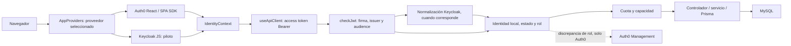

# Inventario de identidad: Auth0, piloto Keycloak y dependencias de ITECSA

Fecha de revisión: **24-10-2026, America/Santiago**. Fuente de verdad: commit empresarial **34dfd7c09f876285c1ea84d9020a44a1414ba468**, rama `POC/KEYCLOAK`. Las líneas corresponden a ese árbol, no al informe universitario. Informe estático: **no acredita configuración efectiva del tenant, del realm, de la VM ni ejecución satisfactoria de pruebas**.

Documentos relacionados: [RBAC](02_RBAC_ACTUAL_Y_PROPUESTO.md), [equivalencias y nuevos flujos](03_AUTH0_VS_KEYCLOAK.md), [guía futura](04_GUIA_CONFIGURACION_KEYCLOAK.md), [plan ejecutivo](05_PLAN_INICIAL_MIGRACION_IDENTIDAD.md).

## 1. Procedencia, separación y límites de esta fase

| Propiedad | Empresarial examinada | Universitaria, solo referencia |
| --- | --- | --- |
| Ruta | `D:/Universidad/Ing software II/Itecsa_app_LAN` | `D:/Universidad/Ing software II/itecsa-app` |
| Rama | `POC/KEYCLOAK` | `dev` |
| HEAD | `34dfd7c09f876285c1ea84d9020a44a1414ba468` | `88bcb972c29e34a9d92cc15fb584fc4211af265f` |
| Remoto fetch/push | `https://github.com/Grupo10ingsoftware/Itecsa_app_LAN.git` | `https://github.com/Grupo10ingsoftware/itecsa-app.git` |
| Git | `.git` propio; directorio común `.git` | `.git` propio; directorio común `.git` |
| Estado inicial | Limpio | Solo `?? docs/arquitectura/AUDITORIA_MAESTRA_LAN_UBUNTU.md` |

La independencia inicial de los repositorios está comprobada. No se ha comprobado independencia de cuentas de servicio, bases, tenant, realm o secretos. El nombre de una carpeta no demuestra esa independencia.

El historial empresarial empieza en **21ac28fa1f3ea366ba1dea653740c6ca4952ca5e** (`Copia del repo para adaptarlo a LAN`). Se compararon los objetos de ambos árboles con `git ls-tree -r`: **552/552 rutas y blobs idénticos** frente al HEAD universitario. La historia empresarial es nueva: la igualdad de contenido no convierte al commit universitario en ancestro Git. En el HEAD empresarial hay **566 archivos: 505 idénticos al universitario, 47 modificados y 14 añadidos; ninguno eliminado**. Los commits siguientes son `7c9a96f` y `34dfd7c`, con el piloto Keycloak.

La auditoría previa está en el repositorio universitario, `docs/arquitectura/AUDITORIA_MAESTRA_LAN_UBUNTU.md`, y declara el commit `88bcb97`. Se examinó su estructura A–Q, los flujos y riesgos y sus inventarios de archivos, paquetes y variables. Es un archivo no versionado: su pertenencia a la carpeta no demuestra inclusión en aquel commit. Sus afirmaciones operativas conservan la fecha y límites originales.

### Estrategia Git propuesta, no ejecutada

1. Utilizar la copia empresarial existente; no hace falta otra clonación para esta fase. Si se reconstruye, hacerlo en otro directorio y verificar el árbol antes de asociar un remoto empresarial, nunca reutilizar un worktree que comparta el directorio Git universitario.
2. Registrar los tres SHA anteriores y la igualdad de árboles en el expediente de aprobación. Proponer después una etiqueta protegida del commit empresarial base y conservar referencia al SHA universitario; no crearla en esta fase.
3. Antes de cualquier implementación: comprobar ruta absoluta, directorio Git común, HEAD, árbol limpio salvo documentación autorizada y URLs fetch/push. Aceptar únicamente el remoto empresarial aprobado; prohibir un remoto de publicación universitario en esa copia.
4. Proponer protección de ramas en el servidor y un control `pre-push` que rechace destinos distintos del remoto empresarial exacto, acompañado de comprobación en CI. Un hook local por sí solo se puede omitir: no es garantía suficiente.
5. Si en el futuro no existiera copia empresarial: clonar localmente sin hardlinks del almacén de objetos, no copiar el working tree con `.env`, borrar/reemplazar el remoto de origen únicamente tras autorización y verificar el remoto nuevo antes del primer push. No copiar configuración global de Git ni almacenes de credenciales.
6. Separar también BD, cuenta administrativa del IdP, volúmenes, backups y secretos. No copiar automáticamente `.env`, `deploy/production.env`, CA y llaves privadas, `node_modules`, `dist`, logs, dumps, perfiles de navegador o credenciales de Docker. Los secretos PIN deben preservarse de forma coordinada si se aprueba trasladar la misma base, no regenerarse por comodidad.

Evidencia de exclusiones: `.gitignore:1-50`, `.dockerignore`, `compose.yaml`, `compose.production.yaml`. Las reglas ignoradas no prueban ausencia de secretos en el historial ni autorizan copiarlos. No se publican valores de configuración privada.

## 2. Estado real: dos proveedores, una migración incompleta

Auth0 sigue implementado y seleccionable. El piloto no es una sustitución integral: `adminUsers.routes.js:28-30` intercepta el router con `503 IDENTITY_PROVIDER_NOT_IMPLEMENTED`; `auth.routes.js:65-68` hace lo mismo para recuperación pública; `router.jsx:94-101` redirige administración a Kanban y `NavigationMenu.jsx:22` oculta ese acceso. Una pantalla o un mock no demuestra que exista un endpoint operativo.

### Versiones verificables en esta copia

| Componente | Declaración / lock | Instalación local observada | Límite |
| --- | --- | --- | --- |
| Auth0 React | `^2.17.0` / `2.17.0` | Ausente en `capaVista/node_modules` | No describe los paquetes dentro de una imagen Docker |
| Auth0 SPA, transitivo | lock `2.20.0` | Ausente en esta copia | Renovación efectiva requiere artefacto y navegador exactos |
| Keycloak JS | `26.2.4` / `26.2.4` | Ausente en esta copia | Versión del adaptador, no del servidor |
| JWT Express | `^1.10.0` / `1.10.0` | `1.10.0` | Se inspeccionó su implementación instalada sin ejecutarla |
| jose del backend | lock `4.15.9` | `4.15.9` | Implementa verificación y JWKS en esa instalación |
| Prisma cliente/adaptador | `^7.10.0` / `7.10.0` | `7.10.0` | No se conectó a MySQL |
| Prisma CLI | lock `7.10.0` en tooling | Ausente en tooling | No se instaló ni ejecutó |
| Servidor Keycloak | Antecedente `26.8.1` | **Pendiente** | No se consultó el servidor durante esta fase |

## 3. Sesión frontend reconstruida

1. `main.jsx:1-18` monta React StrictMode y BrowserRouter; `App.jsx` incorpora providers/router. `AppProviders.jsx:10-40` valida configuración, selecciona proveedor y construye Auth0Provider con domain, clientId, audience, callback al origen y caché **en memoria**.
2. `LoginPage.jsx:10-85` calcula destino interno, evita relanzar login si hay error o usuario y usa `loginWithRedirect({appState:{returnTo}})`. El timeout visual inicial es 10 s. `getLoginErrorMessage` distingue cuenta bloqueada y configuración insegura; el resto muestra mensaje genérico. No recibe la contraseña del trabajador.
3. Auth0 React procesa el retorno OIDC; `handleRedirectCallback` valida con `safeReturnPath` y navega con replace. Las rutas públicas son login, recuperación y acceso denegado. Las rutas desconocidas se resuelven según sesión; volver al origen no implica estar autorizado para Kanban.
4. `IdentityProviders.jsx:8-20` adapta `useAuth0`, solicita tokens con `getAccessTokenSilently` y audience API. La clave de sesión depende de identidad/autenticación. No hay configuración explícita `useRefreshTokens`, `offline_access` ni `localstorage`; no afirmar que se use refresh grant en Auth0 solo porque el SDK lo soporta.
5. `useApiClient.js:5-10` captura la generación; `apiClient.js:57-145` obtiene access token, verifica vigencia de la generación antes/después de esperar y de recibir respuesta, añade Authorization y no devuelve datos de una sesión anterior. No utiliza ID token como Bearer ni guarda tokens en MySQL.
6. `AuthProvider.jsx:40-162` consulta `/auth/verify`, exige el mismo `sub`, sesión/generación vigente, rol reconocido y lista de permisos; no concede acceso únicamente por tener sesión en el IdP. `user` es la proyección verificada; `identityUser` es la identidad del SDK; `auth0User` queda como alias transitorio. Estados: loading, authenticated, unauthenticated, session-invalid, access-denied y error.
7. `hasPermission` aplica catálogo del rol **y** permisos verificados. `ProtectedRoute.jsx:8-69` controla carga, 403, expiración y exige reconocer el PIN antes de la navegación normal, con excepciones informativas/perfil. `RoleGuard.jsx:4-48` combina permiso y lista de roles; menú y rutas repiten esas condiciones visuales.
8. Al recargar se pierde la caché en memoria y el SDK debe resolver su sesión con el IdP; una cookie SSO puede permitirlo. No se acredita continuidad offline con una pestaña ya abierta. `LogoutButton.jsx:7-31` solicita confirmación; AuthProvider delega logout con returnTo al origen. Auth0 debe permitir ese origen de salida en su configuración efectiva.

Los **11 hooks de módulos** usan ahora `useApiClient`, no `useAuth0` directamente: auth, users, orders, kanban, payments, messages, metrics, orderHistory, productionCalendar, privacy y security. El único `useAuth0` runtime propio está en IdentityProviders. Consumidores finales y contratos se detallan en el anexo.

### Piloto Keycloak e incidente reportado

`keycloakSession.js:7-94` mantiene tokens en el objeto SDK/memoria, deduplica init y refresh y usa Authorization Code, PKCE S256, responseMode query y `checkLoginIframe: true`. Solo persiste el destino interno en sessionStorage. Requiere contexto seguro; una IP LAN por HTTP no sustituye a localhost/HTTPS. El callback procesa `code`, publica identidad y restaura destino. `onTokenExpired` renueva; `onAuthLogout` invalida; logout mantiene la UI en carga hasta abandonar la página.

**Evidencia de conversación, no prueba nueva:** el usuario reportó POST `/token` con `invalid_grant / Invalid refresh token` y confirmó `refresh_token=undefined`; la petición tenía 69 bytes. En una fase anterior de diagnóstico se reprodujo la pérdida del token durante una renovación con el SDK servido. En esta auditoría no se repitió ni se contactó el IdP. El disparador específico del equipo (iframe, cookies, varias sesiones, extensiones u otro cierre) permanece **probable**, no demostrado por un HAR completo. Registrar regresión tras login, logout concurrente y Brave; no convertir desactivar el iframe en cambio ya autorizado ni solución validada universal.

## 4. Validación backend y autorización efectiva

`server.js:88-140` instala contexto, headers, auditoría, CORS exacto, JSON limitado y routers. `checkJwt.js:9-35` conserva un validador por proveedor: Auth0 usa issuerBaseURL y discovery; Keycloak usa issuer y JWKS explícitos. Ambos exigen audience API.

La implementación instalada `capaServidor/node_modules/express-oauth2-jwt-bearer/dist/index.js:153-230,246-297,430-460` usa discovery/JWKS remoto y jose para verificar firma, issuer, audience y expiración. Sus defaults locales incluyen timeout 5 s, cooldown JWKS 30 s, caché 600 s y tolerancia 5 s; son hechos de la instalación inspeccionada, no parámetros aprobados del destino. El código propio **no fija explícitamente algoritmo RS256 ni strict**: la expectativa documental RS256 debe contrastarse con metadata y configuración del artefacto. No afirmar que el archivo propio ya restringe un algoritmo único.

Para Keycloak, `keycloakClaims.js:3-10` exige typ Bearer, azp del cliente SPA, sub no vacío, exactamente un rol ITECSA entre realm roles y `permissions` como array de strings no vacíos; conserva estos permisos y proyecta el claim namespaced. Los roles internos/default adicionales del realm no cuentan como otro rol de negocio. No consume automáticamente client roles ni inventa permisos a partir de scopes. Tampoco traduce email nativo al claim namespaced: verify sigue leyendo `https://itecsa.local/email` y puede devolver null aunque el token tenga email nativo; perfil consulta además el contacto local. El contrato futuro debe decidir esa proyección explícitamente.

`requireActiveIdentity.js:8-58` busca `Usuario.id_auth0 = sub`. Rechaza identidad ausente, estado no activo, Pendiente rol y Desvinculado. Un usuario Pendiente puede activarse si el rol coincide, con update condicionado y lectura posterior. Para Auth0, discrepancia de rol consulta Management y solo después intenta sincronizar la fila; para Keycloak **deniega**, sin consultar Auth0. Error de repositorio/proveedor devuelve 503, no acceso por defecto.

Después se aplica cuota (`rateLimit.js:31-42`, 120 lecturas o 30 escrituras/minuto por actor) y `requireCapability.js:3-11`, que usa OR cuando recibe varias capacidades y exige simultáneamente catálogo y permiso emitido. Los servicios agregan controles de estado, transacción y actor. `requirePin.js:4-20` toma el sujeto del JWT, nunca un actor del body; el servicio conserva el usuario interno como actor sensible.

`/auth/verify` no es lectura inocua: `auth.controller.js:65-126` puede aprovisionar PIN; el middleware previo puede activar Pendiente o conciliar un rol Auth0. Incluso un GET como Soporte puede generar auditoría al terminar. Por eso no se llamó a APIs para realizar esta auditoría.

## 5. Administración: contratos propios y llamadas Auth0

Las **7 rutas administrativas implementadas** bajo `/api/admin` son:

| Método y ruta | Handler / líneas en rutas | Entrada / salida | Controles y efectos |
| --- | --- | --- | --- |
| GET `/users` | list, 31-36 | filtros/page/perPage → usuarios/paginación | JWT, manage:users, roles objetivo; MySQL |
| GET `/users/summary` | summary, 37-42 | → resumen | Mismo alcance; MySQL |
| GET `/users/:userId/movements` | movements, 43-48 | sub externo + filtros → movimientos | Pertenencia al departamento; historial por id_usuario |
| POST `/users` | create, 49-54 | nombre/apellido/RUT/correo/rol → resultado completo o parcial | JWT/permiso/alcance; sin PIN en la ruta actual |
| POST `/users/password-setup-email` | resend, 55-60 | correo → confirmación de solicitud | Cuenta local activa/Pendiente y alcance; no prueba entrega |
| PATCH `/users/:userId` | update, 61-68 | datos/correo/rol/PIN → usuario | PIN; alcance actual y nuevo; no autocambio de rol |
| PATCH `/users/:userId/status` | status, 69-76 | estado/PIN → usuario | PIN; no autodesvinculación; transición condicionada |

No hay GET de detalle administrativo dedicado: el modal usa el usuario de la lista; movimientos es otra consulta. La reactivación usa PATCH status, no un endpoint separado. El cliente frontend declara POST `/users/:id/temporary-password` (`adminUsersApi.js:46-47`), **sin ruta backend implementada**, por lo que no se suma a las siete.

### Transporte Auth0: 6 combinaciones Management y 2 operaciones auxiliares

Archivo completo: `capaServidor/src/modules/users/service/auth0Management.service.js`. Cada llamada HTTP usa deadline configurable **8000 ms**, mínimo 100 y máximo 30000 (`:16-90`), sin reintento automático. 429/5xx/403/401/409 se clasifican; Retry-After puede propagarse. Los cuerpos de error no se deben volcar al cliente ni a logs. Hay token M2M nuevo por operación de servicio, sin caché propia de ese token.

| ID | Método / endpoint | Función / líneas | Payload, token y cabeceras | Respuesta y efecto local |
| --- | --- | --- | --- | --- |
| A01 | POST `/oauth/token` | requestManagementToken, 197-239 | JSON client_credentials, client_id/secret, audience Management, cuatro scopes; sin Bearer previo | access_token obligatorio; ninguna escritura MySQL directa |
| A02 | GET `/api/v2/roles` | resolveRoleId / resolveRoleReplacement, 277-350 | Bearer M2M; páginas de 100 | Array id/name; resuelve rol exacto o error; no BD directa |
| A03 | POST `/api/v2/users` | createAuth0User, 421-479 | Bearer + JSON email, connection, password generado en memoria | user_id obligatorio; después asigna rol; controller persiste local |
| A04 | POST `/api/v2/users/{id}/roles` | assignRoleToUser, 352-390 | Bearer + JSON roles:[roleId] | Éxito HTTP → true; alta convierte fallo en false; cambio puede lanzar |
| A05 | PATCH `/api/v2/users/{id}` | updateAuth0User, 482-524; setAuth0UserStatus, 548-578 | Bearer + email/app_metadata o blocked/app_metadata | JSON válido o 204 según helper; después se confirma transición MySQL |
| A06 | DELETE `/api/v2/users/{id}/roles` | replaceUserRole, 393-418 | Bearer + roles oficiales a retirar | 204 → null; después añade nuevo rol; posible fallo entre ambas llamadas |
| A07 | GET `/api/v2/users/{id}/roles` | getAuth0UserRole, 527-546 | Bearer; include_totals y límite 100 | Exige total completo; solo un rol oficial devuelve nombre; participa conciliación |
| A08 | POST `/dbconnections/change_password` | requestPasswordSetupEmail, 580-612 | JSON client_id SPA/reset, email, connection; sin token Management | Cualquier éxito HTTP → requested:true; no entrega ticket ni contraseña |

Scopes solicitados por el código (`:23-28`): `read:users`, `create:users`, `update:users`, `read:roles`. Son el conjunto pedido por el servicio, no evidencia de la concesión efectiva del tenant ni demostración de mínimo por operación. Las asignaciones usan IDs de roles, no nombres como IDs. No hay DELETE de identidad Auth0 implementado. Consultar equivalencias y privilegios candidatos en [03](03_AUTH0_VS_KEYCLOAK.md).

### Ciclo real y fallos parciales

- **Alta:** validator exige nombre, apellido, RUT, correo y rol funcional (`adminUsers.validator.js:44-88`). El controller comprueba duplicado local por correo antes de crear identidad. El servicio genera `randomBytes(32).toString('base64url')` más sufijo (`auth0Management:110-112`), crea identidad y asigna rol. Esa contraseña llega a Auth0 por TLS, no a MySQL ni a la SPA. Llamarla temporal en una variable **no configura cambio obligatorio** en Auth0.
- **Persistencia:** `adminUsers.controller.js:480-615` guarda el sub externo, datos y estado Pendiente/Pendiente rol; luego genera PIN y solicita correo. El resultado informa outcome, recoverable y cuatro banderas. Un 201 puede ser `failed_recoverable`; no equivale a alta utilizable. Un conflicto local posterior a crear identidad puede devolver 409 dejando una identidad externa: no hay transacción distribuida ni DELETE compensatorio universal.
- **Reintentos:** si falla el correo con fila/rol/PIN completos, la UI permite solicitarlo otra vez. Si falla rol o fila, avisa conciliación y no debe repetirse el alta ciegamente. Si falla PIN, primer acceso puede aprovisionarlo, pero no se solicita correo en ese intento de alta. El módulo no ofrece un expediente general de provisión ni garantiza conciliación automática para todos los parciales.
- **Edición:** nombre y apellido se guardan localmente; Auth0 recibe correo y app_metadata de rol. El RUT no es editable en ese contrato. Cambiar rol pone primero Pendiente rol; luego modifica proveedor y confirma local mediante comparación de estado/rol. Un fallo intermedio conserva denegación y puede exigir conciliación. No tratar app_metadata como fuente RBAC.
- **Baja:** primero cambia estado local, después invalida PIN y bloquea Auth0 (`:322-436`). Un fallo remoto no vuelve a autorizar localmente la cuenta. No se borran pedidos, mensajes ni usuario histórico.
- **Reactivación:** invalida PIN, desbloquea proveedor, actualiza local condicionalmente y reprovisiona PIN. Si falla provisión intenta volver a bloquear ambos lados con Promise.allSettled; ese intento también puede fallar. No asumir rollback garantizado.
- **Primer acceso:** middleware activa Pendiente con JWT válido y rol coincidente. Eso prueba acceso válido, no recepción de un evento de cambio de contraseña. La garantía futura del cambio temporal debe quedar en Keycloak antes de emitir un token utilizable.

## 6. Recuperación y credenciales visibles: qué existe y qué no

`PasswordResetPage.jsx:23-66` usa correo en Auth0; en Keycloak presenta instrucciones para contactar administrador, sin crear solicitud interna. `passwordResetApi.js:40-66` hace POST público; no usa Bearer. `auth.controller.js:21-62,183-238` rechaza campos extra, valida/normaliza email, busca local y solicita correo solo si está activo o Pendiente. Cuenta inexistente, bloqueada, error BD o fallo proveedor conservan HTTP 202 y mensaje uniforme. JSON inválido devuelve 400; las cuotas pueden devolver 429.

`rateLimit.js:43-59`: 10 solicitudes/IP y 3/identificador normalizado cada 15 min. `securityThrottle.service.js` usa HMAC y almacenamiento persistente en producción; revisar confianza proxy para evitar suplantar IP. Existe demora mínima 600 ms + jitter 0–199; no asegura latencia idéntica si el proveedor tarda más. El logger registra correlación HMAC, sin email en claro. No hay tabla de solicitudes de recuperación de contraseña ni envío de notificación Soporte en ese flujo.

`TemporaryPasswordModal.jsx:6-53` es preparación UI: exige HTTPS SPA/API, PIN del operador, declaración de identidad verificada, espera username/temporaryPassword/mustChangePassword y oculta tras 90 s o desmontar. Su consumidor existe en gestión de usuarios, pero el router Keycloak la hace inaccesible y el endpoint falta. No acredita generación ni cambio de contraseña en Keycloak. `UserCreateForm` admite correo vacío para Keycloak, mientras el schema y validator backend siguen exigiéndolo: **incompatibilidad real**, no correo opcional extremo a extremo.

No se encontró acción de cambio de contraseña Keycloak desde Mi perfil. Perfil maneja datos propios, movimientos y PIN. El cambio voluntario se debe diseñar con mecanismo nativo del IdP; no reutilizar el reset administrativo como cambio personal.

## 7. Identidad local, PIN, mensajes y auditoría

| Área | Evidencia y símbolo | Entrada → salida / efecto | Qué preservar y riesgo |
| --- | --- | --- | --- |
| Usuario | schema.prisma:193-218; users.repo.js:7-113 | sub → id_auth0 único → id_usuario | PK interna numérica; id_auth0 y correo son obligatorios; no hay username local |
| Relaciones | schema:115-145,193-218,245-289,334-368 | id_usuario → pedidos, avances, comentarios, etiquetas, mensajes, PIN, registros, auditoría | No reasignar FKs ni unir personas solo por correo |
| Repositorio | users.repo.js:265-463 | cambios condicionados → count/lectura | Preservar compare-and-set y estados de transición; carreras no resueltas con un simple find previo |
| PIN | pin.service.js:27-32,44-97,147-237,266-408,453-682 | sub y PIN → actor interno o error | scrypt versionado, comparación segura, HKDF/AES-GCM, huella única, acuse, 5 intentos y bloqueo 15 min |
| Entrega PIN | resendPinDelivery.js:14-45 | correo + OTP → proveedor Resend | Timeout 10 s; error redactado; dependencia de Internet separada de contraseña Keycloak |
| Mensajes | message.service.js:45-59,166-200; message.repo.js:205-255 | destinatarios internos → Mensaje + MENSAJE_USUARIO | Creación transaccional del servicio; lectura/ocultación restringida al destinatario |
| Productores | orderNotificationOperations.js:3-64 | evento pedido + rol → aviso a usuarios | Filtro actual excluye Desvinculado, no todos los estados no activos; no copiarlo sin revisión para Soporte |
| Campana | NotificationBell.jsx:11-69 | polling visible 5 s → avisos/cola popup | Ocultar/leído no equivale a resolver recuperación; cola UI no expediente persistente |
| Auditoría HTTP | supportAudit.js:5-31; securityAudit.repo.js | actor/status → evento tras finish | Async, puede fallar sin revertir operación; Soporte actual genera eventos incluso en GET |
| Logs | safeLogger.js:1-52 | evento + allowlist → sink | No autorizar password/token/PIN en metadata; no confundir logger con auditoría transaccional |

La guía del piloto contiene una reversión de identificador a NULL, mientras el schema versionado declara `id_auth0 String` no nullable. Es **discrepancia documental** que exige comprobar esquema real y autorización antes de cualquier SQL; no se siguió esa instrucción ni se reproduce aquí el identificador de prueba.

Los mensajes existentes permiten una alerta interna sin SMTP, pero no hay creación pública de chat. La PK compuesta evita destinatarios duplicados dentro de un mensaje; `skipDuplicates` no evita crear dos mensajes para el mismo evento. Para recuperación se necesita expediente independiente, operación deduplicada y entrega de evento transaccional o outbox, como se propone en [03](03_AUTH0_VS_KEYCLOAK.md).

## 8. Hallazgos trazables y pruebas futuras

Cada fila usa la evidencia y contratos detallados arriba; la columna Keycloak describe **candidato**, no implementación. C = confirmado estáticamente; P = probable; E = pendiente de evidencia externa. Los identificadores de prueba se desarrollan en 03.

| ID | Archivo:líneas / símbolo | Actual; dependencia; entrada → salida | Consumidores afectados | Esperado Keycloak / riesgo | Prueba / certeza |
| --- | --- | --- | --- | --- | --- |
| H01 | AppProviders.jsx:10-40 / AppProviders | Config → SDK Auth0 o piloto | router, AuthProvider, todos hooks | Cliente público/PKCE y URLs LAN; origen errado | T01–T06 / C |
| H02 | IdentityProviders.jsx:8-20 / Auth0IdentityProvider | SDK → tokens silenciosos/identidad | useApiClient, AuthProvider | Adaptador neutral; no asumir mismo refresh | T04,T09 / C |
| H03 | AuthProvider.jsx:40-218 / verifySession | sub + verify → usuario verificado | guards, perfil, menú, formularios | Mantener rechazo de identidad/generación distinta | T06,T10 / C |
| H04 | apiClient.js:87-145 / request | access token → Bearer → API | 11 hooks y APIs de módulo | Ningún ID token ni secreto admin en SPA | T07,T10 / C |
| H05 | LoginPage.jsx:10-85 / login y errores | destino interno → redirect/error | rutas públicas/protegidas | Recuperar navegación y error legible | T01,T04 / C |
| H06 | ProtectedRoute.jsx:8-69 / guard | estado + PIN → navegación | todas rutas protegidas | Mantener acuse PIN; no confundir sesión IdP con acceso | T06,T23 / C |
| H07 | checkJwt.js:9-35 / checkJwt | JWT → claims/401 | todos routers protegidos | firma/iss/aud/exp/JWKS locales | T07,T08 / C |
| H08 | keycloakClaims.js:3-10 / normalizer | realm role + permissions → contrato propio | identidad/capacidades | Singularidad; client roles no soportados hoy | T11,T12 / C |
| H09 | requireActiveIdentity.js:8-58 / middleware | sub → fila/estado/rol | auth y negocio | Separar emisor/sub; sin conciliación Auth0 en Keycloak | T13,T25 / C |
| H10 | requireCapability.js:3-11; shared/authorization.js:27-55 | rol + permisos → autorización | rutas y servicios de negocio | Intersección con matriz local; no ampliar accesos | T11–T14 / C |
| H11 | auth0Management.service.js:197-418 / transporte/roles | M2M → API externa | alta, edición, baja, conciliación | Admin REST con mínimos y contratos distintos | T15–T18 / C |
| H12 | adminUsers.controller.js:480-615 / alta | datos → identidad/BD/PIN/correo | formulario y outcomes | Provisión rastreable, temporal y cambio obligatorio | T15–T18 / C |
| H13 | adminUsers.controller.js:203-320 / edición | correo/rol/PIN → estados distribuidos | modal, BD y JWT antiguos | Cambios condicionados y conciliación | T17,T19 / C |
| H14 | adminUsers.controller.js:322-436 / estado | estado/PIN → bloqueo local/externo | PIN, sesiones, operaciones | Revocación no garantiza JWT antiguo inválido | T19,T20 / C |
| H15 | auth.controller.js:183-238 / password reset | email → 202 + posible correo | página pública, cuotas y logs | username → expediente y aviso, sin bloqueo público | T26–T31 / C |
| H16 | rateLimit.js:43-59; securityThrottle.service.js | IP/identificador → cuota | reset y operadores | HMAC, cuota compartida, prevenir enumeración | T27,T28 / C |
| H17 | schema.prisma:193-218 / Usuario | sub + correo obligatorio → persona | todos actores/históricos | Username y correo opcional necesitan diseño BD | T25,T32 / C |
| H18 | pin.service.js:147-237,323-408,657-682 | sub/PIN → actor o bloqueo | producción, pagos, administración | Conservar algoritmos/llaves sin usar PIN como reset IdP | T23,T32 / C |
| H19 | message.repo.js:205-255; NotificationBell.jsx:11-69 | destinatarios → avisos | Soporte futuro | Aviso separado de expediente y deduplicación evento | T29,T30 / C |
| H20 | supportAudit.js:5-31 / finish listener | petición → evento async | técnico y admin actual | Renombrar clasificación y registrar acción de cuenta | T22,T31 / C |
| H21 | adminUsers.routes.js:28-30; auth.routes.js:65-68 | proveedor Keycloak → 503 | gestión/reset | Funciones aún no migradas | T15,T26 / C |
| H22 | adminUsersApi.js:46-47; TemporaryPasswordModal.jsx:6-53 | PIN/verificación → ruta inexistente | gestión de usuarios | Contrato a implementar tras aprobación; no prueba de API | T16,T21 / C |
| H23 | UserCreateForm.jsx:127-190; adminUsers.validator.js:44-88 | email opcional UI / obligatorio BE | alta y edición | Alinear UI/API/BD; no correos ficticios | T15,T32 / C |
| H24 | docs/auth0/itecsa-post-login.cjs:2-14 | roles Auth0 → claims | checkJwt y verify | Mapper equivalente o traducción; estado tenant no verificado | T11 / C/E |
| H25 | docs/auth0/universal-login.html:40-44; change-password-email-es.html | template → recursos externos | navegador/correo, si publicado | Tema con activos LAN; despliegue actual desconocido | T33 / C/E |
| H26 | deploy/40-runtime-config.sh:4-29; runtimeConfig.js:1-44 | variables públicas → configuración SPA | Docker/Nginx/browser | HTTPS coherente, no secretos VITE; backchannel distinto de issuer | T05,T33 / C |
| H27 | keycloakSession.js:29,44-46,56-58 | renovación/iframe/cierre → posible token eliminado | sesión navegador | Manejar cierre concurrente y cookies según topología | T09 / C/P |
| H28 | docs/operacion/PILOTO_KEYCLOAK_LAN.md:1-27 | túnel + BD externa → piloto | API, navegador | No acredita LAN autónoma ni reversión SQL compatible | T25,T33 / C/E |

Los archivos abreviados en esta tabla se resuelven inequívocamente en el inventario de rutas completas siguiente. No se atribuye certeza externa a la mera existencia de templates, Action o fixtures.

## 9. Configuración y dependencias indirectas

Auth0 frontend: `VITE_AUTH0_DOMAIN`, `VITE_AUTH0_CLIENT_ID`, `VITE_AUTH0_AUDIENCE`. Backend: `AUTH0_DOMAIN`, `AUTH0_AUDIENCE`; Management: `AUTH0_MANAGEMENT_CLIENT_ID`, `AUTH0_MANAGEMENT_CLIENT_SECRET`, `AUTH0_DATABASE_CONNECTION`; correo: `AUTH0_PASSWORD_RESET_CLIENT_ID`; deadline: `AUTH0_REQUEST_TIMEOUT_MS`.

Selección: `VITE_AUTH_PROVIDER` y `AUTH_PROVIDER` deben concordar. Piloto frontend: `VITE_KEYCLOAK_URL`, `VITE_KEYCLOAK_REALM`, `VITE_KEYCLOAK_CLIENT_ID`, `VITE_KEYCLOAK_AUDIENCE`; API: `KEYCLOAK_ISSUER`, `KEYCLOAK_AUDIENCE`, `KEYCLOAK_CLIENT_ID`, `KEYCLOAK_JWKS_URI`. El env.example backend todavía no documenta este conjunto: riesgo de configuración incompleta. Producción genera `window.__ITECSA_CONFIG__`; runtime prevalece sobre Vite. No hay credencial administrativa Keycloak implementada.

Infraestructura y seguridad: `VITE_API_BASE_URL`, `FRONTEND_ORIGIN`, `TRUST_PROXY`, APP_ENV/NODE_ENV, llaves PIN/cuotas/auditoría/cursor, DB_* y DATABASE_URL. El datasource CLI es distinto de la conexión runtime: deben verificar ambos destinos antes de migrar. No se exponen valores privados en este informe.

Pedidos, producción, ventas, cobranzas, calendario, gerencia, privacidad e incidentes heredan identidad aunque no importen Auth0. Se preservan sus DTO, reglas, transacciones, snapshots, PIN e históricos. Gerencia no obtiene gestión de cuentas por usar Keycloak. Cambiar IdP no resuelve MySQL externo, recuperación PIN/Resend, comunicaciones privacidad/incidentes, fuente de Notas de Venta productiva ni suministro de artefactos offline.

## 10. Cobertura reproducible y limitaciones

Árbol base: **566 archivos versionados**. Inventario relacionado: **347 archivos propios/configuración/documentación**, con **4 fronteras directas runtime**, **178 participantes/consumidores indirectos runtime** y **165 soportes**. Los conjuntos son disjuntos por ruta. D+I = **182 archivos runtime**. Se identificaron **7 endpoints administrativos propios implementados**, **1 referencia frontend a endpoint administrativo no implementado**, **6 combinaciones método/ruta Management Auth0** y **2 operaciones auxiliares** (token M2M y change_password). Estos conteos describen el criterio de inclusión explícito, no todos los archivos del proyecto ni evidencia de ejecución.

Método: enumeración Git; lectura UTF-8; búsqueda de APIs, claims, variables y sujetos; resolución de imports relativos literales y reexports; seguimiento manual de las cadenas críticas anteriores; inspección de tests/mocks como especificaciones, sin ejecutarlos. Se inspeccionó el núcleo completo de sesión/administración/validación y las partes de identidad de consumidores; los estilos y utilidades puras se clasifican por sus contratos/consumidores. Esto no es una prueba formal de alcanzabilidad ni una revisión manual línea por línea de todo el código de negocio o terceros.

Se contaron por separado consumidores runtime y soportes (tests, docs, configuración, SQL, estilos). Los soportes incluyen pruebas que importan contratos compartidos y runners/fixtures de esos consumidores, aunque no llamen al IdP. Los módulos de negocio sin dependencia propia de identidad se conservan y entran en regresión; no se declaran migraciones necesarias por un nombre de variable aislado. Los imports dinámicos mediante informationPageLoaders y los mocks se revisaron explícitamente. No se ejecutó generación RBAC, Prisma, tests, build, app, smoke ni consultas a proveedores/BD.

Pendientes externos: versión/digest/configuración efectiva Keycloak; tenant/Auth0 Action/RBAC actuales; volúmenes y usuarios de BD; datos a preservar; DNS/CA/NTP; autoridad que aprueba roles y entrega de credenciales; navegadores corporativos; privilegios administrativos mínimos probados; RPO/RTO y restauración. No existe evidencia de aceptación offline y no se presenta ninguna prueba futura como aprobada.

La comprobación de SHA-256 de los 566 archivos versionados iniciales y el estado Git al cierre debe conservarlos intactos y mostrar exclusivamente los cinco documentos nuevos. El repositorio universitario no recibe modificaciones.

### 10.1 Inventario de archivos propios relacionados

Cada fila tiene ruta completa relativa al repositorio y líneas vigentes, símbolos/evidencia, clasificación de cambio y justificación. D identifica frontera de proveedor; I participantes runtime del contrato/cadena; S soportes. La clasificación no afirma que cada componente realice HTTP al IdP. Las filas generadas usan evidencia extraída de los archivos actuales, no números copiados del informe previo.

| Ruta y líneas actuales | Clase | Símbolo/evidencia | Acción futura justificada |
| --- | --- | --- | --- |
| `.dockerignore` (1; 21 líneas) | S | declaración/configuración o consumidor por imports | Configuración de entrega/aislamiento; no aplicar ni publicar secretos. |
| `.github/workflows/security-ci.yml` (29, 30; 90 líneas) | S | declaración/configuración o consumidor por imports | Configuración de entrega/aislamiento; no aplicar ni publicar secretos. |
| `.gitignore` (1; 50 líneas) | S | declaración/configuración o consumidor por imports | Configuración de entrega/aislamiento; no aplicar ni publicar secretos. |
| `capaServidor/Dockerfile` (1; 46 líneas) | S | declaración/configuración o consumidor por imports | Configuración de entrega/aislamiento; no aplicar ni publicar secretos. |
| `capaServidor/env.example` (36, 37, 38, 40, 41, 42; 88 líneas) | S | declaración/configuración o consumidor por imports | Configuración de entrega/aislamiento; no aplicar ni publicar secretos. |
| `capaServidor/package-lock.json` (1; 1389 líneas) | S | declaración/configuración o consumidor por imports | Adaptación futura de dependencias; lock contrastado, sin instalar/actualizar. |
| `capaServidor/package.json` (1; 43 líneas) | S | declaración/configuración o consumidor por imports | Adaptación futura de dependencias; lock contrastado, sin instalar/actualizar. |
| `capaServidor/prisma/migrations/0_init/migration.sql` (255, 264; 386 líneas) | S | DDL de identidad/persistencia | Ninguna ejecución: evidencia de esquema/identidad; diseñar migración aparte. |
| `capaServidor/prisma/migrations/20260814120000_remove_electronic_signatures/migration.sql` (1; 30 líneas) | S | DDL de identidad/persistencia | Ninguna ejecución: evidencia de esquema/identidad; diseñar migración aparte. |
| `capaServidor/prisma/migrations/20260830100000_reconcile_aiven_pin_prerequisite/migration.sql` (1; 5 líneas) | S | DDL de identidad/persistencia | Ninguna ejecución: evidencia de esquema/identidad; diseñar migración aparte. |
| `capaServidor/prisma/migrations/20260830103000_add_personal_pins/migration.sql` (1; 31 líneas) | S | DDL de identidad/persistencia | Ninguna ejecución: evidencia de esquema/identidad; diseñar migración aparte. |
| `capaServidor/prisma/migrations/20260901000000_reconcile_pre_september_schema/migration.sql` (1; 258 líneas) | S | DDL de identidad/persistencia | Ninguna ejecución: evidencia de esquema/identidad; diseñar migración aparte. |
| `capaServidor/prisma/migrations/20260905120000_rename_existing_roles/migration.sql` (1; 11 líneas) | S | DDL de identidad/persistencia | Ninguna ejecución: evidencia de esquema/identidad; diseñar migración aparte. |
| `capaServidor/prisma/migrations/20260905130000_normalize_administrator_role_value/migration.sql` (1; 5 líneas) | S | DDL de identidad/persistencia | Ninguna ejecución: evidencia de esquema/identidad; diseñar migración aparte. |
| `capaServidor/prisma/migrations/20260905140000_normalize_production_operator_role_value/migration.sql` (1; 5 líneas) | S | DDL de identidad/persistencia | Ninguna ejecución: evidencia de esquema/identidad; diseñar migración aparte. |
| `capaServidor/prisma/migrations/202609260002_security_hardening/migration.sql` (1; 43 líneas) | S | DDL de identidad/persistencia | Ninguna ejecución: evidencia de esquema/identidad; diseñar migración aparte. |
| `capaServidor/prisma/migrations/202610020002_incident_report_audit/migration.sql` (1; 7 líneas) | S | DDL de identidad/persistencia | Ninguna ejecución: evidencia de esquema/identidad; diseñar migración aparte. |
| `capaServidor/prisma/schema.prisma` (9, 18, 31, 57, 69, 80; 409 líneas) | S | declaración/configuración o consumidor por imports | Conservar negocio/DTO; regresión de acceso/actor y configuración de identidad heredada. |
| `capaServidor/README.md` (3, 23; 57 líneas) | S | declaración/configuración o consumidor por imports | Adaptación documental posterior si cambia el contrato; preservar evidencia fechada. |
| `capaServidor/scripts/paymentsReadBaseline.mjs` (49; 76 líneas) | S | percentile, sample | Revisar proveedor, targets y efectos; no ejecutar en esta fase. |
| `capaServidor/scripts/previewPinRecoveryRetention.mjs` (1; 28 líneas) | S | declaración/configuración o consumidor por imports | Revisar proveedor, targets y efectos; no ejecutar en esta fase. |
| `capaServidor/src/app/app.js` (26, 27, 38, 39, 41; 69 líneas) | I | validateEnvironment | Conservar negocio/DTO; regresión de acceso/actor y configuración de identidad heredada. |
| `capaServidor/src/app/dev.js` (1; 12 líneas) | I | declaración/configuración o consumidor por imports | Conservar negocio/DTO; regresión de acceso/actor y configuración de identidad heredada. |
| `capaServidor/src/config/pinDelivery.js` (4, 13; 28 líneas) | I | PinDeliveryConfigurationError, readPinDeliveryConfiguration | Dependencia separada de entrega; diseño LAN pendiente, sin cambios de PIN. |
| `capaServidor/src/config/roles.js` (2, 3; 4 líneas) | I | OFFICIAL_ROLES | Adaptación: nueve roles/alcances aprobados; no ampliar permisos. |
| `capaServidor/src/config/userLifecycle.js` (1; 9 líneas) | I | declaración/configuración o consumidor por imports | Conservar semántica; revisar compatibilidad con provisión sin eliminar estados. |
| `capaServidor/src/database/prisma.js` (70, 80, 86, 93; 94 líneas) | I | readPrismaConfiguration, getPrismaClient, checkDatabaseConnection, disconnectPrismaClient | Conservar negocio/DTO; regresión de acceso/actor y configuración de identidad heredada. |
| `capaServidor/src/errors/httpErrors.js` (8, 13, 14, 35, 42, 68; 114 líneas) | I | requestId, requestContext, publicError, safeErrorType | Conservar negocio/DTO; regresión de acceso/actor y configuración de identidad heredada. |
| `capaServidor/src/middlewares/checkJwt.js` (9, 14, 15, 16, 23, 25; 35 líneas) | D | checkJwt | Adaptación/configuración: conservar validador y cambiar contrato del emisor. |
| `capaServidor/src/middlewares/keycloakClaims.js` (3; 11 líneas) | I | normalizeKeycloakClaims | Adaptación/pruebas de identidad, generación y renovación; preservar aislamiento de sesión. |
| `capaServidor/src/middlewares/rateLimit.js` (17, 31, 36, 43, 58, 66; 87 líneas) | I | clientAddress, respondRateLimit, createThrottleMiddleware, throttleMiddleware | Preservar control/auditoría; adaptar actor, cuotas y eventos de cuentas sin secretos. |
| `capaServidor/src/middlewares/requireActiveIdentity.js` (2, 3, 8, 10, 13, 19; 59 líneas) | I | createRequireActiveIdentity | Adaptación/pruebas de identidad, generación y renovación; preservar aislamiento de sesión. |
| `capaServidor/src/middlewares/requireAdministrativeRole.js` (2; 3 líneas) | I | declaración/configuración o consumidor por imports | Conservar negocio/DTO; regresión de acceso/actor y configuración de identidad heredada. |
| `capaServidor/src/middlewares/requireAdministratorRole.js` (2; 3 líneas) | I | declaración/configuración o consumidor por imports | Conservar negocio/DTO; regresión de acceso/actor y configuración de identidad heredada. |
| `capaServidor/src/middlewares/requireCapability.js` (1, 2, 3, 6, 7; 13 líneas) | I | requireCapability | Conservar negocio/DTO; regresión de acceso/actor y configuración de identidad heredada. |
| `capaServidor/src/middlewares/requirePin.js` (4, 7, 20; 21 líneas) | I | createRequirePin, requirePin | Preservar crypto/PIN/actor; adaptar lookup solo si cambia modelo de identidad. |
| `capaServidor/src/middlewares/requireSalesRole.js` (2; 3 líneas) | I | declaración/configuración o consumidor por imports | Conservar negocio/DTO; regresión de acceso/actor y configuración de identidad heredada. |
| `capaServidor/src/middlewares/supportAudit.js` (5, 8, 11, 33; 34 líneas) | I | createSupportAudit, supportAudit | Preservar control/auditoría; adaptar actor, cuotas y eventos de cuentas sin secretos. |
| `capaServidor/src/modules/auth/controller/auth.controller.js` (4, 65, 70, 105, 106, 107; 278 líneas) | I | invalidPasswordResetRequest, validatePasswordResetRequest, hashEmail, logPasswordResetAttempt | Adaptación: contrato username, correo, proveedor o credenciales; preservar controles. |
| `capaServidor/src/modules/auth/routes/auth.routes.js` (18, 20, 35, 36, 38, 45; 82 líneas) | I | createAuthRouter | Conservar negocio/DTO; regresión de acceso/actor y configuración de identidad heredada. |
| `capaServidor/src/modules/auth/service/developmentConsolePinDelivery.js` (4; 20 líneas) | I | DevelopmentConsolePinDeliveryProvider | Dependencia separada de entrega; diseño LAN pendiente, sin cambios de PIN. |
| `capaServidor/src/modules/auth/service/fakePinDelivery.js` (3; 13 líneas) | I | FakePinDeliveryProvider | Dependencia separada de entrega; diseño LAN pendiente, sin cambios de PIN. |
| `capaServidor/src/modules/auth/service/pin.service.js` (24, 34, 118, 218, 220, 224; 685 líneas) | I | PinServiceError, decodeSecret, deriveKey, hashValue | Preservar crypto/PIN/actor; adaptar lookup solo si cambia modelo de identidad. |
| `capaServidor/src/modules/auth/service/pinDelivery.service.js` (6, 14, 22, 27; 46 líneas) | I | PinDeliveryUnavailableError, PinDeliveryFailedError, unavailablePinRecoveryDelivery, createPinRecoveryDelivery | Dependencia separada de entrega; diseño LAN pendiente, sin cambios de PIN. |
| `capaServidor/src/modules/auth/service/resendPinDelivery.js` (3; 45 líneas) | I | ResendPinDeliveryProvider | Dependencia separada de entrega; diseño LAN pendiente, sin cambios de PIN. |
| `capaServidor/src/modules/clients/controller/clients.controller.js` (10, 66; 67 líneas) | I | declaración/configuración o consumidor por imports | Conservar negocio/DTO; regresión de acceso/actor y configuración de identidad heredada. |
| `capaServidor/src/modules/clients/routes/clients.routes.js` (8, 14, 15, 16, 21; 21 líneas) | I | createPaymentStatusRouter | Conservar negocio/DTO; regresión de acceso/actor y configuración de identidad heredada. |
| `capaServidor/src/modules/history/controller/orderHistory.controller.js` (3, 6, 7, 10; 47 líneas) | I | mayReadPayments, OrderHistoryController | Conservar negocio/DTO; regresión de acceso/actor y configuración de identidad heredada. |
| `capaServidor/src/modules/history/routes/orderHistory.routes.js` (6, 11, 12, 13, 17; 18 líneas) | I | createOrderHistoryRouter | Conservar negocio/DTO; regresión de acceso/actor y configuración de identidad heredada. |
| `capaServidor/src/modules/messages/controller/message.controller.js` (5, 12, 22, 33, 46, 59; 81 líneas) | I | declaración/configuración o consumidor por imports | Conservar pertenencia/mensajería; ampliar solo vínculo/aviso de recuperación aprobado. |
| `capaServidor/src/modules/messages/repo/message.repo.js` (35, 258; 259 líneas) | I | mapMessageAssignment | Conservar pertenencia/mensajería; ampliar solo vínculo/aviso de recuperación aprobado. |
| `capaServidor/src/modules/messages/routes/message.routes.js` (6, 12, 13, 14, 15, 16; 23 líneas) | I | createMessageRouter | Conservar pertenencia/mensajería; ampliar solo vínculo/aviso de recuperación aprobado. |
| `capaServidor/src/modules/messages/service/message.service.js` (39, 45, 46, 50, 59, 60; 203 líneas) | I | createHttpError, parsePositiveInteger, parseDate | Conservar pertenencia/mensajería; ampliar solo vínculo/aviso de recuperación aprobado. |
| `capaServidor/src/modules/metrics/controller/metrics.controller.js` (4; 26 líneas) | I | MetricsController | Conservar negocio/DTO; regresión de acceso/actor y configuración de identidad heredada. |
| `capaServidor/src/modules/metrics/routes/metrics.routes.js` (6, 12, 13, 17; 18 líneas) | I | createMetricsRouter | Conservar negocio/DTO; regresión de acceso/actor y configuración de identidad heredada. |
| `capaServidor/src/modules/orders/controller/orderDetail.controller.js` (5, 47; 48 líneas) | I | declaración/configuración o consumidor por imports | Conservar negocio/DTO; regresión de acceso/actor y configuración de identidad heredada. |
| `capaServidor/src/modules/orders/controller/orders.controller.js` (4, 16, 59, 89, 100, 101; 175 líneas) | I | declaración/configuración o consumidor por imports | Conservar negocio/DTO; regresión de acceso/actor y configuración de identidad heredada. |
| `capaServidor/src/modules/orders/controller/orderStatus.controller.js` (5, 46; 47 líneas) | I | declaración/configuración o consumidor por imports | Conservar negocio/DTO; regresión de acceso/actor y configuración de identidad heredada. |
| `capaServidor/src/modules/orders/repo/orderNotificationOperations.js` (3, 7, 11, 49; 64 líneas) | I | notifyProductionAdministratorsOperation, notifyCollectionsAdministratorsOperation, notifyAdministratorsByRoleOperation, notifyOrderReadyOperation | Conservar pertenencia/mensajería; ampliar solo vínculo/aviso de recuperación aprobado. |
| `capaServidor/src/modules/orders/repo/orders.repo.js` (40, 184; 185 líneas) | I | declaración/configuración o consumidor por imports | Conservar negocio/DTO; regresión de acceso/actor y configuración de identidad heredada. |
| `capaServidor/src/modules/orders/repo/orderSalesNoteOperations.js` (6; 129 líneas) | I | reevaluateFromSalesNoteOperation | Conservar negocio/DTO; regresión de acceso/actor y configuración de identidad heredada. |
| `capaServidor/src/modules/orders/routes/order.routes.js` (14, 54, 55, 56, 57, 58; 109 líneas) | I | createOrderRouter | Conservar negocio/DTO; regresión de acceso/actor y configuración de identidad heredada. |
| `capaServidor/src/modules/orders/routes/orderDetail.routes.js` (7, 13, 14, 15, 20; 20 líneas) | I | createOrderDetailRouter | Conservar negocio/DTO; regresión de acceso/actor y configuración de identidad heredada. |
| `capaServidor/src/modules/orders/routes/orderStatus.routes.js` (8, 14, 15, 20; 20 líneas) | I | createOrderStatusRouter | Conservar negocio/DTO; regresión de acceso/actor y configuración de identidad heredada. |
| `capaServidor/src/modules/orders/service/order.service.js` (30, 32, 235, 248, 255, 260; 325 líneas) | I | declaración/configuración o consumidor por imports | Conservar negocio/DTO; regresión de acceso/actor y configuración de identidad heredada. |
| `capaServidor/src/modules/orders/service/orderPayment.service.js` (5, 8, 10, 91; 166 líneas) | I | RESOLVED_PAYMENT_PENDING_LOCKED_MESSAGE, updPaymentStateOperation | Conservar negocio/DTO; regresión de acceso/actor y configuración de identidad heredada. |
| `capaServidor/src/modules/orders/service/orderProduction.service.js` (11, 17, 23, 27, 106, 129; 281 líneas) | I | toPrismaDate, isBusinessDate, normalizeText, updGeneralStepOperation | Conservar negocio/DTO; regresión de acceso/actor y configuración de identidad heredada. |
| `capaServidor/src/modules/orders/service/salesOrder.transaction.js` (12; 22 líneas) | I | createSalesOrderTransaction | Conservar negocio/DTO; regresión de acceso/actor y configuración de identidad heredada. |
| `capaServidor/src/modules/orders/service/salesOrderCreation.service.js` (5, 12, 23, 24; 190 líneas) | I | DUPLICATE_SALES_NOTE_MESSAGE, normalizePriorityLabels, SalesOrderCreationService | Conservar negocio/DTO; regresión de acceso/actor y configuración de identidad heredada. |
| `capaServidor/src/modules/payments/controller/paymentRecord.controller.js` (5, 44; 45 líneas) | I | declaración/configuración o consumidor por imports | Conservar negocio/DTO; regresión de acceso/actor y configuración de identidad heredada. |
| `capaServidor/src/modules/payments/controller/paymentStatus.controller.js` (7, 39; 40 líneas) | I | declaración/configuración o consumidor por imports | Conservar negocio/DTO; regresión de acceso/actor y configuración de identidad heredada. |
| `capaServidor/src/modules/payments/routes/paymentRecord.routes.js` (7, 13, 14, 15, 16, 21; 22 líneas) | I | createPaymentRecordRouter | Conservar negocio/DTO; regresión de acceso/actor y configuración de identidad heredada. |
| `capaServidor/src/modules/payments/routes/paymentStatus.routes.js` (8, 14, 15, 16, 21; 22 líneas) | I | createPaymentStatusRouter | Conservar negocio/DTO; regresión de acceso/actor y configuración de identidad heredada. |
| `capaServidor/src/modules/privacy/controller/privacy.controller.js` (4, 10; 17 líneas) | I | PrivacyController | Revisar identidad/contacto y dependencia correo; conservar canal y validación. |
| `capaServidor/src/modules/privacy/repo/privacySubmission.repo.js` (3; 20 líneas) | I | PrivacySubmissionRepo | Revisar identidad/contacto y dependencia correo; conservar canal y validación. |
| `capaServidor/src/modules/privacy/routes/privacy.routes.js` (6, 9, 11, 13; 16 líneas) | I | createPrivacyRouter | Revisar identidad/contacto y dependencia correo; conservar canal y validación. |
| `capaServidor/src/modules/privacy/service/privacyDelivery.service.js` (2, 4; 12 líneas) | I | PrivacyDeliveryService | Dependencia separada de entrega; diseño LAN pendiente, sin cambios de PIN. |
| `capaServidor/src/modules/privacy/service/privacyRequest.service.js` (8, 13; 48 líneas) | I | PrivacyChannelError, PrivacyRequestService | Revisar identidad/contacto y dependencia correo; conservar canal y validación. |
| `capaServidor/src/modules/privacy/validators/privacyRequest.validator.js` (5, 6; 15 líneas) | I | validatePrivacyRequest | Revisar identidad/contacto y dependencia correo; conservar canal y validación. |
| `capaServidor/src/modules/productionCapacity/controller/productionCapacity.controller.js` (4; 19 líneas) | I | ProductionCapacityController | Conservar negocio/DTO; regresión de acceso/actor y configuración de identidad heredada. |
| `capaServidor/src/modules/productionCapacity/routes/productionCapacity.routes.js` (6, 8, 9, 12; 13 líneas) | I | createProductionCapacityRouter | Conservar negocio/DTO; regresión de acceso/actor y configuración de identidad heredada. |
| `capaServidor/src/modules/productionLoad/controller/productionLoad.controller.js` (4, 22; 29 líneas) | I | ProductionLoadController | Conservar negocio/DTO; regresión de acceso/actor y configuración de identidad heredada. |
| `capaServidor/src/modules/productionLoad/routes/productionLoad.routes.js` (7, 13, 14, 24; 25 líneas) | I | createProductionLoadRouter | Conservar negocio/DTO; regresión de acceso/actor y configuración de identidad heredada. |
| `capaServidor/src/modules/productionLoad/service/productionLoad.service.js` (70, 88, 91; 109 líneas) | I | todayKey, normalizeDateKey, normalizeEntries, summarize | Conservar negocio/DTO; regresión de acceso/actor y configuración de identidad heredada. |
| `capaServidor/src/modules/products/controller/product.controller.js` (5, 57; 58 líneas) | I | declaración/configuración o consumidor por imports | Conservar negocio/DTO; regresión de acceso/actor y configuración de identidad heredada. |
| `capaServidor/src/modules/products/routes/product.routes.js` (7, 13, 14, 15, 16, 21; 21 líneas) | I | createProductTypeRouter | Conservar negocio/DTO; regresión de acceso/actor y configuración de identidad heredada. |
| `capaServidor/src/modules/security/controller/incidentReport.controller.js` (4, 7, 10; 17 líneas) | I | IncidentReportController | Revisar identidad/contacto y dependencia correo; conservar canal y validación. |
| `capaServidor/src/modules/security/repo/incidentReport.repo.js` (7; 66 líneas) | I | IncidentReportRepo | Revisar identidad/contacto y dependencia correo; conservar canal y validación. |
| `capaServidor/src/modules/security/repo/securityAudit.repo.js` (18; 47 líneas) | I | SecurityAuditRepository | Preservar control/auditoría; adaptar actor, cuotas y eventos de cuentas sin secretos. |
| `capaServidor/src/modules/security/routes/incidentReport.routes.js` (6, 10, 11; 14 líneas) | I | createIncidentReportRouter | Revisar identidad/contacto y dependencia correo; conservar canal y validación. |
| `capaServidor/src/modules/security/service/businessRetention.service.js` (5, 14, 24, 81; 108 líneas) | I | readBusinessRetentionConfig, sixMonthsAgo, retentionDefinitions, cleanupBusinessRetention | Conservar negocio/DTO; regresión de acceso/actor y configuración de identidad heredada. |
| `capaServidor/src/modules/security/service/incidentDelivery.service.js` (4; 13 líneas) | I | IncidentDeliveryService | Dependencia separada de entrega; diseño LAN pendiente, sin cambios de PIN. |
| `capaServidor/src/modules/security/service/incidentReport.service.js` (10, 16; 65 líneas) | I | IncidentChannelError, IncidentReportService | Revisar identidad/contacto y dependencia correo; conservar canal y validación. |
| `capaServidor/src/modules/security/service/securityThrottle.service.js` (23, 34, 100, 139, 150; 151 líneas) | I | decodeKey, RateLimitExceededError, SecurityThrottleService, MemoryThrottleService | Preservar control/auditoría; adaptar actor, cuotas y eventos de cuentas sin secretos. |
| `capaServidor/src/modules/security/service/temporaryDataCleanup.service.js` (7, 44; 66 líneas) | I | TemporaryDataCleanupService, startTemporaryDataCleanup | Conservar negocio/DTO; regresión de acceso/actor y configuración de identidad heredada. |
| `capaServidor/src/modules/security/validators/incidentReport.validator.js` (5, 6; 15 líneas) | I | validateIncidentReport | Revisar identidad/contacto y dependencia correo; conservar canal y validación. |
| `capaServidor/src/modules/users/controller/adminUsers.controller.js` (2, 4, 5, 7, 8, 27; 636 líneas) | I | allowedTarget, managementUserResponse, createdResponse, internalError | Adaptación: contrato username, correo, proveedor o credenciales; preservar controles. |
| `capaServidor/src/modules/users/repo/users.repo.js` (7, 9, 18, 33, 68, 96; 463 líneas) | I | USER_RESPONSE_SELECT, UserRepositoryError, toUserResponse, normalizeEmail | Adaptación: contrato username, correo, proveedor o credenciales; preservar controles. |
| `capaServidor/src/modules/users/routes/adminUsers.routes.js` (16, 31, 37, 43, 49, 55; 79 líneas) | I | createAdminUsersRouter | Adaptación: contrato username, correo, proveedor o credenciales; preservar controles. |
| `capaServidor/src/modules/users/service/auth0Management.service.js` (6, 7, 8, 9, 12, 13; 612 líneas) | D | AUTH0_MANAGEMENT_SCOPES, Auth0ServiceError, readRequestTimeout, fetchWithDeadline | Sustitución: transporte administrativo propietario; mantener resultados parciales. |
| `capaServidor/src/modules/users/validators/adminUsers.validator.js` (44, 90, 119, 150, 191, 219; 235 líneas) | I | invalidRequest, parseIntegerQuery, validateAdminUserRequest, validatePasswordSetupEmailRequest | Adaptación: contrato username, correo, proveedor o credenciales; preservar controles. |
| `capaServidor/src/server.js` (36, 161; 162 líneas) | I | declaración/configuración o consumidor por imports | Conservar negocio/DTO; regresión de acceso/actor y configuración de identidad heredada. |
| `capaServidor/src/shared/resendTextDelivery.js` (1, 6; 28 líneas) | I | TextDeliveryError, ResendTextDelivery | Dependencia separada de entrega; diseño LAN pendiente, sin cambios de PIN. |
| `capaServidor/src/shared/safeLogger.js` (38, 51; 52 líneas) | I | sanitizedEntry, createSafeLogger, safeLogger | Preservar control/auditoría; adaptar actor, cuotas y eventos de cuentas sin secretos. |
| `capaServidor/test/adminUsers.movements.test.js` (18, 36, 44; 79 líneas) | S | response, request | Adaptación/nuevas pruebas según contrato; solo lectura, no ejecutado. |
| `capaServidor/test/adminUsers.routes.test.js` (7, 31, 57, 71, 75, 79; 1140 líneas) | S | responseRecorder, createUsersRepositoryMock, executeHandler, executePasswordEmailHandler | Adaptación/nuevas pruebas según contrato; solo lectura, no ejecutado. |
| `capaServidor/test/adminUsers.selfRole.test.js` (9, 34, 35, 38, 39, 41; 163 líneas) | S | responseRecorder, createUsersRepositoryMock | Adaptación/nuevas pruebas según contrato; solo lectura, no ejecutado. |
| `capaServidor/test/auth.routes.test.js` (6, 55, 62, 63, 88, 110; 443 líneas) | S | responseRecorder, executeVerify, createUsersRepositoryMock, executePasswordReset | Adaptación/nuevas pruebas según contrato; solo lectura, no ejecutado. |
| `capaServidor/test/auth0.rbac.test.js` (1; 33 líneas) | S | declaración/configuración o consumidor por imports | Adaptación/nuevas pruebas según contrato; solo lectura, no ejecutado. |
| `capaServidor/test/auth0Management.service.test.js` (4, 5, 6, 8, 9, 13; 572 líneas) | S | jsonResponse | Adaptación/nuevas pruebas según contrato; solo lectura, no ejecutado. |
| `capaServidor/test/authorization.fixture.js` (2, 5, 6, 7, 8; 11 líneas) | S | payloadFor, authenticated, invoke | Adaptación/nuevas pruebas según contrato; solo lectura, no ejecutado. |
| `capaServidor/test/demoExposure.test.js` (80, 134, 135, 136, 137, 139; 195 líneas) | S | listen | Adaptación/nuevas pruebas según contrato; solo lectura, no ejecutado. |
| `capaServidor/test/developmentConsolePinDelivery.test.js` (1; 40 líneas) | S | declaración/configuración o consumidor por imports | Adaptación/nuevas pruebas según contrato; solo lectura, no ejecutado. |
| `capaServidor/test/helpers/pinRecoveryFixture.js` (5, 7; 48 líneas) | S | pinRecoveryFixture | Adaptación/nuevas pruebas según contrato; solo lectura, no ejecutado. |
| `capaServidor/test/httpErrors.test.js` (8, 63, 65, 95, 112; 201 líneas) | S | fixture, assertInternal, listen | Adaptación/nuevas pruebas según contrato; solo lectura, no ejecutado. |
| `capaServidor/test/keycloakClaims.test.js` (37, 40, 41; 55 líneas) | S | status | Adaptación/nuevas pruebas según contrato; solo lectura, no ejecutado. |
| `capaServidor/test/keycloakJwt.test.js` (18; 49 líneas) | S | sign, status | Adaptación/nuevas pruebas según contrato; solo lectura, no ejecutado. |
| `capaServidor/test/messages.routes.test.js` (54; 144 líneas) | S | createTestApp, listen, createController, authenticate | Adaptación/nuevas pruebas según contrato; solo lectura, no ejecutado. |
| `capaServidor/test/messages.service.test.js` (35, 36, 59, 73, 86, 99; 120 líneas) | S | createService | Adaptación/nuevas pruebas según contrato; solo lectura, no ejecutado. |
| `capaServidor/test/mysql.regressions.integration.test.js` (70, 76, 82, 84, 85, 88; 145 líneas) | S | assertIsolatedTarget | Adaptación/nuevas pruebas según contrato; solo lectura, no ejecutado. |
| `capaServidor/test/mysql.security.integration.test.js` (17, 20, 31; 69 líneas) | S | declaración/configuración o consumidor por imports | Adaptación/nuevas pruebas según contrato; solo lectura, no ejecutado. |
| `capaServidor/test/orders.routes.test.js` (57, 90, 118, 120, 167, 202; 310 líneas) | S | createTestApp, listen, createController | Adaptación/nuevas pruebas según contrato; solo lectura, no ejecutado. |
| `capaServidor/test/ordersMock.service.test.js` (152, 153, 384, 386, 453; 520 líneas) | S | findOrder, createService, synchronizePaymentTransactions | Adaptación/nuevas pruebas según contrato; solo lectura, no ejecutado. |
| `capaServidor/test/p13.http.test.js` (11, 12, 102; 155 líneas) | S | listen, createServer, assertHeaders | Adaptación/nuevas pruebas según contrato; solo lectura, no ejecutado. |
| `capaServidor/test/pinConcurrency.test.js` (5, 33, 73, 74, 114, 115; 342 líneas) | S | matchesWhere, applyData, createFixture, updateUser | Adaptación/nuevas pruebas según contrato; solo lectura, no ejecutado. |
| `capaServidor/test/pinDebug.test.js` (10, 15, 23, 24; 112 líneas) | S | fixture | Adaptación/nuevas pruebas según contrato; solo lectura, no ejecutado. |
| `capaServidor/test/pinDelivery.test.js` (142; 154 líneas) | S | declaración/configuración o consumidor por imports | Adaptación/nuevas pruebas según contrato; solo lectura, no ejecutado. |
| `capaServidor/test/pinLifecycle.test.js` (21; 121 líneas) | S | matches, fixture | Adaptación/nuevas pruebas según contrato; solo lectura, no ejecutado. |
| `capaServidor/test/pinRecoveryDelivery.test.js` (19, 36, 136, 157, 174; 183 líneas) | S | createRecoveryFixture, responseDouble | Adaptación/nuevas pruebas según contrato; solo lectura, no ejecutado. |
| `capaServidor/test/productionLoad.service.test.js` (31, 32, 45, 56, 62; 68 líneas) | S | declaración/configuración o consumidor por imports | Adaptación/nuevas pruebas según contrato; solo lectura, no ejecutado. |
| `capaServidor/test/productionPerformance.test.js` (72, 78; 99 líneas) | S | declaración/configuración o consumidor por imports | Adaptación/nuevas pruebas según contrato; solo lectura, no ejecutado. |
| `capaServidor/test/profile.test.js` (6, 15, 31; 61 líneas) | S | response | Adaptación/nuevas pruebas según contrato; solo lectura, no ejecutado. |
| `capaServidor/test/rbac.authorization.test.js` (21, 34, 75, 76, 77, 108; 150 líneas) | S | listen, request | Adaptación/nuevas pruebas según contrato; solo lectura, no ejecutado. |
| `capaServidor/test/requireActiveIdentity.roleSync.test.js` (10, 13, 33, 44, 49, 67; 108 líneas) | S | createFixture, request | Adaptación/nuevas pruebas según contrato; solo lectura, no ejecutado. |
| `capaServidor/test/resendPinDelivery.test.js` (1; 62 líneas) | S | declaración/configuración o consumidor por imports | Adaptación/nuevas pruebas según contrato; solo lectura, no ejecutado. |
| `capaServidor/test/salesOrderCreation.service.test.js` (131, 167; 189 líneas) | S | createSalesNoteLookupService | Adaptación/nuevas pruebas según contrato; solo lectura, no ejecutado. |
| `capaServidor/test/salesOrderIntegrity.test.js` (63, 108, 265, 266; 288 líneas) | S | setup | Adaptación/nuevas pruebas según contrato; solo lectura, no ejecutado. |
| `capaServidor/test/users.repo.test.js` (10, 28, 42, 89, 97, 133; 228 líneas) | S | declaración/configuración o consumidor por imports | Adaptación/nuevas pruebas según contrato; solo lectura, no ejecutado. |
| `capaVista/Dockerfile` (1; 34 líneas) | S | declaración/configuración o consumidor por imports | Configuración de entrega/aislamiento; no aplicar ni publicar secretos. |
| `capaVista/env.example` (2, 3, 5, 6, 7, 8; 13 líneas) | S | declaración/configuración o consumidor por imports | Configuración de entrega/aislamiento; no aplicar ni publicar secretos. |
| `capaVista/package-lock.json` (1; 3092 líneas) | S | declaración/configuración o consumidor por imports | Adaptación futura de dependencias; lock contrastado, sin instalar/actualizar. |
| `capaVista/package.json` (1; 43 líneas) | S | declaración/configuración o consumidor por imports | Adaptación futura de dependencias; lock contrastado, sin instalar/actualizar. |
| `capaVista/README.md` (3, 20, 24; 27 líneas) | S | declaración/configuración o consumidor por imports | Adaptación documental posterior si cambia el contrato; preservar evidencia fechada. |
| `capaVista/src/app/App.jsx` (15; 16 líneas) | I | App | Conservar negocio/DTO; regresión de acceso/actor y configuración de identidad heredada. |
| `capaVista/src/app/informationPageLoaders.js` (4, 11, 16; 19 líneas) | I | informationPageLoaders, preloadInformationPage, preloadInformationPages | Conservar negocio/DTO; regresión de acceso/actor y configuración de identidad heredada. |
| `capaVista/src/app/providers/AppProviders.jsx` (2, 4, 10, 28, 39, 40; 43 líneas) | D | AppProviders | Sustitución posterior de rama Auth0; conservar contexto y control de sesión. |
| `capaVista/src/app/providers/authContext.js` (3; 4 líneas) | I | AuthContext | Adaptación/pruebas de identidad, generación y renovación; preservar aislamiento de sesión. |
| `capaVista/src/app/providers/AuthProvider.jsx` (2, 40, 50; 225 líneas) | I | withTimeout, AuthProvider | Adaptación/pruebas de identidad, generación y renovación; preservar aislamiento de sesión. |
| `capaVista/src/app/providers/identityContext.js` (3, 4; 9 líneas) | I | IdentityContext, useIdentity | Adaptación/pruebas de identidad, generación y renovación; preservar aislamiento de sesión. |
| `capaVista/src/app/providers/IdentityProviders.jsx` (1, 8, 9, 24; 39 líneas) | D | Auth0IdentityProvider, KeycloakIdentityProvider | Sustitución posterior de rama Auth0; conservar contexto y control de sesión. |
| `capaVista/src/app/providers/keycloakSession.js` (1, 7; 94 líneas) | I | safeReturnPath, createKeycloakSession | Adaptación/pruebas de identidad, generación y renovación; preservar aislamiento de sesión. |
| `capaVista/src/app/router.jsx` (6, 33, 35, 39; 122 líneas) | I | UnknownRouteRedirect, AppRouter | Conservar negocio/DTO; regresión de acceso/actor y configuración de identidad heredada. |
| `capaVista/src/config/permissions.js` (3; 9 líneas) | I | PERMISSIONS | Adaptación: nueve roles/alcances aprobados; no ampliar permisos. |
| `capaVista/src/config/roles.js` (1, 4, 5, 6; 11 líneas) | I | OFFICIAL_ROLES, isOfficialRole, getRoleLabel | Adaptación: nueve roles/alcances aprobados; no ampliar permisos. |
| `capaVista/src/config/routes.js` (4, 25, 43; 89 líneas) | I | APP_ROUTES, HEADER_NAVIGATION_ROUTES, MAIN_NAVIGATION_ROUTES | Adaptación: nueve roles/alcances aprobados; no ampliar permisos. |
| `capaVista/src/config/runtimeConfig.js` (1, 4, 5, 6, 7, 8; 48 líneas) | I | resolveRuntimeConfig, validateIdentityConfig, validateBrowserIdentityConfig, runtimeConfig | Adaptación/pruebas de identidad, generación y renovación; preservar aislamiento de sesión. |
| `capaVista/src/config/userLifecycle.js` (1; 6 líneas) | I | declaración/configuración o consumidor por imports | Conservar semántica; revisar compatibilidad con provisión sin eliminar estados. |
| `capaVista/src/hooks/useApiClient.js` (2, 5, 6; 11 líneas) | I | useApiClient | Adaptación/pruebas de identidad, generación y renovación; preservar aislamiento de sesión. |
| `capaVista/src/hooks/useAuth.js` (4, 9; 14 líneas) | I | useAuth | Adaptación/pruebas de identidad, generación y renovación; preservar aislamiento de sesión. |
| `capaVista/src/hooks/useOrderCreateFlow.js` (7, 35; 226 líneas) | I | ORDER_CREATE_VIEW_MODE, createInitialDraft, getErrorMessage, toDisplayRecord | Conservar negocio/DTO; regresión de acceso/actor y configuración de identidad heredada. |
| `capaVista/src/main.jsx` (1; 18 líneas) | I | declaración/configuración o consumidor por imports | Conservar negocio/DTO; regresión de acceso/actor y configuración de identidad heredada. |
| `capaVista/src/modules/auth/api/authApi.js` (1; 25 líneas) | I | createAuthApi, getProfile | Adaptación login/reset/errores; conservar API neutral y antienumeración. |
| `capaVista/src/modules/auth/api/passwordResetApi.js` (2, 40; 66 líneas) | I | PasswordResetApiError, getBaseUrl, buildUrl, readPayload | Adaptación login/reset/errores; conservar API neutral y antienumeración. |
| `capaVista/src/modules/auth/components/LogoutButton.jsx` (3, 7, 8; 76 líneas) | I | LogoutButton, openConfirmation, closeConfirmation, handleLogout | Conservar negocio/DTO; regresión de acceso/actor y configuración de identidad heredada. |
| `capaVista/src/modules/auth/components/LogoutButton.module.css` (1; 34 líneas) | S | selectores CSS | Ninguna modificación de identidad: presentación del consumidor; validar UI futura. |
| `capaVista/src/modules/auth/hooks/useAuthApi.js` (2, 5, 6; 9 líneas) | I | useAuthApi | Adaptación/pruebas de identidad, generación y renovación; preservar aislamiento de sesión. |
| `capaVista/src/modules/auth/pages/AccessDeniedPage.jsx` (3, 6, 7; 63 líneas) | I | AccessDeniedPage | Adaptación login/reset/errores; conservar API neutral y antienumeración. |
| `capaVista/src/modules/auth/pages/AccessDeniedPage.module.css` (1; 130 líneas) | S | selectores CSS | Ninguna modificación de identidad: presentación del consumidor; validar UI futura. |
| `capaVista/src/modules/auth/pages/LoginPage.jsx` (3, 51, 52; 157 líneas) | I | getSafeRedirectPath, getErrorText, isBlockedAccountError, getLoginErrorMessage | Adaptación login/reset/errores; conservar API neutral y antienumeración. |
| `capaVista/src/modules/auth/pages/LoginPage.module.css` (1; 62 líneas) | S | selectores CSS | Ninguna modificación de identidad: presentación del consumidor; validar UI futura. |
| `capaVista/src/modules/auth/pages/PasswordResetPage.jsx` (23; 128 líneas) | I | getApiErrorMessage, PasswordResetPage, handleSubmit | Adaptación login/reset/errores; conservar API neutral y antienumeración. |
| `capaVista/src/modules/auth/pages/PasswordResetPage.module.css` (1; 144 líneas) | S | selectores CSS | Ninguna modificación de identidad: presentación del consumidor; validar UI futura. |
| `capaVista/src/modules/kanban/components/KanbanColumn.jsx` (15, 40, 413; 414 líneas) | I | KanbanColumn, loadMoreOrders, applyOrderMove, handleDragEnd | Conservar negocio/DTO; regresión de acceso/actor y configuración de identidad heredada. |
| `capaVista/src/modules/kanban/hooks/useKanbanApi.js` (2, 5, 6; 9 líneas) | I | useKanbanApi | Conservar negocio/DTO; regresión de acceso/actor y configuración de identidad heredada. |
| `capaVista/src/modules/kanban/pages/KanbanBoardPage.jsx` (5, 51, 53; 267 líneas) | I | toInteger, formatDate, normalizeLoad, getEditableMax | Conservar negocio/DTO; regresión de acceso/actor y configuración de identidad heredada. |
| `capaVista/src/modules/messages/api/messagesApi.js` (14; 26 líneas) | I | toQueryString, createMessagesApi | Conservar pertenencia/mensajería; ampliar solo vínculo/aviso de recuperación aprobado. |
| `capaVista/src/modules/messages/components/MessageFilters.jsx` (14; 76 líneas) | I | MessageFilters, update | Conservar pertenencia/mensajería; ampliar solo vínculo/aviso de recuperación aprobado. |
| `capaVista/src/modules/messages/components/MessageFilters.module.css` (1; 17 líneas) | S | selectores CSS | Ninguna modificación de identidad: presentación del consumidor; validar UI futura. |
| `capaVista/src/modules/messages/components/MessageList.jsx` (4; 48 líneas) | I | MessageList | Conservar pertenencia/mensajería; ampliar solo vínculo/aviso de recuperación aprobado. |
| `capaVista/src/modules/messages/components/MessageList.module.css` (1; 21 líneas) | S | selectores CSS | Ninguna modificación de identidad: presentación del consumidor; validar UI futura. |
| `capaVista/src/modules/messages/components/MessagePopup.jsx` (9; 92 líneas) | I | MessagePopup, unlockSound | Conservar pertenencia/mensajería; ampliar solo vínculo/aviso de recuperación aprobado. |
| `capaVista/src/modules/messages/components/MessagePopup.module.css` (1; 29 líneas) | S | selectores CSS | Ninguna modificación de identidad: presentación del consumidor; validar UI futura. |
| `capaVista/src/modules/messages/components/NotificationBell.jsx` (13; 186 líneas) | I | NotificationBell, handlePointerDown, handleOpenMessage, handleHide | Conservar pertenencia/mensajería; ampliar solo vínculo/aviso de recuperación aprobado. |
| `capaVista/src/modules/messages/components/NotificationBell.module.css` (1; 31 líneas) | S | selectores CSS | Ninguna modificación de identidad: presentación del consumidor; validar UI futura. |
| `capaVista/src/modules/messages/hooks/useMessagesApi.js` (2, 5, 6; 9 líneas) | I | useMessagesApi | Conservar pertenencia/mensajería; ampliar solo vínculo/aviso de recuperación aprobado. |
| `capaVista/src/modules/messages/pages/MessageDetailPage.jsx` (8; 87 líneas) | I | MessageDetailPage | Conservar pertenencia/mensajería; ampliar solo vínculo/aviso de recuperación aprobado. |
| `capaVista/src/modules/messages/pages/MessageDetailPage.module.css` (1; 23 líneas) | S | selectores CSS | Ninguna modificación de identidad: presentación del consumidor; validar UI futura. |
| `capaVista/src/modules/messages/pages/MessageInboxPage.jsx` (20; 117 líneas) | I | errorText, MessageInboxPage, handleFiltersChange, handleOpen | Conservar pertenencia/mensajería; ampliar solo vínculo/aviso de recuperación aprobado. |
| `capaVista/src/modules/messages/pages/MessageInboxPage.module.css` (1; 21 líneas) | S | selectores CSS | Ninguna modificación de identidad: presentación del consumidor; validar UI futura. |
| `capaVista/src/modules/messages/utils/messageFormatters.js` (1, 15, 20; 23 líneas) | I | formatMessageDate, messagePreview, notifyMessagesChanged | Conservar pertenencia/mensajería; ampliar solo vínculo/aviso de recuperación aprobado. |
| `capaVista/src/modules/messages/utils/popupNotifications.js` (2, 12; 16 líneas) | I | collectNewNotifications, popupPreview | Conservar pertenencia/mensajería; ampliar solo vínculo/aviso de recuperación aprobado. |
| `capaVista/src/modules/metrics/hooks/useMetricsApi.js` (2, 5, 6; 9 líneas) | I | useMetricsApi | Conservar negocio/DTO; regresión de acceso/actor y configuración de identidad heredada. |
| `capaVista/src/modules/metrics/pages/MetricsPage.jsx` (24; 187 líneas) | I | formatDuration, MetricsPage, updatePeriod, exportReport | Conservar negocio/DTO; regresión de acceso/actor y configuración de identidad heredada. |
| `capaVista/src/modules/orderHistory/hooks/useOrderHistoryApi.js` (2, 5, 6; 9 líneas) | I | useOrderHistoryApi | Conservar negocio/DTO; regresión de acceso/actor y configuración de identidad heredada. |
| `capaVista/src/modules/orderHistory/pages/OrderHistoryDetailPage.jsx` (17; 151 líneas) | I | OrderHistoryDetailPage, selectType, loadMore | Conservar negocio/DTO; regresión de acceso/actor y configuración de identidad heredada. |
| `capaVista/src/modules/orderHistory/pages/OrderHistoryPage.jsx` (21; 175 líneas) | I | errorMessage, OrderHistoryPage, updateDate, submitSearch | Conservar negocio/DTO; regresión de acceso/actor y configuración de identidad heredada. |
| `capaVista/src/modules/orders/hooks/useOrdersApi.js` (2, 5, 6; 9 líneas) | I | useOrdersApi | Conservar negocio/DTO; regresión de acceso/actor y configuración de identidad heredada. |
| `capaVista/src/modules/orders/pages/OrderCreatePage.jsx` (2, 11, 13; 88 líneas) | I | OrderCreatePage | Conservar negocio/DTO; regresión de acceso/actor y configuración de identidad heredada. |
| `capaVista/src/modules/payments/components/PaymentOrderMobileList.jsx` (13; 89 líneas) | I | PaymentOrderMobileList | Conservar negocio/DTO; regresión de acceso/actor y configuración de identidad heredada. |
| `capaVista/src/modules/payments/components/PaymentOrdersTable.jsx` (6; 83 líneas) | I | PaymentOrdersTable | Conservar negocio/DTO; regresión de acceso/actor y configuración de identidad heredada. |
| `capaVista/src/modules/payments/components/PaymentRowActions.jsx` (1, 192, 204; 247 líneas) | I | PaymentActionOption, ManageButton, PaymentRowActions | Conservar negocio/DTO; regresión de acceso/actor y configuración de identidad heredada. |
| `capaVista/src/modules/payments/hooks/usePaymentsApi.js` (2, 5, 6; 9 líneas) | I | usePaymentsApi | Conservar negocio/DTO; regresión de acceso/actor y configuración de identidad heredada. |
| `capaVista/src/modules/payments/pages/PaymentConfirmationPage.jsx` (4, 25, 26; 513 líneas) | I | PaymentConfirmationPage, loadMorePayments | Conservar negocio/DTO; regresión de acceso/actor y configuración de identidad heredada. |
| `capaVista/src/modules/privacy/components/DataRequestForm.jsx` (9; 46 líneas) | I | DataRequestForm | Revisar identidad/contacto y dependencia correo; conservar canal y validación. |
| `capaVista/src/modules/privacy/hooks/usePrivacyApi.js` (2, 5, 6; 9 líneas) | I | usePrivacyApi | Revisar identidad/contacto y dependencia correo; conservar canal y validación. |
| `capaVista/src/modules/privacy/pages/DataRequestsPage.jsx` (1, 9, 10; 26 líneas) | I | DataRequestsPage | Revisar identidad/contacto y dependencia correo; conservar canal y validación. |
| `capaVista/src/modules/privacy/pages/DocumentsPage.jsx` (14; 24 líneas) | I | DocumentsPage | Revisar identidad/contacto y dependencia correo; conservar canal y validación. |
| `capaVista/src/modules/productionCalendar/components/CalendarDayCell.jsx` (4, 6; 72 líneas) | I | MAX_VISIBLE_EVENTS, CalendarDayCell | Conservar negocio/DTO; regresión de acceso/actor y configuración de identidad heredada. |
| `capaVista/src/modules/productionCalendar/components/CalendarEvent.jsx` (2, 6, 7; 45 líneas) | I | CalendarEvent | Conservar negocio/DTO; regresión de acceso/actor y configuración de identidad heredada. |
| `capaVista/src/modules/productionCalendar/components/CalendarOrderTrays.jsx` (2, 6, 7, 67, 68; 150 líneas) | I | PendingOrdersTray, handleDragStart, TransferOrdersTray, handleDragStart | Conservar negocio/DTO; regresión de acceso/actor y configuración de identidad heredada. |
| `capaVista/src/modules/productionCalendar/components/DayOrdersModal.jsx` (2, 6, 7; 79 líneas) | I | DayOrdersModal, handleModalItemDragStart | Conservar negocio/DTO; regresión de acceso/actor y configuración de identidad heredada. |
| `capaVista/src/modules/productionCalendar/components/ProductionCalendarGrid.jsx` (8, 12, 51; 199 líneas) | I | ProductionCalendarGrid, openDetail, handleDropTransferItem, handleDropItem | Conservar negocio/DTO; regresión de acceso/actor y configuración de identidad heredada. |
| `capaVista/src/modules/productionCalendar/hooks/useOrdersCalendarApi.js` (2, 5, 6; 9 líneas) | I | useOrdersCalendarApi | Conservar negocio/DTO; regresión de acceso/actor y configuración de identidad heredada. |
| `capaVista/src/modules/productionCalendar/pages/ProductionCalendarPage.jsx` (72; 230 líneas) | I | toCalendarDateKey, monthRange, normalizeText, getOrderProductNames | Conservar negocio/DTO; regresión de acceso/actor y configuración de identidad heredada. |
| `capaVista/src/modules/profile/components/ProfileSummary.jsx` (1, 5, 6; 35 líneas) | I | ProfileSummary | Adaptación contacto/sesión y acción nativa password; conservar PIN e históricos. |
| `capaVista/src/modules/profile/components/ProfileSummary.module.css` (1; 17 líneas) | S | selectores CSS | Ninguna modificación de identidad: presentación del consumidor; validar UI futura. |
| `capaVista/src/modules/profile/pages/ProfilePage.jsx` (3, 17, 18; 351 líneas) | I | getDisplayValue, ProfilePage, acknowledgePin, debugResetPin | Adaptación contacto/sesión y acción nativa password; conservar PIN e históricos. |
| `capaVista/src/modules/profile/pages/ProfilePage.module.css` (1; 50 líneas) | S | selectores CSS | Ninguna modificación de identidad: presentación del consumidor; validar UI futura. |
| `capaVista/src/modules/profile/utils/profileFormatters.js` (1; 11 líneas) | I | formatProfileDate | Adaptación contacto/sesión y acción nativa password; conservar PIN e históricos. |
| `capaVista/src/modules/security/components/IncidentReportForm.jsx` (16; 52 líneas) | I | openDatePicker, IncidentReportForm | Revisar identidad/contacto y dependencia correo; conservar canal y validación. |
| `capaVista/src/modules/security/hooks/useIncidentReportsApi.js` (2, 5, 6; 9 líneas) | I | useIncidentReportsApi | Revisar identidad/contacto y dependencia correo; conservar canal y validación. |
| `capaVista/src/modules/security/pages/IncidentReportPage.jsx` (8; 22 líneas) | I | IncidentReportPage | Revisar identidad/contacto y dependencia correo; conservar canal y validación. |
| `capaVista/src/modules/users/api/adminUsersApi.js` (16; 81 líneas) | I | buildQueryString, createAdminUsersApi, getMovements | Adaptación: contrato username, correo, proveedor o credenciales; preservar controles. |
| `capaVista/src/modules/users/components/TemporaryPasswordModal.jsx` (6; 60 líneas) | I | TemporaryPasswordModal, submit | Adaptación: contrato username, correo, proveedor o credenciales; preservar controles. |
| `capaVista/src/modules/users/components/UserButton.jsx` (10; 27 líneas) | I | UserButton | Adaptación: contrato username, correo, proveedor o credenciales; preservar controles. |
| `capaVista/src/modules/users/components/UserCreateForm.jsx` (4, 96, 127, 128, 364; 417 líneas) | I | FieldErrors, getErrorMessage, buildCreatedUserMessage, UserCreateForm | Adaptación: contrato username, correo, proveedor o credenciales; preservar controles. |
| `capaVista/src/modules/users/components/UserCreateForm.module.css` (1; 351 líneas) | S | selectores CSS | Ninguna modificación de identidad: presentación del consumidor; validar UI futura. |
| `capaVista/src/modules/users/components/UserCreateModal.jsx` (6; 65 líneas) | I | UserCreateModal, handleBackdropMouseDown | Adaptación: contrato username, correo, proveedor o credenciales; preservar controles. |
| `capaVista/src/modules/users/components/UserEditModal.jsx` (1, 20, 22; 289 líneas) | I | createFormState, UserEditModal, handleChange, handleBackdropMouseDown | Adaptación: contrato username, correo, proveedor o credenciales; preservar controles. |
| `capaVista/src/modules/users/components/UserEditModal.module.css` (1; 393 líneas) | S | selectores CSS | Ninguna modificación de identidad: presentación del consumidor; validar UI futura. |
| `capaVista/src/modules/users/components/UserManagementFilters.jsx` (1, 14, 29; 115 líneas) | I | UserManagementFilters | Adaptación: contrato username, correo, proveedor o credenciales; preservar controles. |
| `capaVista/src/modules/users/components/UserManagementMobileList.jsx` (6; 64 líneas) | I | UserManagementMobileList | Adaptación: contrato username, correo, proveedor o credenciales; preservar controles. |
| `capaVista/src/modules/users/components/UserManagementTable.jsx` (32; 165 líneas) | I | buildNearbyPages, UserManagementTable | Adaptación: contrato username, correo, proveedor o credenciales; preservar controles. |
| `capaVista/src/modules/users/components/UserMovementsModal.jsx` (5; 90 líneas) | I | UserMovementsModal | Adaptación: contrato username, correo, proveedor o credenciales; preservar controles. |
| `capaVista/src/modules/users/components/UserMovementsModal.module.css` (1; 43 líneas) | S | selectores CSS | Ninguna modificación de identidad: presentación del consumidor; validar UI futura. |
| `capaVista/src/modules/users/components/UserMovementsTable.jsx` (4; 14 líneas) | I | UserMovementsTable | Adaptación: contrato username, correo, proveedor o credenciales; preservar controles. |
| `capaVista/src/modules/users/components/UserStatusBadge.jsx` (12; 23 líneas) | I | UserStatusBadge | Adaptación: contrato username, correo, proveedor o credenciales; preservar controles. |
| `capaVista/src/modules/users/components/UserSummaryCards.jsx` (10; 27 líneas) | I | UserSummaryCards | Adaptación: contrato username, correo, proveedor o credenciales; preservar controles. |
| `capaVista/src/modules/users/components/UserUnlinkConfirmModal.jsx` (6; 131 líneas) | I | UserUnlinkConfirmModal, handleBackdropMouseDown, handleSubmit | Adaptación: contrato username, correo, proveedor o credenciales; preservar controles. |
| `capaVista/src/modules/users/hooks/useAdminUsersApi.js` (2, 5, 6; 9 líneas) | I | useAdminUsersApi | Adaptación: contrato username, correo, proveedor o credenciales; preservar controles. |
| `capaVista/src/modules/users/hooks/useModalDialog.js` (20, 57; 121 líneas) | I | getFocusableElements, nextModalFocusTarget, isolateBackground, useModalDialog | Adaptación: contrato username, correo, proveedor o credenciales; preservar controles. |
| `capaVista/src/modules/users/pages/UserManagementPage.jsx` (3, 45, 74, 75, 78, 83; 401 líneas) | I | firstWord, mapApiUser, getErrorText, UserManagementPage | Adaptación: contrato username, correo, proveedor o credenciales; preservar controles. |
| `capaVista/src/modules/users/pages/UserManagementPage.module.css` (1; 1065 líneas) | S | selectores CSS | Ninguna modificación de identidad: presentación del consumidor; validar UI futura. |
| `capaVista/src/modules/users/utils/latestRequestTracker.js` (1; 17 líneas) | I | createLatestRequestTracker | Adaptación: contrato username, correo, proveedor o credenciales; preservar controles. |
| `capaVista/src/modules/users/utils/userCreationOutcome.js` (1, 11; 20 líneas) | I | isCompletedUserCreation, canRequestPasswordSetupEmail | Adaptación: contrato username, correo, proveedor o credenciales; preservar controles. |
| `capaVista/src/modules/users/utils/userValidation.js` (10, 20, 45, 55, 66, 76; 79 líneas) | I | validateRequiredText, validatePersonName, validateEmail, validateRole | Adaptación: contrato username, correo, proveedor o credenciales; preservar controles. |
| `capaVista/src/services/api/apiClient.js` (2, 9, 87; 152 líneas) | I | API_ERROR_CODES, ApiClientError, getDefaultBaseUrl, buildUrl | Adaptación/pruebas de identidad, generación y renovación; preservar aislamiento de sesión. |
| `capaVista/src/shared/components/data/RoleBadge.jsx` (3; 14 líneas) | I | RoleBadge | Adaptación: nueve roles/alcances aprobados; no ampliar permisos. |
| `capaVista/src/shared/components/layout/AppLayout.jsx` (66; 67 líneas) | I | AppLayout, handleToggleSidebar, handleOpenMobileSidebar, handleCloseMobileSidebar | Conservar negocio/DTO; regresión de acceso/actor y configuración de identidad heredada. |
| `capaVista/src/shared/components/layout/Sidebar.jsx` (9; 68 líneas) | I | Sidebar | Conservar negocio/DTO; regresión de acceso/actor y configuración de identidad heredada. |
| `capaVista/src/shared/components/layout/Topbar.jsx` (5, 11, 12; 42 líneas) | I | Topbar | Conservar negocio/DTO; regresión de acceso/actor y configuración de identidad heredada. |
| `capaVista/src/shared/components/navigation/NavigationMenu.jsx` (3, 18, 19; 43 líneas) | I | NavigationMenu, canNavigate | Adaptación: nueve roles/alcances aprobados; no ampliar permisos. |
| `capaVista/src/shared/components/navigation/ProtectedRoute.jsx` (4, 8, 9; 69 líneas) | I | ProtectedRoute | Conservar negocio/DTO; regresión de acceso/actor y configuración de identidad heredada. |
| `capaVista/src/shared/components/navigation/RoleGuard.jsx` (2, 4, 11; 48 líneas) | I | RoleGuard | Adaptación: nueve roles/alcances aprobados; no ampliar permisos. |
| `capaVista/test/adminUsersMovements.test.mjs` (1; 43 líneas) | S | declaración/configuración o consumidor por imports | Adaptación/nuevas pruebas según contrato; solo lectura, no ejecutado. |
| `capaVista/test/authorization.cases.jsx` (11; 46 líneas) | S | run, context | Adaptación/nuevas pruebas según contrato; solo lectura, no ejecutado. |
| `capaVista/test/authSession.browser.jsx` (7, 68, 117; 126 líneas) | S | waitFor, run, ReadAuth, Harness | Adaptación/nuevas pruebas según contrato; solo lectura, no ejecutado. |
| `capaVista/test/keycloakSession.test.mjs` (1; 108 líneas) | S | fixture | Adaptación/nuevas pruebas según contrato; solo lectura, no ejecutado. |
| `capaVista/test/runtimeConfig.test.mjs` (7, 14, 17, 29, 31, 32; 48 líneas) | S | declaración/configuración o consumidor por imports | Adaptación/nuevas pruebas según contrato; solo lectura, no ejecutado. |
| `compose.production.yaml` (1; 31 líneas) | S | declaración/configuración o consumidor por imports | Configuración de entrega/aislamiento; no aplicar ni publicar secretos. |
| `compose.yaml` (1; 55 líneas) | S | declaración/configuración o consumidor por imports | Configuración de entrega/aislamiento; no aplicar ni publicar secretos. |
| `deploy/40-runtime-config.sh` (6, 7, 22; 26 líneas) | S | declaración/configuración o consumidor por imports | Configuración de entrega/aislamiento; no aplicar ni publicar secretos. |
| `deploy/production.env.example` (1; 12 líneas) | S | declaración/configuración o consumidor por imports | Configuración de entrega/aislamiento; no aplicar ni publicar secretos. |
| `docs/archivo/auditorias/AUDITORIA_HALLAZGOS_2026-09-26.md` (3, 15, 34, 52; 80 líneas) | S | declaración/configuración o consumidor por imports | Ninguna modificación: evidencia histórica, no configuración vigente. |
| `docs/archivo/auditorias/AUDITORIA_PREVIA_PROTECCION_DATOS_21719.md` (25, 31, 35, 37, 41, 69; 1083 líneas) | S | declaración/configuración o consumidor por imports | Ninguna modificación: evidencia histórica, no configuración vigente. |
| `docs/archivo/auditorias/AUDITORIA-2026-09-25.md` (5; 26 líneas) | S | declaración/configuración o consumidor por imports | Ninguna modificación: evidencia histórica, no configuración vigente. |
| `docs/archivo/auditorias/ORDERS_REAUDITORIA_2026-09-26.md` (11, 84, 91, 97, 106, 139; 153 líneas) | S | declaración/configuración o consumidor por imports | Ninguna modificación: evidencia histórica, no configuración vigente. |
| `docs/archivo/auditorias/PAYMENTS_AUDITORIA_PLAN_ACCION.md` (13, 25, 33, 49, 57, 101; 424 líneas) | S | declaración/configuración o consumidor por imports | Ninguna modificación: evidencia histórica, no configuración vigente. |
| `docs/archivo/auditorias/USERS_AUDITORIA_PLAN_ACCION.md` (3, 23, 31, 37, 43, 54; 1388 líneas) | S | declaración/configuración o consumidor por imports | Ninguna modificación: evidencia histórica, no configuración vigente. |
| `docs/archivo/implementaciones/ORDERS_IMPLEMENTACION.md` (24, 43, 85, 91; 198 líneas) | S | declaración/configuración o consumidor por imports | Ninguna modificación: evidencia histórica, no configuración vigente. |
| `docs/archivo/implementaciones/PAYMENTS_IMPLEMENTACION_ESTADO.md` (18; 24 líneas) | S | declaración/configuración o consumidor por imports | Ninguna modificación: evidencia histórica, no configuración vigente. |
| `docs/archivo/implementaciones/RBAC-IMPLEMENTACION-Y-PENDIENTES.md` (12, 16, 41, 44, 102, 106; 156 líneas) | S | declaración/configuración o consumidor por imports | Ninguna modificación: evidencia histórica, no configuración vigente. |
| `docs/archivo/README.md` (3, 14, 18, 26, 28; 29 líneas) | S | declaración/configuración o consumidor por imports | Ninguna modificación: evidencia histórica, no configuración vigente. |
| `docs/arquitectura/ARQUITECTURA.md` (9, 17, 24, 28, 49; 76 líneas) | S | declaración/configuración o consumidor por imports | Adaptación documental posterior si cambia el contrato; preservar evidencia fechada. |
| `docs/auth0/change-password-email-es.html` (44, 304; 320 líneas) | S | declaración/configuración o consumidor por imports | Adaptación documental posterior si cambia el contrato; preservar evidencia fechada. |
| `docs/auth0/itecsa-post-login.cjs` (13; 15 líneas) | S | declaración/configuración o consumidor por imports | Adaptación documental posterior si cambia el contrato; preservar evidencia fechada. |
| `docs/auth0/RBAC-PERMISOS-POR-ROL.md` (7, 9, 11; 186 líneas) | S | declaración/configuración o consumidor por imports | Adaptación documental posterior si cambia el contrato; preservar evidencia fechada. |
| `docs/auth0/rbac.expected.json` (1; 227 líneas) | S | declaración/configuración o consumidor por imports | Adaptación documental posterior si cambia el contrato; preservar evidencia fechada. |
| `docs/auth0/rbac.observed.json` (117; 172 líneas) | S | declaración/configuración o consumidor por imports | Adaptación documental posterior si cambia el contrato; preservar evidencia fechada. |
| `docs/auth0/README.md` (1, 22, 27, 35, 37, 39; 65 líneas) | S | declaración/configuración o consumidor por imports | Adaptación documental posterior si cambia el contrato; preservar evidencia fechada. |
| `docs/auth0/universal-login.html` (96; 149 líneas) | S | declaración/configuración o consumidor por imports | Adaptación documental posterior si cambia el contrato; preservar evidencia fechada. |
| `docs/desarrollo/API.md` (27, 29, 33; 125 líneas) | S | declaración/configuración o consumidor por imports | Adaptación documental posterior si cambia el contrato; preservar evidencia fechada. |
| `docs/desarrollo/CARGA_FORMULARIOS_P18_P19.md` (14, 21, 64; 86 líneas) | S | declaración/configuración o consumidor por imports | Adaptación documental posterior si cambia el contrato; preservar evidencia fechada. |
| `docs/desarrollo/CONVENCIONES_UI_FRONTEND.md` (12, 123; 127 líneas) | S | declaración/configuración o consumidor por imports | Adaptación documental posterior si cambia el contrato; preservar evidencia fechada. |
| `docs/desarrollo/evidencias/carga-formularios-2026-10-02.json` (3, 43, 93; 96 líneas) | S | declaración/configuración o consumidor por imports | Adaptación documental posterior si cambia el contrato; preservar evidencia fechada. |
| `docs/desarrollo/evidencias/carga-perfil-2026-10-03.json` (3, 59, 129; 132 líneas) | S | declaración/configuración o consumidor por imports | Adaptación documental posterior si cambia el contrato; preservar evidencia fechada. |
| `docs/desarrollo/PRUEBAS.md` (21, 25; 38 líneas) | S | declaración/configuración o consumidor por imports | Adaptación documental posterior si cambia el contrato; preservar evidencia fechada. |
| `docs/desarrollo/README.md` (7, 28, 34, 36, 37, 90; 91 líneas) | S | declaración/configuración o consumidor por imports | Adaptación documental posterior si cambia el contrato; preservar evidencia fechada. |
| `docs/desarrollo/RECUPERACION_CONTROLADA_EC05C2C.md` (26, 40; 47 líneas) | S | declaración/configuración o consumidor por imports | Adaptación documental posterior si cambia el contrato; preservar evidencia fechada. |
| `docs/desarrollo/REGRESIONES_DEV_2026-10-04.md` (47; 48 líneas) | S | declaración/configuración o consumidor por imports | Adaptación documental posterior si cambia el contrato; preservar evidencia fechada. |
| `docs/INTEGRACION_FIX_21709.md` (20, 31; 34 líneas) | S | declaración/configuración o consumidor por imports | Adaptación documental posterior si cambia el contrato; preservar evidencia fechada. |
| `docs/modulos/METRICS.md` (18; 30 líneas) | S | declaración/configuración o consumidor por imports | Adaptación documental posterior si cambia el contrato; preservar evidencia fechada. |
| `docs/modulos/ORDERS.md` (18, 82; 93 líneas) | S | declaración/configuración o consumidor por imports | Adaptación documental posterior si cambia el contrato; preservar evidencia fechada. |
| `docs/operacion/BACKUP_RESTORE.md` (11, 18, 26, 37; 71 líneas) | S | declaración/configuración o consumidor por imports | Adaptación documental posterior si cambia el contrato; preservar evidencia fechada. |
| `docs/operacion/DOCKER_DESPLIEGUE.md` (7, 12, 43, 44, 129, 144; 273 líneas) | S | declaración/configuración o consumidor por imports | Adaptación documental posterior si cambia el contrato; preservar evidencia fechada. |
| `docs/operacion/PILOTO_KEYCLOAK_LAN.md` (13, 23, 27; 28 líneas) | S | declaración/configuración o consumidor por imports | Adaptación documental posterior si cambia el contrato; preservar evidencia fechada. |
| `docs/PENDIENTES.md` (3, 20, 37, 40, 43, 45; 74 líneas) | S | declaración/configuración o consumidor por imports | Adaptación documental posterior si cambia el contrato; preservar evidencia fechada. |
| `docs/README.md` (17, 40; 43 líneas) | S | declaración/configuración o consumidor por imports | Adaptación documental posterior si cambia el contrato; preservar evidencia fechada. |
| `docs/security/data-processors.md` (3, 17, 23, 27, 28, 38; 54 líneas) | S | declaración/configuración o consumidor por imports | Adaptación documental posterior si cambia el contrato; preservar evidencia fechada. |
| `docs/security/H06-pin-lifecycle.md` (40; 80 líneas) | S | declaración/configuración o consumidor por imports | Adaptación documental posterior si cambia el contrato; preservar evidencia fechada. |
| `docs/security/H07-pin-recovery-delivery.md` (30, 34; 83 líneas) | S | declaración/configuración o consumidor por imports | Adaptación documental posterior si cambia el contrato; preservar evidencia fechada. |
| `docs/security/H08-http-errors.md` (13, 23, 64, 65, 67, 84; 138 líneas) | S | declaración/configuración o consumidor por imports | Adaptación documental posterior si cambia el contrato; preservar evidencia fechada. |
| `docs/security/P07_ORDER_READ_CONTRACTS.md` (3; 15 líneas) | S | declaración/configuración o consumidor por imports | Adaptación documental posterior si cambia el contrato; preservar evidencia fechada. |
| `docs/security/P13_HTTP.md` (18, 25, 32; 34 líneas) | S | declaración/configuración o consumidor por imports | Adaptación documental posterior si cambia el contrato; preservar evidencia fechada. |
| `docs/security/PLAN-P08-P11-P18-P19-P28.md` (16; 32 líneas) | S | declaración/configuración o consumidor por imports | Adaptación documental posterior si cambia el contrato; preservar evidencia fechada. |
| `docs/security/README.md` (3, 9, 21; 22 líneas) | S | declaración/configuración o consumidor por imports | Adaptación documental posterior si cambia el contrato; preservar evidencia fechada. |
| `docs/security/SECRETOS.md` (17; 21 líneas) | S | declaración/configuración o consumidor por imports | Adaptación documental posterior si cambia el contrato; preservar evidencia fechada. |
| `README.md` (3, 18, 22, 41; 42 líneas) | S | declaración/configuración o consumidor por imports | Adaptación documental posterior si cambia el contrato; preservar evidencia fechada. |
| `scripts/docker-smoke.mjs` (41, 56, 57; 87 líneas) | S | run, ready | Revisar proveedor, targets y efectos; no ejecutar en esta fase. |
| `scripts/rbac.mjs` (4, 5, 19, 23, 24, 49; 65 líneas) | S | audience, requirements, expected, actionCode | Revisar proveedor, targets y efectos; no ejecutar en esta fase. |
| `shared/authorization.js` (2, 7, 8, 9, 10, 21; 56 líneas) | I | ROLES, FUNCTIONAL_ROLES, RECOGNIZED_ROLES, ADMIN_ROLES | Adaptación: nueve roles/alcances aprobados; no ampliar permisos. |
| `shared/incidentReports.js` (4, 19, 23, 28, 35; 45 líneas) | I | INCIDENT_MODULES, INCIDENT_LIMITS, validObservation, observationToUtc | Revisar identidad/contacto y dependencia correo; conservar canal y validación. |
| `shared/privacyRequests.js` (2, 12, 13, 15, 19; 31 líneas) | I | REQUEST_TYPES, REQUEST_LIMITS, DOCUMENT_IDS, isContactEmail | Revisar identidad/contacto y dependencia correo; conservar canal y validación. |
| `shared/userLifecycle.js` (1, 9, 14, 21, 28, 32; 39 líneas) | I | USER_STATUS, ACTIVE_USER_STATUSES, USER_STATUS_FILTERS, MUTABLE_USER_STATUSES | Conservar semántica; revisar compatibilidad con provisión sin eliminar estados. |

### 10.1.1 Soportes adicionales resueltos por imports, runners y fixtures

| Ruta y líneas actuales | Clase | Símbolo/evidencia | Acción futura justificada |
| --- | --- | --- | --- |
| `capaServidor/test/adminUsers.validator.test.js` (1, 2, 3, 18, 25, 37; 69 líneas) | S | Contrato simulado / runner / fixture de consumidor de identidad | Nuevas pruebas o regresión de contrato heredado; leído como especificación, no ejecutado; no acredita endpoint ni proveedor real. |
| `capaServidor/test/helpers/pinDeliveryFake.js` (1, 3; 7 líneas) | S | Contrato simulado / runner / fixture de consumidor de identidad | Nuevas pruebas o regresión de contrato heredado; leído como especificación, no ejecutado; no acredita endpoint ni proveedor real. |
| `capaServidor/test/helpers/pinPersistenceFake.js` (1, 11; 15 líneas) | S | Contrato simulado / runner / fixture de consumidor de identidad | Nuevas pruebas o regresión de contrato heredado; leído como especificación, no ejecutado; no acredita endpoint ni proveedor real. |
| `capaServidor/test/kanban.routes.test.js` (1, 2, 3, 4, 5, 6; 181 líneas) | S | Contrato simulado / runner / fixture de consumidor de identidad | Nuevas pruebas o regresión de contrato heredado; leído como especificación, no ejecutado; no acredita endpoint ni proveedor real. |
| `capaServidor/test/orderController.dto.test.js` (1, 2, 3, 9, 32; 63 líneas) | S | Contrato simulado / runner / fixture de consumidor de identidad | Nuevas pruebas o regresión de contrato heredado; leído como especificación, no ejecutado; no acredita endpoint ni proveedor real. |
| `capaServidor/test/orderErrorResponse.test.js` (1, 2, 4, 5, 6, 15; 44 líneas) | S | Contrato simulado / runner / fixture de consumidor de identidad | Nuevas pruebas o regresión de contrato heredado; leído como especificación, no ejecutado; no acredita endpoint ni proveedor real. |
| `capaServidor/test/orderHistory.routes.test.js` (1, 2, 3, 4, 5, 6; 45 líneas) | S | Contrato simulado / runner / fixture de consumidor de identidad | Nuevas pruebas o regresión de contrato heredado; leído como especificación, no ejecutado; no acredita endpoint ni proveedor real. |
| `capaServidor/test/orderMapping.test.js` (1, 2, 3, 5, 54, 198; 228 líneas) | S | Contrato simulado / runner / fixture de consumidor de identidad | Nuevas pruebas o regresión de contrato heredado; leído como especificación, no ejecutado; no acredita endpoint ni proveedor real. |
| `capaServidor/test/orderNotifications.repo.test.js` (1, 2, 3, 4, 10, 35; 43 líneas) | S | Contrato simulado / runner / fixture de consumidor de identidad | Nuevas pruebas o regresión de contrato heredado; leído como especificación, no ejecutado; no acredita endpoint ni proveedor real. |
| `capaServidor/test/orderSnapshotCompatibility.test.js` (1, 2, 3, 4, 5, 7; 57 líneas) | S | Contrato simulado / runner / fixture de consumidor de identidad | Nuevas pruebas o regresión de contrato heredado; leído como especificación, no ejecutado; no acredita endpoint ni proveedor real. |
| `capaServidor/test/orderStatus.service.test.js` (1, 2, 4, 5, 7, 16; 30 líneas) | S | Contrato simulado / runner / fixture de consumidor de identidad | Nuevas pruebas o regresión de contrato heredado; leído como especificación, no ejecutado; no acredita endpoint ni proveedor real. |
| `capaServidor/test/orderTransitions.repo.test.js` (1, 2, 3, 5, 64, 114; 623 líneas) | S | Contrato simulado / runner / fixture de consumidor de identidad | Nuevas pruebas o regresión de contrato heredado; leído como especificación, no ejecutado; no acredita endpoint ni proveedor real. |
| `capaServidor/test/orderViews.p07.test.js` (1, 2, 3, 4, 5, 6; 222 líneas) | S | Contrato simulado / runner / fixture de consumidor de identidad | Nuevas pruebas o regresión de contrato heredado; leído como especificación, no ejecutado; no acredita endpoint ni proveedor real. |
| `capaServidor/test/passwordResetRateLimit.test.js` (1, 2, 3, 4, 6, 11; 41 líneas) | S | Contrato simulado / runner / fixture de consumidor de identidad | Nuevas pruebas o regresión de contrato heredado; leído como especificación, no ejecutado; no acredita endpoint ni proveedor real. |
| `capaServidor/test/paymentErrorResponse.test.js` (1, 2, 4, 5, 14; 41 líneas) | S | Contrato simulado / runner / fixture de consumidor de identidad | Nuevas pruebas o regresión de contrato heredado; leído como especificación, no ejecutado; no acredita endpoint ni proveedor real. |
| `capaServidor/test/renamedRoles.test.js` (1, 2, 3, 4, 5, 6; 43 líneas) | S | Contrato simulado / runner / fixture de consumidor de identidad | Nuevas pruebas o regresión de contrato heredado; leído como especificación, no ejecutado; no acredita endpoint ni proveedor real. |
| `capaServidor/test/requireAdministrador.test.js` (1, 2, 3, 4, 31, 38; 74 líneas) | S | Contrato simulado / runner / fixture de consumidor de identidad | Nuevas pruebas o regresión de contrato heredado; leído como especificación, no ejecutado; no acredita endpoint ni proveedor real. |
| `capaServidor/test/retiredDocuments.routes.test.js` (1, 2, 3, 4, 6; 20 líneas) | S | Contrato simulado / runner / fixture de consumidor de identidad | Nuevas pruebas o regresión de contrato heredado; leído como especificación, no ejecutado; no acredita endpoint ni proveedor real. |
| `capaServidor/test/salesNoteSecurity.controller.test.js` (1, 2, 4, 5, 29, 54; 133 líneas) | S | Contrato simulado / runner / fixture de consumidor de identidad | Nuevas pruebas o regresión de contrato heredado; leído como especificación, no ejecutado; no acredita endpoint ni proveedor real. |
| `capaServidor/test/salesOrderPersistence.test.js` (1, 2, 3, 4, 5, 6; 227 líneas) | S | Contrato simulado / runner / fixture de consumidor de identidad | Nuevas pruebas o regresión de contrato heredado; leído como especificación, no ejecutado; no acredita endpoint ni proveedor real. |
| `capaServidor/test/securityContracts.test.js` (1, 2, 3, 5, 6, 7; 170 líneas) | S | Contrato simulado / runner / fixture de consumidor de identidad | Nuevas pruebas o regresión de contrato heredado; leído como especificación, no ejecutado; no acredita endpoint ni proveedor real. |
| `capaServidor/test/server.proxy.test.js` (1, 2, 3, 4, 5, 7; 24 líneas) | S | Contrato simulado / runner / fixture de consumidor de identidad | Nuevas pruebas o regresión de contrato heredado; leído como especificación, no ejecutado; no acredita endpoint ni proveedor real. |
| `capaServidor/test/serverSecurity.test.js` (1, 2, 3, 5, 7; 16 líneas) | S | Contrato simulado / runner / fixture de consumidor de identidad | Nuevas pruebas o regresión de contrato heredado; leído como especificación, no ejecutado; no acredita endpoint ni proveedor real. |
| `capaServidor/test/setup.mjs` (1; 4 líneas) | S | Contrato simulado / runner / fixture de consumidor de identidad | Nuevas pruebas o regresión de contrato heredado; leído como especificación, no ejecutado; no acredita endpoint ni proveedor real. |
| `capaVista/test/apiErrors.cases.js` (1, 2, 4; 29 líneas) | S | Contrato simulado / runner / fixture de consumidor de identidad | Nuevas pruebas o regresión de contrato heredado; leído como especificación, no ejecutado; no acredita endpoint ni proveedor real. |
| `capaVista/test/authSession.browser.html` (1; 5 líneas) | S | Contrato simulado / runner / fixture de consumidor de identidad | Nuevas pruebas o regresión de contrato heredado; leído como especificación, no ejecutado; no acredita endpoint ni proveedor real. |
| `capaVista/test/authSession.browser.mjs` (1, 2, 3, 4, 5, 6; 62 líneas) | S | Contrato simulado / runner / fixture de consumidor de identidad | Nuevas pruebas o regresión de contrato heredado; leído como especificación, no ejecutado; no acredita endpoint ni proveedor real. |
| `capaVista/test/p07Api.cases.js` (1, 2, 3, 4, 6; 69 líneas) | S | Contrato simulado / runner / fixture de consumidor de identidad | Nuevas pruebas o regresión de contrato heredado; leído como especificación, no ejecutado; no acredita endpoint ni proveedor real. |
| `capaVista/test/popupNotifications.test.mjs` (1, 2, 3, 5, 8, 13; 27 líneas) | S | Contrato simulado / runner / fixture de consumidor de identidad | Nuevas pruebas o regresión de contrato heredado; leído como especificación, no ejecutado; no acredita endpoint ni proveedor real. |
| `capaVista/test/profile.cases.jsx` (1, 2, 3, 4, 5, 6; 29 líneas) | S | Contrato simulado / runner / fixture de consumidor de identidad | Nuevas pruebas o regresión de contrato heredado; leído como especificación, no ejecutado; no acredita endpoint ni proveedor real. |
| `capaVista/test/run.mjs` (1; 41 líneas) | S | Contrato simulado / runner / fixture de consumidor de identidad | Nuevas pruebas o regresión de contrato heredado; leído como especificación, no ejecutado; no acredita endpoint ni proveedor real. |
| `capaVista/test/stage4.cases.jsx` (1, 2, 3, 4, 6; 20 líneas) | S | Contrato simulado / runner / fixture de consumidor de identidad | Nuevas pruebas o regresión de contrato heredado; leído como especificación, no ejecutado; no acredita endpoint ni proveedor real. |
| `capaVista/test/usersAccessibility.test.mjs` (1, 2, 4, 5, 6, 11; 75 líneas) | S | Contrato simulado / runner / fixture de consumidor de identidad | Nuevas pruebas o regresión de contrato heredado; leído como especificación, no ejecutado; no acredita endpoint ni proveedor real. |

### 10.2 Contraste de referencias de la auditoría previa

Se distinguen referencias explícitas con ruta de archivo completo y las referencias abreviadas/prosa. Una línea dentro de un archivo modificado debe relocalizarse; una ruta con node_modules ausente no demuestra desaparición funcional. Los inventarios de paquetes de la auditoría previa no sustituyen los locks actuales.

Se extrajeron **599 referencias explícitas distintas** (una misma ruta puede aparecer con varias líneas). La comparación de contenido y existencia clasifica **441 referencias de contenido idéntico, 37 de archivo modificado y 121 ausentes/locales/no versionadas**. No todas las ausencias son archivos propios: hay rutas node_modules y menciones históricas. La tabla agrupa por ruta para evitar repetir referencias; las referencias abreviadas se contrastaron en los flujos principales.

| Ruta referida por auditoría previa | Resultado al cotejar la copia empresarial |
| --- | --- |
| `.github/workflows/docker.yml` | Vigente en contenido; conservar referencia y comprobar contexto. |
| `.github/workflows/security-ci.yml` | Vigente en contenido; conservar referencia y comprobar contexto. |
| `capaServidor/README.md` | Vigente en contenido; conservar referencia y comprobar contexto. |
| `capaServidor/data/demo/sales-notes-fixture.js` | Ausente/local/no versionada: no tratar como implementación activa; confirmar artefacto si es tercero. |
| `capaServidor/node_modules/express-oauth2-jwt-bearer/dist/index.js` | Modificada: referencias relocalizadas en secciones 3–8 y anexo actual. |
| `capaServidor/package-lock.js` | Ausente/local/no versionada: no tratar como implementación activa; confirmar artefacto si es tercero. |
| `capaServidor/package.js` | Ausente/local/no versionada: no tratar como implementación activa; confirmar artefacto si es tercero. |
| `capaServidor/prisma.config.ts` | Vigente en contenido; conservar referencia y comprobar contexto. |
| `capaServidor/prisma/schema.prisma` | Vigente en contenido; conservar referencia y comprobar contexto. |
| `capaServidor/scripts/ordersPreflight.mjs` | Vigente en contenido; conservar referencia y comprobar contexto. |
| `capaServidor/scripts/paymentsReadBaseline.mjs` | Vigente en contenido; conservar referencia y comprobar contexto. |
| `capaServidor/scripts/previewBusinessRetention.mjs` | Vigente en contenido; conservar referencia y comprobar contexto. |
| `capaServidor/scripts/previewPinRecoveryRetention.mjs` | Vigente en contenido; conservar referencia y comprobar contexto. |
| `capaServidor/src/app/app.js` | Modificada: referencias relocalizadas en secciones 3–8 y anexo actual. |
| `capaServidor/src/app/dev.js` | Vigente en contenido; conservar referencia y comprobar contexto. |
| `capaServidor/src/app/shutdown.js` | Vigente en contenido; conservar referencia y comprobar contexto. |
| `capaServidor/src/config/environment.js` | Vigente en contenido; conservar referencia y comprobar contexto. |
| `capaServidor/src/config/incidentChannel.js` | Vigente en contenido; conservar referencia y comprobar contexto. |
| `capaServidor/src/config/pinDelivery.js` | Vigente en contenido; conservar referencia y comprobar contexto. |
| `capaServidor/src/config/privacyChannel.js` | Vigente en contenido; conservar referencia y comprobar contexto. |
| `capaServidor/src/config/roles.js` | Vigente en contenido; conservar referencia y comprobar contexto. |
| `capaServidor/src/config/status.js` | Vigente en contenido; conservar referencia y comprobar contexto. |
| `capaServidor/src/config/userLifecycle.js` | Vigente en contenido; conservar referencia y comprobar contexto. |
| `capaServidor/src/database/prisma.js` | Vigente en contenido; conservar referencia y comprobar contexto. |
| `capaServidor/src/errors/AppError.js` | Vigente en contenido; conservar referencia y comprobar contexto. |
| `capaServidor/src/errors/httpErrors.js` | Vigente en contenido; conservar referencia y comprobar contexto. |
| `capaServidor/src/middlewares/checkJwt.js` | Modificada: referencias relocalizadas en secciones 3–8 y anexo actual. |
| `capaServidor/src/middlewares/errorHandler.js` | Vigente en contenido; conservar referencia y comprobar contexto. |
| `capaServidor/src/middlewares/rateLimit.js` | Vigente en contenido; conservar referencia y comprobar contexto. |
| `capaServidor/src/middlewares/requireActiveIdentity.js` | Modificada: referencias relocalizadas en secciones 3–8 y anexo actual. |
| `capaServidor/src/middlewares/requireAdministrativeRole.js` | Vigente en contenido; conservar referencia y comprobar contexto. |
| `capaServidor/src/middlewares/requireAdministratorRole.js` | Vigente en contenido; conservar referencia y comprobar contexto. |
| `capaServidor/src/middlewares/requireCapability.js` | Vigente en contenido; conservar referencia y comprobar contexto. |
| `capaServidor/src/middlewares/requirePin.js` | Vigente en contenido; conservar referencia y comprobar contexto. |
| `capaServidor/src/middlewares/requireSalesRole.js` | Vigente en contenido; conservar referencia y comprobar contexto. |
| `capaServidor/src/middlewares/supportAudit.js` | Vigente en contenido; conservar referencia y comprobar contexto. |
| `capaServidor/src/modules/auth/controller/auth.controller.js` | Modificada: referencias relocalizadas en secciones 3–8 y anexo actual. |
| `capaServidor/src/modules/auth/routes/auth.routes.js` | Modificada: referencias relocalizadas en secciones 3–8 y anexo actual. |
| `capaServidor/src/modules/auth/service/developmentConsolePinDelivery.js` | Vigente en contenido; conservar referencia y comprobar contexto. |
| `capaServidor/src/modules/auth/service/fakePinDelivery.js` | Vigente en contenido; conservar referencia y comprobar contexto. |
| `capaServidor/src/modules/auth/service/pin.service.js` | Vigente en contenido; conservar referencia y comprobar contexto. |
| `capaServidor/src/modules/auth/service/pinDelivery.service.js` | Vigente en contenido; conservar referencia y comprobar contexto. |
| `capaServidor/src/modules/auth/service/resendPinDelivery.js` | Vigente en contenido; conservar referencia y comprobar contexto. |
| `capaServidor/src/modules/clients/controller/clients.controller.js` | Vigente en contenido; conservar referencia y comprobar contexto. |
| `capaServidor/src/modules/clients/repo/clients.repo.js` | Vigente en contenido; conservar referencia y comprobar contexto. |
| `capaServidor/src/modules/clients/routes/clients.routes.js` | Vigente en contenido; conservar referencia y comprobar contexto. |
| `capaServidor/src/modules/clients/service/clients.service.js` | Vigente en contenido; conservar referencia y comprobar contexto. |
| `capaServidor/src/modules/health/routes/health.routes.js` | Vigente en contenido; conservar referencia y comprobar contexto. |
| `capaServidor/src/modules/history/controller/orderHistory.controller.js` | Vigente en contenido; conservar referencia y comprobar contexto. |
| `capaServidor/src/modules/history/repo/orderHistory.repo.js` | Vigente en contenido; conservar referencia y comprobar contexto. |
| `capaServidor/src/modules/history/routes/orderHistory.routes.js` | Vigente en contenido; conservar referencia y comprobar contexto. |
| `capaServidor/src/modules/history/service/orderHistory.service.js` | Vigente en contenido; conservar referencia y comprobar contexto. |
| `capaServidor/src/modules/messages/controller/message.controller.js` | Vigente en contenido; conservar referencia y comprobar contexto. |
| `capaServidor/src/modules/messages/repo/message.repo.js` | Vigente en contenido; conservar referencia y comprobar contexto. |
| `capaServidor/src/modules/messages/routes/message.routes.js` | Vigente en contenido; conservar referencia y comprobar contexto. |
| `capaServidor/src/modules/messages/service/message.service.js` | Vigente en contenido; conservar referencia y comprobar contexto. |
| `capaServidor/src/modules/metrics/controller/metrics.controller.js` | Vigente en contenido; conservar referencia y comprobar contexto. |
| `capaServidor/src/modules/metrics/repo/metrics.repo.js` | Vigente en contenido; conservar referencia y comprobar contexto. |
| `capaServidor/src/modules/metrics/routes/metrics.routes.js` | Vigente en contenido; conservar referencia y comprobar contexto. |
| `capaServidor/src/modules/metrics/service/metrics.service.js` | Vigente en contenido; conservar referencia y comprobar contexto. |
| `capaServidor/src/modules/orders/controller/orderDetail.controller.js` | Vigente en contenido; conservar referencia y comprobar contexto. |
| `capaServidor/src/modules/orders/controller/orderStatus.controller.js` | Vigente en contenido; conservar referencia y comprobar contexto. |
| `capaServidor/src/modules/orders/controller/orders.controller.js` | Vigente en contenido; conservar referencia y comprobar contexto. |
| `capaServidor/src/modules/orders/dto/order.dto.js` | Vigente en contenido; conservar referencia y comprobar contexto. |
| `capaServidor/src/modules/orders/repo/orderDetail.repo.js` | Vigente en contenido; conservar referencia y comprobar contexto. |
| `capaServidor/src/modules/orders/repo/orderMapping.js` | Vigente en contenido; conservar referencia y comprobar contexto. |
| `capaServidor/src/modules/orders/repo/orderNotificationOperations.js` | Vigente en contenido; conservar referencia y comprobar contexto. |
| `capaServidor/src/modules/orders/repo/orderPaymentOperations.js` | Vigente en contenido; conservar referencia y comprobar contexto. |
| `capaServidor/src/modules/orders/repo/orderProductionRules.js` | Vigente en contenido; conservar referencia y comprobar contexto. |
| `capaServidor/src/modules/orders/repo/orderReadOperations.js` | Vigente en contenido; conservar referencia y comprobar contexto. |
| `capaServidor/src/modules/orders/repo/orderReadSelect.js` | Vigente en contenido; conservar referencia y comprobar contexto. |
| `capaServidor/src/modules/orders/repo/orderSalesNoteOperations.js` | Vigente en contenido; conservar referencia y comprobar contexto. |
| `capaServidor/src/modules/orders/repo/orderSnapshotSchema.js` | Vigente en contenido; conservar referencia y comprobar contexto. |
| `capaServidor/src/modules/orders/repo/orderStageOperations.js` | Vigente en contenido; conservar referencia y comprobar contexto. |
| `capaServidor/src/modules/orders/repo/orderStatus.repo.js` | Vigente en contenido; conservar referencia y comprobar contexto. |
| `capaServidor/src/modules/orders/repo/orderSubprocessOperations.js` | Vigente en contenido; conservar referencia y comprobar contexto. |
| `capaServidor/src/modules/orders/repo/orderViewOperations.js` | Vigente en contenido; conservar referencia y comprobar contexto. |
| `capaServidor/src/modules/orders/repo/orderWriteOperations.js` | Vigente en contenido; conservar referencia y comprobar contexto. |
| `capaServidor/src/modules/orders/repo/orders.repo.js` | Vigente en contenido; conservar referencia y comprobar contexto. |
| `capaServidor/src/modules/orders/routes/order.routes.js` | Vigente en contenido; conservar referencia y comprobar contexto. |
| `capaServidor/src/modules/orders/routes/orderDetail.routes.js` | Vigente en contenido; conservar referencia y comprobar contexto. |
| `capaServidor/src/modules/orders/routes/orderStatus.routes.js` | Vigente en contenido; conservar referencia y comprobar contexto. |
| `capaServidor/src/modules/orders/service/order.service.js` | Vigente en contenido; conservar referencia y comprobar contexto. |
| `capaServidor/src/modules/orders/service/orderDetail.service.js` | Vigente en contenido; conservar referencia y comprobar contexto. |
| `capaServidor/src/modules/orders/service/orderPayment.service.js` | Vigente en contenido; conservar referencia y comprobar contexto. |
| `capaServidor/src/modules/orders/service/orderProduction.service.js` | Vigente en contenido; conservar referencia y comprobar contexto. |
| `capaServidor/src/modules/orders/service/orderStatus.service.js` | Vigente en contenido; conservar referencia y comprobar contexto. |
| `capaServidor/src/modules/orders/service/salesNoteSource.service.js` | Vigente en contenido; conservar referencia y comprobar contexto. |
| `capaServidor/src/modules/orders/service/salesOrder.errors.js` | Vigente en contenido; conservar referencia y comprobar contexto. |
| `capaServidor/src/modules/orders/service/salesOrder.snapshot.js` | Vigente en contenido; conservar referencia y comprobar contexto. |
| `capaServidor/src/modules/orders/service/salesOrder.transaction.js` | Vigente en contenido; conservar referencia y comprobar contexto. |
| `capaServidor/src/modules/orders/service/salesOrder.validator.js` | Vigente en contenido; conservar referencia y comprobar contexto. |
| `capaServidor/src/modules/orders/service/salesOrderCreation.service.js` | Vigente en contenido; conservar referencia y comprobar contexto. |
| `capaServidor/src/modules/payments/controller/paymentRecord.controller.js` | Vigente en contenido; conservar referencia y comprobar contexto. |
| `capaServidor/src/modules/payments/controller/paymentStatus.controller.js` | Vigente en contenido; conservar referencia y comprobar contexto. |
| `capaServidor/src/modules/payments/repo/paymentRecord.repo.js` | Vigente en contenido; conservar referencia y comprobar contexto. |
| `capaServidor/src/modules/payments/repo/paymentStatus.repo.js` | Vigente en contenido; conservar referencia y comprobar contexto. |
| `capaServidor/src/modules/payments/routes/paymentRecord.routes.js` | Vigente en contenido; conservar referencia y comprobar contexto. |
| `capaServidor/src/modules/payments/routes/paymentStatus.routes.js` | Vigente en contenido; conservar referencia y comprobar contexto. |
| `capaServidor/src/modules/payments/service/paymentRecord.service.js` | Vigente en contenido; conservar referencia y comprobar contexto. |
| `capaServidor/src/modules/payments/service/paymentStatus.service.js` | Vigente en contenido; conservar referencia y comprobar contexto. |
| `capaServidor/src/modules/privacy/controller/privacy.controller.js` | Vigente en contenido; conservar referencia y comprobar contexto. |
| `capaServidor/src/modules/privacy/repo/privacySubmission.repo.js` | Vigente en contenido; conservar referencia y comprobar contexto. |
| `capaServidor/src/modules/privacy/routes/privacy.routes.js` | Vigente en contenido; conservar referencia y comprobar contexto. |
| `capaServidor/src/modules/privacy/service/privacyDelivery.service.js` | Vigente en contenido; conservar referencia y comprobar contexto. |
| `capaServidor/src/modules/privacy/service/privacyRequest.service.js` | Vigente en contenido; conservar referencia y comprobar contexto. |
| `capaServidor/src/modules/privacy/validators/privacyRequest.validator.js` | Vigente en contenido; conservar referencia y comprobar contexto. |
| `capaServidor/src/modules/productionCapacity/controller/productionCapacity.controller.js` | Vigente en contenido; conservar referencia y comprobar contexto. |
| `capaServidor/src/modules/productionCapacity/repo/productionCapacity.repo.js` | Vigente en contenido; conservar referencia y comprobar contexto. |
| `capaServidor/src/modules/productionCapacity/routes/productionCapacity.routes.js` | Vigente en contenido; conservar referencia y comprobar contexto. |
| `capaServidor/src/modules/productionCapacity/service/productionCapacity.service.js` | Vigente en contenido; conservar referencia y comprobar contexto. |
| `capaServidor/src/modules/productionLoad/controller/productionLoad.controller.js` | Vigente en contenido; conservar referencia y comprobar contexto. |
| `capaServidor/src/modules/productionLoad/repo/productionLoad.repo.js` | Vigente en contenido; conservar referencia y comprobar contexto. |
| `capaServidor/src/modules/productionLoad/routes/productionLoad.routes.js` | Vigente en contenido; conservar referencia y comprobar contexto. |
| `capaServidor/src/modules/productionLoad/service/productionLoad.service.js` | Vigente en contenido; conservar referencia y comprobar contexto. |
| `capaServidor/src/modules/products/controller/product.controller.js` | Vigente en contenido; conservar referencia y comprobar contexto. |
| `capaServidor/src/modules/products/repo/product.repo.js` | Vigente en contenido; conservar referencia y comprobar contexto. |
| `capaServidor/src/modules/products/routes/product.routes.js` | Vigente en contenido; conservar referencia y comprobar contexto. |
| `capaServidor/src/modules/products/service/product.service.js` | Vigente en contenido; conservar referencia y comprobar contexto. |
| `capaServidor/src/modules/security/controller/incidentReport.controller.js` | Vigente en contenido; conservar referencia y comprobar contexto. |
| `capaServidor/src/modules/security/repo/incidentReport.repo.js` | Vigente en contenido; conservar referencia y comprobar contexto. |
| `capaServidor/src/modules/security/repo/securityAudit.repo.js` | Vigente en contenido; conservar referencia y comprobar contexto. |
| `capaServidor/src/modules/security/routes/incidentReport.routes.js` | Vigente en contenido; conservar referencia y comprobar contexto. |
| `capaServidor/src/modules/security/service/businessRetention.service.js` | Vigente en contenido; conservar referencia y comprobar contexto. |
| `capaServidor/src/modules/security/service/incidentDelivery.service.js` | Vigente en contenido; conservar referencia y comprobar contexto. |
| `capaServidor/src/modules/security/service/incidentReport.service.js` | Vigente en contenido; conservar referencia y comprobar contexto. |
| `capaServidor/src/modules/security/service/pinRecoveryCleanup.service.js` | Vigente en contenido; conservar referencia y comprobar contexto. |
| `capaServidor/src/modules/security/service/salesNoteSecurityMonitor.service.js` | Vigente en contenido; conservar referencia y comprobar contexto. |
| `capaServidor/src/modules/security/service/securityThrottle.service.js` | Vigente en contenido; conservar referencia y comprobar contexto. |
| `capaServidor/src/modules/security/service/temporaryDataCleanup.service.js` | Vigente en contenido; conservar referencia y comprobar contexto. |
| `capaServidor/src/modules/security/validators/incidentReport.validator.js` | Vigente en contenido; conservar referencia y comprobar contexto. |
| `capaServidor/src/modules/users/controller/adminUsers.controller.js` | Vigente en contenido; conservar referencia y comprobar contexto. |
| `capaServidor/src/modules/users/repo/users.repo.js` | Vigente en contenido; conservar referencia y comprobar contexto. |
| `capaServidor/src/modules/users/routes/adminUsers.routes.js` | Modificada: referencias relocalizadas en secciones 3–8 y anexo actual. |
| `capaServidor/src/modules/users/service/auth0Management.service.js` | Vigente en contenido; conservar referencia y comprobar contexto. |
| `capaServidor/src/modules/users/validators/adminUsers.validator.js` | Vigente en contenido; conservar referencia y comprobar contexto. |
| `capaServidor/src/server.js` | Vigente en contenido; conservar referencia y comprobar contexto. |
| `capaServidor/src/shared/appError.js` | Vigente en contenido; conservar referencia y comprobar contexto. |
| `capaServidor/src/shared/pagination.js` | Vigente en contenido; conservar referencia y comprobar contexto. |
| `capaServidor/src/shared/resendTextDelivery.js` | Vigente en contenido; conservar referencia y comprobar contexto. |
| `capaServidor/src/shared/safeLogger.js` | Vigente en contenido; conservar referencia y comprobar contexto. |
| `capaServidor/test/adminUsers.movements.test.js` | Vigente en contenido; conservar referencia y comprobar contexto. |
| `capaServidor/test/adminUsers.routes.test.js` | Vigente en contenido; conservar referencia y comprobar contexto. |
| `capaServidor/test/adminUsers.selfRole.test.js` | Vigente en contenido; conservar referencia y comprobar contexto. |
| `capaServidor/test/adminUsers.validator.test.js` | Vigente en contenido; conservar referencia y comprobar contexto. |
| `capaServidor/test/auth.routes.test.js` | Vigente en contenido; conservar referencia y comprobar contexto. |
| `capaServidor/test/auth0.rbac.test.js` | Vigente en contenido; conservar referencia y comprobar contexto. |
| `capaServidor/test/auth0Management.service.test.js` | Vigente en contenido; conservar referencia y comprobar contexto. |
| `capaServidor/test/authorization.fixture.js` | Vigente en contenido; conservar referencia y comprobar contexto. |
| `capaServidor/test/demoExposure.test.js` | Vigente en contenido; conservar referencia y comprobar contexto. |
| `capaServidor/test/developmentConsolePinDelivery.test.js` | Vigente en contenido; conservar referencia y comprobar contexto. |
| `capaServidor/test/health.routes.test.js` | Vigente en contenido; conservar referencia y comprobar contexto. |
| `capaServidor/test/helpers/pinDeliveryFake.js` | Vigente en contenido; conservar referencia y comprobar contexto. |
| `capaServidor/test/helpers/pinPersistenceFake.js` | Vigente en contenido; conservar referencia y comprobar contexto. |
| `capaServidor/test/helpers/pinRecoveryFixture.js` | Vigente en contenido; conservar referencia y comprobar contexto. |
| `capaServidor/test/httpErrors.test.js` | Vigente en contenido; conservar referencia y comprobar contexto. |
| `capaServidor/test/kanban.routes.test.js` | Vigente en contenido; conservar referencia y comprobar contexto. |
| `capaServidor/test/messages.routes.test.js` | Vigente en contenido; conservar referencia y comprobar contexto. |
| `capaServidor/test/messages.service.test.js` | Vigente en contenido; conservar referencia y comprobar contexto. |
| `capaServidor/test/mysql.regressions.integration.test.js` | Vigente en contenido; conservar referencia y comprobar contexto. |
| `capaServidor/test/mysql.security.integration.test.js` | Vigente en contenido; conservar referencia y comprobar contexto. |
| `capaServidor/test/orderController.dto.test.js` | Vigente en contenido; conservar referencia y comprobar contexto. |
| `capaServidor/test/orderDto.test.js` | Vigente en contenido; conservar referencia y comprobar contexto. |
| `capaServidor/test/orderErrorResponse.test.js` | Vigente en contenido; conservar referencia y comprobar contexto. |
| `capaServidor/test/orderHistory.repo.performance.test.js` | Vigente en contenido; conservar referencia y comprobar contexto. |
| `capaServidor/test/orderHistory.routes.test.js` | Vigente en contenido; conservar referencia y comprobar contexto. |
| `capaServidor/test/orderHistory.service.test.js` | Vigente en contenido; conservar referencia y comprobar contexto. |
| `capaServidor/test/orderMapping.test.js` | Vigente en contenido; conservar referencia y comprobar contexto. |
| `capaServidor/test/orderNotifications.repo.test.js` | Vigente en contenido; conservar referencia y comprobar contexto. |
| `capaServidor/test/orderSnapshotCompatibility.test.js` | Vigente en contenido; conservar referencia y comprobar contexto. |
| `capaServidor/test/orderStatus.service.test.js` | Vigente en contenido; conservar referencia y comprobar contexto. |
| `capaServidor/test/orderTransitions.repo.test.js` | Vigente en contenido; conservar referencia y comprobar contexto. |
| `capaServidor/test/orderViews.p07.test.js` | Vigente en contenido; conservar referencia y comprobar contexto. |
| `capaServidor/test/orders.routes.test.js` | Vigente en contenido; conservar referencia y comprobar contexto. |
| `capaServidor/test/ordersMock.service.test.js` | Vigente en contenido; conservar referencia y comprobar contexto. |
| `capaServidor/test/p13.http.test.js` | Vigente en contenido; conservar referencia y comprobar contexto. |
| `capaServidor/test/passwordResetRateLimit.test.js` | Vigente en contenido; conservar referencia y comprobar contexto. |
| `capaServidor/test/paymentConfirmationDetails.service.test.js` | Vigente en contenido; conservar referencia y comprobar contexto. |
| `capaServidor/test/paymentErrorResponse.test.js` | Vigente en contenido; conservar referencia y comprobar contexto. |
| `capaServidor/test/paymentRecord.repo.test.js` | Vigente en contenido; conservar referencia y comprobar contexto. |
| `capaServidor/test/paymentStatus.repo.test.js` | Vigente en contenido; conservar referencia y comprobar contexto. |
| `capaServidor/test/pinConcurrency.test.js` | Vigente en contenido; conservar referencia y comprobar contexto. |
| `capaServidor/test/pinDebug.test.js` | Vigente en contenido; conservar referencia y comprobar contexto. |
| `capaServidor/test/pinDelivery.test.js` | Vigente en contenido; conservar referencia y comprobar contexto. |
| `capaServidor/test/pinLifecycle.test.js` | Vigente en contenido; conservar referencia y comprobar contexto. |
| `capaServidor/test/pinRecoveryDelivery.test.js` | Vigente en contenido; conservar referencia y comprobar contexto. |
| `capaServidor/test/productionLoad.repo.test.js` | Vigente en contenido; conservar referencia y comprobar contexto. |
| `capaServidor/test/productionLoad.service.test.js` | Vigente en contenido; conservar referencia y comprobar contexto. |
| `capaServidor/test/productionPerformance.test.js` | Vigente en contenido; conservar referencia y comprobar contexto. |
| `capaServidor/test/profile.test.js` | Vigente en contenido; conservar referencia y comprobar contexto. |
| `capaServidor/test/rbac.authorization.test.js` | Vigente en contenido; conservar referencia y comprobar contexto. |
| `capaServidor/test/renamedRoles.test.js` | Vigente en contenido; conservar referencia y comprobar contexto. |
| `capaServidor/test/requireActiveIdentity.roleSync.test.js` | Vigente en contenido; conservar referencia y comprobar contexto. |
| `capaServidor/test/requireAdministrador.test.js` | Vigente en contenido; conservar referencia y comprobar contexto. |
| `capaServidor/test/resendPinDelivery.test.js` | Vigente en contenido; conservar referencia y comprobar contexto. |
| `capaServidor/test/retiredDocuments.routes.test.js` | Vigente en contenido; conservar referencia y comprobar contexto. |
| `capaServidor/test/salesNoteSecurity.controller.test.js` | Vigente en contenido; conservar referencia y comprobar contexto. |
| `capaServidor/test/salesNoteSecurityMonitor.service.test.js` | Vigente en contenido; conservar referencia y comprobar contexto. |
| `capaServidor/test/salesOrderCreation.service.test.js` | Vigente en contenido; conservar referencia y comprobar contexto. |
| `capaServidor/test/salesOrderIntegrity.test.js` | Vigente en contenido; conservar referencia y comprobar contexto. |
| `capaServidor/test/salesOrderPersistence.test.js` | Vigente en contenido; conservar referencia y comprobar contexto. |
| `capaServidor/test/securityContracts.test.js` | Vigente en contenido; conservar referencia y comprobar contexto. |
| `capaServidor/test/server.proxy.test.js` | Vigente en contenido; conservar referencia y comprobar contexto. |
| `capaServidor/test/serverSecurity.test.js` | Vigente en contenido; conservar referencia y comprobar contexto. |
| `capaServidor/test/setup.mjs` | Vigente en contenido; conservar referencia y comprobar contexto. |
| `capaServidor/test/users.repo.test.js` | Vigente en contenido; conservar referencia y comprobar contexto. |
| `capaVista/README.md` | Vigente en contenido; conservar referencia y comprobar contexto. |
| `capaVista/dist/index.html` | Ausente/local/no versionada: no tratar como implementación activa; confirmar artefacto si es tercero. |
| `capaVista/eslint.config.js` | Vigente en contenido; conservar referencia y comprobar contexto. |
| `capaVista/index.html` | Vigente en contenido; conservar referencia y comprobar contexto. |
| `capaVista/node_modules/browser-tabs-lock/scripts/postinstall.js` | Ausente/local/no versionada: no tratar como implementación activa; confirmar artefacto si es tercero. |
| `capaVista/package-lock.js` | Ausente/local/no versionada: no tratar como implementación activa; confirmar artefacto si es tercero. |
| `capaVista/package.js` | Ausente/local/no versionada: no tratar como implementación activa; confirmar artefacto si es tercero. |
| `capaVista/public/runtime-config.js` | Vigente en contenido; conservar referencia y comprobar contexto. |
| `capaVista/src/app/App.js` | Ausente/local/no versionada: no tratar como implementación activa; confirmar artefacto si es tercero. |
| `capaVista/src/app/informationPageLoaders.js` | Vigente en contenido; conservar referencia y comprobar contexto. |
| `capaVista/src/app/providers/AppProviders.js` | Ausente/local/no versionada: no tratar como implementación activa; confirmar artefacto si es tercero. |
| `capaVista/src/app/providers/AuthProvider.js` | Ausente/local/no versionada: no tratar como implementación activa; confirmar artefacto si es tercero. |
| `capaVista/src/app/providers/authContext.js` | Vigente en contenido; conservar referencia y comprobar contexto. |
| `capaVista/src/app/router.js` | Ausente/local/no versionada: no tratar como implementación activa; confirmar artefacto si es tercero. |
| `capaVista/src/config/permissions.js` | Vigente en contenido; conservar referencia y comprobar contexto. |
| `capaVista/src/config/roles.js` | Vigente en contenido; conservar referencia y comprobar contexto. |
| `capaVista/src/config/routes.js` | Vigente en contenido; conservar referencia y comprobar contexto. |
| `capaVista/src/config/runtimeConfig.js` | Modificada: referencias relocalizadas en secciones 3–8 y anexo actual. |
| `capaVista/src/config/status.js` | Vigente en contenido; conservar referencia y comprobar contexto. |
| `capaVista/src/config/userLifecycle.js` | Vigente en contenido; conservar referencia y comprobar contexto. |
| `capaVista/src/hooks/useAuth.js` | Vigente en contenido; conservar referencia y comprobar contexto. |
| `capaVista/src/hooks/useOrderCreateFlow.js` | Vigente en contenido; conservar referencia y comprobar contexto. |
| `capaVista/src/main.js` | Ausente/local/no versionada: no tratar como implementación activa; confirmar artefacto si es tercero. |
| `capaVista/src/modules/auth/api/authApi.js` | Vigente en contenido; conservar referencia y comprobar contexto. |
| `capaVista/src/modules/auth/api/passwordResetApi.js` | Vigente en contenido; conservar referencia y comprobar contexto. |
| `capaVista/src/modules/auth/components/LogoutButton.js` | Ausente/local/no versionada: no tratar como implementación activa; confirmar artefacto si es tercero. |
| `capaVista/src/modules/auth/hooks/useAuthApi.js` | Modificada: referencias relocalizadas en secciones 3–8 y anexo actual. |
| `capaVista/src/modules/auth/pages/AccessDeniedPage.js` | Ausente/local/no versionada: no tratar como implementación activa; confirmar artefacto si es tercero. |
| `capaVista/src/modules/auth/pages/LoginPage.js` | Ausente/local/no versionada: no tratar como implementación activa; confirmar artefacto si es tercero. |
| `capaVista/src/modules/auth/pages/PasswordResetPage.js` | Ausente/local/no versionada: no tratar como implementación activa; confirmar artefacto si es tercero. |
| `capaVista/src/modules/kanban/api/kanbanApi.js` | Vigente en contenido; conservar referencia y comprobar contexto. |
| `capaVista/src/modules/kanban/components/CancelProductionModal.js` | Ausente/local/no versionada: no tratar como implementación activa; confirmar artefacto si es tercero. |
| `capaVista/src/modules/kanban/components/DroppableColumn.js` | Ausente/local/no versionada: no tratar como implementación activa; confirmar artefacto si es tercero. |
| `capaVista/src/modules/kanban/components/KanbanCard.js` | Ausente/local/no versionada: no tratar como implementación activa; confirmar artefacto si es tercero. |
| `capaVista/src/modules/kanban/components/KanbanColumn.js` | Ausente/local/no versionada: no tratar como implementación activa; confirmar artefacto si es tercero. |
| `capaVista/src/modules/kanban/components/KanbanComments.js` | Ausente/local/no versionada: no tratar como implementación activa; confirmar artefacto si es tercero. |
| `capaVista/src/modules/kanban/components/KanbanDetailBoundary.js` | Ausente/local/no versionada: no tratar como implementación activa; confirmar artefacto si es tercero. |
| `capaVista/src/modules/kanban/components/KanbanFilters.js` | Ausente/local/no versionada: no tratar como implementación activa; confirmar artefacto si es tercero. |
| `capaVista/src/modules/kanban/components/KanbanOffCanvas.js` | Ausente/local/no versionada: no tratar como implementación activa; confirmar artefacto si es tercero. |
| `capaVista/src/modules/kanban/components/KanbanOrderSummary.js` | Ausente/local/no versionada: no tratar como implementación activa; confirmar artefacto si es tercero. |
| `capaVista/src/modules/kanban/components/KanbanSubprocesses.js` | Ausente/local/no versionada: no tratar como implementación activa; confirmar artefacto si es tercero. |
| `capaVista/src/modules/kanban/components/MoveToProductionModal.js` | Ausente/local/no versionada: no tratar como implementación activa; confirmar artefacto si es tercero. |
| `capaVista/src/modules/kanban/components/PaymentDeconfirmationModal.js` | Ausente/local/no versionada: no tratar como implementación activa; confirmar artefacto si es tercero. |
| `capaVista/src/modules/kanban/components/SubprocessAuthModal.js` | Ausente/local/no versionada: no tratar como implementación activa; confirmar artefacto si es tercero. |
| `capaVista/src/modules/kanban/hooks/useKanbanApi.js` | Modificada: referencias relocalizadas en secciones 3–8 y anexo actual. |
| `capaVista/src/modules/kanban/pages/KanbanBoardPage.js` | Ausente/local/no versionada: no tratar como implementación activa; confirmar artefacto si es tercero. |
| `capaVista/src/modules/kanban/utils/kanbanColumns.js` | Vigente en contenido; conservar referencia y comprobar contexto. |
| `capaVista/src/modules/kanban/utils/kanbanDates.js` | Vigente en contenido; conservar referencia y comprobar contexto. |
| `capaVista/src/modules/kanban/utils/kanbanDetail.js` | Vigente en contenido; conservar referencia y comprobar contexto. |
| `capaVista/src/modules/kanban/utils/kanbanOrderMapping.js` | Vigente en contenido; conservar referencia y comprobar contexto. |
| `capaVista/src/modules/kanban/utils/kanbanOrderRules.js` | Vigente en contenido; conservar referencia y comprobar contexto. |
| `capaVista/src/modules/kanban/utils/orderStagePatch.js` | Vigente en contenido; conservar referencia y comprobar contexto. |
| `capaVista/src/modules/messages/api/messagesApi.js` | Vigente en contenido; conservar referencia y comprobar contexto. |
| `capaVista/src/modules/messages/components/MessageFilters.js` | Ausente/local/no versionada: no tratar como implementación activa; confirmar artefacto si es tercero. |
| `capaVista/src/modules/messages/components/MessageList.js` | Ausente/local/no versionada: no tratar como implementación activa; confirmar artefacto si es tercero. |
| `capaVista/src/modules/messages/components/MessagePopup.js` | Ausente/local/no versionada: no tratar como implementación activa; confirmar artefacto si es tercero. |
| `capaVista/src/modules/messages/components/NotificationBell.js` | Ausente/local/no versionada: no tratar como implementación activa; confirmar artefacto si es tercero. |
| `capaVista/src/modules/messages/hooks/useMessagesApi.js` | Modificada: referencias relocalizadas en secciones 3–8 y anexo actual. |
| `capaVista/src/modules/messages/pages/MessageDetailPage.js` | Ausente/local/no versionada: no tratar como implementación activa; confirmar artefacto si es tercero. |
| `capaVista/src/modules/messages/pages/MessageInboxPage.js` | Ausente/local/no versionada: no tratar como implementación activa; confirmar artefacto si es tercero. |
| `capaVista/src/modules/messages/utils/messageFormatters.js` | Vigente en contenido; conservar referencia y comprobar contexto. |
| `capaVista/src/modules/messages/utils/popupNotifications.js` | Vigente en contenido; conservar referencia y comprobar contexto. |
| `capaVista/src/modules/metrics/api/metricsApi.js` | Vigente en contenido; conservar referencia y comprobar contexto. |
| `capaVista/src/modules/metrics/components/ProductionPerformance.js` | Ausente/local/no versionada: no tratar como implementación activa; confirmar artefacto si es tercero. |
| `capaVista/src/modules/metrics/hooks/useMetricsApi.js` | Modificada: referencias relocalizadas en secciones 3–8 y anexo actual. |
| `capaVista/src/modules/metrics/pages/MetricsPage.js` | Ausente/local/no versionada: no tratar como implementación activa; confirmar artefacto si es tercero. |
| `capaVista/src/modules/metrics/utils/metricsPage.js` | Vigente en contenido; conservar referencia y comprobar contexto. |
| `capaVista/src/modules/metrics/utils/reportFormatting.js` | Vigente en contenido; conservar referencia y comprobar contexto. |
| `capaVista/src/modules/orderHistory/api/orderHistoryApi.js` | Vigente en contenido; conservar referencia y comprobar contexto. |
| `capaVista/src/modules/orderHistory/hooks/useOrderHistoryApi.js` | Modificada: referencias relocalizadas en secciones 3–8 y anexo actual. |
| `capaVista/src/modules/orderHistory/pages/OrderHistoryDetailPage.js` | Ausente/local/no versionada: no tratar como implementación activa; confirmar artefacto si es tercero. |
| `capaVista/src/modules/orderHistory/pages/OrderHistoryPage.js` | Ausente/local/no versionada: no tratar como implementación activa; confirmar artefacto si es tercero. |
| `capaVista/src/modules/orderHistory/utils/orderHistoryFormatters.js` | Vigente en contenido; conservar referencia y comprobar contexto. |
| `capaVista/src/modules/orders/README.md` | Vigente en contenido; conservar referencia y comprobar contexto. |
| `capaVista/src/modules/orders/api/ordersApi.js` | Vigente en contenido; conservar referencia y comprobar contexto. |
| `capaVista/src/modules/orders/components/OrderCreateConfirmModal.js` | Ausente/local/no versionada: no tratar como implementación activa; confirmar artefacto si es tercero. |
| `capaVista/src/modules/orders/components/OrderCreateHeader.js` | Ausente/local/no versionada: no tratar como implementación activa; confirmar artefacto si es tercero. |
| `capaVista/src/modules/orders/components/OrderCreateSuccess.js` | Ausente/local/no versionada: no tratar como implementación activa; confirmar artefacto si es tercero. |
| `capaVista/src/modules/orders/components/OrderNotice.js` | Ausente/local/no versionada: no tratar como implementación activa; confirmar artefacto si es tercero. |
| `capaVista/src/modules/orders/components/SalesNoteStep.js` | Ausente/local/no versionada: no tratar como implementación activa; confirmar artefacto si es tercero. |
| `capaVista/src/modules/orders/hooks/useOrdersApi.js` | Modificada: referencias relocalizadas en secciones 3–8 y anexo actual. |
| `capaVista/src/modules/orders/pages/OrderCreatePage.js` | Ausente/local/no versionada: no tratar como implementación activa; confirmar artefacto si es tercero. |
| `capaVista/src/modules/orders/utils/createOrderPayload.js` | Vigente en contenido; conservar referencia y comprobar contexto. |
| `capaVista/src/modules/orders/utils/orderCreateFormatters.js` | Vigente en contenido; conservar referencia y comprobar contexto. |
| `capaVista/src/modules/orders/utils/orderCreateValidation.js` | Vigente en contenido; conservar referencia y comprobar contexto. |
| `capaVista/src/modules/orders/utils/orderDto.js` | Vigente en contenido; conservar referencia y comprobar contexto. |
| `capaVista/src/modules/payments/README.md` | Vigente en contenido; conservar referencia y comprobar contexto. |
| `capaVista/src/modules/payments/api/paymentsApi.js` | Vigente en contenido; conservar referencia y comprobar contexto. |
| `capaVista/src/modules/payments/components/DocumentPreviewModalLayout.js` | Ausente/local/no versionada: no tratar como implementación activa; confirmar artefacto si es tercero. |
| `capaVista/src/modules/payments/components/PaymentActionConfirmModal.js` | Ausente/local/no versionada: no tratar como implementación activa; confirmar artefacto si es tercero. |
| `capaVista/src/modules/payments/components/PaymentCredentialsModal.js` | Ausente/local/no versionada: no tratar como implementación activa; confirmar artefacto si es tercero. |
| `capaVista/src/modules/payments/components/PaymentFilters.js` | Ausente/local/no versionada: no tratar como implementación activa; confirmar artefacto si es tercero. |
| `capaVista/src/modules/payments/components/PaymentOrderMobileList.js` | Ausente/local/no versionada: no tratar como implementación activa; confirmar artefacto si es tercero. |
| `capaVista/src/modules/payments/components/PaymentOrdersTable.js` | Ausente/local/no versionada: no tratar como implementación activa; confirmar artefacto si es tercero. |
| `capaVista/src/modules/payments/components/PaymentRowActions.js` | Ausente/local/no versionada: no tratar como implementación activa; confirmar artefacto si es tercero. |
| `capaVista/src/modules/payments/components/PaymentStatusBadge.js` | Ausente/local/no versionada: no tratar como implementación activa; confirmar artefacto si es tercero. |
| `capaVista/src/modules/payments/components/PaymentSummaryCards.js` | Ausente/local/no versionada: no tratar como implementación activa; confirmar artefacto si es tercero. |
| `capaVista/src/modules/payments/hooks/usePaymentsApi.js` | Modificada: referencias relocalizadas en secciones 3–8 y anexo actual. |
| `capaVista/src/modules/payments/pages/PaymentConfirmationPage.js` | Ausente/local/no versionada: no tratar como implementación activa; confirmar artefacto si es tercero. |
| `capaVista/src/modules/payments/utils/paymentDocuments.js` | Vigente en contenido; conservar referencia y comprobar contexto. |
| `capaVista/src/modules/payments/utils/paymentOrders.js` | Vigente en contenido; conservar referencia y comprobar contexto. |
| `capaVista/src/modules/privacy/api/privacyApi.js` | Vigente en contenido; conservar referencia y comprobar contexto. |
| `capaVista/src/modules/privacy/components/DataRequestForm.js` | Ausente/local/no versionada: no tratar como implementación activa; confirmar artefacto si es tercero. |
| `capaVista/src/modules/privacy/components/LegalDocumentCard.js` | Ausente/local/no versionada: no tratar como implementación activa; confirmar artefacto si es tercero. |
| `capaVista/src/modules/privacy/components/PrivacyPageHeader.js` | Ausente/local/no versionada: no tratar como implementación activa; confirmar artefacto si es tercero. |
| `capaVista/src/modules/privacy/components/RequestTypesPanel.js` | Ausente/local/no versionada: no tratar como implementación activa; confirmar artefacto si es tercero. |
| `capaVista/src/modules/privacy/hooks/useDataRequestForm.js` | Vigente en contenido; conservar referencia y comprobar contexto. |
| `capaVista/src/modules/privacy/hooks/usePrivacyApi.js` | Modificada: referencias relocalizadas en secciones 3–8 y anexo actual. |
| `capaVista/src/modules/privacy/hooks/usePrivacyDocuments.js` | Vigente en contenido; conservar referencia y comprobar contexto. |
| `capaVista/src/modules/privacy/pages/DataRequestsPage.js` | Ausente/local/no versionada: no tratar como implementación activa; confirmar artefacto si es tercero. |
| `capaVista/src/modules/privacy/pages/DocumentsPage.js` | Ausente/local/no versionada: no tratar como implementación activa; confirmar artefacto si es tercero. |
| `capaVista/src/modules/productionCalendar/api/ordersCalendarApi.js` | Vigente en contenido; conservar referencia y comprobar contexto. |
| `capaVista/src/modules/productionCalendar/components/CalendarDayCell.js` | Ausente/local/no versionada: no tratar como implementación activa; confirmar artefacto si es tercero. |
| `capaVista/src/modules/productionCalendar/components/CalendarEvent.js` | Ausente/local/no versionada: no tratar como implementación activa; confirmar artefacto si es tercero. |
| `capaVista/src/modules/productionCalendar/components/CalendarFilters.js` | Ausente/local/no versionada: no tratar como implementación activa; confirmar artefacto si es tercero. |
| `capaVista/src/modules/productionCalendar/components/CalendarHeader.js` | Ausente/local/no versionada: no tratar como implementación activa; confirmar artefacto si es tercero. |
| `capaVista/src/modules/productionCalendar/components/CalendarOrderDetailModal.js` | Ausente/local/no versionada: no tratar como implementación activa; confirmar artefacto si es tercero. |
| `capaVista/src/modules/productionCalendar/components/CalendarOrderTrays.js` | Ausente/local/no versionada: no tratar como implementación activa; confirmar artefacto si es tercero. |
| `capaVista/src/modules/productionCalendar/components/CalendarToolbar.js` | Ausente/local/no versionada: no tratar como implementación activa; confirmar artefacto si es tercero. |
| `capaVista/src/modules/productionCalendar/components/DayOrdersModal.js` | Ausente/local/no versionada: no tratar como implementación activa; confirmar artefacto si es tercero. |
| `capaVista/src/modules/productionCalendar/components/DeliveryChangeModals.js` | Ausente/local/no versionada: no tratar como implementación activa; confirmar artefacto si es tercero. |
| `capaVista/src/modules/productionCalendar/components/ProductionCalendarGrid.js` | Ausente/local/no versionada: no tratar como implementación activa; confirmar artefacto si es tercero. |
| `capaVista/src/modules/productionCalendar/config/productionCalendar.config.js` | Vigente en contenido; conservar referencia y comprobar contexto. |
| `capaVista/src/modules/productionCalendar/hooks/useOrdersCalendarApi.js` | Modificada: referencias relocalizadas en secciones 3–8 y anexo actual. |
| `capaVista/src/modules/productionCalendar/pages/ProductionCalendarPage.js` | Ausente/local/no versionada: no tratar como implementación activa; confirmar artefacto si es tercero. |
| `capaVista/src/modules/productionCalendar/utils/calendarOrder.js` | Vigente en contenido; conservar referencia y comprobar contexto. |
| `capaVista/src/modules/productionCalendar/utils/calendarPresentation.js` | Vigente en contenido; conservar referencia y comprobar contexto. |
| `capaVista/src/modules/productionCalendar/utils/calendarUtils.js` | Vigente en contenido; conservar referencia y comprobar contexto. |
| `capaVista/src/modules/profile/components/ProfileSummary.js` | Ausente/local/no versionada: no tratar como implementación activa; confirmar artefacto si es tercero. |
| `capaVista/src/modules/profile/pages/ProfilePage.js` | Ausente/local/no versionada: no tratar como implementación activa; confirmar artefacto si es tercero. |
| `capaVista/src/modules/profile/utils/profileFormatters.js` | Vigente en contenido; conservar referencia y comprobar contexto. |
| `capaVista/src/modules/security/api/incidentReportsApi.js` | Vigente en contenido; conservar referencia y comprobar contexto. |
| `capaVista/src/modules/security/components/IncidentReportForm.js` | Ausente/local/no versionada: no tratar como implementación activa; confirmar artefacto si es tercero. |
| `capaVista/src/modules/security/components/IncidentTypesPanel.js` | Ausente/local/no versionada: no tratar como implementación activa; confirmar artefacto si es tercero. |
| `capaVista/src/modules/security/hooks/useIncidentConfiguration.js` | Vigente en contenido; conservar referencia y comprobar contexto. |
| `capaVista/src/modules/security/hooks/useIncidentReportForm.js` | Vigente en contenido; conservar referencia y comprobar contexto. |
| `capaVista/src/modules/security/hooks/useIncidentReportsApi.js` | Modificada: referencias relocalizadas en secciones 3–8 y anexo actual. |
| `capaVista/src/modules/security/pages/IncidentReportPage.js` | Ausente/local/no versionada: no tratar como implementación activa; confirmar artefacto si es tercero. |
| `capaVista/src/modules/users/api/adminUsersApi.js` | Modificada: referencias relocalizadas en secciones 3–8 y anexo actual. |
| `capaVista/src/modules/users/components/UserButton.js` | Ausente/local/no versionada: no tratar como implementación activa; confirmar artefacto si es tercero. |
| `capaVista/src/modules/users/components/UserCreateForm.js` | Ausente/local/no versionada: no tratar como implementación activa; confirmar artefacto si es tercero. |
| `capaVista/src/modules/users/components/UserCreateModal.js` | Ausente/local/no versionada: no tratar como implementación activa; confirmar artefacto si es tercero. |
| `capaVista/src/modules/users/components/UserEditModal.js` | Ausente/local/no versionada: no tratar como implementación activa; confirmar artefacto si es tercero. |
| `capaVista/src/modules/users/components/UserManagementFilters.js` | Ausente/local/no versionada: no tratar como implementación activa; confirmar artefacto si es tercero. |
| `capaVista/src/modules/users/components/UserManagementMobileList.js` | Ausente/local/no versionada: no tratar como implementación activa; confirmar artefacto si es tercero. |
| `capaVista/src/modules/users/components/UserManagementTable.js` | Ausente/local/no versionada: no tratar como implementación activa; confirmar artefacto si es tercero. |
| `capaVista/src/modules/users/components/UserMovementsModal.js` | Ausente/local/no versionada: no tratar como implementación activa; confirmar artefacto si es tercero. |
| `capaVista/src/modules/users/components/UserMovementsTable.js` | Ausente/local/no versionada: no tratar como implementación activa; confirmar artefacto si es tercero. |
| `capaVista/src/modules/users/components/UserStatusBadge.js` | Ausente/local/no versionada: no tratar como implementación activa; confirmar artefacto si es tercero. |
| `capaVista/src/modules/users/components/UserSummaryCards.js` | Ausente/local/no versionada: no tratar como implementación activa; confirmar artefacto si es tercero. |
| `capaVista/src/modules/users/components/UserUnlinkConfirmModal.js` | Ausente/local/no versionada: no tratar como implementación activa; confirmar artefacto si es tercero. |
| `capaVista/src/modules/users/hooks/useAdminUsersApi.js` | Modificada: referencias relocalizadas en secciones 3–8 y anexo actual. |
| `capaVista/src/modules/users/hooks/useModalDialog.js` | Vigente en contenido; conservar referencia y comprobar contexto. |
| `capaVista/src/modules/users/pages/UserManagementPage.js` | Ausente/local/no versionada: no tratar como implementación activa; confirmar artefacto si es tercero. |
| `capaVista/src/modules/users/utils/latestRequestTracker.js` | Vigente en contenido; conservar referencia y comprobar contexto. |
| `capaVista/src/modules/users/utils/userCreationOutcome.js` | Modificada: referencias relocalizadas en secciones 3–8 y anexo actual. |
| `capaVista/src/modules/users/utils/userValidation.js` | Modificada: referencias relocalizadas en secciones 3–8 y anexo actual. |
| `capaVista/src/services/api/apiClient.js` | Modificada: referencias relocalizadas en secciones 3–8 y anexo actual. |
| `capaVista/src/shared/components/data/RoleBadge.js` | Ausente/local/no versionada: no tratar como implementación activa; confirmar artefacto si es tercero. |
| `capaVista/src/shared/components/errors/AppErrorBoundary.js` | Ausente/local/no versionada: no tratar como implementación activa; confirmar artefacto si es tercero. |
| `capaVista/src/shared/components/forms/SelectInput.js` | Ausente/local/no versionada: no tratar como implementación activa; confirmar artefacto si es tercero. |
| `capaVista/src/shared/components/forms/TextInput.js` | Ausente/local/no versionada: no tratar como implementación activa; confirmar artefacto si es tercero. |
| `capaVista/src/shared/components/layout/AppLayout.js` | Ausente/local/no versionada: no tratar como implementación activa; confirmar artefacto si es tercero. |
| `capaVista/src/shared/components/layout/Sidebar.js` | Ausente/local/no versionada: no tratar como implementación activa; confirmar artefacto si es tercero. |
| `capaVista/src/shared/components/layout/Topbar.js` | Ausente/local/no versionada: no tratar como implementación activa; confirmar artefacto si es tercero. |
| `capaVista/src/shared/components/navigation/ModuleLoadingState.js` | Ausente/local/no versionada: no tratar como implementación activa; confirmar artefacto si es tercero. |
| `capaVista/src/shared/components/navigation/NavigationMenu.js` | Ausente/local/no versionada: no tratar como implementación activa; confirmar artefacto si es tercero. |
| `capaVista/src/shared/components/navigation/ProtectedRoute.js` | Ausente/local/no versionada: no tratar como implementación activa; confirmar artefacto si es tercero. |
| `capaVista/src/shared/components/navigation/RoleGuard.js` | Ausente/local/no versionada: no tratar como implementación activa; confirmar artefacto si es tercero. |
| `capaVista/src/shared/utils/createRequestId.js` | Vigente en contenido; conservar referencia y comprobar contexto. |
| `capaVista/test/adminUsersMovements.test.mjs` | Vigente en contenido; conservar referencia y comprobar contexto. |
| `capaVista/test/apiErrors.cases.js` | Vigente en contenido; conservar referencia y comprobar contexto. |
| `capaVista/test/authorization.cases.js` | Ausente/local/no versionada: no tratar como implementación activa; confirmar artefacto si es tercero. |
| `capaVista/test/calendarOrder.test.mjs` | Vigente en contenido; conservar referencia y comprobar contexto. |
| `capaVista/test/kanbanDetail.cases.js` | Ausente/local/no versionada: no tratar como implementación activa; confirmar artefacto si es tercero. |
| `capaVista/test/kanbanOrderRules.test.mjs` | Vigente en contenido; conservar referencia y comprobar contexto. |
| `capaVista/test/kanbanOrderSummary.cases.js` | Ausente/local/no versionada: no tratar como implementación activa; confirmar artefacto si es tercero. |
| `capaVista/test/metrics.browser.html` | Vigente en contenido; conservar referencia y comprobar contexto. |
| `capaVista/test/metrics.browser.js` | Ausente/local/no versionada: no tratar como implementación activa; confirmar artefacto si es tercero. |
| `capaVista/test/metrics.browser.mjs` | Vigente en contenido; conservar referencia y comprobar contexto. |
| `capaVista/test/metrics.cases.js` | Ausente/local/no versionada: no tratar como implementación activa; confirmar artefacto si es tercero. |
| `capaVista/test/metricsPageLogic.test.mjs` | Vigente en contenido; conservar referencia y comprobar contexto. |
| `capaVista/test/orderCreateFlow.test.mjs` | Vigente en contenido; conservar referencia y comprobar contexto. |
| `capaVista/test/orderCreatePayload.cases.js` | Vigente en contenido; conservar referencia y comprobar contexto. |
| `capaVista/test/orderDto.test.mjs` | Vigente en contenido; conservar referencia y comprobar contexto. |
| `capaVista/test/orderStagePatch.test.mjs` | Vigente en contenido; conservar referencia y comprobar contexto. |
| `capaVista/test/orders.cases.js` | Ausente/local/no versionada: no tratar como implementación activa; confirmar artefacto si es tercero. |
| `capaVista/test/p07Api.cases.js` | Vigente en contenido; conservar referencia y comprobar contexto. |
| `capaVista/test/payment.cases.js` | Ausente/local/no versionada: no tratar como implementación activa; confirmar artefacto si es tercero. |
| `capaVista/test/paymentOrderDto.test.mjs` | Vigente en contenido; conservar referencia y comprobar contexto. |
| `capaVista/test/paymentPin.browser.html` | Vigente en contenido; conservar referencia y comprobar contexto. |
| `capaVista/test/paymentPin.browser.js` | Ausente/local/no versionada: no tratar como implementación activa; confirmar artefacto si es tercero. |
| `capaVista/test/paymentPin.browser.mjs` | Vigente en contenido; conservar referencia y comprobar contexto. |
| `capaVista/test/popupNotifications.test.mjs` | Vigente en contenido; conservar referencia y comprobar contexto. |
| `capaVista/test/profile.cases.js` | Ausente/local/no versionada: no tratar como implementación activa; confirmar artefacto si es tercero. |
| `capaVista/test/run.mjs` | Modificada: referencias relocalizadas en secciones 3–8 y anexo actual. |
| `capaVista/test/runtimeConfig.test.mjs` | Modificada: referencias relocalizadas en secciones 3–8 y anexo actual. |
| `capaVista/test/usersAccessibility.test.mjs` | Vigente en contenido; conservar referencia y comprobar contexto. |
| `capaVista/vite.config.js` | Vigente en contenido; conservar referencia y comprobar contexto. |
| `deploy/40-runtime-config.sh` | Modificada: referencias relocalizadas en secciones 3–8 y anexo actual. |
| `docs/DEMO-ENVIRONMENTS.md` | Vigente en contenido; conservar referencia y comprobar contexto. |
| `docs/INTEGRACION_FIX_21709.md` | Vigente en contenido; conservar referencia y comprobar contexto. |
| `docs/PENDIENTES.md` | Vigente en contenido; conservar referencia y comprobar contexto. |
| `docs/README.md` | Vigente en contenido; conservar referencia y comprobar contexto. |
| `docs/archivo/README.md` | Vigente en contenido; conservar referencia y comprobar contexto. |
| `docs/archivo/auditorias/AUDITORIA-2026-09-25.md` | Vigente en contenido; conservar referencia y comprobar contexto. |
| `docs/archivo/auditorias/AUDITORIA_HALLAZGOS_2026-09-26.md` | Vigente en contenido; conservar referencia y comprobar contexto. |
| `docs/archivo/auditorias/AUDITORIA_PREVIA_PROTECCION_DATOS_21719.md` | Vigente en contenido; conservar referencia y comprobar contexto. |
| `docs/archivo/auditorias/ORDERS_REAUDITORIA_2026-09-26.md` | Vigente en contenido; conservar referencia y comprobar contexto. |
| `docs/archivo/auditorias/PAYMENTS_AUDITORIA_PLAN_ACCION.md` | Vigente en contenido; conservar referencia y comprobar contexto. |
| `docs/archivo/auditorias/USERS_AUDITORIA_PLAN_ACCION.md` | Vigente en contenido; conservar referencia y comprobar contexto. |
| `docs/archivo/implementaciones/ORDERS_IMPLEMENTACION.md` | Vigente en contenido; conservar referencia y comprobar contexto. |
| `docs/archivo/implementaciones/PAYMENTS_IMPLEMENTACION_ESTADO.md` | Vigente en contenido; conservar referencia y comprobar contexto. |
| `docs/archivo/implementaciones/RBAC-IMPLEMENTACION-Y-PENDIENTES.md` | Vigente en contenido; conservar referencia y comprobar contexto. |
| `docs/arquitectura/ARQUITECTURA.md` | Vigente en contenido; conservar referencia y comprobar contexto. |
| `docs/arquitectura/AUDITORIA_MAESTRA_LAN_UBUNTU.md` | Ausente/local/no versionada: no tratar como implementación activa; confirmar artefacto si es tercero. |
| `docs/auth0/RBAC-PERMISOS-POR-ROL.md` | Vigente en contenido; conservar referencia y comprobar contexto. |
| `docs/auth0/README.md` | Vigente en contenido; conservar referencia y comprobar contexto. |
| `docs/auth0/change-password-email-es.html` | Vigente en contenido; conservar referencia y comprobar contexto. |
| `docs/auth0/itecsa-post-login.cjs` | Vigente en contenido; conservar referencia y comprobar contexto. |
| `docs/auth0/rbac.expected.js` | Ausente/local/no versionada: no tratar como implementación activa; confirmar artefacto si es tercero. |
| `docs/auth0/rbac.observed.js` | Ausente/local/no versionada: no tratar como implementación activa; confirmar artefacto si es tercero. |
| `docs/auth0/universal-login.html` | Vigente en contenido; conservar referencia y comprobar contexto. |
| `docs/desarrollo/API.md` | Vigente en contenido; conservar referencia y comprobar contexto. |
| `docs/desarrollo/CARGA_FORMULARIOS_P18_P19.md` | Vigente en contenido; conservar referencia y comprobar contexto. |
| `docs/desarrollo/CONVENCIONES_UI_FRONTEND.md` | Vigente en contenido; conservar referencia y comprobar contexto. |
| `docs/desarrollo/ORDERS_DTO_CANONICO.md` | Vigente en contenido; conservar referencia y comprobar contexto. |
| `docs/desarrollo/PRUEBAS.md` | Vigente en contenido; conservar referencia y comprobar contexto. |
| `docs/desarrollo/README.md` | Vigente en contenido; conservar referencia y comprobar contexto. |
| `docs/desarrollo/RECUPERACION_CONTROLADA_EC05C2C.md` | Vigente en contenido; conservar referencia y comprobar contexto. |
| `docs/desarrollo/REGRESIONES_DEV_2026-10-04.md` | Vigente en contenido; conservar referencia y comprobar contexto. |
| `docs/desarrollo/evidencias/carga-formularios-2026-10-02.js` | Ausente/local/no versionada: no tratar como implementación activa; confirmar artefacto si es tercero. |
| `docs/desarrollo/evidencias/carga-perfil-2026-10-03.js` | Ausente/local/no versionada: no tratar como implementación activa; confirmar artefacto si es tercero. |
| `docs/latest/server_admin/index.html` | Ausente/local/no versionada: no tratar como implementación activa; confirmar artefacto si es tercero. |
| `docs/modulos/INCIDENT_REPORTS.md` | Vigente en contenido; conservar referencia y comprobar contexto. |
| `docs/modulos/METRICS.md` | Vigente en contenido; conservar referencia y comprobar contexto. |
| `docs/modulos/ORDERS.md` | Vigente en contenido; conservar referencia y comprobar contexto. |
| `docs/modulos/PAYMENTS.md` | Vigente en contenido; conservar referencia y comprobar contexto. |
| `docs/modulos/PRIVACY.md` | Vigente en contenido; conservar referencia y comprobar contexto. |
| `docs/operacion/BACKUP_RESTORE.md` | Vigente en contenido; conservar referencia y comprobar contexto. |
| `docs/operacion/DOCKER_DESPLIEGUE.md` | Vigente en contenido; conservar referencia y comprobar contexto. |
| `docs/operacion/ORDERS_MIGRACION.md` | Vigente en contenido; conservar referencia y comprobar contexto. |
| `docs/operacion/P21_RECONCILIACION.md` | Vigente en contenido; conservar referencia y comprobar contexto. |
| `docs/operacion/PAYMENTS_SOLICITUD_BD.md` | Vigente en contenido; conservar referencia y comprobar contexto. |
| `docs/security/DEPENDENCIAS.md` | Vigente en contenido; conservar referencia y comprobar contexto. |
| `docs/security/DESPLIEGUE_SEGURIDAD.md` | Vigente en contenido; conservar referencia y comprobar contexto. |
| `docs/security/H06-pin-lifecycle.md` | Vigente en contenido; conservar referencia y comprobar contexto. |
| `docs/security/H07-pin-recovery-delivery.md` | Vigente en contenido; conservar referencia y comprobar contexto. |
| `docs/security/H08-http-errors.md` | Vigente en contenido; conservar referencia y comprobar contexto. |
| `docs/security/INCIDENTES_Y_RESTAURACION.md` | Vigente en contenido; conservar referencia y comprobar contexto. |
| `docs/security/INFORME_CAMBIOS_PIN_DELEGADOS.md` | Vigente en contenido; conservar referencia y comprobar contexto. |
| `docs/security/INTEGRACION_NOTAS_VENTA.md` | Vigente en contenido; conservar referencia y comprobar contexto. |
| `docs/security/P05_CIERRE_CODIGO_HUERFANO.md` | Vigente en contenido; conservar referencia y comprobar contexto. |
| `docs/security/P07_ORDER_READ_CONTRACTS.md` | Vigente en contenido; conservar referencia y comprobar contexto. |
| `docs/security/P13_HTTP.md` | Vigente en contenido; conservar referencia y comprobar contexto. |
| `docs/security/P14_BUSQUEDA_NOTAS_VENTA.md` | Vigente en contenido; conservar referencia y comprobar contexto. |
| `docs/security/PLAN-P08-P11-P18-P19-P28.md` | Vigente en contenido; conservar referencia y comprobar contexto. |
| `docs/security/README.md` | Vigente en contenido; conservar referencia y comprobar contexto. |
| `docs/security/RETENCION_Y_DERECHOS.md` | Vigente en contenido; conservar referencia y comprobar contexto. |
| `docs/security/SECRETOS.md` | Vigente en contenido; conservar referencia y comprobar contexto. |
| `docs/security/data-processors.md` | Vigente en contenido; conservar referencia y comprobar contexto. |
| `scripts/check-docs.mjs` | Vigente en contenido; conservar referencia y comprobar contexto. |
| `scripts/check-docs.test.mjs` | Vigente en contenido; conservar referencia y comprobar contexto. |
| `scripts/deploy-northflank.mjs` | Vigente en contenido; conservar referencia y comprobar contexto. |
| `scripts/deploy-northflank.test.mjs` | Vigente en contenido; conservar referencia y comprobar contexto. |
| `scripts/docker-smoke.mjs` | Vigente en contenido; conservar referencia y comprobar contexto. |
| `scripts/rbac.mjs` | Vigente en contenido; conservar referencia y comprobar contexto. |
| `scripts/verify-data-artifacts.sh` | Vigente en contenido; conservar referencia y comprobar contexto. |
| `shared/authorization.js` | Vigente en contenido; conservar referencia y comprobar contexto. |
| `shared/incidentReports.js` | Vigente en contenido; conservar referencia y comprobar contexto. |
| `shared/pagination.js` | Ausente/local/no versionada: no tratar como implementación activa; confirmar artefacto si es tercero. |
| `shared/privacyRequests.js` | Vigente en contenido; conservar referencia y comprobar contexto. |
| `shared/safeLogger.js` | Ausente/local/no versionada: no tratar como implementación activa; confirmar artefacto si es tercero. |
| `shared/userLifecycle.js` | Vigente en contenido; conservar referencia y comprobar contexto. |
| `tooling/prisma/package-lock.js` | Ausente/local/no versionada: no tratar como implementación activa; confirmar artefacto si es tercero. |
| `tooling/prisma/package.js` | Ausente/local/no versionada: no tratar como implementación activa; confirmar artefacto si es tercero. |

## 11. Fuentes oficiales consultadas y límites

- [Auth0 React SDK](https://auth0.com/docs/libraries/auth0-react): contexto, PKCE, tokens y callbacks; aplicabilidad contrastada con opciones propias, no tenant.
- [Management tokens](https://auth0.com/docs/secure/tokens/access-tokens/management-api-access-tokens), [creación de usuarios](https://auth0.com/docs/api/management/v2/users/post-users) y [asignación de roles](https://auth0.com/docs/manage-users/access-control/configure-core-rbac/rbac-users/assign-roles-to-users): contratos distintos del token API del trabajador.
- [Cambio de contraseña Auth0](https://auth0.com/docs/authenticate/database-connections/password-change) y [claims personalizados](https://auth0.com/docs/secure/tokens/json-web-tokens/create-custom-claims): contrastados con A08 y Action versionada; no acredita su publicación.
- [Adaptador Keycloak](https://www.keycloak.org/securing-apps/javascript-adapter): sesiones/cookies/PKCE; [REST 26.8.1](https://www.keycloak.org/docs-api/26.8.1/rest-api/index.html) para equivalencias. Procedimientos concretos y limitaciones por versión se desarrollan en 03/04.

No se inspeccionaron contraseñas, tokens o secretos reales ni se descargaron exports de identidades. Las verificaciones anteriores de diagnóstico son antecedentes de conversación y no se mezclan con acciones realizadas durante esta auditoría.

## 12. Respuestas para revisión y aceptación de la fase documental

| Nº solicitado | Respuesta verificable y ubicación |
| --- | --- |
| 1. Qué hace Auth0 | Autentica, entrega/renueva tokens, cierra sesión, valida identidad API y administra identidades/roles/bloqueos/correo; secciones 3–6 |
| 2. Archivos | Inventario por ruta/líneas y criterio de conteo en 10.1; fronteras directas diferenciadas |
| 3. Dependencias indirectas | Hooks, guards, actor, módulos y contratos locales; secciones 3,7,9 y anexo |
| 4. Llamadas administrativas | A01–A08; seis combinaciones Management más dos auxiliares, sección 5 |
| 5. Datos frontend/Auth0 | Config pública, redirect/appState, token/identidad SDK y logout; no password del trabajador ni secreto M2M, sección 3 |
| 6. Backend | Firma/iss/aud/exp, sujeto, estado/rol local, cuotas, matriz/permisos y PIN donde aplica, sección 4 y 02 |
| 7. Alta real | Identidad/rol externo, fila Pendiente/Pendiente rol, PIN y correo, con resultados parciales, sección 5 |
| 8. Password actual | CSPRNG backend → Auth0; no revela a SPA ni fuerza cambio solo por llamarse temporal; establecimiento mediante correo, sección 5 |
| 9. Recuperación actual | Email/validación/cuotas/202 uniforme/posible correo; Keycloak piloto 503, sección 6 |
| 10. Estados | Cinco estados y transiciones; secciones 4–7 y 03.4 |
| 11. Soporte actual | 25 capacidades y alcance técnico interdepartamental; 02.1 |
| 12. Desarrollador | Alternativas D1/D2/D3, sin selección ni privilegios IdP implícitos; 02.3 |
| 13. Nuevo Soporte | Cuentas, credenciales y recuperaciones; negocio denegado por defecto y lecturas comunes pendientes; 02.3 |
| 14. Permisos retirados a administradores | Solo manage:users por nueva política; validar ruta directa/token previo, 02.3–4 |
| 15. Username | Alternativas, canonización, unicidad concurrente y estabilidad; sin fijar formato, 03.4 |
| 16. Temporal Keycloak | CredentialRepresentation temporary:true; confirmar establecimiento antes de revelar, 03.3/5 |
| 17. Cambio obligatorio | UPDATE_PASSWORD nativo antes de retorno utilizable; enabled no equivale a definitiva, 03.5/04 |
| 18. Recuperación supervisada | Expediente/operación/identidad verificada/revelado controlado, 03.5 |
| 19. Solicitud y avisos | Transacción expediente+evento, outbox/dedupe, destinatarios autorizados, sin password en mensaje, 03.5 |
| 20. Identificadores e históricos | id_usuario invariable; correspondencia emisor/sub; alternativas transitoria y sostenible, 03.4 |
| 21. Configuración manual | 29 elementos con opciones, pendientes y verificaciones; 04.2 |
| 22. Automatización | Realm/clientes/roles/mappers/políticas después de aprobación, sin secretos versionados; 04.4 |
| 23. Código posterior | Áreas y clasificación por archivo en 10.1, matriz M01–M18 en 03 y siete etapas en 05 |
| 24. Pruebas sin ampliar acceso | Matrices exactas y negativas de APIs directas, T07/T11–T14/T19–T23; 02/03 |
| 25. Sin Internet | T33/T34, caché fría, servidor y puesto aislados, DNS/CA/NTP y artefactos LAN; 03/04 |
| 26. Aprobaciones | Roles/username/datos/versión/infraestructura/entrega/privilegios/sesiones/continuidad, 03.7/05 |

### Verificación documental al cierre

Las comprobaciones ejecutadas son exclusivamente estáticas: existencia de enlaces locales, rangos de referencia al código, conteos de catálogos/rutas/inventario y comparación SHA-256 del árbol inicial. No son las pruebas funcionales T01–T34. Los resultados finales y las limitaciones se informan con los cinco documentos; no se acredita por ello funcionamiento empresarial offline.

**Resultado comprobado:** cinco documentos nuevos y ningún otro archivo nuevo del repositorio; SHA-256 intacto en los **566 archivos versionados iniciales**; **347 rutas únicas** del inventario con referencias dentro de su archivo; **172 referencias explícitas al código** y **14 enlaces Markdown locales** comprobados sin errores; tablas con columnas consistentes y sin marcadores pendientes de generación. El universitario conserva HEAD `88bcb97`, sin diff versionado y con el mismo único archivo de auditoría previo no versionado. No se hizo commit ni push. La comprobación de referencias acredita existencia/rango y el contraste de comportamiento descrito, no valida por sí sola cada afirmación externa ni los destinos web en ejecución.
