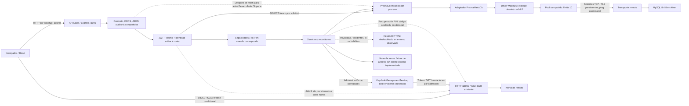

# Auditoría transversal de conexiones, comunicación y latencia

Fecha: 30-10-2026, America/Santiago. Investigación y medición; **sin optimizaciones aplicadas**. Rama `optimizacion-final`, HEAD `554734f6c5aef2fdc075c0cd76e79ed14be0413d`, más cambios de Cobranzas que ya estaban en el árbol al comenzar. Evidencia nueva: [índice y condiciones de cada archivo](evidencia/conexiones-20261030/INDICE.md).

## A. Resumen ejecutivo

La ejecución rápida del SELECT dentro de MySQL y la respuesta lenta de la aplicación son compatibles: se están midiendo límites distintos. En el **Prisma de la API activa**, un `SELECT 1` caliente tiene mediana **658,497 ms**. La misma traza separa una adquisición de **219,007 ms**, que contiene validación por ping, y una ejecución binaria de **438,971 ms**, que contiene preparación y ejecución. Estas son medianas descriptivas; la atribución se apoya en los intervalos de cada muestra, no en sumar medianas.

Se confirmó una combinación transversal: transporte remoto costoso, validación de conexiones inactivas y preparación de sentencias sin caché. El pool tiene conexiones libres y reutiliza sesiones. Una adquisición de aproximadamente 219 ms **no significa que se espere por un cupo**. Hay pings de ese orden y también `ER_PING_TIMEOUT` con límite efectivo 250 ms, seguidos de otra validación y descarte de la conexión. Aumentar el pool no está justificado por estas pruebas.

En la comparación alternada sobre un mismo pool diagnóstico reutilizado, driver MariaDB y Prisma tienen tiempos del mismo orden. No se demostró que la conversión de Prisma, por sí sola, explique cientos de milisegundos para este agregado pequeño. Sí está confirmado que la política del adaptador selecciona protocolo binario y caché 0, lo que afecta a todos sus consumidores.

La verificación JWT caliente puede realizarse localmente: en una prueba con el Keycloak configurado se observó una sola obtención JWKS al crear el verificador y ninguna nueva en 20 verificaciones calientes. La lectura fresca de identidad en MySQL permanece secuencial antes del dominio. **No se propone cachear ni eliminar esa comprobación de revocación/estado/rol.**

La serie continua final de 20 HTTP válidos por recorrido da medianas de **1320,908 ms en Usuarios, 1322,523 ms en Cobranzas y 1248,392 ms en Perfil**; liveness sin DB tarda 0,593 ms dentro del servidor. En el agregado dedicado correlacionado exactamente, MySQL tarda mediana **0,640 ms** frente a **219,577 ms** desde Node por texto. La diferencia no es ejecución lenta de ese agregado; el desglose de API demuestra además los multiplicadores del protocolo/pool y las dos fases identidad→dominio.

Confianza alta para la política efectiva, los pings, la preparación y la ausencia de saturación en el alcance probado; moderada para extrapolar el reparto a otras consultas, tamaños, concurrencia o topologías. No se separaron los dos sentidos de la red, CPU pura del driver, planificación del servidor remoto, ni el costo de commit de nuevas escrituras empresariales.

## B. Arquitectura actual

Las flechas continuas describen dependencias del recorrido; las discontinuas, operaciones condicionales o posteriores a respuesta. Una flecha HTTP representa peticiones individuales, no un socket nuevo por petición. Las sesiones MySQL pertenecen al pool; no se abre un PrismaClient por endpoint. La identidad del issuer se conserva aunque el transporte administrativo use otro origen permitido en desarrollo. Aquí ambos apuntan a `127.0.0.1:18080`.

Entorno comprobado: backend PID **25844**, ejecutado por `nodemon src/app/dev.js` desde `capaServidor`, puerto 3000; Vite PID **14596**, puerto 5173. El proceso SSH PID **16620** mantiene el forwarding local 18080 hacia Keycloak remoto: el TCP local al listener no mide el RTT hasta Keycloak. No se reiniciaron estos servicios ni se utilizó otra API como sustituto.

## C. Inventario técnico y ciclo de vida

Rutas relativas a `capaServidor/` salvo indicación. [entorno-activo.json](evidencia/conexiones-20261030/entorno-activo.json) contiene valores permitidos y hashes; [config-pool.json](evidencia/conexiones-20261030/config-pool.json) contiene las opciones del pool vivo. No se publican host completo, usuario, URL de conexión ni secretos.

| Familia | Configuración / creación | Uso / administración / cierre |
| --- | --- | --- |
| Configuración efectiva de API | `src/app/dev.js` carga dotenv; `src/app/app.js` valida entorno; `DOTENV_PATH` no definido, cwd `capaServidor`, `APP_ENV=NODE_ENV=development` | Se leyó `process.env` del proceso activo. El destino coincide por huella con `.env` actual; no se asumió equivalencia con scripts históricos. |
| Prisma compartido | `src/database/prisma.js`: `getPrismaClient`, variable de módulo `prisma`, `readPrismaConfiguration` | Los repositorios reutilizan ese cliente, algunos mediante getter lazy. No se encontraron constructores PrismaClient por petición en código de la API. `disconnectPrismaClient` ejecuta `$disconnect` y borra referencia. |
| Pool MariaDB | `PrismaMariaDb.connect` en `node_modules/@prisma/adapter-mariadb/dist/index.mjs`, crea y posee pool; `getCapabilities` consulta versión | La inicialización del pool es diferida respecto al constructor Prisma; el driver completa el mínimo de conexiones en segundo plano. `dispose` termina el pool propio. Un script que inyecta pool externo tiene otro contrato de propiedad y no hereda la normalización de caché. |
| Lecturas | `MariaDbQueryable.performIO` selecciona `execute`, convierte argumentos y transforma filas/metadatos | `PoolPromise.execute` adquiere una conexión, ejecuta y la devuelve. La devolución ordinaria difiere de la de una conexión retenida por una transacción. |
| Transacciones | `PrismaMariaDbAdapter.startTransaction`: adquirir conexión, aislamiento si se solicita, `BEGIN` | La misma sesión queda retenida hasta `commit`/`rollback`; se quita listener y se libera. El driver controla estado; no debe confundirse el evento lógico Prisma con un paquete SQL físico. |
| HTTP React → API | `capaVista/src/services/api/apiClient.js`: `createApiClient`, fetch, token, abort; timeout de cliente 45 s | El navegador administra sus sockets. No hay un Agent de Node en React ni reintentos automáticos de mutaciones. Obtener token puede esperar renovación antes de enviar HTTP. |
| HTTP Express | `src/server.js`: `middlewares`, `routes`, `listen` | Listener 0.0.0.0:3000; requestTimeout 15 s, headersTimeout 10 s, keepAliveTimeout 5 s. Estos valores no equivalen a un presupuesto global de negocio ni al timeout SQL. |
| JWT / JWKS compartido | `src/middlewares/checkJwt.js`: `createCheckJwt`, closure `jwtValidator`; `src/config/identity.js` | `express-oauth2-jwt-bearer` y jose verifican firma/issuer/audience/algoritmo/claims; JWKS se obtiene condicionalmente. No hay introspección de Keycloak por cada GET caliente. Configuración resuelta localmente, sin discovery en `resolveIdentityConfiguration`. |
| Identidad activa | `src/middlewares/requireActiveIdentity.js`, `UserRepository.findBySubject` en `src/modules/users/repo/users.repo.js` | JOIN parametrizado ExternalIdentity/Usuario, LIMIT 1. Valida binding, estado y rol frente a JWT. Guarda `req.currentUser` para la petición. Pendiente de primer ingreso puede activar y releer; ese caso no es una lectura pura y no se utilizó como muestra caliente. |
| Cuota autenticada | `src/middlewares/rateLimit.js`; `createDefaultThrottle` en `securityThrottle.service.js` | **MemoryThrottleService en development**, 120 lecturas / 30 escrituras por minuto y actor. La implementación SQL transaccional existe, pero se selecciona en production. No se atribuyen sus INSERT/SELECT a este entorno. |
| Administración Keycloak | `src/config/keycloakAdministration.js`, `KeycloakManagementService` y `KeycloakIdentityAdministrationService` | Servicio creado al montar router; reutiliza token de client_credentials y UUID de cliente; deduplica solicitudes en vuelo. `fetch` por operación, `redirect:error`, timeout **8 s efectivo** (default de código 5 s). Token expira con margen de 5 s, límite máximo de caché 1 h; 401 invalida caché. No reintenta mutaciones ambiguas. |
| Login / renovación SPA | `capaVista/src/app/providers/keycloakSession.js`, proveedor Keycloak | Authorization code / PKCE S256, tokens en memoria, `updateToken(30)` deduplicado, refresh por expiración y revalidación de sesión. `checkLoginIframe:true`; no se desactivó. El login ordinario no pasa por un endpoint backend de contraseñas. |
| Recuperación de PIN | `pinRecovery.service.js`, `pinRecoveryNavigation.service.js`, `config/pinRecovery.js` | POST token para código PKCE o refresh al reanudar; timeout 8 s, sin redirects. JWKS por URI cacheado en cada servicio, timeout 5 s. Estado, nonce, sesión y consumo único se mantienen; temporizadores de purga en memoria. No se ejecutó recuperación ni se rotó PIN. |
| Auditoría automática | `src/middlewares/supportAudit.js`, `SecurityAuditRepository.record` | Listener `finish`: para Desarrollador/Soporte dispara escritura asincrónica SQL; no espera para confirmar HTTP. Puede competir por conexiones con la solicitud siguiente. Se mantuvo habilitada y se separó del primer plano. |
| Correo realmente implementado | `src/shared/resendTextDelivery.js`; consumidores `privacyDelivery.service.js`, `incidentDelivery.service.js` | POST HTTPS a `api.resend.com/emails`, timeout 10 s, idempotency key, sin redirects. Los canales están deshabilitados en el entorno efectivo; no se enviaron correos. No se encontró cliente SMTP/nodemailer. Variables antiguas no prueban un cliente activo. |
| Notas de venta | `salesNoteSource.service.js`: `FixtureSalesNoteRepository` y `UnavailableExternalSalesNoteRepository` | Archivo local con stat/mtime/tamaño, caché 5 min; la clase externa responde no disponible. No existe cliente HTTP comercial implementado que se pueda inventariar como conexión real. |
| Cierre | `src/app/shutdown.js`, `registerShutdown`; callback en app.js | SIGTERM/SIGINT: deja de aceptar HTTP, espera cierre, desconecta Prisma; plazo 10 s y cierre forzado. No se invocó sobre la API activa. Los procesos diagnósticos cierran solo sus propios recursos. |

`DATABASE_URL` se valida contra destino/TLS, pero el adaptador de la API se construye con `DB_*`: parámetros de URL no configuran automáticamente este pool. Hay variables antiguas Auth0 y `PIN_DELIVERY_PROVIDER=resend` en el entorno; el proveedor de identidad actual rechaza Auth0 y `PinService` no implementa un envío HTTP de PIN. No se convierten variables residuales en integraciones activas.

### Opciones efectivas de MySQL

| Opción | Valor observado | Procedencia / significado |
| --- | --- | --- |
| `connectionLimit` | 10 | Explícito en `readPrismaConfiguration`; confirmado en pool vivo. |
| `connectTimeout` / `socketTimeout` | 8000 / 15000 ms | Env efectivo, aplicado por la API. No representan exclusivamente motor ni adquisición. |
| TLS | obligatorio, CA, `rejectUnauthorized:true`, validación contra host seleccionado | `createStrictTlsOptions`; conexiones nuevas verificadas TLS 1.3 y authorized=true. `@@require_secure_transport=0` del servidor no altera la obligación del cliente. |
| `prepareCacheLength` | 0 | No declarado en aplicación; **normalización del adaptador**. El driver aislado tiene otro default (256). Confirmado en opciones vivas. |
| Protocolo | binario, `execute` | `useTextProtocol` no configurado; no se infiere del valor `pipelining`. |
| `minimumIdle` / `idleTimeout` | 10 / 1800 s | Defaults del driver instalado, confirmados en objeto vivo. Diez conexiones inactivas no son evidencia de fuga. |
| `acquireTimeout` / `initializationTimeout` | 10000 / 9900 ms | Defaults efectivos. El timeout de adquisición incluye búsqueda/validación/creación según el caso. |
| `minDelayValidation` / `pingTimeout` | 500 / 250 ms | Defaults efectivos de esta versión instalada. El ping se omite si la conexión se usó hace ≤500 ms. No confundir con otros valores de ejemplos o versiones online. |
| `resetAfterUse` / `noControlAfterUse` / detección de fugas | false / false / 0 | Defaults observados. En liberación de conexión retenida se controla estado transaccional; no se ejecuta necesariamente ROLLBACK de red si ya no hay transacción. |
| `pipelining` | true | Default observado, pero la rama de PREPARE/EXECUTE en pipeline del driver exige **servidor MariaDB ≥10.2.4**. El destino es MySQL: el código espera PREPARE y después envía EXECUTE. |

Los defaults transaccionales de Prisma instalado, cuando el consumidor no los sobrescribe, son `maxWait=2000` y `timeout=5000` ms (código `runtime/client.js`); **son defaults deducidos del código**, no una medición de esperas. Pedidos los sobrescribe con 10000/20000 ms. No confundir esos presupuestos con `acquireTimeout` del pool ni con timeout del socket.

Versiones leídas del proceso: Node v24.19.0, Prisma Client y adaptador 7.10.0, MariaDB 3.5.4, Express 5.2.1, express-oauth2-jwt-bearer 1.10.0 y jose 4.15.9. Motor observado MySQL 8.4.8, REPEATABLE-READ. El código instalado prevalece para estos defaults; las [opciones oficiales de MariaDB](https://mariadb.com/docs/connectors/mariadb-connector-nodejs/node-js-connection-options) y su [API de pool](https://mariadb.com/docs/connectors/mariadb-connector-nodejs/connector-nodejs-promise-api) explican su semántica.

En fallos de conexión/validación, el pool descarta conexiones inválidas, prueba otra y repone tamaño cuando corresponde. La creación tiene reintentos acotados por timeout; errores de autenticación fatales no se tratan como recuperables. Esto no equivale a reintentar automáticamente una escritura de negocio. No se encontraron túneles MySQL declarados ni Proxy/Agent personalizado en la configuración del cliente; la ruta física externa del proveedor/red no se trazó.

El driver elige desde la cola de idle con `shift` y devuelve con `push`. Reutilizar sesiones no implica reutilizar inmediatamente la misma: con varias sesiones y umbral 500 ms, una secuencia de solicitudes puede encontrar todas sus sesiones suficientemente inactivas para exigir ping. Es compatible con un pool caliente sin saturación.

## D. Recorridos reales

### A: lectura autenticada

1. React espera `getAccessToken`; puede renovar con Keycloak antes de iniciar HTTP. API recibe solicitud, contexto/headers/auditoría/CORS/JSON y router.
2. `checkJwt`: firma RS256, issuer, audience, vigencia; obtiene JWKS cuando falta o expira, normaliza cliente, rol y permisos. Después, **secuencialmente**, identidad activa MySQL; valida estado y coincidencia de rol, almacena `currentUser`; después cuota en memoria.
3. Capacidad/rol local y validadores de query. Listado administrativo reutiliza el actor validado dentro de esta petición y ejecuta página JOIN y COUNT ORM **en paralelo**. Cobranzas ejecuta página y contadores en paralelo, y catálogo condicional/cacheado. Perfil reutiliza identidad y lee movimientos propios; no es un endpoint sin DB.
4. Cada consulta pasa por Prisma → adaptador → pool; una adquisición puede contener ping. Binario sin caché: PREPARE → EXECUTE; devuelve conexión. Se forman DTO/JSON y termina respuesta.
5. Para el actor utilizado, `supportAudit` inicia escritura **después de finish**. No se suman esos milisegundos al tiempo de respuesta. Sí es trabajo real que puede solaparse con otra solicitud.

La lectura fresca de identidad tiene propósito de seguridad. La consulta no confirma cada vez el usuario remoto Keycloak; revocación local de estado/rol y validación del JWT tienen límites distintos. El reporte no propone ampliar esos límites.

### B: escritura autenticada, referencia PATCH de estado de pago

`order.routes.js` → `checkJwt` → capacidad `UPDATE_PAYMENT_STATUS_PERMISSION` → `requirePin` → controlador → `updPaymentStateOperation` en `orderPayment.service.js`.

PIN se valida contra estado fresco y hash scrypt; el actor se coloca en `req.pinActor` y el PIN se elimina de `req.body`. Servicio valida destino y lee catálogo/pedido observado **en paralelo**. `OrderService.runInTransaction` crea dependencias con el cliente transaccional (`maxWait=10000`, `timeout=20000` ms): adquirir sesión → BEGIN → lock pedido → relectura actual → idempotencia/conflicto/capacidad de revisión y motivo si corresponde → UPDATE → registros/auditoría de dominio → avisos SQL condicionales → COMMIT → liberación → respuesta confirmada. El frontend refresca después de confirmación.

Las consultas del cliente transaccional comparten una sesión: `Promise.all` no concede conexiones independientes dentro de esa transacción. Hay tiempo retenido entre operaciones secuenciales; no se probó que exista tiempo retenido innecesario o una espera por locks actual. Los avisos de producción de este flujo son persistencia SQL de notificaciones, no un envío de correo externo.

No se ejecutaron escrituras de negocio para medir. Los tiempos históricos >5 s de [Cobranzas](cobranzas.md) se conservan como antecedentes de otra cohorte/fixture, no como medición de esta auditoría. No se cronometró ahora el COMMIT del pago, fsync ni rollback real.

Sí se observaron los BEGIN/INSERT/SELECT/COMMIT reales que la auditoría de seguridad normal genera después de un GET del actor Desarrollador. Ese COMMIT es el intercambio cliente/servidor de la auditoría, no tiempo puro de durabilidad ni el COMMIT del pago; sus cifras se separan abajo.

### C: autenticación / administración de identidad

Login ordinario: navegador → autorización Keycloak → formulario → callback con código → intercambio PKCE → JWT en memoria → petición API. Se completó ese flujo por HTTP diagnóstico con las credenciales existentes autorizadas, sin crear cuenta, cambiar contraseña ni persistir tokens. La API conserva sus verificaciones reales; no se firmó un JWT sintético.

Administración: guard local y actor → `KeycloakManagementService.request` → token cacheado o POST client_credentials **condicional y secuencial** → GET/mutación administrativa. `roleClient` descubre UUID una vez por instancia, con promesa en vuelo. En inspección actual se consulta primero binding local y después usuario y roles remotos **en paralelo**; el primer acceso a roles puede requerir descubrir cliente.

Alta/edición usan PIN, relecturas frescas de actor y journal local, cuenta deshabilitada, operaciones remotas, confirmaciones, transacciones locales y habilitación/finalización condicionadas. Las transacciones MySQL no abarcan Keycloak como transacción distribuida. Las fases remotas y checkpoints secuenciales multiplican el costo; no se eliminaron controles ni se ejecutaron mutaciones administrativas en esta auditoría.

## E. Mediciones y límites

### Método

Reloj monotónico `performance.now()`. Observadores temporales en memoria mediante inspector **loopback**, sin reinicio ni cambios en `.env`, `src/` o dependencias. Peticiones reales al listener habitual; cliente de medición Node en el mismo proceso para series HTTP, por lo que el tiempo de cliente incluye planificación local y lectura completa del cuerpo, pero no navegador/renderizado. Se conservaron estados HTTP y bytes, nunca cuerpos, valores SQL, tokens o PIN.

Correlación: AsyncLocalStorage en HTTP/servicios. Prisma pierde ese contexto en algunos pasos internos; para las series seriales se utilizó una ventana temporal única, y se esperó a que acabara la auditoría posterior antes de la siguiente muestra. Para pares simultáneos la unidad de correlación es **el par**, no cada consulta. No se atribuyen eventos del driver concurrentes a una solicitud individual.

Cada serie principal tiene 20 lecturas; primeras observaciones/primera petición de ruta se conservan aparte. p95 usa rango más cercano (19 de 20), descriptivo e inestable con este tamaño; no es un SLO poblacional. En n=1,3,10,19 no se calcula p95. [resumen.json](evidencia/conexiones-20261030/resumen.json) contiene cálculo y valores derivados; los JSON de origen preservan todas las muestras.

Se repitió una línea final HTTP **después de terminar los ensayos directos**, para evitar que su tráfico adicional condicionara la lectura. Las series HTTP sin sufijo `final` pertenecen a la exploración anterior; parte de Cobranzas/Perfil coincidió temporalmente con el ensayo directo exacto. No se agregan esas series a la línea final. El propio ensayo directo exacto tuvo ese tráfico de baja intensidad concurrente en otra sesión: sus tiempos/contadores son propios y válidos para ese escenario, pero no se presenta como host/red sin otra actividad.

### Prisma y pool de la API activa

Fuente final de esta comparación: [prisma-pool-completo.json](evidencia/conexiones-20261030/prisma-pool-completo.json), 20 SELECT 1 seriales.

| Límite observado | n | Mediana ms | p95 ms | Máximo ms |
| --- | ---: | ---: | ---: | ---: |
| Prisma completo | 20 | 658,497 | 826,650 | 915,578 |
| Adquisición de conexión | 20 | 219,007 | 450,777 | 475,666 |
| Preparar + ejecutar, driver | 20 | 438,971 | 441,391 | 442,725 |
| Solo callback executePromise, incluido transporte/resultado | 20 | 219,213 | 220,765 | 221,070 |

`executePromise` está contenido en `prepareExecute`; ping está contenido en adquisición. **No sumar las filas.** La diferencia de intervalos anidados de una misma consulta permite localizar la fase de preparación, no CPU pura de preparación. Dos validaciones fallaron por timeout; el máximo de adquisición incluye descartar/probar otra conexión, con conexiones libres y cola observada 0. Se observaron 12 identificadores anónimos de sesión, algunos invalidados; el pool volvió a 10 idle / 0 active / 0 queued.

[pool-pares.json](evidencia/conexiones-20261030/pool-pares.json): diez pares de SELECT simultáneos, mediana del par **658,072 ms**, máximo **913,352 ms**; máximo 2 conexiones activas en snapshots, cola 0, un `ER_PING_TIMEOUT`. Las consultas no se serializaron por un pool de tamaño insuficiente. No se certifica capacidad para otra carga.

La primera observación anterior de Prisma tomó 1886,175 ms, conservada en `prisma-activo.json`; no se presenta como frío reproducido del proceso completo. La API ya estaba iniciada y no se reinició para producir una muestra fría. `prisma-activo-correlacionado.json` contiene una serie intermedia sin adquisición bien capturada; se excluye del desglose final del pool.

### HTTP autenticado

Mismo actor autorizado `desarrollador.prueba`, estado activo existente, mismas rutas y filtros en cada serie. No se guardan subject ni datos de respuesta. En `http-*-final.json`, 20/20 respuestas **200** por recorrido. Los máximos y p95 corresponden al mismo límite de cliente, hasta consumir el cuerpo:

| Recorrido continuo final | n | Mediana HTTP ms | p95 HTTP ms | Máximo HTTP ms | Mediana Express ms |
| --- | ---: | ---: | ---: | ---: | ---: |
| GET `/api/admin/identity/users?page=1&perPage=10` | 20 | 1320,908 | 1334,643 | 1335,003 | 1316,340 |
| GET `/api/orders/payments?status=Pendiente&page=1&limit=10` | 20 | 1322,523 | 1334,941 | 1337,728 | 1315,796 |
| GET `/api/auth/profile` | 20 | 1248,392 | 1334,204 | 1335,110 | 1232,680 |
| GET `/api/health/live`, sin DB ni autenticación | 20 | 15,413 | 16,247 | 16,379 | 0,593 |

La fila continua de Cobranzas contiene **una renovación de catálogo** en la primera muestra (4 SELECT de primer plano) y 19 lecturas con catálogo caliente (3 SELECT). Para mantener separados esos estados: renovación, n=1, HTTP **1306,920 ms**; catálogo caliente dentro de esa serie, n=19, mediana **1324,018 ms**, máximo **1337,728 ms**, sin p95. No se atribuye a la caché una diferencia causal entre esos tiempos; el catálogo concurre con página/contadores. Usuarios tiene 3 SELECT por solicitud (identidad + página + COUNT paralelo); Perfil, 2 (identidad + movimientos).

Cobertura de límites: entrada justo antes de invocar Express en `http.Server.emit`; inicio/fin del middleware por `next`; identidad y algunos servicios/repositorios por entrada/retorno; adquisición hasta callback efectivo; driver hasta callback de resultado decodificado; final HTTP mediante `finish`, y lectura completa en cliente. `finish` confirma entrega al transporte local, no recepción en navegador. Inicio físico de envío de cada paquete, transformación Prisma/DTO aislada y motor de cada SQL de la API **no están instrumentados**. El motor exacto se mide solo en la prueba complementaria descrita abajo.

| Etapa en serie final, 20 solicitudes | Usuarios mediana / máximo ms | Cobranzas mediana / máximo ms | Perfil mediana / máximo ms |
| --- | ---: | ---: | ---: |
| Inicio de checkJwt → inicio de lectura de identidad | 0,391 / 0,857 | 0,386 / 0,803 | 0,393 / 0,663 |
| Lectura fresca de identidad | 658,003 / 658,958 | 657,758 / 658,979 | 654,506 / 658,757 |
| checkJwt completo, incluye identidad y cuota | 658,458 / 659,344 | 658,187 / 659,465 | 654,917 / 659,223 |
| Cuota en memoria | 0,036 / 0,056 | 0,036 / 0,054 | 0,036 / 0,053 |
| Servicio de listado / workspace | 657,468 / 660,438 | 657,598 / 660,886 | No instrumentado como servicio separado |
| Resto desde fin de autenticación hasta finish | 657,833 / 660,785 | 657,999 / 661,218 | 656,889 / 662,681 |

Autorización administrativa del servicio de Usuarios reutilizando actor: mediana 0,006 ms, máximo 0,018. El intervalo previo a identidad incluye JWT/configuración/claims y planificación; no es solo CPU de firma. Las etapas de la tabla se contienen unas en otras: no sumarlas ni sumar medianas para reconstruir HTTP. Las muestras de Perfil muestran variación de transporte entre sus dos consultas; no se infiere mejora funcional respecto a otras series.

Unión temporal, por solicitud, de adquisición + driver (sin duplicar solapamientos, recortada a finish): en Usuarios mediana **1314,168 ms**; el resto no cubierto tiene mediana **2,056 ms**, máximo **3,081 ms**. En Cobranzas final el resto tiene mediana **2,105 ms**, máximo **2,408 ms**; Perfil **2,006 ms**, máximo **2,780 ms**. Son residuos temporales, no perfiles de CPU. El reparto de la última solicitud de Usuarios, por ejemplo, es identidad primero y página/COUNT concurrentes después; no son tres consultas sumadas en serie.

Muestra adicional **separada tras una pausa**, [http-cobranzas-extra-caliente.json](evidencia/conexiones-20261030/http-cobranzas-extra-caliente.json), 200 en **2878,723 ms** HTTP / **2876,456 ms** Express: el intervalo antes de empezar identidad es **1384,899 ms**, identidad **573,912 ms**, servicio **916,852 ms**, con un ping que vence en **257,379 ms** y otra validación. Es compatible con refresco JWKS tras el TTL de 600 s y con coste del descarte de conexión; **no se instrumentó la petición JWKS de ese intervalo y su causa exacta queda probable, no confirmada**. Se mantiene visible, fuera de la serie continua y sin convertirla en un supuesto p95 estable. El resumen también ofrece una cohorte de catálogo caliente combinada, con IDs de origen; **no usarla como cohorte homogénea de JWT caliente**, pues incluye esta muestra después de pausa.

### Transacción automática posterior a HTTP

Las 20 solicitudes de cada serie final observan un registro de auditoría normal después de finish. El driver emite BEGIN → INSERT → SELECT de hidratación del evento → COMMIT en una sesión. Desde adquisición efectiva hasta terminar COMMIT, retención mediana **1144,488 ms** (Usuarios), **1141,573 ms** (Cobranzas), **1309,234 ms** (Perfil); máximos respectivos **1320,798 / 1317,819 / 1320,091 ms**. El intercambio COMMIT tiene medianas **190,792 / 191,035 / 217,949 ms**, respectivamente.

Estos tiempos **no** se agregan a HTTP. Son duraciones observadas de auditoría, no escrituras de pago o usuario simuladas. La espera de drenaje del instrumento controla la siguiente muestra y limita la concurrencia, por lo que no representa un usuario navegando sin pausa: el efecto de solapamiento sostenido con auditoría queda pendiente. No se eliminaron registros de auditoría de pruebas.

### Motor frente a cliente y transporte

El ensayo complementario usa el SQL de `readPaymentCounts` sin filtros ni datos de muestra incrustados, destino real y sesiones dedicadas. Solo lee datos y los descarta. Cada muestra del motor exige hilo propio y **SQL_TEXT exactamente igual** al SELECT marcado. Los resultados nulos se informan como no instrumentados; no se sustituyen con el tiempo de otra sentencia.

`events_statements_history` registra eventos terminados por hilo y sus tiempos no son CPU pura. Se usó TIMER_WAIT/1e9 para ms, sin habilitar consumidores, cambiar tablas de performance_schema ni acceder al SQL de otras sesiones. Véase [documentación MySQL 8.4](https://dev.mysql.com/doc/refman/8.4/en/performance-schema-statement-tables.html).

La comparación driver/Prisma usa el mismo SQL, argumentos, destino y pool reutilizado de una conexión, con caché 0. Alterna driver y Prisma 20 veces. El límite del pool diagnóstico es deliberadamente distinto del pool de la API: **sirve para aislar capas, no para medir HTTP ni recomendar cambiar el límite real**. No se resta una muestra de motor de otra sesión de Prisma.

En [directo-exacto.json](evidencia/conexiones-20261030/directo-exacto.json), tres conexiones nuevas observaron conexión total **1789,438 / 1334,885 / 1324,121 ms**; TCP desde inicio **358,301 / 221,965 / 219,706 ms**; DNS **73,242 / 0,641 / 0,631 ms**; TLS desde inicio de upgrade **575,230 / 449,331 / 444,264 ms**, authorized=true, TLSv1.3. TCP incluye resolución; TLS se mide desde la llamada de upgrade del socket y no incluye toda la autenticación MySQL. No sumar ambos relojes para fabricar conexión total.

| Serie dedicada, SQL COUNT real | n caliente | Mediana cliente ms | p95 / máximo cliente ms | Motor correlacionado |
| --- | ---: | ---: | ---: | --- |
| Texto, caché 0 | 20 | 219,577 | 219,916 / 220,064 | 20 eventos: mediana 0,640; p95 0,798; máximo 0,822 ms |
| Binario, caché 0 | 20 | 438,866 | 439,495 / 439,504 | Sin evento con SQL_TEXT exacto: no instrumentado |
| Binario, caché 16, solo diagnóstico | 20 | 220,471 | 221,191 / 221,203 | Sin evento con SQL_TEXT exacto: no instrumentado |

Primeras ejecuciones separadas: 220,011 / 440,688 / 441,080 ms respectivamente. Los contadores propios, incluyendo esa primera ejecución y 20 calientes, son texto 0 PREPARE/EXECUTE/CLOSE; binario caché 0 **21/21/21**; binario caché 16 **1/21/0**. No se convierten esos contadores en una captura de paquetes. Las series dedicadas se ejecutaron consecutivamente; admiten deriva temporal y no son un ensayo aleatorizado.

En texto, el residuo **emparejado de la misma consulta**, cliente menos evento de motor, tiene mediana 218,925 ms: transporte/protocolo/driver/planificación no separados. No se atribuye íntegramente a red. En el pool diagnóstico común, driver: **441,055 ms** (máximo 441,729); Prisma: **441,254 ms** (máximo 442,632), 20 pares. Diferencia emparejada Prisma menos driver: mediana 0,478 ms, máximo 1,464 ms; no es una estimación de CPU pura y el orden fijo puede influir. Adquisición del mismo pool recientemente usado: mediana 0,026 ms, máximo 0,105 ms. Esto separa el costo de adquirir cupo disponible del ping de una sesión poco reciente.

Las consultas sobre una conexión persistente evitan ese establecimiento. Un ping SQL es un intercambio del protocolo con MySQL, no un ICMP ni el tiempo completo de consulta. No hubo captura de paquetes ni sincronización de relojes para separar ida/vuelta, fragmentación, CPU del cliente y buffers del servidor. Las etapas de resultado incluyen transporte de respuesta y decodificación; la transformación final Prisma/DTO no se cronometró de manera independiente.

### Identidad y Keycloak

Fuente: [keycloak-activo.json](evidencia/conexiones-20261030/keycloak-activo.json), desde el proceso API, proveedor real y cuenta de servicio configurada. Sin mutar usuarios.

| Prueba | n | Resultado |
| --- | ---: | --- |
| Primer token administrativo de instancia nueva | 1 | 33,244 ms; no equivale a TCP frío ni proceso Keycloak frío |
| Descubrimiento inicial del cliente de roles | 1 | 26,271 ms |
| GET de representación de rol | 20 | Mediana 68,248 ms, p95 203,547, máximo 209,302 |
| JWT con nuevo caché JWKS | 1 | 74,267 ms; 1 GET JWKS observado |
| JWT con caché caliente | 20 | Mediana 0,144 ms, p95 0,206, máximo 0,512; GET acumulados sigue en 1 |

El proceso complementario exacto observó token inicial **458,464 ms**, caché de token mediana **0,001 ms**, y 20 GET públicos JWKS con valores individuales en su JSON. Son instancias y momentos distintos de los de `keycloak-activo.json`, no un antes/después ni costo fijo de Keycloak. El ensayo preliminar observó otro token en 1080,886 ms y se conserva separado. Los GET directos públicos de JWKS no representan la política cacheada del middleware. TCP al listener local del túnel tomó **0,800 / 0,391 / 0,279 ms**: no mide el transporte completo a Keycloak. El forwarding local no usa TLS HTTP en este desarrollo autorizado; el túnel SSH aporta otro transporte. No se presenta esa configuración como HTTPS de producción.

Defaults del verificador instalado: timeout JWKS 5 s, cooldown 30 s, cacheMaxAge 600 s. El middleware no cambia esos valores; los servicios de recuperación tienen sus propios resolvers. El cliente administrativo y JWKS no comparten caché de tokens/claves. [Keycloak documenta el flujo y almacenamiento en memoria](https://www.keycloak.org/securing-apps/javascript-adapter); aquí se verificó además el código consumidor actual.

### Incidencias del instrumento, excluidas

- `http-live.json` y `perfil-inicial-error.json`: un observador intentó envolver `res.json` antes de la inicialización Express, provocando 500. Se retiró completamente ese envoltorio; **no es un defecto atribuido al producto**. Se repiten liveness y perfil con el instrumento corregido y se verifica nuevamente al cerrar. Las auditorías de seguridad automáticas de esos intentos se conservan.
- Primeras series Prisma: se detectó pérdida de contexto y una envoltura de comprobación que ocultaba adquisición. Se retiró la propiedad temporal y se repitió la serie final; no se mezclan esas muestras.
- `directo.json`: búsqueda inicial por LIKE podía coincidir con el SQL de diagnóstico anterior cuando una ejecución preparada no tiene SQL_TEXT. Sus duraciones cliente siguen siendo observadas, pero **sus atribuciones de motor se excluyen**. `directo-exacto.json` repite la prueba con igualdad exacta; ausencia de registro no se convierte en tiempo de motor.

## F. Diagnóstico causal

Para una consulta caliente representativa de la API, el costo observado no es únicamente «Node envía SELECT y MySQL tarda 660 ms». La adquisición valida una sesión poco reciente y espera ping. Luego, caché 0 sobre MySQL exige preparar y ejecutar en fases secuenciales. Cada intercambio cruza el transporte remoto. Una lectura autenticada añade antes otra consulta de identidad con el mismo mecanismo. Las consultas independientes de dominio pueden compartir una oleada concurrente, pero la identidad y el dominio son fases diferentes.

Las esperas observadas son tiempo transcurrido. Se aisló ping, adquisición, tramo binario, subtramo executePromise, intervalos HTTP y algunos servicios. Se aisló motor donde hubo coincidencia exacta del hilo/SQL. **No** se aisló CPU pura del adaptador, enviar frente a recibir, MySQL esperando socket, toda la planificación de OS, o GC local. El pequeño residuo entre intervalos instrumentados no debe etiquetarse automáticamente como CPU Node.

No hay evidencia de que todas las consultas sean rápidas: el agregado probado es pequeño, con aproximadamente 94 filas examinadas en la primera cohorte. No se extrapola a tablas grandes ni locks de escrituras. Tampoco se concluye que «nuestro código no importa»: determina protocolo, política de caché/validación, cantidad de comunicaciones y orden de dependencias.

## G. Hallazgos e hipótesis contrastadas

| Hipótesis | Clasificación | Alcance de la evidencia |
| --- | --- | --- |
| La inicialización de conexiones domina toda lectura caliente | Descartado en el alcance probado | Sesiones se reutilizan; consultas calientes siguen siendo lentas. Nuevas conexiones sí cuestan más de 1 s. |
| Espera por falta de conexiones es el cuello dominante | Descartado en el alcance probado | Cola 0 y conexiones idle durante adquisiciones; con dos lecturas simultáneas hay cupo. No prueba ausencia de saturación a otra carga. |
| La adquisición lenta incluye validación de salud | Confirmado | Ping anidado y callbacks de adquisición en la misma muestra. |
| El límite de ping descarta conexiones en este entorno | Confirmado | `ER_PING_TIMEOUT`, límite 250 ms, siguiente validación y caída/recuperación de tamaño. Su frecuencia futura depende de red/carga. |
| Preparación sin caché añade fases de comunicación | Confirmado | Código MySQL PREPARE→EXECUTE, caché viva 0 y contadores de sesión. |
| Prisma introduce por sí solo cientos de ms de cómputo | Descartado para el agregado y pool comparados | Driver y Prisma alternados sobre el mismo pool quedan muy próximos; no se extrapola a conversiones masivas. |
| Transporte remoto es significativo | Confirmado | TCP/TLS, ping y consultas persistentes con costos de cientos de ms. No se atribuye todo el residuo exclusivamente a Internet. |
| La identidad activa añade costo a rutas autenticadas | Confirmado | Código secuencial y traza real; lectura MySQL fresca. La cuota development es local. |
| Keycloak se consulta en cada lectura autenticada caliente | Descartado en el alcance probado | Firma local con JWKS reutilizado; no introspección por solicitud. Operaciones administrativas sí usan Keycloak. |
| Hay clientes Prisma nuevos por petición | Descartado por código y observación acotada | Singleton de proceso y pool compartido; scripts externos son procesos separados. |
| Transacciones retienen sesiones | Confirmado en código | Hasta COMMIT/ROLLBACK. Tiempo innecesario o locks dominantes actuales: no determinado sin nuevas escrituras. |
| Todas las cascadas secuenciales son evitables | No determinado | Algunas son dependencias de seguridad/integridad. No basta contarlas para declararlas redundantes. |
| SQL del agregado pequeño explica la latencia integral | Descartado en el alcance con motor correlacionado | Tiempo de motor muy inferior al del cliente; los binarios sin evento exacto quedan sin motor medido. |
| RAM/CPU remotas o GC dominan | No determinado | No se obtuvieron métricas de host Aiven ni perfiles CPU/GC comparables. |

Comportamientos normales: pool compartido, sesiones idle, validación de salud, verificaciones frescas de identidad y dependencia transaccional. Candidatos de política que merecen ensayo: caché de preparación 0, coste de pings por conexión y margen del ping frente a variabilidad. No se presentan como vulnerabilidades ni se modifican automáticamente.

Un timeout demuestra que el ping no terminó dentro del presupuesto; no demuestra por sí solo que la conexión descartada siguiera sana. El margen estrecho frente a los tiempos observados es un indicio para comparar políticas, no autorización para omitir validación.

## H. Recomendaciones candidatas, sin aplicar

| Prioridad / componente | Problema y evidencia | Beneficio y límites | Riesgo / prueba necesaria |
| --- | --- | --- | --- |
| P1: `prisma.js` / política de preparación del adaptador | Repreparación en cada execute, medida con contadores y ramas del driver | Reducir una fase de protocolo en aciertos de caché. La magnitud del endpoint depende de conexión elegida y diversidad de SQL; no se promete porcentaje. Válido en topología actual y LAN. | Ensayo aislado de caché acotada vs 0, mismo actor/datos/SQL y orden alternado; errores de invalidación, DDL externo, consumo de statements por conexión, transacciones, fechas/decimales/bigint y memoria. No aplicar texto global sin regresiones de tipos/parametrización. |
| P1: validación del pool / `pingTimeout` | Ping ~RTT y timeouts con 250 ms, aun con cupo libre | Evitar falsos descartes y latencia de validación si otra política segura resulta adecuada. Depende del transporte; LAN requiere nueva medición. | No desactivar salud a ciegas. Comparar margen de timeout y umbral de validación con sesiones muertas, corte remoto, reanudación tras idle y límites de recuperación; conservar TLS, no reenviar escrituras ambiguas. |
| P1: transporte actual Aiven/Keycloak | Conexiones y viajes remotos medidos; forwarding SSH de identidad | Evaluar cercanía y estabilidad del transporte; LAN podría reducir cada intercambio, no eliminar dependencias. No permite prometer respuesta integral <1 s. | Ensayo futuro de la misma API/operaciones/versiones en la topología elegida, TLS y controles intactos. No cambiar infraestructura en esta fase. |
| P2: observabilidad transversal | Instrumentación original no distinguía cola, ping, preparación y ejecución; contexto Prisma se pierde | Diagnóstico reproducible con duración, hash SQL y métricas de pool por límite, sin datos sensibles | Diseñar un hook soportado y opt-in en una fase posterior; medir overhead, límites de memoria, concurrencia y saneamiento. El inspector no debe quedar abierto para uso ordinario. |
| P2: auditoría posterior / `supportAudit` y `securityAudit.repo.js` | Trabajo SQL posterior a finish; `.create` inserta y vuelve a leer un evento cuyo resultado el middleware descarta | Estudiar una escritura confirmada sin hidratación para este consumidor y explicar contención entre navegación y registro. Beneficio integral incierto; afecta a esos actores, no a todos. | Revisar otros consumidores que puedan necesitar retorno y preservar exactamente un evento durable y errores. Comparar sin esperar artificialmente entre peticiones, con actor operativo equivalente. No suprimir auditoría ni cambiar su durabilidad/semántica por ahorro. |
| P2: servicios transaccionales | Varias comunicaciones seriales bajo sesión retenida, demostrado por código y antecedentes | Reducir lecturas redundantes solo tras demostrar equivalencia de estado, permisos y respuesta; ganancia actual sin cuantificar | Fixtures explícitamente autorizados, locks, aislamiento, rollback, idempotencia, revisión de capacidades y commit ambiguo. No combinar MySQL/Keycloak como transacción atómica. |
| P3: tamaño del pool | No hay saturación en estas muestras | **No recomendar incremento** con la evidencia actual | Solo revisarlo si aparece cola/cupo agotado bajo concurrencia representativa y recursos del servidor medidos. |

No se recomienda cachear autorización transversal, quitar PIN, omitir confirmaciones remotas, relajar TLS/durabilidad ni alterar aislamiento para obtener mejores cifras.

## I. Impacto transversal

Prisma, driver, pool, identidad activa y JWT se comparten entre módulos: su mecanismo puede afectar cualquier ruta autenticada con SQL. El costo no se replica de manera idéntica: número de consultas, tamaño de resultado, tiempo desde el último uso de cada conexión y paralelismo cambian el recorrido.

Keycloak administrativo afecta preparación/edición/inspección de identidad, no todas las lecturas de Cobranzas. El refresh SPA puede anteceder una petición, pero no se incluye en el reloj desde entrada Express. Auditoría posterior depende del actor; PIN y transacciones dependen de la operación. Resend y la fuente de notas externas no participan de los GET examinados.

Los informes previos [Gestión de usuarios](gestion-usuarios.md), [Cobranzas](cobranzas.md) y [auditoría general](../AUDITORIA_RENDIMIENTO_ITECSA.md) son antecedentes, con sus JSON. Esta última usó otra versión de código y ejecución API en contenedor; sus cifras no se mezclan con el Node local de ahora. Los harness antiguos pueden inyectar Prisma con opciones fijas, throttle en memoria o JWKS sintético: son útiles para reproducir su alcance, no para afirmar configuración efectiva de la API. Se inspeccionaron `diagnoseUsersLive.mjs`, `diagnoseCollections.mjs`, `collectionsHttpProbe.mjs` y los probes generales existentes antes de interpretar los resultados.

## J. Reproducción segura

1. Registrar rama, HEAD, `git status --short`, procesos Node/SSH y listeners. No reiniciar la API. Confirmar PID real de `src/app/dev.js`, cwd y destino; no reutilizar el PID numérico de este documento sin verificarlo.
2. Si no hay inspector, habilitar **solo temporalmente** el inspector loopback del PID verificado: `node -e "process._debugProcess(PID_VERIFICADO)"`. Comprobar que 9229 no pertenece a otro proceso. No usar `--inspect-brk` ni exponerlo a otra interfaz.
3. Desde la raíz del repo, ejecutar `node capaServidor/scripts/auditConnections.mjs probe` y el instalador `node capaServidor/scripts/auditConnections.mjs eval-file capaServidor/scripts/auditConnections.runtime.cjs`. El instrumento no se carga por `npm run dev` y no cambia opciones del pool.
4. Para HTTP autenticado, usar sesión existente del usuario autorizado y abrir Mi Perfil. El observador toma únicamente en memoria un Bearer que ya produjo 200 en un GET permitido. No pegar token en argumentos, archivos, evidencia o consola. En esta ejecución, el uso de las credenciales del mensaje anterior requirió autorización específica adicional; el helper de recuperación se retira al cerrar.
5. Ejecutar `node capaServidor/scripts/auditConnections.mjs users RUTA_NUEVA.json --samples=1` para conservar primera observación y luego 20 sin `--samples`. Repetir modos `payments`, `profile`, `health`. Otros modos: `prisma`, `pool-pairs`, `config`, `status`, `take`. Los resultados nuevos deben ir a nombres nuevos; los modos principales fallan si el archivo ya existe.
6. Para comparar capas, **después** de las series HTTP, desde `capaServidor`: `node scripts/auditConnections.direct.mjs --allow-aiven-reads --output=../docs/optimización/evidencia/conexiones-20261030/directo-repeticion-NUEVA.json`. Elegir nombre nuevo: el script rechaza un archivo existente antes de conectar. Usa credenciales/configuración existentes, sesiones propias y lecturas limitadas. La cuenta de servicio Keycloak solo obtiene token y hace GET; no modifica usuarios.
7. `auditConnections.identity.cjs` y `auditConnections.environment.cjs` se ejecutan con `eval-file` para guardar medidas de identidad/configuración permitida. `node capaServidor/scripts/auditConnections.summarize.mjs` recalcula únicamente el resumen derivado de esta carpeta; no modifica muestras históricas.
8. Ejecutar `node capaServidor/scripts/auditConnections.mjs cleanup`, después `verify-restored` y `close-inspector`. Comprobar que el PID API sigue igual, puerto 3000 responde y 9229 ya no escucha. Revisar diff y seguridad de evidencia. El instalador final también tiene retirada automática tras 15 min; no sustituye cerrar el inspector que se haya abierto para el ensayo.

Los wrappers instrumentan prototipos/middleware en memoria y tienen limitaciones con concurrencia. Para pares se informan agregados, sin restar/sumar intervalos paralelos. No hay cambios de autenticación, SQL del producto, TLS, caché del pool real, políticas de red o schema. Los scripts no son una funcionalidad productiva ni un benchmark de estrés.

## K. Estado final y validación

Archivos de producto examinados: los inventariados en C/D y sus consumidores, configuración de entorno/identidad, pinRecovery, historial/perfil, repositorios y transacciones de pedidos/pagos; frontend API/Keycloak y scripts previos. Se contrastó también el código instalado del adaptador y `mariadb/lib/{pool,pool-promise,connection,connection-promise,config/*}`, más jose y express-oauth2-jwt-bearer.

Validación final: **427/427 pruebas backend PASS** con `node --test test/*.test.js src/modules/auth/service/*.test.js src/modules/users/service/*.test.js`, incluyendo JWT/identidad/capacidades/PIN/transacciones/errores/TLS. **PASS** `node --check` de los seis scripts y `git diff --check`. Se parsearon los JSON y se comprobó ausencia de los secretos configurados/JWT en evidencia; **cero diferencias** en los 16 hashes de código de producto registrados desde la API. Véase [validacion-final.json](evidencia/conexiones-20261030/validacion-final.json). No se atribuye a esta fase el build ni la suite frontend históricos; no se modificó frontend.

Se conservan únicamente informe, evidencia saneada y **seis scripts diagnósticos** opt-in: controlador `auditConnections.mjs`, observador `.runtime.cjs`, ensayo `.direct.mjs`, identidad `.identity.cjs`, metadata `.environment.cjs` y resumen `.summarize.mjs`. Los helpers temporales de login y sondeo se eliminaron. Los observadores de la API se retiraron y el inspector temporal se cerró. [verificacion-restauracion.json](evidencia/conexiones-20261030/verificacion-restauracion.json) confirma ausencia de globals diagnósticos y métodos originales; [smoke-final.json](evidencia/conexiones-20261030/smoke-final.json) verifica 200 liveness y 401 sin JWT en las tres rutas autenticadas.

Los PID de API, Vite y túnel siguen **25844 / 14596 / 16620**, sin reinicio. Puertos 3000/5173/18080 presentes, 9229 cerrado. No se hizo commit/push/merge/despliegue ni cambios en datos empresariales, esquemas, migraciones o infraestructura. Login y lecturas generan los registros normales de seguridad del sistema; no se eliminan para ocultar ensayos o fallos del instrumento.

Los cambios previos de Cobranzas permanecen fuera de esta auditoría. El cierre deja documentados los límites: CPU/red por sentido sin separar, motor de consultas preparadas solo si hay evento exacto, escrituras/commit nuevos no medidos, dos solicitudes simultáneas como límite de concurrencia, sin resultados de la futura LAN ni latencia visible en navegador.

Git al cerrar: misma rama/HEAD. Continúan las **9 modificaciones rastreadas previas** y los archivos no rastreados previos de Cobranzas; esta fase agrega solamente este informe, la carpeta de evidencia y los seis scripts indicados. No hay cambios nuevos de `src/`, frontend, paquetes, `.env` o configuración. No quedan bloqueos de acceso pendientes; las restricciones de control automático para navegación/uso del mensaje con credenciales se resolvieron mediante autorización explícita del usuario y un helper temporal que ya se retiró.
